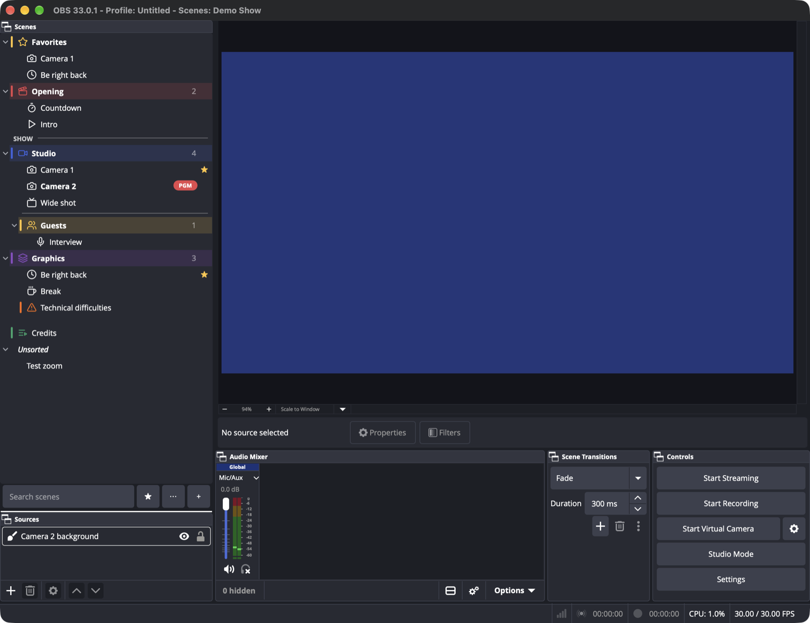
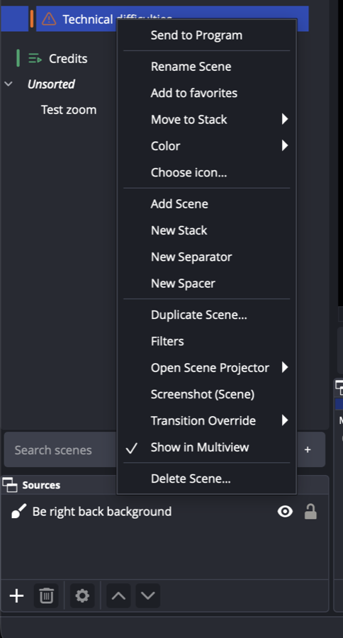
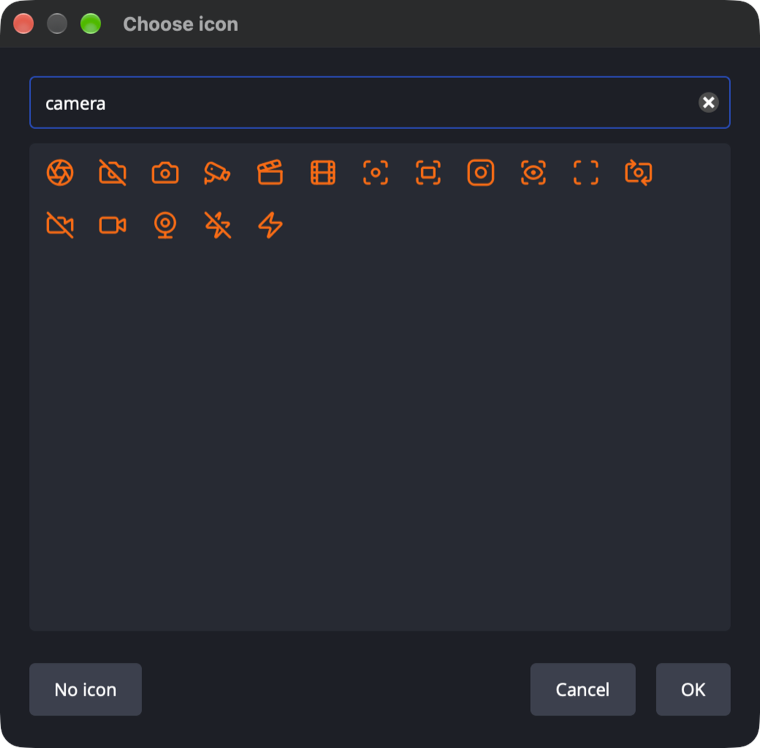
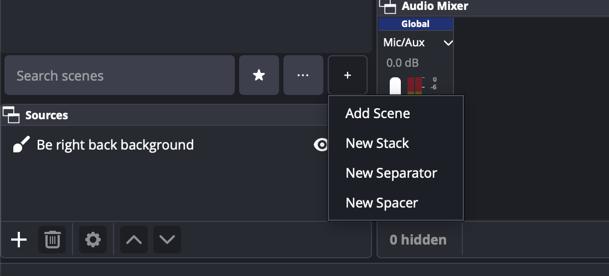
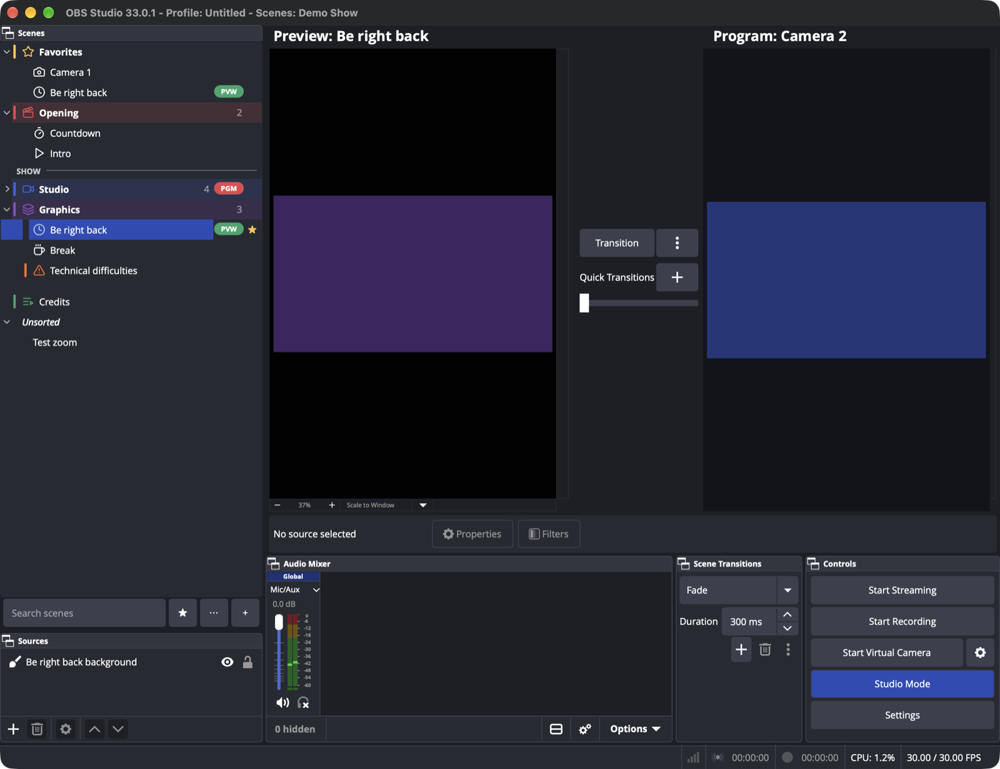
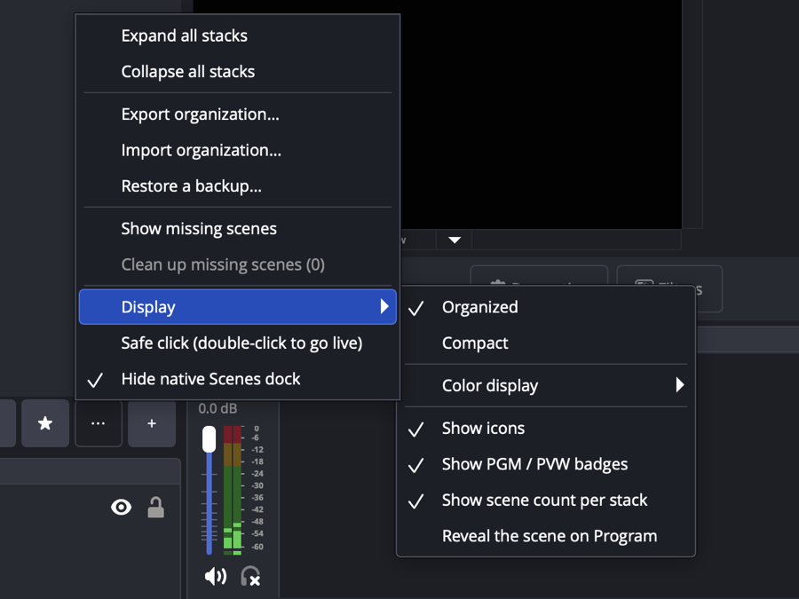
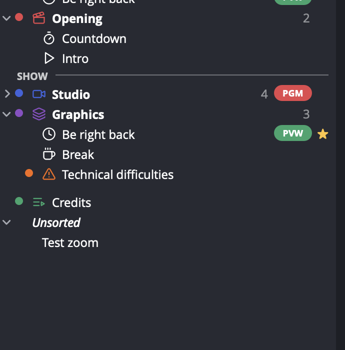

<div align="center">

# Stacks for OBS

[](https://github.com/TheOnAirCompany/obs-stacks/actions/workflows/push.yaml) [](https://github.com/TheOnAirCompany/obs-stacks/releases) [](https://github.com/TheOnAirCompany/obs-stacks/releases) [](https://obsproject.com) [](#install) [](data/locale) [](LICENSE)

**A better way to organize your OBS scenes.**

Stacks for OBS is a native OBS Studio plugin that replaces the flat Scenes list with a scene explorer: collapsible **stacks**, real **separators**, **colors**, **icons**, **favorites** and **search** — without ever creating fake scenes, touching your sources or rewriting your scene collections.

</div>



> **Status: 0.1.0 preview.** Usable and tested in OBS Studio 33.0.1, but early and unsigned. Keep a backup of your scene collection before trying it, and report anything odd in [Issues](https://github.com/TheOnAirCompany/obs-stacks/issues).

## Why

OBS Studio's Scenes panel is a flat list. As collections grow, people fake structure with `----------` scenes, `[LIVE]` prefixes and emoji. Those workarounds pollute the collection, show up in Stream Deck and obs-websocket, and are slow to scan during a live show.

Stacks keeps OBS as the single source of truth for scenes and only stores *organization metadata* next to them. Stacks, separators, colors and icons exist only in the plugin's data:

- a separator can never be put on air, never appears in transitions, obs-websocket or Stream Deck;
- dissolving a stack never deletes a scene;
- disabling or uninstalling the plugin leaves every scene, source and setting exactly as it was.

## Features

### Organize

- **Stacks**: collapsible groups of scenes, nestable up to 4 levels, with drag & drop and *Move to Stack*. Dissolving a stack keeps its scenes.
- **Separators**: a plain line, a labeled line, or an empty spacer. They are never scenes.
- **Colors**: 8-color palette or any custom color, shown as a strip, tinted rows, tinted stacks or a dot.
- **Icons**: 1,544 [Lucide](https://lucide.dev) icons with a searchable picker, tinted with the item's color.
- **Favorites**: a pinned *Favorites* section at the top, plus a favorites-only filter.
- **Unsorted**: scenes created outside Stacks land in an *Unsorted* section, never in the middle of your stacks.
- **Search**: instant, case- and accent-insensitive.

| Context menu | Icon picker | Add menu |
|---|---|---|
|  |  |  |

### Made for live shows

- **PGM / PVW badges** on scenes, and on collapsed stacks that hide the scene on air.
- **Studio Mode aware**: a click sets Preview, a double-click or *Send to Program* runs the transition. Program requests are refused while a transition runs.
- **Safe click** (optional): a single click never goes live outside Studio Mode; a double-click does.
- **Safe delete**: confirmation with *Cancel* as default, the scene on air can't be deleted, and *Edit > Undo* restores a deleted scene in its stack without switching Program.
- **Undo / redo** of every organization change through OBS's *Edit* menu.
- **Native scene actions**: Duplicate, Filters, Scene Projector, Screenshot, Show in Multiview, Transition Override.
- **Keyboard**: F2 / Return to rename in place, Delete to delete, Ctrl/Cmd+F or `/` to search, Alt+Up/Down to move, Esc to clear the search.



### Display

- **Organized** or **Compact** rows, color display mode, and toggles for icons, badges and scene counts.
- The dock replaces the native Scenes dock (opt-in on first launch, reversible any time) and has no close button, like the native one.

| Display options | Compact + dot colors |
|---|---|
|  |  |

### Safe with your data

- The organization is saved **inside your scene collection**, matched by scene UUID with a name fallback (duplicated collections keep their organization).
- Scenes deleted elsewhere keep their place so that undo can restore them; *Clean up missing scenes* forgets them.
- **Rolling backups** per scene collection (10 kept, at most one every 5 minutes) and *Restore a backup…*.
- **Export / import** of the organization as JSON. Import never creates or deletes a scene and can be undone.
- Data written by a newer version is kept read-only, never overwritten.
- English and French UI.

## Install

Download the file for your system from the [latest release](https://github.com/TheOnAirCompany/obs-stacks/releases/latest). OBS Studio **33.0.1 or later** is required.

| System | File | How to install |
|---|---|---|
| macOS 13+ (Apple Silicon and Intel) | `obs-stacks-<version>-macos-universal.pkg` | Open the package and follow the installer (it installs for the current user). The package is not notarized yet: if macOS blocks it, right-click it and choose *Open*, or allow it in *System Settings > Privacy & Security*. |
| Windows 10/11 x64 | `obs-stacks-<version>-windows-x64.zip` | Extract the `obs-stacks` folder into `C:\ProgramData\obs-studio\plugins\`. |
| Ubuntu x86_64 | `obs-stacks-<version>-x86_64-linux-gnu.deb` | `sudo apt install ./obs-stacks-<version>-x86_64-linux-gnu.deb`. Needs the `obs-studio` package **33 or later** installed system-wide (Ubuntu 26.04 itself ships 32.1; Flatpak is not supported by this package). |

Restart OBS. On first launch Stacks places its dock next to the native Scenes dock and asks whether to hide the native one. You can change that later from the **⋯** menu, or from OBS's **Docks** menu.

To uninstall, remove the plugin (delete `obs-stacks.plugin` / the `obs-stacks` folder, or `sudo apt remove obs-stacks`). Your scenes are never touched. If you hid the native Scenes dock, show it again from the **Docks** menu.

See the [user guide](docs/user-guide.md) for details.

## Roadmap

- Import of custom SVG / PNG icons (sanitized)
- A model separated from the widgets, with unit tests
- Performance measurements with 250 to 500 scenes
- Accessibility pass (screen readers, full keyboard navigation)
- Signed and notarized macOS package, Windows installer

## Documentation

| Document | Content |
|----------|---------|
| [User guide](docs/user-guide.md) | How to use Stacks 0.1.0 |
| [Technical feasibility report](docs/01-technical-feasibility.md) | What OBS 33 allows, verified against its source code |
| [Product requirements](docs/02-product-requirements.md) | Goals, personas, user stories, MVP scope |
| [UX/UI specification](docs/03-ux-ui-specification.md) | Layouts, states, interactions, accessibility |
| [Software architecture](docs/04-software-architecture.md) | Components, data model, events, persistence, ADRs |
| [Implementation plan](docs/05-implementation-plan.md) | Phased, dependency-ordered tasks |
| [Testing strategy](docs/06-testing-strategy.md) | Unit, integration, manual, performance and data-safety tests |

## Compatibility

- **OBS Studio 33.0.1 or later** (uses the OBS 33 plugin layout and `manifest.json`).
- macOS 13+ (Apple Silicon and Intel, universal binary), Windows 10/11 x64, Linux (Ubuntu 26.04 `.deb`).

Stacks keeps its own order of scenes. OBS's native scene order — used by the Multiview, obs-websocket clients, Stream Deck and Companion — is never modified.

## Building

The build system comes from [obs-plugintemplate](https://github.com/obsproject/obs-plugintemplate), updated for OBS Studio 33.0.1 (obs-deps and Qt6 `2026-10-23`).

| Platform | Requirements |
|----------|--------------|
| macOS | Xcode 26.5 or newer (macOS SDK 26.5+), CMake 3.30.5+ |
| Windows | Visual Studio 18 2026, Windows SDK 10.0.26100.0, CMake 3.30.5+ |
| Ubuntu 26.04 | CMake 3.28.3+, `ninja-build`, `pkg-config`, `build-essential` |

```sh
# macOS
cmake --preset macos
cmake --build --preset macos

# Windows
cmake --preset windows-x64
cmake --build --preset windows-x64

# Ubuntu
cmake --preset ubuntu-x86_64
cmake --build --preset ubuntu-x86_64
```

The first configure downloads the OBS 33.0.1 sources and prebuilt dependencies into `.deps/` and builds `libobs` and `obs-frontend-api` once.

### In-OBS self-test (development)

Configure with `-DSTACKS_SELFTEST=ON` and start OBS with `STACKS_SELFTEST=1` on a disposable scene collection that contains the demo scenes (Countdown, Opening, Cam 1, Cam 2, Plan large, Interview, BRB, Pause, Problème technique, Générique de fin, Test Zoom, in the stacks Ouverture, Plateau, Habillage). The dock then drives its own code against the real frontend API and writes `[selftest] PASS|FAIL <name>` lines to the OBS log. Release builds never contain it.

### Plugin layout (OBS 33)

| Platform | Binary | Data (incl. `manifest.json`) |
|----------|--------|------------------------------|
| Windows  | `%ProgramData%/obs-studio/plugins/obs-stacks/obs-stacks.dll` | `%ProgramData%/obs-studio/plugins/obs-stacks/data` |
| macOS    | `~/Library/Application Support/obs-studio/plugins/obs-stacks.plugin/Contents/MacOS` | `obs-stacks.plugin/Contents/Resources` |
| Linux    | `<libdir>/obs-modules/plugins/obs-stacks.so` | `<datadir>/obs/obs-modules/plugins/obs-stacks` |

## License

[GPL-2.0-or-later](LICENSE), like OBS Studio.

Icons: Lucide (ISC), https://lucide.dev

© 2026 The OnAir Company
