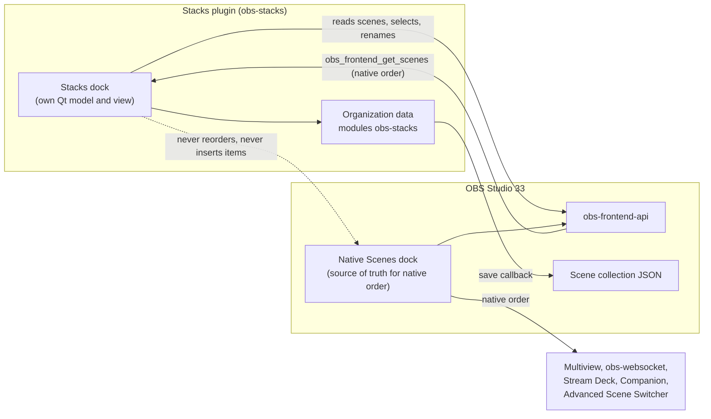
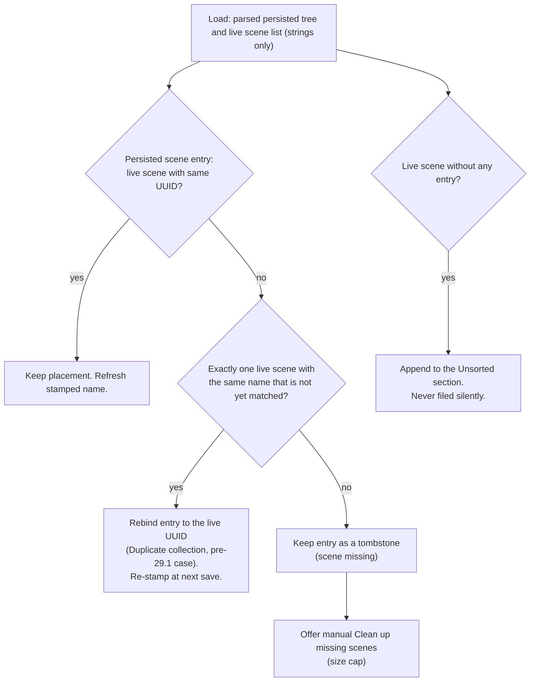
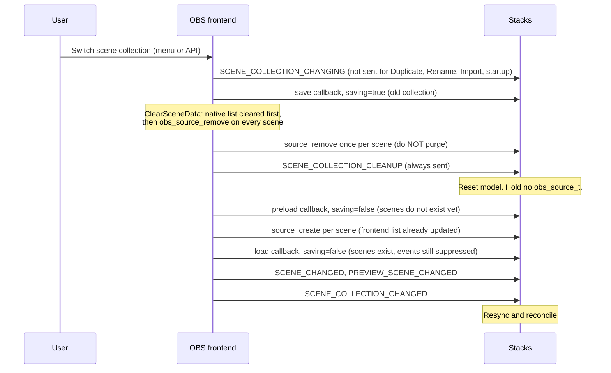
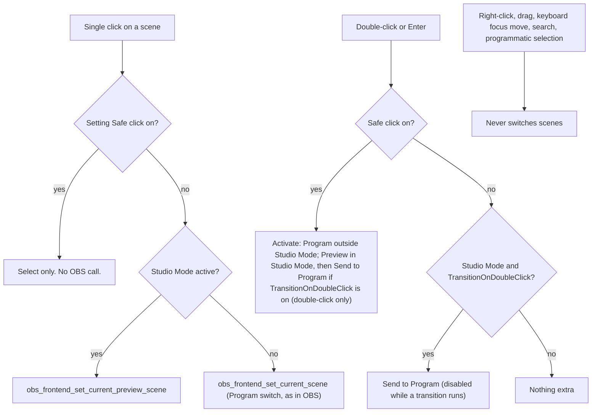

# Technical Feasibility Report — Stacks for OBS

Status: Draft — pending product-owner validation (Phase 1)

Target: OBS Studio 33.0.1+

Last updated: 2026-11-04

> **Stacks for OBS** (short: "Stacks") — *A better way to organize your OBS scenes.*
> Publisher: The OnAir Company · Module: `obs-stacks` · Dock id: `obs-stacks-dock` · Persistence key: `modules["obs-stacks"]`

Sibling documents: [02-product-requirements.md](02-product-requirements.md) · [03-ux-ui-specification.md](03-ux-ui-specification.md) · [04-software-architecture.md](04-software-architecture.md) · [05-implementation-plan.md](05-implementation-plan.md) · [06-testing-strategy.md](06-testing-strategy.md)

## How to read this report

**Confidence labels.** Every technical claim carries one of four labels, and the report never upgrades a label without new evidence.

| Label | Meaning |
|---|---|
| **Verified in source** | Read in the OBS Studio 33.0.1 source tree. A permalink to the exact lines is given. Nothing was built or executed: this is static reading. |
| **Documented** | Stated in official documentation, release notes or vendor documentation, but not independently confirmed in code. |
| **Third-party** | Taken from other projects' source code, issue trackers or forums. Reliable as a record of what others observed, outside our control. |
| **Hypothesis** | Reasoned but not verified. The verification method is stated in [section 14](#14-open-questions-and-unverified-hypotheses). |

**Evidence links.** Source citations are permalinks to the `33.0.1` tag of [obsproject/obs-studio](https://github.com/obsproject/obs-studio/tree/33.0.1). obs-websocket 5.x is a git submodule of obs-studio (`plugins/obs-websocket`, see `.gitmodules`), so permalinks into that path do not resolve on the obs-studio repository; its files are cited as plain text paths inside the obs-studio 33.0.1 tree. Third-party links point to the repositories or threads named, at the time of the research (branch names, not tags, where no tag was available).

**Design values.** This document specifies behavior and feasibility, not visual design. Any color, size, spacing, radius or type value that appears here is a **proposal pending the design review page** (see [03-ux-ui-specification.md](03-ux-ui-specification.md)), never a final value.

**Terminology.** A **Stack** is a visual, collapsible folder of scenes. The word "group" is never used for it, because OBS already uses "Groups" for grouped sources in the Sources dock. A **Separator** is a non-scene visual divider. **Organized order** is the order shown by Stacks; **native order** is OBS's own scene list order, which is what Multiview, obs-websocket, Stream Deck and Companion see.

## Contents

1. [Executive summary](#1-executive-summary)
2. [Current OBS limitations](#2-current-obs-limitations)
3. [Answers to the 15 critical questions](#3-answers-to-the-15-critical-questions)
4. [Capability matrix](#4-capability-matrix)
5. [Integration options and the native-order decision](#5-integration-options-and-the-native-order-decision)
6. [Scene identity and reconciliation](#6-scene-identity-and-reconciliation)
7. [Persistence strategy summary](#7-persistence-strategy-summary)
8. [Event model and threading facts](#8-event-model-and-threading-facts)
9. [Studio Mode and live-safety facts](#9-studio-mode-and-live-safety-facts)
10. [Ecosystem: what other tools see](#10-ecosystem-what-other-tools-see)
11. [Prior art and competitors](#11-prior-art-and-competitors)
12. [Platform and distribution constraints](#12-platform-and-distribution-constraints)
13. [Risk register](#13-risk-register)
14. [Open questions and unverified hypotheses](#14-open-questions-and-unverified-hypotheses)

---

## 1. Executive summary

**Verdict: feasible, without patching OBS, using public APIs only.** Stacks is a custom Qt dock that renders its own tree of Stacks, Separators and scene entries. That tree exists only as plugin data. It never becomes an OBS scene, never touches the native scene list, and is stored inside the scene collection file so it follows the collection.

### 1.1 Findings that shape the product

1. **There is no extension point for the native Scenes dock.** The frontend API offers dock registration, event and save callbacks, undo/redo and a main-window getter, and nothing for the scene list: no menu hook, no delegate, no model, no custom roles ([`obs-frontend-api.h:116-175`][hdr]). Enriching the native panel (Option B) does not exist; manipulating its widgets (Option C) is possible but unsupported and fragile. **Verified in source.**
2. **The one supported way to add a panel is `obs_frontend_add_dock_by_id`**, called from `obs_module_load` ([`obs-frontend-api.h:156-162`][hdrdock], [`OBSStudioAPI.cpp:338-359`][dockid]). The legacy `obs_frontend_add_dock` was removed upstream ([PR #12488](https://github.com/obsproject/obs-studio/pull/12488), merged 2025-08-20). **Verified in source / Third-party (PR).**
3. **Native scene order cannot be changed through any public API** (frontend API, libobs, obs-websocket). Native order lives in the native dock's `QListWidget` and is saved by scene name in `scene_order` ([`OBSBasic_Scenes.cpp:60-70`][saveorder]). **Verified in source.**
4. **Therefore order in Stacks is organization-only** (validated decision 2). Multiview, obs-websocket, Stream Deck and Companion keep seeing the native order. This must be explained in the UI and the docs ([section 5.3](#53-consequences-of-organization-only-order), [section 10](#10-ecosystem-what-other-tools-see)).
5. **Metadata belongs in the collection JSON** under `modules["obs-stacks"]`, written from a save callback. OBS keeps the whole `modules` object in memory and rewrites it on every save, so data from a disabled or uninstalled plugin survives ([`OBSBasic_SceneCollections.cpp:1210-1219`][loadmods]). **Verified in source.**
6. **Scene identity is the UUID, with the name as fallback.** UUIDs persist across save/load, but *Scene Collection > Duplicate* regenerates every UUID while copying `modules` verbatim ([`OBSBasic_SceneCollections.cpp:159-206`][dupcoll]). **Verified in source.**
7. **Studio Mode needs care.** `obs_frontend_set_current_scene` triggers a real transition to Program in Studio Mode; selection must use `obs_frontend_set_current_preview_scene` ([`OBSStudioAPI.cpp:57-76`][scur], [`:568-584`][prev]). A Program request during a running transition corrupts `programScene` ([`OBSBasic_Transitions.cpp:303-345`][tts]). **Verified in source.**
8. **OBS suppresses most frontend events while a collection loads**, and fails to switch collections (then exits) if a plugin still holds a scene reference after `SCENE_COLLECTION_CLEANUP`. The plugin keeps strings only ([section 8](#8-event-model-and-threading-facts)). **Verified in source.**
9. **The market is already occupied** (StreamUP Scene Organiser 2.4.1, SceneAnchor 2.0.0 and others). The decision is to continue without repositioning; competitors are documented factually in [section 11](#11-prior-art-and-competitors).

### 1.2 Feasibility by module (master brief, modules A to H)

| Module | Verdict | Key constraint |
|---|---|---|
| A. Scene Explorer (dock, list, bottom action bar) | Feasible | Dock starts hidden and floating after registration; the native Scenes dock cannot be closed, only hidden ([section 5.4](#54-hiding-the-native-scenes-dock-opt-in)). |
| B. Stacks (collapsible folders, 1 level in v1) | Feasible | Pure plugin data; never reaches `ui->scenes`. |
| C. Separators (line, labeled, spacer) | Feasible | Not scenes, not sources: invisible to every external tool by construction. |
| D. Colors | Feasible | Plugin data only; never write to scene `private_settings`. |
| E. Icons | Feasible with constraints | Qt6::Svg is shipped by OBS; user-imported SVG needs sanitizing. |
| F. Search | Feasible | In-plugin, no OBS API needed. |
| G. Favorites | Feasible | Virtual references; never duplicate scenes. |
| H. Display and density | Feasible | Theme derived from `qApp->palette()`; no access to theme variables. |
| Scene actions (rename, duplicate, delete, filters, projector, screenshot) | Feasible with constraints | Rename, duplicate and delete are reimplemented on public API; undo/redo is ours ([section 4](#4-capability-matrix)). |
| Applying Stacks order to the native list | **Not feasible by public API** | Out of v1 by decision; any future opt-in action sits behind an isolated adapter. |

### 1.3 Validated decisions applied in this report

| # | Decision (product owner, 2026-11-04) | Where applied |
|---|---|---|
| 1 | Option A custom dock; Stacks replaces the native Scenes dock for daily use, with an opt-in offer to hide it and a guard against leaving the user without a Scenes panel | [5](#5-integration-options-and-the-native-order-decision) |
| 2 | Order is organization-only; "Apply Stacks order to OBS" is a future opt-in idea, out of v1 | [5.2](#52-native-order-analysis), [5.3](#53-consequences-of-organization-only-order) |
| 3 | OBS 33+ only | [12](#12-platform-and-distribution-constraints) |
| 8 | Unsigned or ad-hoc signed builds first; CI prepared for later signing | [12.3](#123-macos) |
| 10 | Scene deletion reimplemented safely (confirmation, OBS undo/redo, refuses Program and last scene, never switches Program) | [4](#4-capability-matrix), [9.4](#94-safe-deletion) |
| 11 | Click behavior matches OBS by default; optional "Safe click" | [9.2](#92-click-and-activation-matrix) |
| 12 | New, duplicated and external scenes go to **Unsorted** | [6](#6-scene-identity-and-reconciliation) |

### 1.4 Top risks (full list in [section 13](#13-risk-register))

1. Unintended Program switch during a live show.
2. A leaked `obs_source_t` reference that makes OBS exit during a collection switch.
3. Loss of organization data by purging on `source_remove`.
4. A user confusing the organized order with the Multiview or Stream Deck order.
5. A user left without a Scenes panel after hiding the native dock and removing the plugin.

All five have a mitigation designed from verified facts. The items that still need a runtime test before the MVP is frozen are listed in [section 14](#14-open-questions-and-unverified-hypotheses).

---

## 2. Current OBS limitations

### 2.1 What the native Scenes panel can do (OBS 33.0.1)

The native Scenes dock is a `QDockWidget` subclass (`OBSDock`, objectName `scenesDock`) containing a `QListWidget` subclass named `scenes` (`SceneTree`), and a toolbar with add, remove, filters, move up and move down ([`OBSBasic.ui:973-1077`](https://github.com/obsproject/obs-studio/blob/33.0.1/frontend/forms/OBSBasic.ui#L973-L1077)). **Verified in source.**

| Capability | Native behavior | Evidence |
|---|---|---|
| Flat list of scenes | One `QListWidgetItem` per scene, text = scene name, no color, icon or tag | [`OBSBasic_Scenes.cpp:105-112`][addscene] |
| Drag-and-drop reorder, Move Up/Down/Top/Bottom | `takeItem`/`insertItem` on the list; no save, no undo, no frontend event | [`OBSBasic_Scenes.cpp:720-741`][chgidx] |
| List and grid display | `SceneTree::SetGridMode`, persisted as `BasicWindow/gridMode` | [`SceneTree.cpp:15-34`](https://github.com/obsproject/obs-studio/blob/33.0.1/frontend/components/SceneTree.cpp#L15-L34) |
| Context menu | Rename, duplicate, remove, filters, copy/paste filters, projectors, screenshot, transition override, show in Multiview. Most actions act on the **current** scene, not the right-clicked row | [`OBSBasic_Scenes.cpp:548-626`][ctxmenu] |
| Switch scenes | Non-Studio Mode: selecting a row is a Program switch. Studio Mode: selecting a row sets Preview; double-click transitions only if `TransitionOnDoubleClick` is set | [`OBSBasic_Scenes.cpp:508-532`][curitem], [`:769-782`][dblclick] |
| Persistence of order | `scene_order` array of `{name}` written from the row texts at every save | [`OBSBasic_Scenes.cpp:60-70`][saveorder] |

### 2.2 What it cannot do

1. **No folders, groups, colors, icons or tags for scenes.** The "Groups" feature of OBS is a Sources-list feature (a scene item of type `group`, a hidden scene with id `group`), not a scene folder ([`obs.h:1864-1888`](https://github.com/obsproject/obs-studio/blob/33.0.1/libobs/obs.h#L1864-L1888)). **Verified in source.**
2. **No separators.** Every list item is assumed to be a real scene by `SaveSceneListOrder`, `obs_frontend_get_scenes`, `SetCurrentScene` and the "last scene" check ([`OBSStudioAPI.cpp:44-55`][gs], [`OBSBasic_Scenes.cpp:60-70`][saveorder]). **Verified in source.**
3. **No reorder API and no reorder event.** No function in the frontend API moves scenes, no libobs concept of a scene list exists (`obs_enum_scenes` is hash order), and obs-websocket has no reorder request. The documentation says `SCENE_LIST_CHANGED` fires for "reordered" ([`reference-frontend-api.rst:62-65`][docreord]) but the code does not do it ([`OBSBasic.cpp:465-466`][scenesreord]). **Verified in source.**
4. **No extension point.** No hook for the context menu, item delegate, model or roles. The only related API is dock registration ([`obs-frontend-api.h:116-175`][hdr]). **Verified in source.**
5. **Plugin dock layout is keyed by dock id.** OBS restores layout from `DockState` by `objectName`, which `add_dock_by_id` sets to the id ([`OBSStudioAPI.cpp:338-359`][dockid], [`OBSBasic.cpp:1118-1126`][restore]), so the id `obs-stacks-dock` must never change once shipped. **Verified in source.**

### 2.3 Community workarounds and why they are not enough

| Workaround | What it does | Consequences (all **Verified in source** unless stated) |
|---|---|---|
| Fake scenes named like `-----DECO-----` or `-----AUDIO-----` used as separators | Creates real scenes whose only purpose is to look like a divider. Evidence of the practice: a user's `scene_tree.json` in [DigitOtter issue #19](https://github.com/DigitOtter/obs_scene_tree_view/issues/19) and the [RFP discussion #5076](https://github.com/obsproject/obs-studio/discussions/5076) (comment of 2023-08-18). **Third-party.** | The fake scene is a real scene: it appears in obs-websocket `GetSceneList` (`plugins/obs-websocket/src/utils/Obs_ArrayHelper.cpp:87-109` (obs-studio 33.0.1)), is sent to Stream Deck and Companion, consumes one of the first N Multiview slots unless excluded ([`Multiview.cpp:158-178`][multiview]), has its own hotkey entries, and can be put on air by a mis-click. |
| Name prefixes (`01 - Intro`, `ZZ Tools`) | Encodes order or category in the scene name | Renaming scenes changes names used by obs-websocket clients, hotkey bindings keyed by scene and any script that matches by name. Only the native order of the list is visible. **Hypothesis** (common practice, not measured in this study; to be confirmed during Phase 2 user feedback). |
| Emoji in scene names | Adds a visual marker or category | Same side effects as prefixes; emoji rendering differs across OS and fonts. **Hypothesis** (same status). |
| Separate Scene Collections per context | Keeps unrelated sets of scenes apart | The staff-recommended answer in 2018 ([forum thread](https://obsproject.com/forum/threads/folders-in-scenes.82593/)); switching collections reloads everything and cannot share sources or audio setup between sets. **Third-party.** |
| Third-party folder plugins | Add a second dock with a tree | See [section 11](#11-prior-art-and-competitors). |

No Lua or Python script can add folders or separators, because the Scenes dock is a Qt widget that scripts cannot extend. **Third-party** (absence of any such script in the study).

### 2.4 Upstream status

- Scene folders, groups and colors are an **open request for proposals** upstream ([discussion #5076](https://github.com/obsproject/obs-studio/discussions/5076), tracking [issue #5077](https://github.com/obsproject/obs-studio/issues/5077)). A maintainer wrote on 2026-01-07 that it "is still considered open and active". The requirements include unchanged enumeration APIs and a backward-compatible file format. **Third-party.**
- OBS 33.0.0 (released 2026-10-23) and 33.0.1 contain no scene folder, group or color feature. **Documented** (release notes) and **Verified in source** (absence).
- Open pull requests to watch, none implementing folders: [#13328](https://github.com/obsproject/obs-studio/pull/13328) (decouples the Scenes dock and logic from `OBSBasic`; replaces the dock implementation), [#13617](https://github.com/obsproject/obs-studio/pull/13617) (no reload after scene collection rename), [#13622](https://github.com/obsproject/obs-studio/pull/13622) (SceneTree cleanup). **Third-party.**

---

## 3. Answers to the 15 critical questions

| # | Question | Answer | Mechanism / API | Confidence | Evidence |
|---|---|---|---|---|---|
| 1 | Can the native Scenes panel be enriched through public APIs? | **No.** The API has no hook for menu, delegate, model or roles on the scene list. | Only `findChild` and private slots exist, both outside the API. | Verified in source | [`obs-frontend-api.h:116-175`][hdr]; [`OBSBasic_Scenes.cpp:548-626`][ctxmenu] |
| 2 | Is a custom Qt dock the best solution? | **Yes**, and it is the only supported path. Use `add_dock_by_id`: `add_custom_qdock` adds no Docks menu entry, and `obs_frontend_add_dock` was removed. | `obs_frontend_add_dock_by_id(id, title, QWidget*)` in `obs_module_load`. | Verified in source | [`obs-frontend-api.h:156-162`][hdrdock]; [`OBSStudioAPI.cpp:338-359`][dockid]; [PR #12488](https://github.com/obsproject/obs-studio/pull/12488) |
| 3 | How to get the scenes of a collection? | `obs_frontend_get_scenes`, in native row order. It covers the **main canvas** only. | `obs_frontend_get_scenes` then `obs_frontend_source_list_free`. | Verified in source | [`OBSStudioAPI.cpp:44-55`][gs]; [`obs-source.c:540-546`][srccreate] |
| 4 | How to identify a scene durably? | By **UUID** (saved and reloaded), with the **name** as secondary key. UUIDs are regenerated by *Duplicate collection*; collections saved before 29.1 have none until re-saved. | `obs_source_get_uuid`, `obs_get_source_by_uuid` | Verified in source | [`obs.c:2285-2293`][uuidload]; [`OBSBasic_SceneCollections.cpp:159-206`][dupcoll] |
| 5 | How to detect collection changes? | `SCENE_COLLECTION_CLEANUP` is always sent; `SCENE_COLLECTION_CHANGED`, `FINISHED_LOADING` and the load callback follow. `SCENE_COLLECTION_CHANGING` is **not** sent for Duplicate, Rename, Import or startup. | `obs_frontend_add_event_callback`, `obs_frontend_add_preload_callback`, `obs_frontend_add_save_callback` (called with `saving=false` on load) | Verified in source | [`OBSStudioAPI.cpp:730-763`][saveapi]; [`OBSBasic_SceneCollections.cpp:159-237`][dupcoll]; [`:1559-1668`][clear] |
| 6 | How to handle renames and deletions? | Global libobs signals `source_rename` and `source_remove` cover every path. `SCENE_LIST_CHANGED` is **not** sent for an API rename. `source_remove` is also sent for every scene at collection switch and at exit, so metadata must **never** be purged from it. | `signal_handler_connect(obs_get_signal_handler(), "source_rename" / "source_remove" / "source_create", ...)` | Verified in source | [`obs.c:1084-1118`][sigs]; [`OBSBasic_Scenes.cpp:889-942`][rename]; [`OBSBasic_SceneCollections.cpp:1597-1613`][clear] |
| 7 | Can native order and organized order be synchronized? | **Not through public APIs.** A native reorder emits no frontend event, despite the documentation. | Organization-only order (decision 2). A future sync would need Qt-internal manipulation (Option C), behind an isolated adapter, never automatic. | Verified in source | [`OBSBasic_Scenes.cpp:720-741`][chgidx]; [`OBSBasic.cpp:465-466`][scenesreord]; [`reference-frontend-api.rst:62-65`][docreord] |
| 8 | How to avoid breaking Preview/Program behavior? | Outside Studio Mode, selecting a scene is a Program switch (`set_current_scene`). In Studio Mode, a single click calls `set_current_preview_scene`; sending to Program is an explicit action. Highlight on `SCENE_CHANGED` and `PREVIEW_SCENE_CHANGED`. | `obs_frontend_preview_program_mode_active()` | Verified in source | [`OBSStudioAPI.cpp:57-76`][scur]; [`:568-584`][prev]; [`OBSBasic_Transitions.cpp:295-345`][tts], [`:684-742`][setcur] |
| 9 | Where to store the metadata? | In the collection JSON under `modules["obs-stacks"]`, versioned. `plugin_config` is only for global preferences and disposable backups. | `obs_frontend_add_save_callback`; `obs_frontend_save()` to request a save | Verified in source | [`OBSBasic_SceneCollections.cpp:944-954`][savejson]; [`obs-frontend-api.h:166-176`][hdrsave] |
| 10 | Is data preserved on uninstall or disable? | **Yes.** OBS keeps `modules` for unloaded plugins and rewrites it on every save. Scenes remain ordinary scenes. Residual risks are plugin-side only (a failed parse that writes an empty object; an older plugin dropping newer fields). | `collectionModuleData` | Verified in source | [`OBSBasic_SceneCollections.cpp:1210-1219`][loadmods]; [`PluginManager.cpp:61-80`](https://github.com/obsproject/obs-studio/blob/33.0.1/frontend/plugin-manager/PluginManager.cpp#L61-L80) |
| 11 | How to handle OBS version changes? | Depend on `obs-frontend-api` and libobs only; keep a versioned schema. [PR #13328](https://github.com/obsproject/obs-studio/pull/13328) (open) replaces the Scenes dock: anything that depends on internals would break. Re-run the acceptance suite on each OBS release. | Public API only. | Verified in source (API); Third-party (PR) | [`obs-frontend-api.h`][hdr]; [PR #13328](https://github.com/obsproject/obs-studio/pull/13328) (updated 2026-09-24) |
| 12 | Which features are possible without patching OBS? | Stacks, separators, colors, icons, favorites, search, Preview/Program selection, rename, duplicate, **delete (reimplemented)**, filters, projector, screenshot, persistence, theme, i18n. **Not possible**: changing native order, Multiview order, websocket order. | See [section 4](#4-capability-matrix). | Verified in source | [`obs-frontend-api.h:116-262`][hdr]; [`obs.h`](https://github.com/obsproject/obs-studio/blob/33.0.1/libobs/obs.h) |
| 13 | What are the live-production risks? | Unintended Program switch (click outside Studio Mode, wrong call in Studio Mode, request during a transition); a leaked reference that makes OBS exit; a blocking callback on a websocket thread. | See [sections 8, 9 and 13](#8-event-model-and-threading-facts). | Verified in source | [`OBSBasic_Transitions.cpp:303-345`][tts]; [`OBSBasic_SceneCollections.cpp:1633-1667`][clear]; [`signal.c:296-321`][signal] |
| 14 | How to test without risking real collections? | Use a separate OBS configuration: Windows portable mode, a dedicated user account, or a config path override; exported test collections; `OBS_PLUGINS_PATH` to load the dev build; OBS Safe Mode to confirm behavior without the plugin. Detail in [06-testing-strategy.md](06-testing-strategy.md). | `OBS_PLUGINS_PATH`; Safe Mode | Verified in source (`OBS_PLUGINS_PATH`); Hypothesis (procedure) | [`PluginModuleLoader.hpp:31-33`][pmloader] |
| 15 | How to distribute on three OS? | macOS: `.plugin` bundle, at least ad-hoc signed, Developer ID and notarization later. Windows: plugin folder with `.dll` and `data/`. Linux: `.deb` or archive; Flatpak extension later. **Never bundle Qt.** | obs-plugintemplate updated to 33.0.1 | Verified in source (paths); Documented (signing) | [`PluginModuleLoader_MacOS.mm:25-60`](https://github.com/obsproject/obs-studio/blob/33.0.1/frontend/plugin-manager/PluginModuleLoader_MacOS.mm#L25-L60); [`entitlements.plist`][entitlements] |

---

## 4. Capability matrix

Version dependency means the OBS version the API requires; the target is 33.0.1 and later, so all rows are satisfied. "Maintenance risk" rates exposure to upstream refactors such as [PR #13328](https://github.com/obsproject/obs-studio/pull/13328).

| Capability | API / mechanism | Confidence | Limits | Version dependency | Alternative | Maintenance risk |
|---|---|---|---|---|---|---|
| **Dock** | `obs_frontend_add_dock_by_id`, called in `obs_module_load`, before `restoreState` ([`OBSBasic.cpp:929`][basicmods] vs [`:1118-1126`][restore]) | Verified in source | Dock starts hidden and floating. OBS owns the widget. The id must never change. Docks > Reset Docks (also triggered by View > Reset UI) hides and floats it again ([`OBSBasic_Docks.cpp:46-100`][dockreset]) | 30.0 or later (documented `versionadded`) | `add_custom_qdock` (no Docks menu entry; Reset Docks leaves no way back) | Low |
| **Scene list (read)** | `obs_frontend_get_scenes`, signals `source_create`, `source_remove`, `source_rename` | Verified in source | Main canvas only. No event on a native reorder. `SCENE_LIST_CHANGED` is payload-less | 33 (canvases) | `obs_enum_scenes` (hash order, not UI order) | Low. PR #13328 reimplements the list but not the contract |
| **Preview / Program selection** | `obs_frontend_set_current_preview_scene`, `obs_frontend_set_current_scene`, `obs_frontend_preview_program_mode_active` | Verified in source | `set_current_scene` blocks (`WaitConnection`) and goes through the transition. `set_current_preview_scene` is a no-op outside Studio Mode. Program request during a transition corrupts `programScene` | Stable | None | Low |
| **Rename** | `obs_source_set_name`; own validation; `obs_frontend_add_undo_redo_action` | Verified in source | No native confirmation or undo on the API path. A duplicate name is silently renamed by libobs, so validate empty and duplicate names first ([`obs-source.c:4286-4315`][setname]) | Stable | Send the user to the native dock | Low |
| **Duplicate** | `obs_scene_duplicate(scene, name, OBS_SCENE_DUP_REFS)` | Verified in source | New scene gets a new UUID and a copy of `private_settings`. Undo is ours. The copy is inserted in the native list at `currentRow()+1` | Stable | Private slot `DuplicateSelectedScene` (acts on the current row) | Medium |
| **Delete (reimplemented, decision 10)** | `obs_save_source` for undo data, `obs_source_remove`, `obs_scene_prune_sources`, `obs_load_source` + `obs_source_load2` for undo, `obs_frontend_add_undo_redo_action` | Verified in source (APIs and native reference implementation) | `obs_source_remove` alone lacks confirmation, undo and nested-scene prune. Native undo forces a Program switch and restores the native row by private widget access; Stacks must do neither ([section 9.4](#94-safe-deletion)) | Stable | Not offering delete (rejected by decision 10) | Medium to high: most intricate reimplemented action; needs dedicated tests |
| **Undo / redo** | `obs_frontend_add_undo_redo_action(name, undo, redo, undo_data, redo_data, repeatable)` | Verified in source | Linear stack (max 5000) shared with OBS. Scene **reorder is not in the stack at all**. Mutations by other tools leave stale closures, so closures must key on UUID and tolerate missing scenes ([`OBSStudioAPI.cpp:674-680`][undoapi]) | Stable | None | Low |
| **Filters, projector, screenshot** | `obs_frontend_open_source_filters(source)`, `obs_frontend_open_projector("Scene", ...)`, `obs_frontend_take_source_screenshot(source)` | Verified in source | Explicit target, so right-click can act on the clicked scene. Copy/paste filters uses `obs_source_copy_filters` without native backup or undo | Stable | Private slots (current row only) | Low |
| **Native reorder** | **None.** Only `takeItem`/`insertItem` on `ui->scenes` or private slots `MoveSceneTo*` | Verified in source | No save, no undo, no Multiview refresh, risk of Program switch, breaks if #13328 merges | Internals stable 30 to 33 | Organization-only order (decision 2) | **High** |
| **Event detection** | Frontend event callback, libobs global signals | Verified in source | Frontend events dropped while `disableSaving` is non-zero. Signals fire on arbitrary threads | Stable | None | Low |
| **Persistence in the collection** | Save, preload callbacks; `modules["obs-stacks"]` | Verified in source | No collection id. UUIDs regenerated on Duplicate. No `.bak` on Duplicate or Rename ([`:198`][dupcoll], [`:229`][renamecoll]). Edits made while the plugin is absent are not seen | Stable | Side file in `plugin_config` (orphaned by Rename/Duplicate) | Low |
| **Backup and export** | `obs_module_config_path` (rolling snapshot); manual JSON export/import | Verified in source (path); design in [04](04-software-architecture.md) | libobs does not create the directory. Snapshot is disposable and never overwrites collection data automatically | Stable | None | Low |
| **Theme integration** | `qApp->palette()`, OBS global stylesheet, `obs_frontend_is_theme_dark`, `OBS_FRONTEND_EVENT_THEME_CHANGED`, dynamic property `class="icon-plus"` | Verified in source | No access to theme variables; palette is derived from the theme's `palette_*` variables. Native look only with Yami-derived themes | 29 or later (documented) | `QEvent::PaletteChange` | Low |
| **Icons (Lucide, SVG)** | Qt6::Svg (linked by the OBS frontend), `.qrc` resources, recolored at runtime | Verified in source | `currentColor` resolves to black, not the palette; recolor explicitly. `clipPath` is unsupported by QtSvg. User-imported SVG must be sanitized | Qt 6.11.1 (macOS, Windows); system Qt on Linux | Rasterize to PNG at import | Medium (import path) |
| **i18n** | `OBS_MODULE_USE_DEFAULT_LOCALE`, `data/locale/en-US.ini` and `fr-FR.ini`, `obs_module_text` | Verified in source | No `QTranslator`. The default-locale file is mandatory or lookups return the key | Stable | None | Low |
| **Accessibility** | `QAbstractItemModel` with `Qt::AccessibleTextRole` and `Qt::AccessibleDescriptionRole`; keyboard navigation | Verified in source (Qt) | Not tested with VoiceOver or NVDA. OBS has no a11y code for plugin docks | Qt 6 | None | Low |
| **Search, favorites, colors, stacks, separators** | Pure plugin logic and data | n/a (no OBS API involved) | Must stay smooth at hundreds of scenes: targets to measure, see [06](06-testing-strategy.md) | n/a | None | Low |
| **Hide the native Scenes dock** | `toggleViewAction` of `scenesDock` found through the main window | Verified in source (dock exists and can be hidden); Hypothesis (how to reach it) | Native list stays the source of truth even when hidden. Dock-local shortcuts stop working while hidden ([section 5.4](#54-hiding-the-native-scenes-dock-opt-in)) | Stable | Leave visible | Medium |
| **Packaging** | obs-plugintemplate updated to 33.0.1; OBS 33 plugin layout; `manifest.json` | Verified in source (layout); Third-party (template) | Notarization not tested. Template `src/plugin-main.c` must become C++ for a Qt plugin | 33 | Legacy layout (loaded until OBS 34, not shipped) | Medium |

---

## 5. Integration options and the native-order decision

### 5.1 Options A, B and C compared

| Criterion | **A. Custom dock** | **B. Extend the native panel** | **C. Manipulate internal widgets** |
|---|---|---|---|
| Description | Own Qt dock with its own model, registered with `obs_frontend_add_dock_by_id` | Use an official extension point of the native Scenes list | `findChild("scenes")`, replace delegate or menu, call private slots, insert items |
| Exists? | Yes | **No** (no hook for menu, delegate, model, roles) | Yes, unsupported |
| Public API only | Yes | n/a | No (`GetOBSRef` comes from a private header; private slots by name) |
| Folders and separators without side effects | Yes: plugin data never reaches `ui->scenes` | n/a | No: every code path assumes list items are scenes (`SaveSceneListOrder` would write a folder as a scene name) |
| Survives [PR #13328](https://github.com/obsproject/obs-studio/pull/13328) | Yes | n/a | No: the PR removes the Scenes dock implementation |
| Live-safety | Under our control | n/a | Risk of Program switch via `currentItemChanged`; stale `currentScene` cache |
| Native Scenes panel | Coexists (can be hidden, not closed) | n/a | Replaced or modified in place |
| Maintenance | Low | n/a | High, breaks silently (`invokeMethod` on a renamed slot fails without error) |
| **Verdict** | **Recommended. Validated (decision 1).** | Does not exist | Excluded from v1 |

**Evidence.**
- Option B: no extension point in [`obs-frontend-api.h:116-175`][hdr]. **Verified in source.**
- Option A: `add_dock_by_id` creates an `OBSDock` owned by OBS, sets the objectName to the id, adds a Docks menu toggle, then hides and floats it ([`OBSStudioAPI.cpp:338-359`][dockid], [`OBSBasic_Docks.cpp:143-181`][dockadd]). **Verified in source.**
- `SaveSceneListOrder` writes every list item's text as a scene name ([`OBSBasic_Scenes.cpp:60-70`][saveorder]), which is why a folder item must never be inserted into the native list. **Verified in source.**

Option C fragility points (all verified in source)

1. Object names `scenesDock`, `scenes`, `scenesFrame`, `scenesToolbar`, `actionRemoveScene` are unchanged from 30.0.0 through 33.0.1 but are not API.
2. The rename delegate is installed with `setItemDelegate` and its completion is wired to `SceneNameEdited`; replacing the delegate silently breaks rename and undo ([`OBSBasic.cpp:283`](https://github.com/obsproject/obs-studio/blob/33.0.1/frontend/widgets/OBSBasic.cpp#L283), [`:346`](https://github.com/obsproject/obs-studio/blob/33.0.1/frontend/widgets/OBSBasic.cpp#L346)).
3. The context menu is a local `QMenu` built in a private slot; it can only be replaced, which drops every native action.
4. Item data uses a `Q_DECLARE_METATYPE` from `qt-wrappers.hpp`, which is a private build helper, not an installed header (whether it is shipped to plugins is a **Hypothesis**, [section 14](#14-open-questions-and-unverified-hypotheses)).
5. Several code paths assume every item is a real scene.
6. Several code paths cache `currentScene` separately from the widget.
7. `SceneTree` has custom resize and drop logic in grid mode.
8. Private slots are only reachable by name through the Qt meta-object system; a rename or signature change turns `invokeMethod` into a failed call.

### 5.2 Native-order analysis

The question: should the order shown by Stacks also be pushed to OBS's own scene list?

| Option | Mechanism | Facts | Verdict |
|---|---|---|---|
| **(a) Organization-only** | Stacks keeps its own order. The native list is never touched. | Zero change to the collection and no live risk. Multiview, obs-websocket, Stream Deck and Companion keep the native order ([section 10](#10-ecosystem-what-other-tools-see)). | **Validated for v1 (decision 2).** |
| **(b) Automatic push of the flattened order** | `takeItem`/`insertItem` on the native `QListWidget` with signals blocked, restore the current row, copy the private `currentScene` cache, then `obs_frontend_save()` | Multiview does not refresh (`UpdateMultiviewProjectors` is static and internal); no frontend event is emitted, so websocket clients are not notified; no undo; Program switch risk if `currentItemChanged` fires; the change to `scene_order` persists after uninstall, so it modifies the user's collection; breaks when #13328 merges. **Verified in source.** | **Rejected**, never automatic. |
| **(c) Opt-in "Apply Stacks order to OBS" action** | Same internals as (b) but explicit: diff preview, confirmation, blocked while streaming, recording or transitioning, backup of the previous `scene_order` for undo, self-test of Qt object names with graceful degradation | Same fragility as (b), contained behind an adapter | **Future idea, out of v1 (decision 2).** Never automatic. |

**Validated decision.** Order is organization-only in v1. Stacks never reorders OBS's native scene list. A future opt-in action (c) may be studied later, behind an isolated adapter, and is listed under future ideas in [02-product-requirements.md](02-product-requirements.md).

Source references for (b) and (c): [`OBSBasic_Scenes.cpp:720-741`][chgidx] (`ChangeSceneIndex` blocks signals, reassigns `currentScene`, updates only the Multiview), [`SceneTree.cpp:105-147`](https://github.com/obsproject/obs-studio/blob/33.0.1/frontend/components/SceneTree.cpp#L105-L147) (drop emits only `scenesReordered`), [`OBSBasic.cpp:465-466`][scenesreord] (connected only to the Multiview refresh).

### 5.3 Consequences of organization-only order

1. **Two orders coexist.** The user sees the organized order in Stacks and the native order in every other tool. The UI must say so: help text in settings and a first-run note (specified in [03-ux-ui-specification.md](03-ux-ui-specification.md)).
2. **Multiview shows the first N scenes of the native list** (default 8) and skips scenes whose private setting `show_in_multiview` is false ([`Multiview.cpp:83-84`][multiview], [`:158-178`][multiview]). Stacks does not write `show_in_multiview` (competitor DigitOtter did). **Verified in source.**
3. **New scenes land in the native list at `currentRow()+1`** ([`OBSBasic_Scenes.cpp:105-112`][addscene]). Stacks cannot control that position and does not need to: the new scene is placed in **Unsorted**, or in the selected stack when created with "+" (decisions 11 and 12).
4. **Scene hotkeys** ("Switch to scene") are listed in registration order, not UI order ([`obs-hotkey.c:970-982`](https://github.com/obsproject/obs-studio/blob/33.0.1/libobs/obs-hotkey.c#L970-L982)); they are unaffected by either order. **Verified in source.**

### 5.4 Hiding the native Scenes dock (opt-in)

Validated decision 1: on first launch Stacks *offers* an opt-in dialog to hide the native Scenes dock; the user can show it again from the Docks menu. The facts that constrain the design:

| Fact | Evidence | Confidence |
|---|---|---|
| The native dock cannot be removed or replaced: `Closable` is removed from its features, but a Docks menu toggle exists, so it can be hidden | [`OBSBasic_Docks.cpp:104-125`][docklock]; [`OBSBasic.cpp:1091-1103`][docksmenu] | Verified in source |
| The toggle action sets visibility under a `QSignalBlocker` and is never disabled | [`OBSBasic_Docks.cpp:24-43`][docksetup] | Verified in source |
| Hiding the dock does not break core behavior: scene switching, hotkeys and Studio Mode use the list **widget** as source of truth, not its visibility | [`OBSBasic_Transitions.cpp:684-742`][setcur]; [`OBSBasic_Scenes.cpp:508-532`][curitem] | Verified in source |
| Dock-local shortcuts of the native dock (rename F2, Delete) work only while that dock has focus, so they stop working when it is hidden | `OBSBasic.cpp:356-380` | Verified in source |
| `DockState` is written once, at exit, in `saveAll()`, **after** `SaveProjectNow()` has run the save callbacks, and restored at startup after plugins load | [`OBSBasic.cpp:1739-1752`][saveall]; [`:1118-1126`][restore] | Verified in source |
| After a crash the previous clean-exit `DockState` is still on disk | same | Verified in source (inferred from the single write site) |
| **Docks > Reset Docks** (also triggered by View > Reset UI, which calls `on_resetDocks_triggered`, [`OBSBasic_MainControls.cpp:526-538`](https://github.com/obsproject/obs-studio/blob/33.0.1/frontend/widgets/OBSBasic_MainControls.cpp#L526-L538)) shows the native Scenes dock again and hides and floats every plugin dock, the Stacks dock included | [`OBSBasic_Docks.cpp:46-100`][dockreset] | Verified in source |
| A newly registered plugin dock is **hidden and floating** until the user enables it or a saved `DockState` makes it visible | [`OBSStudioAPI.cpp:338-359`][dockid] | Verified in source |

**Consequences for the guard strategy (detailed design in [04-software-architecture.md](04-software-architecture.md)).**

1. Documented recovery always exists: *Docks > Scenes*, or *Docks > Reset Docks* (View > Reset UI does the same). Both reset commands also hide and float the Stacks dock ([`OBSBasic_Docks.cpp:46-100`](https://github.com/obsproject/obs-studio/blob/33.0.1/frontend/widgets/OBSBasic_Docks.cpp#L46-L100)). **Verified in source.**
2. The save callback cannot be used to restore the native dock "before `DockState` is written": it runs at every save and carries no "shutting down" flag, and `DockState` is serialized right after it. A reliable pre-exit hook is not offered by the public API (the `EXIT` event fires after `saveAll()`, [`OBSBasic.cpp:1866-1902`][closewin]). **Verified in source.**
3. Candidate mechanisms, both **Hypothesis** pending a runtime test: (a) an event filter on the main window (obtained through `obs_frontend_get_main_window`) that restores the native dock's visibility on `QEvent::Close`; `closeWindow()` is called from `closeEvent` ([`OBSBasic.cpp:1569-1614`](https://github.com/obsproject/obs-studio/blob/33.0.1/frontend/widgets/OBSBasic.cpp#L1569-L1614)) but on Windows and Linux only (`#ifndef __APPLE__`) it is also called directly from `QApplication::aboutToQuit`, where OBS's own slot was connected first and therefore runs first ([`OBSBasic.cpp:469-470`](https://github.com/obsproject/obs-studio/blob/33.0.1/frontend/widgets/OBSBasic.cpp#L469-L470)); on macOS only the `closeEvent` path applies (Hypothesis, to be verified by a runtime test of Cmd+Q and Quit menu); a cancelled exit prompt also needs handling; (b) keep the stored `DockState` always "safe" by treating the hidden state as a plugin preference re-applied after `FINISHED_LOADING` at each start.
4. First-run visibility: because a new dock starts hidden, Stacks needs a deliberate way to show its dock on first launch (for example toggling the `QDockWidget` that OBS creates around the widget, reachable as the widget's parent). That is a **Hypothesis** to verify at runtime.

---

## 6. Scene identity and reconciliation

### 6.1 Facts that govern identity

| Fact | Evidence | Confidence |
|---|---|---|
| UUIDs are written for every source (scenes included) and read back at load. A loaded UUID that is not 36 characters is replaced; one that collides inside the same file is regenerated with a warning | [`obs.c:2285-2293`][uuidload]; [`obs.c:2786-2793`][uuiddup] | Verified in source |
| Collections saved before 29.1 have no UUIDs; they are random at each load until the next save writes them. `obs_get_source_by_uuid` is `versionadded 29.1` | [`reference-core.rst:349-357`](https://github.com/obsproject/obs-studio/blob/33.0.1/docs/sphinx/reference-core.rst#L349-L357) | Documented (version) / Verified in source (behavior) |
| Renaming a scene keeps its UUID | [`OBSBasic_Scenes.cpp:889-942`][rename] | Verified in source |
| Scene names are unique within the **main canvas** (libobs de-duplicates). Names are unique per canvas, not globally | [`obs-source.c:4286-4315`][setname] | Verified in source |
| **Duplicate collection** copies the file, then regenerates a new UUID for every entry of `sources` (scenes and inputs). `groups` and global audio devices are untouched. `modules` is copied verbatim | [`OBSBasic_SceneCollections.cpp:159-206`][dupcoll] (UUID loop at 175-196) | Verified in source |
| **Rename collection** copies the file under the new name, keeps UUIDs and `modules`, then deletes the old file | [`OBSBasic_SceneCollections.cpp:208-240`][renamecoll] | Verified in source |
| **Import** writes back the parsed JSON with only the name changed (and path translations): UUIDs and `modules` are preserved. Two imports of one export, or an import next to its original, yield identical scene UUIDs. **Export** also keeps `modules` | [`OBSImporter.cpp:180-232`](https://github.com/obsproject/obs-studio/blob/33.0.1/frontend/importer/OBSImporter.cpp#L180-L232) | Verified in source |
| OBS holds one collection in memory at a time, so identical UUIDs across files only matter for storage **outside** the collection | [`OBSBasic_SceneCollections.cpp:1559-1668`][clear] | Verified in source |
| A collection has no UUID. It is identified by its name; Rename and Duplicate always create a new file | [`OBSBasic_SceneCollections.cpp:244-271`](https://github.com/obsproject/obs-studio/blob/33.0.1/frontend/widgets/OBSBasic_SceneCollections.cpp#L244-L271) | Verified in source |
| Native *Duplicate Scene* creates a new scene with a **new UUID** and a copy of `private_settings` and filters; default name is `<name> 2` | [`OBSBasic_Scenes.cpp:240-300`][dup] | Verified in source |
| Undoing a native scene delete re-creates the scene from saved JSON, so the **original UUID returns** (unless the old source is still alive, in which case it is regenerated) | [`OBSBasic_Scenes.cpp:344-478`][rmsel] | Verified in source |
| Scenes of non-main canvases are not in the native list and not in `obs_frontend_get_scenes` | [`obs-source.c:540-546`][srccreate] | Verified in source |

### 6.2 Identity rule

- **Primary key: scene UUID.** **Fallback key: unique scene name.** Names are re-stamped into every scene node at every save, so the fallback is always current.
- Stacks and Separators carry their own plugin-generated `id` (a UUID unrelated to OBS).
- v1 covers the main canvas. The schema is ready for a future `canvas_uuid` per scene entry (canvases are persisted with a `canvas_uuid` in the same `sources` array, [`obs.c:2285-2293`][uuidload]).

### 6.3 Reconciliation algorithm

Reconciliation runs in the load callback and again on `SCENE_COLLECTION_CHANGED` and `FINISHED_LOADING`, because frontend events are suppressed during load ([section 8](#8-event-model-and-threading-facts)).

Rules:

1. **UUID first, then unique name.** A name match is accepted only when it is unambiguous and the live scene is not already matched by UUID.
2. **Tombstones.** An entry whose scene no longer exists is **kept**, because OBS's own undo of a deletion restores the same UUID ([`OBSBasic_Scenes.cpp:344-478`][rmsel]). Tombstones are removed by the manual "Clean up missing scenes" action, or by an automatic hard-cap trim of the oldest tombstones (2,000; proposal pending product-owner decision OP-4, same rule as [04](04-software-architecture.md)). Never purge on `source_remove`: it fires for every scene at collection switch and at exit ([`OBSBasic_SceneCollections.cpp:1597-1613`][clear]). **Verified in source** (facts) and a **validated decision** (retention policy).
3. **Unsorted.** Scenes created outside Stacks (native dock, obs-websocket, Stream Deck, collection import) and scenes whose organization data was lost go to the visible **Unsorted** section at the bottom. Scenes created with Stacks' "+" go into the selected stack after the selected scene; a scene duplicated from Stacks is placed right after the original in the same stack (decision 12).
4. **Renamed while the plugin was absent.** If a scene was renamed while Stacks was disabled and the collection was then duplicated, neither key matches: the scene reappears in Unsorted and the old entry becomes a tombstone. This is the documented limit of name fallback. **Hypothesis** about frequency; behavior verified by the reasoning above.
5. **Ambiguous names** (two live scenes with an identical name in different canvases) cannot occur in v1 (main canvas, unique names).
6. **After `Duplicate collection`:** all UUIDs differ, all names match, so every entry is rebound by name and re-stamped. The duplicated collection ends up with the same organization. This is the exact case where the name-keyed side-file competitors lost data ([section 11](#11-prior-art-and-competitors)).

Detailed algorithm, data structures and tests: [04-software-architecture.md](04-software-architecture.md), [06-testing-strategy.md](06-testing-strategy.md).

---

## 7. Persistence strategy summary

This section summarizes the facts and decisions; the detailed design is in [04-software-architecture.md](04-software-architecture.md).

### 7.1 Where data lives

| Data | Location | Role |
|---|---|---|
| Organization (stacks, separators, scene entries, colors, icons, favorites, collapsed state) | Collection JSON, top-level `modules["obs-stacks"]` | **Source of truth** |
| Global preferences (display mode, color mode, "Safe click", first-run flags) | `obs_module_config_path` directory (plugin config) | Per-user, not per collection |
| Rolling backup of the organization per collection | `<plugin_config>/obs-stacks/backups/` (collection name and timestamp) | **Disposable safety net**. Never overwrites collection data automatically |
| Manual JSON export / import of an organization | User-chosen file | Safety feature (backup and transfer); not Presets (decision 6) |

How OBS handles the `modules` object (all **Verified in source**):

- On save, `api->on_save(collectionModuleData)` lets plugins write their key, then OBS writes the object as `modules` ([`OBSBasic_SceneCollections.cpp:944-954`][savejson]). The callback receives the single `modules` object shared by every plugin, so Stacks must use only its own key.
- On load, `modules` is passed to preload callbacks (before scenes exist) and kept in `collectionModuleData` "so plugins that are not loaded do not have their collection specific data lost" ([`OBSBasic_SceneCollections.cpp:1210-1219`][loadmods]). The load callback (`saving=false`) runs after scenes exist ([`:1468-1472`](https://github.com/obsproject/obs-studio/blob/33.0.1/frontend/widgets/OBSBasic_SceneCollections.cpp#L1468-L1472)).
- Neither load callback runs when the collection file does not exist or is unreadable, nor for a freshly created collection. A save without a prior load is possible. The in-memory model must therefore always be ready to serialize, and must be reset on `SCENE_COLLECTION_CLEANUP` ([`:1559-1668`][clear]).
- The collection is written atomically with `obs_data_save_json_pretty_safe(..., "tmp", "bak")`, keeping `<file>.json.bak` ([`:985`][atomic]). **Duplicate and Rename write without a `.bak`** (`nullptr` at [`:198`][dupcoll] and [`:229`][renamecoll]).
- `obs_frontend_save()` queues a save ([`obs-frontend-api.h:202`](https://github.com/obsproject/obs-studio/blob/33.0.1/frontend/api/obs-frontend-api.h#L202)); organization changes should request one, coalesced, so the crash window is small.

### 7.2 Schema contract

Defined fully in [04](04-software-architecture.md): `{ schema_version, writer_version, nodes: [...], unknown: {...} }`.

- Scene nodes carry `uuid` and `name`; Stacks and Separators carry their own `id`.
- Unknown fields and versions are passed through **verbatim**.
- If parsing or migration fails, the **original object is re-saved untouched**.
- A newer `schema_version` than the plugin understands puts Stacks in **read-only mode** and preserves the blob.
- `obs_data_erase` on the key is called only for an explicit user reset.

### 7.3 Behavior per operation

| Operation | What OBS does | Effect on `modules["obs-stacks"]` | Stacks behavior |
|---|---|---|---|
| Normal save | Atomic write with `.bak` | Written by the save callback | n/a |
| Scene Collection > Rename | `SaveProjectNow()`, copy, reload; UUIDs kept | Data follows the file | Reload, reconcile (all UUIDs match) |
| Scene Collection > Duplicate | `SaveProjectNow()`, copy, **new UUIDs**, reload | `modules` copied verbatim, UUIDs stale | Rebind by name, re-stamp ([section 6](#6-scene-identity-and-reconciliation)) |
| Export / Import | JSON copied; UUIDs and `modules` preserved | Follows the file | Reconcile; identical UUIDs across collections are harmless (one collection in memory) |
| Switch collection | `CHANGING` (menu/API only), save of old collection, cleanup, preload, load | Per collection | Reset on CLEANUP, rebuild on load |
| New empty collection | No load callback | Key absent | Empty model, everything in Unsorted |
| Delete collection | File removed | Gone with the file | The disposable backup in `plugin_config` remains until rotated |
| Plugin disabled or uninstalled | Module not loaded; no callbacks | **Preserved** and rewritten on every save | Inert data; scenes remain ordinary scenes |
| Safe Mode | Third-party plugins not loaded | Preserved, same as disabled | Same |
| OBS crash | Last atomic write remains | Last saved state | Rolling backup as extra net |
| Older plugin opens newer data | Loads blob | Must not drop unknown fields | Passthrough, read-only on newer schema |
| Edits made while the plugin was absent | Scenes created, renamed or deleted | Not seen | Reconcile on next load: new scenes to Unsorted; missing scenes become tombstones |

All rows are **Verified in source** except the "Edits while absent" row, which is a reasoned consequence (**Hypothesis**, covered by tests in [06](06-testing-strategy.md)). The "Safe Mode" row relies on the documented behavior that Safe Mode loads no third-party plugins (**Documented**, [33.0.0 release notes](https://github.com/obsproject/obs-studio/releases/tag/33.0.0)); the skip logic is in [`obs-module.c:475-477`](https://github.com/obsproject/obs-studio/blob/33.0.1/libobs/obs-module.c#L475-L477).

### 7.4 Uninstall and "disabled" semantics

The Plugin Manager writes `enabled=false` to `<config>/obs-studio/plugin_manager/modules.json`. At the next startup `PluginManager::preLoad()` calls `obs_add_disabled_module`, so the module is skipped entirely: no `dlopen`, no `obs_module_load`, no callbacks registered. A change needs a restart ([`PluginManager.cpp:61-80`](https://github.com/obsproject/obs-studio/blob/33.0.1/frontend/plugin-manager/PluginManager.cpp#L61-L80)). **Verified in source.** The interaction with a hidden native dock is covered in [section 5.4](#54-hiding-the-native-scenes-dock-opt-in).

### 7.5 Why not a side file only

| Approach | Strengths | Weaknesses |
|---|---|---|
| Collection JSON (`modules`) | Follows Rename, Duplicate, Export, Import; survives plugin absence; atomic write by OBS | UUIDs regenerated on Duplicate; edits made while absent are not seen; depends on OBS to write |
| Separate JSON file | Independent of OBS; easy to back up | Keyed by collection **name**, so orphaned by Rename and Duplicate (the failures behind DigitOtter #27, #37, #42); absent from exports |
| **Both (chosen)** | Collection is authoritative; file is a recovery net | Two formats to maintain; the file must never overwrite the collection automatically |

Resolved path of the plugin config directory: `<module_config_path>/<mod_name>/<file>` where `mod_name` is the binary file name without extension (`obs-stacks`). libobs does **not** create the directory. macOS: `~/Library/Application Support/obs-studio/plugin_config/obs-stacks/`; Windows: `%APPDATA%\obs-studio\plugin_config\obs-stacks\`; Linux: `$XDG_CONFIG_HOME` or `~/.config`, then `obs-studio/plugin_config/obs-stacks/` ([`obs-module.c:82-95`](https://github.com/obsproject/obs-studio/blob/33.0.1/libobs/obs-module.c#L82-L95), [`platform-cocoa.m:60-95`](https://github.com/obsproject/obs-studio/blob/33.0.1/libobs/util/platform-cocoa.m#L60-L95)). **Verified in source.** Flatpak and portable-mode paths were derived from code and environment conventions, not from a running install (**Hypothesis**).

---

## 8. Event model and threading facts

### 8.1 libobs global signals (on `obs_get_signal_handler()`)

| Signal | Emitted when | Thread | Notes |
|---|---|---|---|
| `source_create(ptr source)` | A **public** source is created, only if it has no canvas or lives in the main canvas | The creating thread (UI thread, or an obs-websocket worker) | Scenes are told apart with `obs_scene_from_source(source) != NULL`; groups (id `group`) are not scenes. Private sources emit no global signal |
| `source_create_canvas(ptr source, ptr canvas)` | A source is created in an additional canvas | Creating thread | The OBS frontend does not connect it. Not used in v1 |
| `source_rename(ptr source, string new_name, string prev_name)` | `obs_source_set_name` on a main-canvas or canvas-less source | Calling thread (UI or websocket worker) | **Authoritative rename notification.** `SCENE_LIST_CHANGED` does not fire for API renames |
| `source_remove(ptr source)` | `obs_source_remove`, once (`removed` flag) | Calling thread | Also fires **for every scene** at collection clear and at exit |
| `source_destroy(ptr source)` | The last reference is released | libobs destruction-task thread | Can arrive much later, even during the cleanup wait |

Evidence: [`obs.c:1084-1118`][sigs]; [`obs-source.c:540-546`][srccreate]; [`:960-976`](https://github.com/obsproject/obs-studio/blob/33.0.1/libobs/obs-source.c#L960-L976); [`:4286-4315`][setname]. **Verified in source.**

### 8.2 Frontend events relevant to Stacks

| Event | Delivered during load/cleanup? | Stacks use |
|---|---|---|
| `SCENE_COLLECTION_CLEANUP` | **Always** | Reset the model and drop all state. A fresh collection triggers no load callback |
| `SCENE_COLLECTION_CHANGING` | n/a | Not reliable: **not** fired for Duplicate, Rename, Import or startup |
| `SCENE_COLLECTION_CHANGED` | No (fired explicitly after load) | Resync and reconcile |
| `FINISHED_LOADING` | Fired once at the end of startup | Initial resync; apply opt-in dock hiding |
| `SCENE_LIST_CHANGED` | No (suppressed during load; not fired after) | Rescan the scene list; **not** fired on API rename or native reorder |
| `SCENE_CHANGED`, `PREVIEW_SCENE_CHANGED` | No (emitted explicitly at the end of load) | Program and Preview highlight |
| `STUDIO_MODE_ENABLED` / `DISABLED` | No (dropped at startup) | Read `obs_frontend_preview_program_mode_active()` at resync instead of relying on the event |
| `THEME_CHANGED` | n/a | Rebuild palette-derived colors; also read the palette at dock creation |
| `EXIT` | Always | Last chance to call frontend API; afterwards every `obs_frontend_*` call is a no-op |

Evidence: [`OBSStudioAPI.cpp:754-763`][evdrop] (`on_event` drops every event while `disableSaving` is non-zero, except `CLEANUP` and `EXIT`); complete event enum in [`obs-frontend-api.h:12-67`][hdrenum]. **Verified in source.** Enum values are order-dependent; compare only symbolic names.

### 8.3 Sequences

Startup order (**Verified in source**, [`OBSBasic.cpp`](https://github.com/obsproject/obs-studio/blob/33.0.1/frontend/widgets/OBSBasic.cpp) lines 812-834, 929, 958-966, 995-1016, 1118-1126, 1241-1252):

1. The frontend API is valid before modules load; the frontend registers its own global source signal handlers first.
2. `obs_module_load` and post-load run for every plugin; Stacks registers its dock here.
3. Studio Mode saved state is applied (its event is dropped), then the collection loads (`CLEANUP`, preload, scene creation, load callback; all other events dropped).
4. OBS explicitly fires `SCENE_COLLECTION_LIST_CHANGED`, `SCENE_COLLECTION_CHANGED`, `SCENE_CHANGED`, `PREVIEW_SCENE_CHANGED`.
5. `restoreState(DockState)` runs, then the window is shown, then `FINISHED_LOADING`.

Shutdown order (**Verified in source**, [`OBSBasic.cpp:1827-1902`][closewin]): displays destroyed, frontend's own signal handlers disconnected, `saveAll()` (save callbacks with `saving=true`, then `DockState`), `SCRIPTING_SHUTDOWN`, `ClearSceneData` (one `source_remove` per scene, `CLEANUP`), `EXIT`, then the frontend API is torn down. No save happens after `ClearSceneData`.

### 8.4 Threading rules

| Fact | Evidence | Confidence |
|---|---|---|
| obs-websocket handles requests on a `QThreadPool` and calls `obs_source_set_name`, `obs_source_remove` and scene creation from those worker threads | `plugins/obs-websocket/src/websocketserver/WebSocketServer.cpp:352` (obs-studio 33.0.1); `RequestHandler_Scenes.cpp:271, 311, 347` | Verified in source |
| Signal callbacks run **while the signal's mutex is held**, in registration order | [`signal.c:296-321`][signal] | Verified in source |
| The frontend's own handlers run first. From a non-UI thread, `SourceCreated` uses a **blocking-queued** call (`WaitConnection`) to add the scene to the native list; `SourceRemoved` and `SourceRenamed` use plain queued calls | [`OBSBasic_SceneItems.cpp:199-228`][srccreated] | Verified in source |
| Therefore, when Stacks' handler runs, the native list is already updated, **except during bulk clears**: `ClearSceneData` empties the native list first, then removes sources, so `obs_frontend_get_scenes()` returns an empty list while `source_remove` signals still arrive | [`OBSBasic_SceneCollections.cpp:1559-1613`][clear] | Verified in source |
| Frontend events are emitted from the UI thread in practice; save callbacks run on the UI thread | [`OBSBasic_SceneCollections.cpp:1528-1557`](https://github.com/obsproject/obs-studio/blob/33.0.1/frontend/widgets/OBSBasic_SceneCollections.cpp#L1528-L1557) | Verified in source |

**Rules that follow (design in [04](04-software-architecture.md)):**

1. A libobs signal handler **copies strings** (UUID, new and previous names) and posts to the Qt main thread with `Qt::QueuedConnection`. It never calls back into OBS, never blocks, never uses `Qt::BlockingQueuedConnection` (a blocked worker thread would hold the signal mutex while the UI thread is busy).
2. The handler does O(1) work, so a burst of websocket scene creation cannot stall other signal consumers.
3. Do not assume the order of `source_create` relative to `SCENE_LIST_CHANGED`: rescan the scene list in the queued slot instead of trusting a single event.
4. Use `obs_source_removed(source)` as the safe "is removed" query where needed.

### 8.5 The CLEANUP reference rule

After `SCENE_COLLECTION_CLEANUP`, OBS waits for the destroy queue. If any source is still alive it logs `Not all sources were cleared`, sets `clearingFailed = true`, does **not** decrement `disableSaving`, and `LoadData` then shows a "Source Leak" message and calls `close()`: **OBS exits** ([`OBSBasic_SceneCollections.cpp:1193-1201`](https://github.com/obsproject/obs-studio/blob/33.0.1/frontend/widgets/OBSBasic_SceneCollections.cpp#L1193-L1201), [`:1633-1667`][clear]). **Verified in source.** The deliberate "do not decrement" branch protects user data from being overwritten by a broken state. A competitor shipped exactly this bug ([StreamUP #48/#49](https://github.com/StreamUPTips/obs-streamup/issues/48), **Third-party**).

**Rule.** Stacks stores **only strings** (UUID, name). Whenever it needs a source it acquires one (`obs_get_source_by_uuid` or by name), uses it, and releases it immediately, never across an event-loop turn that could straddle `CLEANUP`. Frontend getters such as `obs_frontend_get_current_scene` return a new reference that must be released.

---

## 9. Studio Mode and live-safety facts

### 9.1 API semantics

| Call | Studio Mode **on** | Studio Mode **off** | Evidence |
|---|---|---|---|
| `obs_frontend_get_current_scene` | Returns **Program** (`programScene`) | Returns the one selected scene, which is live | [`OBSStudioAPI.cpp:57-65`][scur] |
| `obs_frontend_get_current_preview_scene` | Returns Preview | `NULL` | [`OBSStudioAPI.cpp:568-576`][prev] |
| `obs_frontend_set_current_scene` | `TransitionToScene`: a **real transition to Program**, using the current transition and the scene's override; Preview is unchanged. Blocking if called off the UI thread | `SetCurrentScene(scene, false)`: Program switch through the normal transition | [`OBSStudioAPI.cpp:67-76`][scur]; [`OBSBasic_Transitions.cpp:295-419`][tts] |
| `obs_frontend_set_current_preview_scene` | Sets Preview; no transition; ignored if the scene is not in the native list or is already Preview | **No-op** | [`OBSStudioAPI.cpp:578-584`][prev]; [`OBSBasic_Transitions.cpp:684-742`][setcur] |

All **Verified in source**. Both set calls are non-forced: `SCENE_CHANGED` fires when the transition **ends** (`TransitionStopped`), not at the click. With a non-Cut transition, the Program indicator therefore updates at the end of the transition. Stacks follows the OBS semantic.

### 9.2 Click and activation matrix

Validated decision 11. The native behavior being matched:

| Situation | Native behavior | Evidence |
|---|---|---|
| Studio Mode off, click on a row | The current item changes, which switches Program | [`OBSBasic_Scenes.cpp:508-532`][curitem] |
| Studio Mode on, click | Sets Preview | same |
| Studio Mode on, double-click | Transitions Preview to Program **only if** user setting `BasicWindow/TransitionOnDoubleClick` is true | [`OBSBasic_Scenes.cpp:769-782`][dblclick] |
| Right-click on a row | A `QListWidget` selection change can occur, so the right-click can change the current item (and, outside Studio Mode, the Program) | Verified in source ([`OBSBasic_Scenes.cpp:508-534`][curitem]) |

Stacks behavior:

- A "Send to Program" action exists in Studio Mode and is **disabled while a transition is running**.
- Stacks' selection is its own model, decoupled from the native list's current item. Nothing in OBS depends on Stacks' selection, so "Safe click" (select without activating) is feasible by construction. **Verified in source** (the native dock stays the source of truth even when hidden, [section 5.4](#54-hiding-the-native-scenes-dock-opt-in)).
- Scene hotkeys (`OBSBasic.SelectScene`) call `SetCurrentScene` directly and are unaffected.

### 9.3 Transition race

In Studio Mode, `TransitionToScene` **overwrites `programScene` (and `lastProgramScene`) before** checking whether a transition is in flight, then returns without starting a transition if `t` is strictly between 0 and 1 ([`OBSBasic_Transitions.cpp:303-345`][tts]; `float t = obs_transition_get_time(transition); stillTransitioning = t < 1.0f && t > 0.0f`). A Program request during a running transition can leave `programScene` (and `obs_frontend_get_current_scene`) pointing at a scene that is not on air. The native UI disables its controls during transitions. **Verified in source.**

There is no frontend "transition started" event; only `TRANSITION_STOPPED` exists. Stacks disables "Send to Program" while a transition runs by testing the transition's time on the same condition as OBS. The exact equivalence of that test is a **Hypothesis** to confirm at runtime ([section 14](#14-open-questions-and-unverified-hypotheses)).

Additional Studio Mode facts: `TransitionToScene` does nothing if the scene is already on Program (`lastScene == source`) unless `sceneDuplicationMode` is on. With `sceneDuplicationMode`, Program becomes a **private copy** of the scene ([`OBSBasic_Transitions.cpp:330-334`][tts]); the copy emits no global signal, but Program highlighting based on `obs_frontend_get_current_scene` must be checked in that mode (**Hypothesis**, section 14).

### 9.4 Safe deletion

Validated decision 10: deletion is reimplemented in Stacks. The native path (`RemoveSelectedScene`, [`OBSBasic_Scenes.cpp:344-478`][rmsel]) is the reference. All the building blocks are public: `obs_save_source` and `obs_load_source` ([`obs.h:859-862`](https://github.com/obsproject/obs-studio/blob/33.0.1/libobs/obs.h#L859-L862)), `obs_source_remove`, `obs_scene_prune_sources` ([`obs.h:1912`](https://github.com/obsproject/obs-studio/blob/33.0.1/libobs/obs.h#L1912)), `obs_enum_scenes`, `obs_source_load2` and `obs_frontend_add_undo_redo_action`. **Verified in source.**

| Native step | Stacks requirement |
|---|---|
| `QueryRemoveSource`: confirmation dialog; refuses the last scene (`ui->scenes->count() == 1`) | Explicit confirmation; refuse the last remaining scene; additionally **refuse the scene currently on Program** |
| Snapshot of the scene, its sources, and every scene or group that **nests** it (`obs_save_source` into the undo entry) | Same snapshot, serialized into the undo data |
| `obs_source_remove` then `obs_scene_prune_sources` on every scene to drop nested references | Same |
| Undo re-creates sources from JSON with `obs_load_source` + `obs_source_load2`, re-adds the scene to the scenes that nested it, then **`SetCurrentScene(scene, true)`** (a forced Program switch) and restores the native row index by `takeItem`/`insertItem` | **Do not** switch Program. **Do not** touch the native row: the restored scene lands where OBS inserts new scenes, and its placement in the organized tree comes from the **tombstone** that was kept |
| `RemoveScene` deletes the list item; deleting the *current* item makes the list select another row | Refusing deletion of the Program scene avoids a Program switch (outside Studio Mode the current native item **is** Program). In Studio Mode, deleting the Preview scene can change Preview as a side effect (**Hypothesis**: runtime test) |
| Mutations by other tools leave stale undo closures (they look up scenes by name) | Undo and redo closures key on UUID and no-op safely when the scene or sources are missing |

Dissolving a Stack never deletes scenes. Deleting a Stack from a context menu is **Dissolve Stack** only. DigitOtter's `RemoveFolder` really deleted a folder's scenes ([section 11](#11-prior-art-and-competitors)).

### 9.5 Rules that follow

1. Single click never calls an OBS API that moves Program unless the user's setting says so; right-click, drag, keyboard focus movement, search and any programmatic selection **never** switch scenes.
2. Never call `obs_frontend_set_current_scene` while a drag is in progress.
3. Never use `set_current_scene` in Studio Mode for selection.
4. Disable "Send to Program" during transitions.
5. Rename goes through `obs_source_set_name` after validation (no empty, no duplicate); duplicates and empty names are refused before calling `obs_source_set_name`, because libobs silently renames duplicates.
6. Deleting a scene never changes Program and refuses Program and the last scene.
7. Stacks never writes to scene `private_settings` (they are serialized with the scene, so writing there modifies scene data; [`obs-source.c`](https://github.com/obsproject/obs-studio/blob/33.0.1/libobs/obs-source.c) and [`obs.c:2366, 2510`](https://github.com/obsproject/obs-studio/blob/33.0.1/libobs/obs.c#L2510)). **Verified in source.**

---

## 10. Ecosystem: what other tools see

Because Stacks and Separators are plugin data and not sources, **no external tool can ever see them**. Scenes appear to every tool exactly as before, in native order.

| Consumer | How it gets scenes | Order it uses | Effect of Stacks | Evidence | Confidence |
|---|---|---|---|---|---|
| **Multiview** | `obs_frontend_get_scenes`; takes the first `maxSrcs` scenes (8 by default; 4, 9, 16, 25 or 18, 24 by layout); skips scenes with private `show_in_multiview` false | Native order | None. Order changes made in Stacks do **not** change Multiview. Scenes beyond the cap are not displayed | [`Multiview.cpp:83-84, 103-134, 158-178`][multiview] | Verified in source |
| **obs-websocket 5.x** | `GetSceneList` from `obs_frontend_get_scenes`; `sceneIndex = num - i - 1`, then the array is reversed (array[0] is the **last** UI row; sceneIndex 0 is the bottom scene) | Native order | None. No request exists to reorder scenes; `SceneListChanged` carries the whole list and the source says `TODO: Make OBS fire this event when scenes are reordered` | `plugins/obs-websocket/src/utils/Obs_ArrayHelper.cpp:87-109` (obs-studio 33.0.1); `plugins/obs-websocket/src/requesthandler/RequestHandler.cpp:66-77` (obs-studio 33.0.1); `plugins/obs-websocket/src/eventhandler/EventHandler_Scenes.cpp:163-170` (obs-studio 33.0.1) | Verified in source |
| **obs-websocket events** | `SceneCreated`, `SceneRemoved`, `SceneNameChanged` from libobs signals, main canvas only; `CurrentProgramSceneChanged` and `CurrentPreviewSceneChanged` from frontend events | n/a | None. Scenes created by websocket (`CreateScene`) enter the native list at `currentRow()+1` and appear in Stacks' **Unsorted** | `plugins/obs-websocket/src/eventhandler/EventHandler.cpp:313-321, 486-583` (obs-studio 33.0.1); [`OBSBasic_Scenes.cpp:105-112`][addscene] | Verified in source |
| **obs-websocket, Studio Mode** | `SetCurrentProgramScene` calls `obs_frontend_set_current_scene` (a real Program transition in Studio Mode); `SetCurrentPreviewScene` returns an error outside Studio Mode | n/a | An external Program change updates Stacks' Program highlight through `SCENE_CHANGED` | `plugins/obs-websocket/src/requesthandler/RequestHandler_Scenes.cpp:217-241` (obs-studio 33.0.1) | Verified in source |
| **Stream Deck (Elgato plugin 2.0)** | Dedicated OBS plugin (not obs-websocket): JSON-RPC `obs.frontend.scene.list` and event `obs.frontend.event.scenes`, both built from `obs_frontend_get_scenes()` and triggered on `SCENE_LIST_CHANGED`. The older plugin is deprecated | Native order for the list; how the closed-source Stream Deck **app** orders its dropdown is unknown | None | [elgatosf/streamdeck-obs-plugin2](https://github.com/elgatosf/streamdeck-obs-plugin2) (`handler-obs-frontend.cpp`) | Third-party (source read); app ordering is a Hypothesis |
| **Bitfocus Companion (OBS module)** | obs-websocket `GetSceneList`, re-registered on `SceneListChanged`; list `.reverse()`d with the comment "OBS orders scenes bottom-up"; Next/Previous scene steps through `sceneIndex` | Native order top to bottom | None | [companion-module-obs-studio](https://github.com/bitfocus/companion-module-obs-studio) (`src/api.ts`, `state.ts`, `listeners.ts`, `actions/scenes.ts`; branch `main`) | Third-party (source read) |
| **Touch Portal** | Official integration documented as working through obs-websocket 5.x (port 4455). A separate community plugin exists | Not documented | None. Ordering of the dropdown not documented | [Touch Portal OBS guide](https://www.touch-portal.com/blog/post/tutorials/obs-touch-portal-get-started.php) | Documented (transport); ordering is a Hypothesis |
| **Advanced Scene Switcher** | `obs_frontend_get_scene_names()` (native order), sorted alphabetically in its selectors; "scene at index" and next/previous use `obs_frontend_get_scenes()` for the main canvas | Native order for index logic | None. Code comment: "The frontend scene order does not necessarily match the order of the scenes in the canvas" | [WarmUpTill/SceneSwitcher](https://github.com/WarmUpTill/SceneSwitcher) (`canvas-helpers.cpp`, `selection-helpers.cpp`) | Third-party (source read) |
| **Add Source > Scene dialog** | Built from `obs_frontend_get_scenes` | Displayed ordering not verified | None | [`OBSBasicSourceSelect.cpp:362-378`](https://github.com/obsproject/obs-studio/blob/33.0.1/frontend/dialogs/OBSBasicSourceSelect.cpp#L362-L378) | Verified in source (data source); display order is a Hypothesis |
| **Scene projector / window** | Acts on the scene named explicitly | Not list order | None | [`OBSBasic_Projectors.cpp:199-231`](https://github.com/obsproject/obs-studio/blob/33.0.1/frontend/widgets/OBSBasic_Projectors.cpp#L199-L231) | Verified in source |
| **Per-scene hotkeys** | Registered per source; enumerated in registration order | Not list order | None | [`obs-hotkey.c:970-982`](https://github.com/obsproject/obs-studio/blob/33.0.1/libobs/obs-hotkey.c#L970-L982) | Verified in source |
| **Aitum Vertical and other canvases** | Scenes of non-main canvases are not in the native list nor in `obs_frontend_get_scenes` | None (obs-websocket calls them "an unordered array") | Out of v1 scope; schema ready for `canvas_uuid`. Competitor DigitOtter filtered scenes with `custom_size == true` to avoid a launch crash with Aitum Vertical (issue #23) | `plugins/obs-websocket/src/requesthandler/RequestHandler_Scenes.cpp:50-75` (obs-studio 33.0.1) | Verified in source; coexistence needs a test |
| **Source Dock, Move transition** | n/a | n/a | No public report of a conflict with scene-folder plugins was found. This is an absence of evidence | Issue trackers of [exeldro/obs-source-dock](https://github.com/exeldro/obs-source-dock), [exeldro/obs-move-transition](https://github.com/exeldro/obs-move-transition) | Hypothesis |

**What to tell the user** (wording in [03-ux-ui-specification.md](03-ux-ui-specification.md)): Stacks organizes the *view*; Multiview, Stream Deck, Companion and websocket clients keep using the native scene order. To change that order, reorder the native Scenes dock.

---

## 11. Prior art and competitors

### 11.1 Factual comparison

All rows are **Third-party** unless noted (data gathered from the projects' repositories, releases and issue trackers; dates are release or push dates).

| Name | Version / date | Approach | Storage | Status | Known issues |
|---|---|---|---|---|---|
| **StreamUP Scene Organiser** (in [obs-streamup](https://github.com/StreamUPTips/obs-streamup)) | 2.4.1, 2026-10-10; GPL-2.0; 71 stars; OBS 31, 32, 33 | Own dock; nested folders, colors, custom/Lucide/emoji icons, Favorites/Recent/custom tabs, search, multi-select, undo/redo, sorting, hide/lock, Vertical canvas organiser, "on air" marker, Studio Mode toggles | Began as side files keyed by collection name; moved in 2.4.x to the collection `modules` key `streamup_scene_organiser` | Active | Folders lost between collections (#25) and on duplicate (#54); crashes at collection switch in 2.3.1 from a scene reference held during cleanup (#36, #48, #49; fixed in 2.3.2); users call it "massive overkill" for just folders |
| **SceneAnchor** ([rockbenben/scene-anchor](https://github.com/rockbenben/scene-anchor)) | 2.0.0, 2026-10-31; created 2026-08-18; license shown as GPL-2.0 by GitHub metadata (the "or-later" form is not verified); targets OBS 33.0+, tested on 33.0.1 | Own dock; nested folders, multi-select drag-and-drop, live search, color labels with contrast adjustment, MRU strip, native undo/redo, 12 languages; main canvas only | Versioned tree as a JSON string in `modules` (`scene_anchor`); UUID with name fallback; foreign-version state preserved verbatim; resolve-and-prune on load | Active; the closest architectural twin | Only Windows tested on hardware; macOS and Linux built in CI only |
| **gd-scene-tree** ([ronplanken/gd-scene-tree](https://github.com/ronplanken/gd-scene-tree)) | 2026-09; OBS 31+ | Own dock; import from StreamUP; lock; hidden scenes; about 100 Lucide icons | Collection `modules`; JSON import/export with name and UUID | Active | Not studied in depth |
| **obs_scene_tree_view** ([DigitOtter](https://github.com/DigitOtter/obs_scene_tree_view)) | 0.1.6, 2023-08-21 (last commit 2023-08-28; last push 2023-10-24); GPL-2.0; 90 stars | Own `QTreeView` dock (about 1,360 lines); calls private OBSBasic slots by name | Side file `scene_tree.json` in `plugin_config`, keyed by collection **name**, scenes by **name** only | **Abandoned; broken on OBS 32+** (issue #40) because it calls `obs_frontend_add_dock`, removed in [PR #12488](https://github.com/obsproject/obs-studio/pull/12488) | Folders lost on duplicate, rename and switch (#27, #37, #42, #43); structure lost after a crash (#35); crash with Aitum Vertical (#23); `ScenesReordered` slot called by name no longer exists in 33 |
| **TheThirdRail/scene-tree-view** | 0.2.0, 2026-01-28; 18 stars | Fork of DigitOtter | As DigitOtter | Maintained lightly | Requires an exact OBS 32.x and Qt 6.8.3 match; "latest release not loaded" (#4); layout lost on export/duplicate (#5) |
| **jcocano/obs-scene-tree** | 0.1.1, 2026-06; OBS 30+ | Own dock | Key `obs-tree` in save data, keyed by source UUID | Early | Not studied in depth |
| **WaffleSmacker/obs-scene-folders** | 1.1, 2026-04 | Own dock | Not studied | Early; Windows only | n/a |
| Others (sunjoo scene-tree-view, spaghetticodefactory scene tree) | n/a | n/a | n/a | 0 to 2 stars | n/a |
| Adjacent: [exeldro/obs-source-dock](https://github.com/exeldro/obs-source-dock), obs-scene-collection-manager, Advanced Scene Switcher | n/a | Docks and tools around scenes, not folders | n/a | Active | Dock persistence issues (#2, #21) unrelated to scene order |

### 11.2 Facts about the DigitOtter reference implementation (source read)

The only competitor whose code was read in full for this study; evidence in a local clone and in the issues cited. **Verified in source (third-party code).**

- Second dock only; does not reorder the native list; does not hide the native Scenes dock.
- Maps items to scenes at runtime by `obs_weak_source_t*`, persists by name; drag-and-drop MIME encodes **raw pointers**.
- **Deleting a folder deletes its scenes** (`RemoveFolder` triggers the native remove action per scene).
- Selecting an item switches the scene, including programmatic selection, with no guard during drag selection.
- Writes `show_in_multiview` into scenes' private settings.
- Uses `findChild<QAction*>` and `SLOT(...)` strings against private OBSBasic internals.
- On collection rename the old key is never deleted (a TODO in the code).

### 11.3 Lessons learned and how Stacks answers them

| Lesson (evidence) | Stacks answer | Designed in |
|---|---|---|
| Side files keyed by collection or scene **name** lose data on Duplicate, Rename and Export (DigitOtter #6, #27, #37, #42, #43; TheThirdRail #5; StreamUP #25, #54) | Data in `modules["obs-stacks"]`; UUID with name fallback; round-trip tests across Rename, Duplicate, Export, Import | [04](04-software-architecture.md), [06](06-testing-strategy.md) |
| Plugins fail to load after OBS major updates (OBS 28, 29.1, 32) | Public API only; no private slots; no `findChild`; acceptance run per OBS release | [04](04-software-architecture.md), [06](06-testing-strategy.md) |
| Reference held during cleanup crashes OBS at collection switch (StreamUP #48, #49) | Strings only; acquire and release immediately | [section 8.5](#85-the-cleanup-reference-rule) |
| Deleting a folder deletes scenes (DigitOtter `RemoveFolder`) | "Dissolve Stack" keeps scenes; scene deletion is separate, confirmed, undoable, refuses Program | [section 9.4](#94-safe-deletion) |
| Selection switches Program (DigitOtter) | Selection decoupled from activation; Studio Mode uses Preview; "Safe click" | [section 9.2](#92-click-and-activation-matrix) |
| Dummy "-----DECO-----" scenes as separators | Real Separators that are never scenes; no OBS source | [section 2.3](#23-community-workarounds-and-why-they-are-not-enough) |
| Pointers in drag-and-drop MIME | Strings or opaque ids only | [04](04-software-architecture.md) |
| Exact Qt coupling (TheThirdRail needs Qt 6.8.3) | Compile against minimum Qt API, guard anything newer than 6.5, no bundled Qt | [section 12.5](#125-linux-and-flatpak-qt-version-caveat) |
| Not following the OBS theme; no active-scene highlight (DigitOtter #33, #24) | Palette-derived colors; Program and Preview indicators with non-color cues | [03](03-ux-ui-specification.md) |
| Windows-only testing (SceneAnchor, WaffleSmacker) | Test and ship macOS universal; Linux checked early | [06](06-testing-strategy.md) |
| Bloat (StreamUP "overkill") | Deliberately narrow scope: no Presets (decision 6), no unrelated features | [02](02-product-requirements.md) |
| Writing group membership into scene `private_settings` modifies scenes | Never write to scene data | [section 9.5](#95-rules-that-follow) |

### 11.4 Positioning (for context; not a technical finding)

The decision (9) is to continue without repositioning. The elements Stacks aims to offer together, which were not found together in any studied competitor, are positioning **hypotheses**, not facts: real Separators that are never scenes; an explicit, tested data-safety contract; correct Studio Mode behavior; macOS quality; migration importers from DigitOtter's `scene_tree.json` and StreamUP; a deliberately small scope. Evidence is the absence of "separator" in the READMEs of the projects listed and the stated platform coverage of SceneAnchor.

---

## 12. Platform and distribution constraints

### 12.1 OBS 33 plugin layout

OBS 33 loads third-party plugins through the Plugin Manager (`frontend/plugin-manager`). Legacy locations are still loaded until OBS 34 (release notes, **Documented**); Stacks ships only the new layout (decision 3). `ENABLE_BUILD_LEGACY` exists in the template and stays off.

| OS | Binary | Data | Notes | Evidence |
|---|---|---|---|---|
| macOS | `~/Library/Application Support/obs-studio/plugins/<Plugin>.plugin/Contents/MacOS/<Plugin>` | `Contents/Resources` | Legacy Intel-only system path `/Library/Application Support/obs-studio/plugins/<Plugin>/bin/<Plugin>.so` is not used | [`PluginModuleLoader_MacOS.mm:25-60`](https://github.com/obsproject/obs-studio/blob/33.0.1/frontend/plugin-manager/PluginModuleLoader_MacOS.mm#L25-L60) |
| Windows | `C:\ProgramData\obs-studio\plugins\<Plugin>\<Plugin>.dll` (portable mode: `../../plugins/%module%`) | `<Plugin>\data` | Legacy `bin\64bit` layout still loaded | [`PluginModuleLoader_Windows.cpp:30-70, 100-135`](https://github.com/obsproject/obs-studio/blob/33.0.1/frontend/plugin-manager/PluginModuleLoader_Windows.cpp#L30-L70) |
| Linux | `/usr/lib/<arch>/obs-modules/plugins/<Plugin>.so` or `$XDG_DATA_HOME/obs-studio/plugins/<Plugin>/<Plugin>.so` | `/usr/share/obs/obs-modules/plugins/<Plugin>` or `<Plugin>/data` | Older `obs-plugins/` and `bin/64bit` also loaded | [`PluginModuleLoader_Linux.cpp:25-70`](https://github.com/obsproject/obs-studio/blob/33.0.1/frontend/plugin-manager/PluginModuleLoader_Linux.cpp#L25-L70) |
| Flatpak | `/app/plugins/<ext>/lib/obs-modules/plugins` | alongside | Each plugin is its own Flathub extension of `com.obsproject.Studio.Plugin` | [`PluginModuleLoader_Flatpak.cpp:20-42`](https://github.com/obsproject/obs-studio/blob/33.0.1/frontend/plugin-manager/PluginModuleLoader_Flatpak.cpp#L20-L42); [`com.obsproject.Studio.json`](https://github.com/obsproject/obs-studio/blob/33.0.1/build-aux/com.obsproject.Studio.json) |

All **Verified in source**. The environment variable `OBS_PLUGINS_PATH` adds a user plugin path on all OS ([`PluginModuleLoader.hpp:31-33`][pmloader]); it is the development loader. The exact output layout of the template used by this repository is to be checked against these paths in Phase 2 (**Hypothesis** until the first install test).

### 12.2 `manifest.json`

libobs reads an optional `manifest.json` from the module's data directory (`display_name`, `id`, `version`, `os_arch`, `name`, `description`, `long_description`, `urls.{repository,website,support}`, `has_banner`, `has_icon`) ([`obs-module.c:99-137`][manifest]). The Plugin Manager UI currently shows only the display name and version and carries a TODO for further manifest data ([`InstalledPluginRow.cpp:55-70`](https://github.com/obsproject/obs-studio/blob/33.0.1/frontend/plugin-manager/InstalledPluginRow.cpp#L55-L70)). **Verified in source.** Which fields future releases will display is unknown. Plugin Manager state is stored in `<config>/obs-studio/plugin_manager/modules.json`.

### 12.3 macOS

| Fact | Confidence |
|---|---|
| Official OBS.app builds with hardened runtime and the entitlement `com.apple.security.cs.disable-library-validation`, which is Apple's documented way to let an app load third-party plug-ins signed by other teams ([`entitlements.plist`][entitlements]) | Verified in source (entitlement); Documented (meaning) |
| Apple Silicon requires all code to carry at least an ad-hoc signature; the entitlement does not help completely unsigned binaries | Documented |
| The template builds a `.plugin` bundle and a component `.pkg` (`pkgbuild`/`productbuild`, hosts `arm64` and `x86_64`, installs to the user's `Library/Application Support/obs-studio/plugins`). Its packaging script supports `--codesign`, `--notarize` (`notarytool`, `stapler`) and defaults the identity to `-` (ad hoc) | Third-party (template) |
| A browser-downloaded, quarantined, un-notarized `.plugin` or `.pkg` may be blocked by Gatekeeper. Standard macOS behavior for downloaded files, **not tested for plugin loading** | Hypothesis |
| Universal binary (Apple Silicon and Intel) is required by the brief; deployment target macOS 13.0 | Brief |

Decision 8: v1 builds are unsigned or ad-hoc signed; CI is prepared to plug Developer ID signing and notarization in later. Until then, the install documentation must state the quarantine workaround (for example removing the quarantine attribute), after it is verified on a clean Mac (section 14).

### 12.4 Windows

The template installs `<target>/bin/64bit/<target>.dll` and `<target>/data` and produces a `.zip` with `Compress-Archive`; it has no installer and no signing step (**Third-party**, legacy layout; the repository scaffold follows the 33 layout). Windows x64 only in the brief. Unsigned binaries trigger SmartScreen reputation warnings (general platform behavior, **Hypothesis** for this plugin); signing is prepared in CI for later (decision 8). Toolchain per brief: Visual Studio 2026 and Windows SDK 10.0.26100.0. obs-deps also provides an arm64 Qt, so arm64 is a possible later target, not in v1.

### 12.5 Linux and Flatpak; Qt version caveat

- Brief target: Ubuntu 26.04, `.deb`; Flatpak later. The template builds a `.deb` via CPack (ubuntu-x86_64 only) ([template](https://github.com/obsproject/obs-plugintemplate)); **Third-party**.
- Flatpak: the OBS Flatpak (runtime `org.freedesktop.Platform` 26.08 per `build-aux/com.obsproject.Studio.json`) declares the extension point `com.obsproject.Studio.Plugin`; a plugin ships as its own Flathub extension (`com.obsproject.Studio.Plugin.<Name>`) installed under `/app/plugins/<name>`. **Third-party** (template, Flathub reference extension) and **Verified in source** (extension point).
- **Qt version caveat.** On macOS and Windows, OBS 33.0.1 pins obs-deps and Qt at tag `2026-10-23`: Qt **6.11.1** with `qtbase`, `qtimageformats`, `qtshadertools`, `qtmultimedia`, `qtsvg` and `qttools` ([`CMakePresets.json:28-47`](https://github.com/obsproject/obs-studio/blob/33.0.1/CMakePresets.json#L28-L47)). The Flatpak uses its own Qt build (6.11.1). On Linux `.deb` builds, **Qt comes from the distribution and its version is not pinned by OBS** (**Verified in source** for the pin; the version of the distro Qt is unknown, **Hypothesis**, verify on the target distribution).
- **Rules.** Do not rely on Qt APIs newer than 6.5 without a compile-time guard. Never bundle Qt. Build the Linux package against the distribution's own Qt, because building against a newer Qt than the runtime can fail to resolve symbols (Qt's binary-compatibility policy guarantees forward compatibility within Qt 6, not the reverse; **Documented**). The TheThirdRail fork shows the cost of exact coupling: it requires OBS 32.x and Qt 6.8.3 exactly.

### 12.6 Language, build and libraries

- C++17 minimum (OBS builds as C++17, [`compiler_common.cmake:10-13`](https://github.com/obsproject/obs-studio/blob/33.0.1/cmake/common/compiler_common.cmake#L10-L13)); C++20 allowed if template flags handle it.
- The template defaults `ENABLE_QT` to OFF and finds only `Qt6 Widgets Core`. The scaffold's `src/plugin-main.c` must become C++ for a Qt plugin; Stacks needs `Widgets`, `Gui`, `Core` and `Svg`. OBS links `Qt6::Svg` (but not `Qt6::SvgWidgets`) on all three OS ([`ui-qt.cmake:1-13`](https://github.com/obsproject/obs-studio/blob/33.0.1/frontend/cmake/ui-qt.cmake#L1-L13)), so Stacks uses `QSvgRenderer`/`QIcon` only. **Verified in source.** Whether the `qsvg` image plugin and `qsvgicon` icon engine are inside the shipped bundles was not unpacked (**Hypothesis**, section 14).
- Template `buildspec.json` is stale (points at OBS 31.1.1, obs-deps 2025-07-11); the brief's scaffold targets 33.0.1 and deps/Qt6 `2026-10-23`. **Third-party** (template).
- **i18n.** `OBS_MODULE_USE_DEFAULT_LOCALE` loads `locale/en-US.ini` first and `locale/<locale>.ini` on top, so missing keys fall back to English; the default-locale file is mandatory. No `QTranslator`. **Verified in source** ([`obs-module.h:127-152`](https://github.com/obsproject/obs-studio/blob/33.0.1/libobs/obs-module.h#L127-L152)).
- **Theme.** `obs_frontend_is_theme_dark()` and `OBS_FRONTEND_EVENT_THEME_CHANGED` exist ([`obs-frontend-api.h:247`][hdrtheme], [`OBSApp_Themes.cpp:992-1020`](https://github.com/obsproject/obs-studio/blob/33.0.1/frontend/OBSApp_Themes.cpp#L992-L1020)). The application `QPalette` is built from theme `palette_*` variables, so widgets and delegates using `option.palette` follow the theme; no access to theme variables is offered ([`OBSApp_Themes.cpp:803-870`](https://github.com/obsproject/obs-studio/blob/33.0.1/frontend/OBSApp_Themes.cpp#L803-L870)). Native-looking toolbar buttons use the dynamic property `class` (for example `icon-plus`) with OBS's stylesheet ([`OBSHotkeyWidget.cpp:97-116`](https://github.com/obsproject/obs-studio/blob/33.0.1/frontend/settings/OBSHotkeyWidget.cpp#L97-L116)). Only the Yami base theme rules were read; Yami-derived variants are assumed to inherit. All concrete visual values for Stacks are proposals pending the design review page.
- **Icons.** Lucide is ISC licensed, with Feather-derived icons under MIT; both require only that the notices accompany copies; treated as compatible with GPL-2.0-or-later distribution (**Third-party**; the FSF compatibility page was not consulted, **Hypothesis**; a third-party notices file is shipped). Lucide SVGs are 24×24, `stroke=currentColor`, basic paths only, inside QtSvg's Tiny 1.2 static subset; `currentColor` resolves to black by default, so recolor at render time (qtsvg 6.11.1, `src/svg/qsvghandler.cpp`, `currentColor` handling). **Verified in source** (third-party Qt source, version 6.11.1).
- **User-imported SVG safety.** QtSvg turns `<script>` and `<foreignObject>` into no-op stubs, but resolves `<image href>` to local files (absolute paths accepted) and reads external CSS from a local path; CSS and SMIL animation and filters can be CPU-heavy. A whitelist parse (for example with `QXmlStreamReader`) or rasterization with size caps is required; PNG import needs size caps because `QImageReader` allows up to a 256 MB allocation by default. **Verified in source** (Qt 6.11.1 `qsvghandler.cpp` and `qimagereader.cpp`).
- **Licensing.** Repository is GPL-2.0-or-later, imposed by linking libobs. All competitors are GPL-2.0 (SceneAnchor's "or-later" unverified). The product owner is asked to confirm the choice ([section 14](#14-open-questions-and-unverified-hypotheses)).

---

## 13. Risk register

Probability and impact are qualitative (Low, Medium, High, Critical) and reflect the state **before** mitigation. "Verification" points to the test that closes the risk ([06-testing-strategy.md](06-testing-strategy.md)).

| ID | Risk | Probability | Impact | Mitigation | Verification |
|---|---|---|---|---|---|
| R1 | Unintended **Program switch** during a live show (click outside Studio Mode, `set_current_scene` in Studio Mode, right-click or drag changing selection) | Medium | **Critical** | Selection decoupled from activation; Studio Mode click = Preview; Program only on explicit action or double-click when OBS's own setting allows; "Safe click"; no OBS call during drag; right-click never selects-and-activates | Scripted scenarios in both modes, with and without Safe click; manual checklist |
| R2 | Program request **during a running transition** corrupts `programScene` | Low | High | Disable "Send to Program" while the transition time is strictly between 0 and 1 (same test as OBS; equivalence is a hypothesis) | Runtime test with a long transition |
| R3 | **Leaked `obs_source_t`** at CLEANUP: collection switch fails and OBS exits | Medium | **Critical** | Strings only; acquire and release immediately; no source in any queued lambda; automated collection-switch loop (including Duplicate and Rename) | Stress test in CI-manual runs; leak log inspection (`Not all sources were cleared`) |
| R4 | **Blocking** or slow signal callback on a websocket worker thread (signal mutex held) | Medium | High | Copy strings, `QueuedConnection`, O(1) work, no OBS call from the handler | Websocket create/rename/remove burst test |
| R5 | **Purge** of metadata on `source_remove` at collection switch or exit | High if naive | High (loss of organization) | Never purge on a signal; tombstones; reconciliation only in the load and save callbacks; manual cleanup with size cap | Switch and exit round-trip tests |
| R6 | A **mutated or older plugin version overwrites** the blob (failed parse writes empty; older version drops fields) | Low | Medium | `schema_version`, verbatim passthrough, read-only mode on newer schema, re-save the original object on parse failure, never erase the key, rolling backup | Fixture matrix of old, new and corrupt blobs |
| R7 | **Native Scenes dock hidden**, then plugin uninstalled or disabled: user cannot find Scenes | Low | Medium | Opt-in only; documented recovery (Docks > Scenes; Docks > Reset Docks or View > Reset UI); restore strategy at exit designed in [04](04-software-architecture.md) (candidate mechanisms are hypotheses) | Runtime test of exit, crash, disable and uninstall flows |
| R8 | Upstream change: [#13328](https://github.com/obsproject/obs-studio/pull/13328) replaces the Scenes dock; [#13617](https://github.com/obsproject/obs-studio/pull/13617) changes reload behavior | Medium | Medium | Public API only; no reliance on `CHANGING`; acceptance run on each OBS release; watch the PRs | Per-release regression; recheck event sequence when #13617 merges |
| R9 | **Malicious or heavy imported SVG/PNG** (local `<image href>`, external CSS, huge PNG) | Low | Medium | Whitelist parse or rasterize with caps; `QImageReader` allocation limit; no external resources | Fuzz and bomb fixtures |
| R10 | **Confusion** between organized order and Multiview / Stream Deck order | High | Medium | Explicit UI text and first-run note; docs; order never claimed to be native | UX review; user feedback |
| R11 | **Data loss on Duplicate / Rename / Export / Import** | Low (by design) | High | `modules` storage; UUID plus name rebind; round-trip tests | Automated round-trip on exported fixtures |
| R12 | **Scene deletion reimplementation** has a bug (wrong prune, undo restores incompletely, switches Program) | Medium | High | Mirror the native reference; refuse Program and last scene; snapshot nested referencing scenes; UUID-keyed closures; dedicated test matrix | Delete, undo, redo with nesting; Studio Mode preview deletion |
| R13 | **Stale undo closures** after external mutations | Medium | Low | UUID keys; no-op on missing; never crash | Mutate via websocket between undo steps |
| R14 | **macOS Gatekeeper** blocks an unsigned plugin | Medium | Medium | Ad-hoc signature at least; documented workaround; notarization plumbing in CI; Developer ID later | Test on clean Intel and Apple Silicon Macs with a browser download |
| R15 | **Linux Qt mismatch** (build against newer Qt than runtime) or undefined behavior from a Qt API above 6.5 | Medium | Medium | Build against distro Qt; compile-time guard; CI on target distro | `.deb` install test on Ubuntu 26.04 |
| R16 | **Plugin destroyed after dylib unload** (macOS shutdown order) causing a crash at exit | Low | Medium | Do not touch frontend API after `EXIT`; no static QObjects with non-trivial destructors | Exit-path runtime test on macOS |
| R17 | **Performance** with hundreds of scenes (model rebuild, search, painting) | Medium | Medium | Incremental model updates; per-row delegate work minimal; no work in render or encode path; no polling | Benchmarks at 10, 50, 100, 250, 500 scenes on the dev (MacBook Pro M1 Max) and prod (Mac mini M4) machines: these are **targets to measure**, not claims |
| R18 | **Competitor catch-up** (StreamUP, SceneAnchor) | High | Low to medium | Decision 9: continue; differentiate on safety, separators and Studio Mode | Periodic review |
| R19 | **Accessibility gaps** (VoiceOver, NVDA untested) | Medium | Medium | Model roles; non-color cues; keyboard nav; test with screen readers | Manual a11y pass |
| R20 | **Licensing or notice omission** (Lucide ISC/MIT notices) | Low | Low | Third-party notices file; PO confirms GPL-2.0-or-later | Packaging checklist |
| R21 | **Coexistence with extra canvases** (Aitum Vertical) | Low | Medium | Main canvas only in v1; never touch scenes outside `obs_frontend_get_scenes` | Test with Aitum Vertical installed |
| R22 | **Dock layout loss** if the dock id changes or is registered late | Low | Medium | Id `obs-stacks-dock` never changes; register in `obs_module_load` (before `restoreState`) | Layout persistence test across restarts and Reset Docks / Reset UI |

---

## 14. Open questions and unverified hypotheses

"When" means the latest phase by which the item must be closed.

| # | Question or hypothesis | Why it matters | How it will be verified | When |
|---|---|---|---|---|
| 1 | How can Stacks show its own dock on first launch? A new `add_dock_by_id` dock is hidden and floating. Hypothesis: the `QDockWidget` created by OBS is reachable as the parent of the widget handed to the API | First-run experience | Runtime test on all three OS; fall back to a first-run hint pointing to the Docks menu | Phase 2 |
| 2 | Which mechanism restores the native Scenes dock's visibility before `DockState` is saved (event filter on `QEvent::Close` through `obs_frontend_get_main_window`, or re-applying the hidden state after `FINISHED_LOADING`)? Cancelled exit prompt and `aboutToQuit` ordering | Decision 1 safety guarantee | Runtime tests of graceful exit, cancelled exit, crash, plugin disable and uninstall | Phase 2 |
| 3 | Qt `restoreState` behavior when a saved `DockState` names a dock registered later than `restoreState` | Only relevant if the dock is ever created after `FINISHED_LOADING`; moot when registered in `obs_module_load` | Runtime test (only if the registration point changes) | Phase 2 |
| 4 | Is the dock widget destroyed **before** the module's dylib is unloaded on macOS? | Crash at exit | Runtime test of `obs_module_unload` ordering | Phase 2 |
| 5 | Does the "Send to Program is disabled during a transition" test (`obs_transition_get_time` strictly between 0 and 1) behave exactly like OBS's internal check? | Prevents `programScene` corruption | Runtime test with long transitions; compare highlight and actual Program | Phase 2 |
| 6 | With `sceneDuplicationMode`, does Program highlighting based on `obs_frontend_get_current_scene` stay correct (Program is a private copy)? | Wrong Program indicator | Runtime test with the mode on | Phase 3 |
| 7 | Deleting the **Preview** scene in Studio Mode: does the list's reselection change Preview, and is that acceptable? | Decision 10 side-effect check | Runtime test | Phase 2 |
| 8 | Undo of a deleted scene through `obs_load_source` + `obs_source_load2`: exact signals, native placement, nested-scene restoration without a forced Program switch | Decision 10 | Prototype and tests mirroring [`OBSBasic_Scenes.cpp:344-478`][rmsel] | Phase 2 |
| 9 | Does a Stream Deck **app** (closed source) and Touch Portal order scenes as native order or alphabetically? | Accuracy of the "what other tools see" message | Manual tests with the real apps | Phase 4 |
| 10 | Linux `.deb`: which Qt version does the target distribution (Ubuntu 26.04) provide for OBS 33.0.1? | Qt API ceiling | Package inspection (`apt`) on the target; CI build on that Qt | Phase 2 |
| 11 | Are `qsvg` (imageformats) and `qsvgicon` (iconengines) Qt plugins present in the shipped macOS and Windows OBS 33.0.1 bundles, and does `QtSvg` resolve at runtime for a plugin? | Icons would fail to render | Inspect installed bundles; first load test | Phase 2 |
| 12 | Gatekeeper behavior for a quarantined, ad-hoc-signed `.plugin` or `.pkg` on current macOS | Install instructions; notarization urgency | Download via browser on a clean Intel and Apple Silicon Mac | Phase 2 |
| 13 | Do third-party themes not derived from Yami style the dock acceptably? Does `THEME_CHANGED` fire for the initial theme before `FINISHED_LOADING`? | Visual consistency | Read the palette at dock creation; test Yami, Acri, Rachni, Light, System and high-contrast `.oha` | Phase 3 |
| 14 | Private headers (`qt-wrappers.hpp`, `OBSBasic.hpp`) are assumed not shipped to plugins | Only relevant to Option C | Inspect the installed development package; no action needed for v1 | Not needed in v1 |
| 15 | Native reorder detection through model signals (`rowsMoved`) despite `blockSignals` on the widget | Only relevant to a future option (c) adapter | Runtime test if the adapter is ever studied | Future |
| 16 | Behavior of `obs_frontend_set_current_scene` on a scene in another canvas | Only if canvases are ever exposed | Experiment | Future |
| 17 | Effect of [PR #13617](https://github.com/obsproject/obs-studio/pull/13617) (no reload after rename) on the event sequence; contract of `obs_frontend_get_scenes` after [#13328](https://github.com/obsproject/obs-studio/pull/13328) | Event-sequence assumptions | Re-read both when merged; run the acceptance suite on the first OBS release containing them | Each OBS release |
| 18 | Tombstone retention: kept until a manual "Clean up missing scenes", with a size cap. What cap value? | Storage growth vs undo fidelity | Decide in [04](04-software-architecture.md) (**proposal**), test with 500 scenes | Phase 2 |
| 19 | Export, Import and the relative-coordinates migration rewrite: is the whole `modules` object kept in every path? Read in source, but only a round-trip test proves it | Data safety | Automated round-trip fixtures | Phase 2 |
| 20 | Performance at 10, 50, 100, 250 and 500 scenes (model rebuild, search, paint) | Smoothness | Benchmarks on the dev and prod machines (targets to measure) | Phase 3 |
| 21 | Screen-reader behavior (VoiceOver, NVDA) with the model roles chosen | Accessibility | Manual a11y pass | Phase 3 |
| 22 | Flatpak and portable-mode resolved config paths | Where the backup lives | One check per platform when the plugin writes its first file | Phase 4 |
| 23 | Plugin Manager `manifest.json` fields shown in future OBS releases | Presentation only | Re-check each release | Phase 4 |
| 24 | Frequency of renames while the plugin is absent (name fallback miss) | Size of the Unsorted and tombstone side effects | Field feedback | Phase 3 onward |
| 25 | Prefix and emoji naming as common practice (section 2.3) | Context for onboarding messages | Community sampling during beta | Phase 3 |
| 26 | Compatibility of Lucide's ISC and MIT notices with GPL-2.0-or-later distribution, and product-owner confirmation of the license | Packaging compliance | License review; notices file; PO sign-off | Phase 4 |
| 27 | Conflicts with Source Dock and the Move transition (no report found) | Ecosystem | Beta testing with both installed | Phase 4 |

Everything not listed here and labeled **Verified in source** was read in the OBS 33.0.1 tree. Nothing was built or executed against OBS for this report. Runtime confirmation is the job of the testing plan ([06-testing-strategy.md](06-testing-strategy.md)).

---

## Reference links

[hdr]: https://github.com/obsproject/obs-studio/blob/33.0.1/frontend/api/obs-frontend-api.h#L116-L175
[hdrdock]: https://github.com/obsproject/obs-studio/blob/33.0.1/frontend/api/obs-frontend-api.h#L156-L162
[hdrsave]: https://github.com/obsproject/obs-studio/blob/33.0.1/frontend/api/obs-frontend-api.h#L166-L176
[hdrtheme]: https://github.com/obsproject/obs-studio/blob/33.0.1/frontend/api/obs-frontend-api.h#L247
[hdrenum]: https://github.com/obsproject/obs-studio/blob/33.0.1/frontend/api/obs-frontend-api.h#L12-L67
[gs]: https://github.com/obsproject/obs-studio/blob/33.0.1/frontend/OBSStudioAPI.cpp#L44-L55
[scur]: https://github.com/obsproject/obs-studio/blob/33.0.1/frontend/OBSStudioAPI.cpp#L57-L76
[prev]: https://github.com/obsproject/obs-studio/blob/33.0.1/frontend/OBSStudioAPI.cpp#L568-L584
[dockid]: https://github.com/obsproject/obs-studio/blob/33.0.1/frontend/OBSStudioAPI.cpp#L338-L359
[evdrop]: https://github.com/obsproject/obs-studio/blob/33.0.1/frontend/OBSStudioAPI.cpp#L754-L763
[undoapi]: https://github.com/obsproject/obs-studio/blob/33.0.1/frontend/OBSStudioAPI.cpp#L674-L680
[saveapi]: https://github.com/obsproject/obs-studio/blob/33.0.1/frontend/OBSStudioAPI.cpp#L730-L763
[docksetup]: https://github.com/obsproject/obs-studio/blob/33.0.1/frontend/widgets/OBSBasic_Docks.cpp#L24-L43
[dockadd]: https://github.com/obsproject/obs-studio/blob/33.0.1/frontend/widgets/OBSBasic_Docks.cpp#L143-L181
[dockreset]: https://github.com/obsproject/obs-studio/blob/33.0.1/frontend/widgets/OBSBasic_Docks.cpp#L46-L100
[docklock]: https://github.com/obsproject/obs-studio/blob/33.0.1/frontend/widgets/OBSBasic_Docks.cpp#L104-L125
[basicmods]: https://github.com/obsproject/obs-studio/blob/33.0.1/frontend/widgets/OBSBasic.cpp#L929
[restore]: https://github.com/obsproject/obs-studio/blob/33.0.1/frontend/widgets/OBSBasic.cpp#L1118-L1126
[docksmenu]: https://github.com/obsproject/obs-studio/blob/33.0.1/frontend/widgets/OBSBasic.cpp#L1091-L1103
[scenesreord]: https://github.com/obsproject/obs-studio/blob/33.0.1/frontend/widgets/OBSBasic.cpp#L465-L466
[saveall]: https://github.com/obsproject/obs-studio/blob/33.0.1/frontend/widgets/OBSBasic.cpp#L1739-L1752
[closewin]: https://github.com/obsproject/obs-studio/blob/33.0.1/frontend/widgets/OBSBasic.cpp#L1827-L1902
[saveorder]: https://github.com/obsproject/obs-studio/blob/33.0.1/frontend/widgets/OBSBasic_Scenes.cpp#L60-L70
[addscene]: https://github.com/obsproject/obs-studio/blob/33.0.1/frontend/widgets/OBSBasic_Scenes.cpp#L105-L112
[chgidx]: https://github.com/obsproject/obs-studio/blob/33.0.1/frontend/widgets/OBSBasic_Scenes.cpp#L720-L741
[curitem]: https://github.com/obsproject/obs-studio/blob/33.0.1/frontend/widgets/OBSBasic_Scenes.cpp#L508-L534
[dblclick]: https://github.com/obsproject/obs-studio/blob/33.0.1/frontend/widgets/OBSBasic_Scenes.cpp#L769-L782
[ctxmenu]: https://github.com/obsproject/obs-studio/blob/33.0.1/frontend/widgets/OBSBasic_Scenes.cpp#L548-L626
[dup]: https://github.com/obsproject/obs-studio/blob/33.0.1/frontend/widgets/OBSBasic_Scenes.cpp#L240-L300
[rmsel]: https://github.com/obsproject/obs-studio/blob/33.0.1/frontend/widgets/OBSBasic_Scenes.cpp#L344-L478
[rename]: https://github.com/obsproject/obs-studio/blob/33.0.1/frontend/widgets/OBSBasic_Scenes.cpp#L889-L942
[srccreated]: https://github.com/obsproject/obs-studio/blob/33.0.1/frontend/widgets/OBSBasic_SceneItems.cpp#L199-L228
[dupcoll]: https://github.com/obsproject/obs-studio/blob/33.0.1/frontend/widgets/OBSBasic_SceneCollections.cpp#L159-L206
[renamecoll]: https://github.com/obsproject/obs-studio/blob/33.0.1/frontend/widgets/OBSBasic_SceneCollections.cpp#L208-L240
[savejson]: https://github.com/obsproject/obs-studio/blob/33.0.1/frontend/widgets/OBSBasic_SceneCollections.cpp#L944-L954
[atomic]: https://github.com/obsproject/obs-studio/blob/33.0.1/frontend/widgets/OBSBasic_SceneCollections.cpp#L985
[loadmods]: https://github.com/obsproject/obs-studio/blob/33.0.1/frontend/widgets/OBSBasic_SceneCollections.cpp#L1210-L1219
[clear]: https://github.com/obsproject/obs-studio/blob/33.0.1/frontend/widgets/OBSBasic_SceneCollections.cpp#L1559-L1668
[tts]: https://github.com/obsproject/obs-studio/blob/33.0.1/frontend/widgets/OBSBasic_Transitions.cpp#L295-L345
[setcur]: https://github.com/obsproject/obs-studio/blob/33.0.1/frontend/widgets/OBSBasic_Transitions.cpp#L684-L742
[sigs]: https://github.com/obsproject/obs-studio/blob/33.0.1/libobs/obs.c#L1084-L1118
[uuidload]: https://github.com/obsproject/obs-studio/blob/33.0.1/libobs/obs.c#L2285-L2293
[uuiddup]: https://github.com/obsproject/obs-studio/blob/33.0.1/libobs/obs.c#L2786-L2793
[srccreate]: https://github.com/obsproject/obs-studio/blob/33.0.1/libobs/obs-source.c#L540-L546
[setname]: https://github.com/obsproject/obs-studio/blob/33.0.1/libobs/obs-source.c#L4286-L4315
[signal]: https://github.com/obsproject/obs-studio/blob/33.0.1/libobs/callback/signal.c#L296-L321
[manifest]: https://github.com/obsproject/obs-studio/blob/33.0.1/libobs/obs-module.c#L99-L137
[pmloader]: https://github.com/obsproject/obs-studio/blob/33.0.1/frontend/plugin-manager/PluginModuleLoader.hpp#L31-L33
[entitlements]: https://github.com/obsproject/obs-studio/blob/33.0.1/frontend/cmake/macos/entitlements.plist
[multiview]: https://github.com/obsproject/obs-studio/blob/33.0.1/frontend/components/Multiview.cpp#L158-L178
[docreord]: https://github.com/obsproject/obs-studio/blob/33.0.1/docs/sphinx/reference-frontend-api.rst#L62-L65
