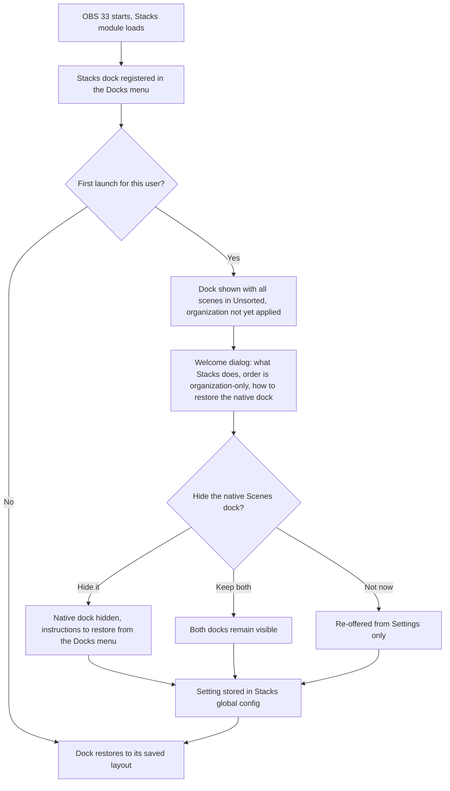
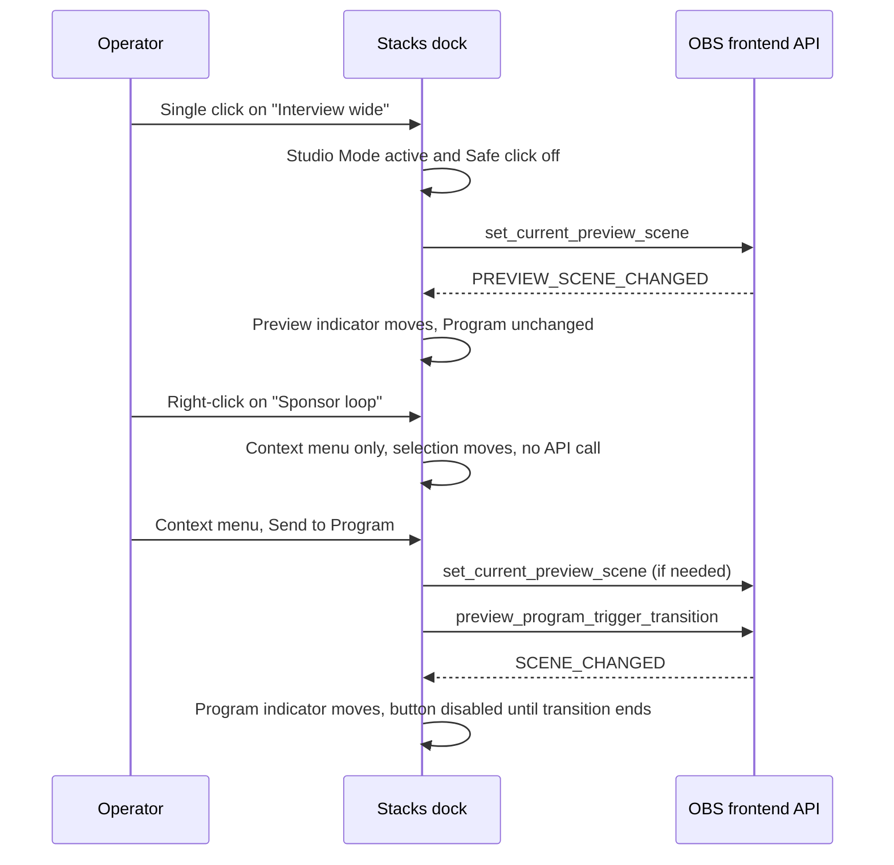
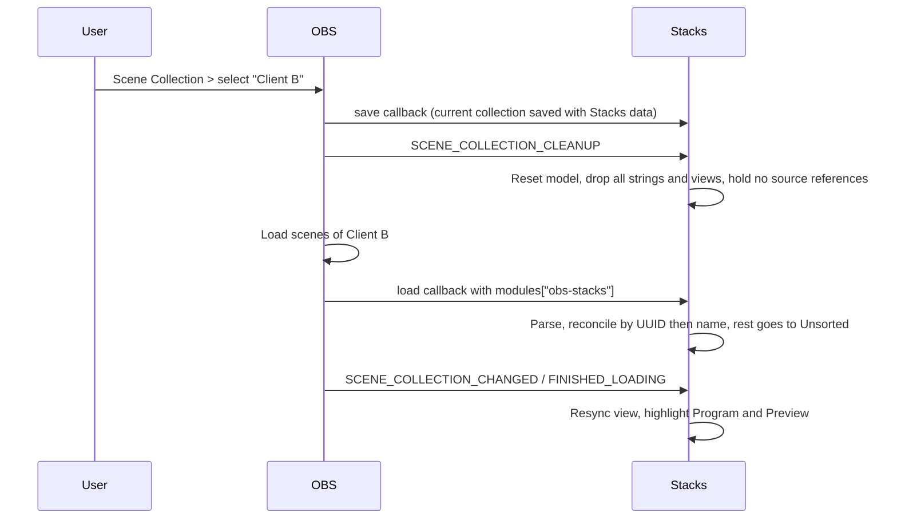
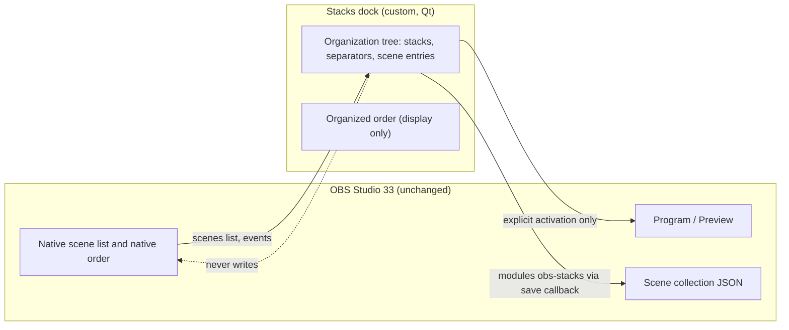
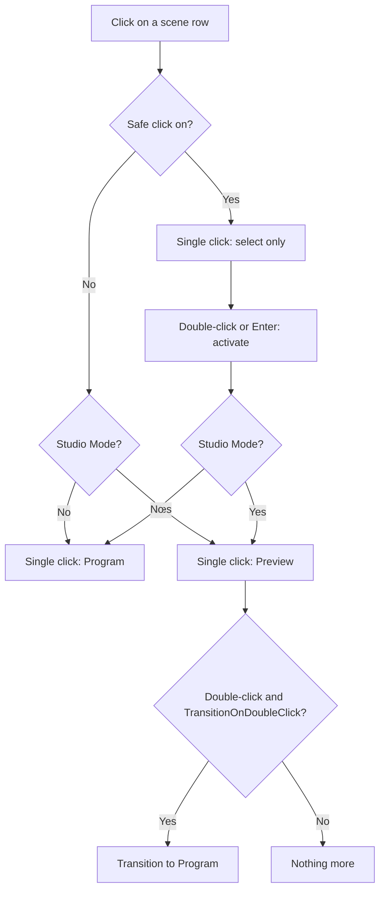
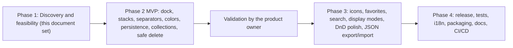

# Stacks for OBS — Product Requirements Document

> Status: Draft — pending product-owner validation (Phase 1)
> Target: OBS Studio 33.0.1+
> Last updated: 2026-11-04

**Tagline:** A better way to organize your OBS scenes.

Related documents: [01-technical-feasibility.md](01-technical-feasibility.md) · [03-ux-ui-specification.md](03-ux-ui-specification.md) · [04-software-architecture.md](04-software-architecture.md) · [05-implementation-plan.md](05-implementation-plan.md) · [06-testing-strategy.md](06-testing-strategy.md)

---

## Table of contents

1. [Executive summary](#1-executive-summary)
2. [Terminology and conventions](#2-terminology-and-conventions)
3. [Problem statement](#3-problem-statement)
4. [Goals](#4-goals)
5. [Non-goals](#5-non-goals)
6. [Personas](#6-personas)
7. [User stories](#7-user-stories)
8. [Key user journeys](#8-key-user-journeys)
9. [Functional requirements](#9-functional-requirements)
10. [Non-functional requirements](#10-non-functional-requirements)
11. [Safety contract](#11-safety-contract)
12. [Risks](#12-risks)
13. [Success metrics](#13-success-metrics)
14. [Scope by phase](#14-scope-by-phase)
15. [Competitive landscape summary](#15-competitive-landscape-summary)
16. [Validated decisions traceability and open points](#16-validated-decisions-traceability-and-open-points)
17. [Evidence index](#17-evidence-index)

---

## 1. Executive summary

**Stacks for OBS** ("Stacks") is a native OBS Studio plugin (C++/Qt 6, GPL-2.0-or-later, published by The OnAir Company) that gives users a better way to organize a large scene list. It adds a custom dock that presents the scenes of the active scene collection as an organized tree:

- **Stacks** — collapsible, nameable, colorable visual folders of scenes (one level deep in v1).
- **Real separators** — line, labeled or spacer dividers that are *not* scenes, replacing the fake "-----DECO-----" scenes users create today.
- **Colors, icons and favorites** — to recognize scenes at a glance, including under pressure during a live show.
- **Search** — accent- and case-insensitive, working inside collapsed stacks.
- **Compact and Organized display modes** — Compact stays close to the native list; Organized adopts the spirit of the product owner's mockup, adapted to the active OBS theme.

The product is built on **Option A** from the feasibility study: a custom dock registered with `obs_frontend_add_dock_by_id`. OBS 33 offers no public API to extend or reorder the native Scenes list ([01-technical-feasibility.md](01-technical-feasibility.md)), so Stacks **replaces the native Scenes dock for daily use** (hiding it is an opt-in offered at first launch) while keeping OBS's own scene list untouched.

Three principles shape every requirement:

1. **Non-destructive by contract.** Stacks never creates fake scenes, never reorders OBS's native scene list, never switches Program unless the user explicitly asks, never deletes a scene as a side effect, and keeps its data inert and harmless if the plugin is disabled or uninstalled (see [section 11](#11-safety-contract)).
2. **Live-safe.** A misclick on a live show is the worst failure mode. Click behavior is explicit, a **Safe click** option exists, and right-click, drag, keyboard focus, search and programmatic selection never switch scenes.
3. **Organization-only order.** The order shown by Stacks (the *organized order*) is independent of OBS's *native order*. Multiview, obs-websocket, Stream Deck and Companion keep the native order; the UI and docs say so plainly.

Delivery follows the master roadmap: Phase 1 (this document and its siblings) → **Phase 2 MVP** (dock, scene display and selection, stacks, real separators, colors, reordering, persistence, OBS sync, collections) → Phase 3 (icons, favorites, search, display modes, drag-and-drop polish, JSON export/import) → Phase 4 (multi-platform release). Scope per phase is tabulated in [section 14](#14-scope-by-phase).

**Design values** (colors, sizes, spacing, radii, type scale) mentioned anywhere in this document are **proposals pending a design review page**; none is final.

---

## 2. Terminology and conventions

| Term | Meaning |
|---|---|
| **Stack** | A visual, collapsible folder of scenes. Never called "group" in UI or docs: OBS already uses "Groups" for grouped sources in the Sources dock. UI strings: "New Stack", "Rename Stack", "Dissolve Stack" (keeps scenes), "Collapse" / "Expand". |
| **Separator** | A non-scene divider. Variants: `line` (simple rule), `labeled` (rule with title), `spacer` (vertical space). Not an OBS source. |
| **Scene entry** | A reference from the Stacks tree to a real OBS scene, by UUID with name fallback. |
| **Unsorted** | A visible section at the bottom of the list that receives scenes created outside Stacks (native dock, obs-websocket, Stream Deck, collection import) or whose organization data was lost. Nothing is ever filed silently. |
| **Organized order** | The order shown by Stacks. |
| **Native order** | OBS's own scene list order, used by Multiview, obs-websocket, Stream Deck, Companion and similar tools. |
| **Compact / Organized** | The two display modes. Color display modes: Color Strip (default), Tinted Background, Color Dot, Combined. |
| **Program / Preview** | The on-air scene / the staged scene in Studio Mode. |
| **Tombstone** | A retained tree entry whose scene no longer exists (kept so an OBS undo of a deletion restores the organization). |

**Requirement keywords.** Priorities use MoSCoW: **Must**, **Should**, **Could**, **Won't (this release)**. Phases refer to the master roadmap (2 = MVP, 3 = Advanced UX, 4 = Release). IDs: `US-xx` user stories, `FR-xx` functional requirements, `NFR-xx` non-functional requirements, `SC-xx` safety-contract clauses, `R-xx` risks.

**Evidence labels** (used when citing OBS behavior): *Verified in source* (OBS 33.0.1 code read), *Documented*, *Third-party*, *Hypothesis* (to be verified, with the verification method stated).

---

## 3. Problem statement

### 3.1 Current OBS limitations

OBS Studio's Scenes dock is a flat, single-column list. Productions that grow past a dozen scenes outgrow it. The table lists the limitations that matter for this product, with their source evidence.

| # | Limitation | Consequence for users | Evidence |
|---|---|---|---|
| L1 | The scene list is flat: no folders, groups, separators, colors or icons. | Dozens or hundreds of scenes become a wall of text; finding the right one live is slow and error-prone. | OBS 33.0.1 exposes no such concept; an official RFP for scene organization tools remains open ([OBS discussion #5076](https://github.com/obsproject/obs-studio/discussions/5076), *Third-party*). |
| L2 | There is no public API to extend, decorate or reorder the native Scenes list (frontend API, libobs and obs-websocket all lack one). | Plugins cannot enrich the native list; any third-party organizer must be a separate UI. | *Verified in source*: [obs-frontend-api.h L116-L175](https://github.com/obsproject/obs-studio/blob/33.0.1/frontend/api/obs-frontend-api.h#L116-L175). |
| L3 | The native order is held in the dock's widget and saved by scene **name** in `scene_order`. A native reorder emits no frontend event. | External tools cannot observe native reordering; an organizer cannot stay in sync with it. | *Verified in source*: [OBSBasic_Scenes.cpp L720-L741](https://github.com/obsproject/obs-studio/blob/33.0.1/frontend/widgets/OBSBasic_Scenes.cpp#L720-L741); `SaveSceneListOrder` writes whatever is in the list as a scene name ([L60-L70](https://github.com/obsproject/obs-studio/blob/33.0.1/frontend/widgets/OBSBasic_Scenes.cpp#L60-L70)). |
| L4 | Multiview shows the first N scenes in native order; obs-websocket lists scenes in native order; Stream Deck, Companion and Advanced Scene Switcher follow it. | Order is semantically meaningful outside the dock; any organizer that silently reorders scenes would change what external surfaces show. | *Verified in source*: [Multiview.cpp L161-L175](https://github.com/obsproject/obs-studio/blob/33.0.1/frontend/components/Multiview.cpp#L161-L175); obs-websocket `src/utils/Obs_ArrayHelper.cpp:87-109` (obs-websocket repository; tag not verified); Stream Deck and Companion: *Third-party*. |
| L5 | Selecting a scene in the native list switches Program (outside Studio Mode). Deleting the selected scene is therefore awkward, and in Studio Mode `obs_frontend_set_current_scene` triggers a transition. | Accidental clicks put the wrong scene on air. | *Verified in source*: [OBSBasic_Transitions.cpp L295-L345](https://github.com/obsproject/obs-studio/blob/33.0.1/frontend/widgets/OBSBasic_Transitions.cpp#L295-L345). |
| L6 | Scene Collection > Duplicate regenerates all source UUIDs; collections older than OBS 29.1 may lack UUIDs until re-saved. | Any naive scene-keyed metadata store loses its associations on duplicate. | *Verified in source*: [OBSBasic_SceneCollections.cpp L180-L194](https://github.com/obsproject/obs-studio/blob/33.0.1/frontend/widgets/OBSBasic_SceneCollections.cpp#L180-L194). |
| L7 | The native Scenes dock cannot be extended or removed by a plugin, only shown or hidden by the user. | A replacement UI means two scene lists coexist unless the user hides the native one. | *Verified in source*: dock is `scenesDock` in [OBSBasic.ui L973](https://github.com/obsproject/obs-studio/blob/33.0.1/frontend/forms/OBSBasic.ui#L973). |

> Note on L7: the dock definition is in `frontend/forms/OBSBasic.ui` line 973 of OBS 33.0.1 ([permalink](https://github.com/obsproject/obs-studio/blob/33.0.1/frontend/forms/OBSBasic.ui#L973)). The object name `scenesDock` is not part of any public API (see open point OP-1 in [section 16](#16-validated-decisions-traceability-and-open-points)).

### 3.2 Workarounds in use today, and why they fall short

| Workaround | How it works | Why it falls short |
|---|---|---|
| **Fake separator scenes** (e.g. `-----AUDIO-----`, `-------DECO-------`) | Empty scenes named as dividers, placed in the native list. | They are real scenes: clickable (a live mistake puts an empty scene on air), counted by Multiview, exposed to obs-websocket and Stream Deck, included in transitions and scene-switcher rules, and pollute exports. *Third-party* (visible in user reports of existing folder plugins). |
| **Naming conventions** (`01 - Intro`, `[GAME] Boss fight`) | Prefixes sort and categorize by name. | No collapsing, no color, no icons; renaming a scene to fit a scheme breaks references in external tools that match by name. |
| **Multiple scene collections** | One collection per show or segment. | Collections do not share sources or scenes; switching collections is heavy and unsafe during a show; shared scenes get duplicated. |
| **Nested scenes as "folders"** | A scene that contains other scenes as sources. | Changes what is rendered, not how the list is organized; adds composition overhead; not a navigation aid. |
| **Existing folder plugins** (see [section 15](#15-competitive-landscape-summary)) | A second dock with a tree. | Several store data in side files keyed by names (lost on duplicate or rename), depend on private OBS widgets (broken by OBS updates), or delete scenes when a folder is deleted. None advertises real separators. *Third-party*, detailed in [01-technical-feasibility.md](01-technical-feasibility.md). |
| **External controllers** (Stream Deck pages, Companion) | Rebuild navigation on a hardware surface. | Do not help the on-screen operator; still follow the flat native order. |

### 3.3 Opportunity

A plugin that (1) delivers folders, real separators, colors, icons, favorites and search; (2) treats the user's collection as untouchable data with a testable safety contract; and (3) gets Studio Mode click semantics right, addresses a recurring and under-served need. The differentiators — real separators, the safety contract and live-safe selection — are product choices, not technical facts (*Hypothesis* of positioning; validated in the field after beta).

---

## 4. Goals

| ID | Goal | How we will know (see [section 13](#13-success-metrics)) |
|---|---|---|
| G1 | Let users organize any scene collection into stacks, real separators, colors, icons and favorites without changing a single OBS scene. | Scene count and native order are byte-identical before and after organizing (SC-01..SC-03). |
| G2 | Make finding and activating the right scene fast and safe live. | Search and navigation targets met; zero accidental Program switches in test matrix. |
| G3 | Keep the user's data safe in every situation: collection duplicate, rename, export, import, crash, plugin disabled or uninstalled, newer plugin version. | Safety-contract tests pass on all three OS; zero data-loss reports. |
| G4 | Be a good citizen of OBS: public API only, no work in the render/encode path, no polling, correct threading, theme-aware. | Performance benchmarks at 10/50/100/250/500 scenes; no use of private OBS widgets. |
| G5 | Stay usable for people with a keyboard or assistive technology and in both English and French. | Accessibility checklist and locale completeness checks pass. |
| G6 | Ship a maintainable, well-tested open-source plugin on macOS (universal), Windows x64 and Linux. | CI green on three platforms; release checklist complete. |
| G7 | Preserve a clean path to future capabilities (multi-canvas, nested stacks, opt-in "apply order") without schema or architecture rewrites. | Schema carries `schema_version`, unknown-field passthrough, and room for `canvas_uuid` and nesting. |

---

## 5. Non-goals

| Non-goal | Rationale | Status |
|---|---|---|
| **Presets** (save/reuse an organization, shown in the product owner's mockup) | Validated decision: out of scope — not MVP, not Phase 3. JSON export/import for backup is a safety feature, not a preset system. | Future ideas / not planned |
| **Native reordering** (changing OBS's own scene list order, automatically or as an action) | No public API; only possible through internal Qt widgets. Organization-only order is validated. A future opt-in "Apply Stacks order to OBS" action is listed as a future idea, behind an isolated adapter, never automatic. | Won't (v1) |
| **Multi-canvas** support | `obs_frontend_get_scenes` covers the main canvas only. v1 targets the main canvas; schema stays ready for a `canvas_uuid` key. | Won't (v1); Future |
| **Nested stacks** | Depth is limited to one level in v1; evaluation later. | Won't (v1); Future |
| **Option C hacks**: internal widgets, `findChild` on the native list, private slots, patching OBS | Unsupported and fragile; open upstream PR [obs-studio #13328](https://github.com/obsproject/obs-studio/pull/13328) replaces the native Scenes dock. (A single, narrowly scoped exception is discussed in OP-1.) | Won't |
| **Replacing or extending the native Scenes dock in place** (Option B) | Does not exist: no extension point. | Not possible |
| Legacy OBS (< 33.0.1) support | New plugin structure, Plugin Manager and manifest. Validated: OBS 33+ only. | Won't |
| Telemetry, accounts, cloud sync, network access | Not needed; contradicts "no external resources". | Won't |
| Scene-content editing (sources, filters, transitions) | Out of the product's concern; only entry points to existing OBS dialogs are offered. | Won't |
| Automatic scene switching, rules, scheduling | Different product category (e.g. Advanced Scene Switcher). | Won't |
| Importers from other folder plugins | Listed as a future idea after v1; not required to ship. | Future |
| Bundling Qt or distributing signed binaries at v1 | No certificates yet; unsigned or ad-hoc signed builds first, CI prepared for notarization and signing later. | Deferred |

---

## 6. Personas

### P1 — Maya, the streamer (solo)

- **Context:** Streams games and just-chatting from one PC. 25–60 scenes across several games, with intro, BRB, ending and chat-only scenes. Operates with mouse and a Stream Deck.
- **Pains:** Scrolling a long flat list mid-stream; fake `-----GAMES-----` scenes that she once put on air; scenes for each game become unreadable.
- **Needs:** Stacks per game, colors by type, favorites for the six scenes she actually uses, search, safe click. Must not break her Stream Deck page.
- **Key requirements:** FR-05, FR-06, FR-19–FR-24, FR-27, FR-30, FR-39; SC-02, SC-03.

### P2 — Karim, the live director / régie

- **Context:** Runs live shows for events and corporate streams in Studio Mode. 80–200 scenes per show, supplied by several people. Often works under time pressure, sometimes with a second operator.
- **Pains:** A wrong click is visible to thousands. Needs to stage in Preview and cut deliberately. Scenes appear from remote tools without warning.
- **Needs:** Deterministic click rules, immediate recognition of Program vs Preview, an Unsorted section that shows scenes added by others, never an accidental transition, and a way to bring order before the show starts.
- **Key requirements:** FR-05–FR-08, FR-14, FR-45–FR-47; SC-04, SC-06.

### P3 — Léa, the video-podcast producer

- **Context:** Records and streams a weekly video podcast: scenes per guest count, layout (wide, two-shot, screen share), sponsor reads, and intro/outro bumpers. 30–50 scenes, reused for every episode; shares the collection between two machines.
- **Pains:** Duplicating or exporting the collection to the second machine loses plugin metadata in other organizers; layouts are only distinguishable by name.
- **Needs:** Organization that travels with the collection (export, import, duplicate, rename), colors and icons that identify layouts, labeled separators for show segments.
- **Key requirements:** FR-27, FR-30–FR-31, FR-33–FR-34, FR-48–FR-49, FR-53–FR-54.

### P4 — Tomás, the broadcast / TV operator

- **Context:** Operates OBS as a lightweight playout and graphics engine in a small broadcast facility. Scene lists mirror rundowns: 150–300 scenes per day, ordered by segment, with strict naming. Works under change-control rules, often in locked-down machines.
- **Pains:** Tools that change data silently are unacceptable; he needs predictable behavior, auditability and recovery. Needs accessible, high-contrast, keyboard-first operation.
- **Needs:** The safety contract in writing, explicit delete with undo, backups, export/import, clear logs, readable at distance, deterministic behavior across restarts.
- **Key requirements:** FR-12, FR-48–FR-52, FR-56–FR-58, FR-60; section 11 in full.

### P5 — Dana, the power user with hundreds of scenes

- **Context:** Maintains a template collection with 300–500+ scenes (game libraries, client branding variants, sponsor sets). Uses obs-websocket scripts and automation that depend on native order and names.
- **Pains:** Even scrolling is expensive; keeping the list tidy is manual; plugins that rename or reorder scenes break her scripts.
- **Needs:** Performance at scale, powerful search, bulk-friendly interactions, guaranteed non-interference with native order and names, unobtrusive external-scene handling.
- **Key requirements:** FR-14, FR-36–FR-38, NFR-01–NFR-10, FR-55; SC-03.

---

## 7. User stories

Format: *As a [persona], I want … so that …*. Priority is MoSCoW; Phase uses the master roadmap. "FR" links each story to its functional requirement(s) in [section 9](#9-functional-requirements).

### Module A — Scene Explorer

| ID | Story | Priority | Phase | FR |
|---|---|---|---|---|
| US-01 | As a streamer, I want one dock listing all my scenes (with a header, a list and an action bar) so that I can browse and manage them in one place. | Must | 2 | FR-01–FR-04 |
| US-02 | As a streamer, I want clicking a scene to behave like OBS's own list (Program outside Studio Mode) so that I do not have to relearn anything. | Must | 2 | FR-05 |
| US-03 | As a live director, I want a **Safe click** setting where a single click only selects and double-click or Enter activates so that I cannot cut to a scene by accident. | Must | 2 | FR-06 |
| US-04 | As a live director, I want right-click, drag, keyboard focus moves, search and programmatic selection to never switch scenes so that managing the list is safe on air. | Must | 2 | FR-07 |
| US-05 | As a live director, I want to see at a glance which scene is Program and which is Preview, with cues that do not rely on color alone so that I never confuse them. | Must | 2 | FR-08, FR-32 |
| US-06 | As a streamer, I want to add a scene with "+" and have it land in the selected stack after the selected scene so that new scenes appear where I am working. | Must | 2 | FR-09 |
| US-07 | As a streamer, I want to rename a scene from Stacks (F2 or menu) with duplicate and empty-name validation so that I never end up with ambiguous names. | Must | 2 | FR-10 |
| US-08 | As a producer, I want to duplicate a scene and get the copy right after the original in the same stack so that variants stay together. | Must | 2 | FR-11 |
| US-09 | As a broadcast operator, I want to delete a scene with an explicit confirmation, undo support, and refusal to delete the on-air or last scene so that deletion can never take my show off the air. | Must | 2 | FR-12, FR-56 |
| US-10 | As a streamer, I want a context menu on scenes (rename, duplicate, delete, move to stack, color, favorite) so that actions are one right-click away. | Must | 2 | FR-13 |
| US-11 | As a streamer, I want filters, projector and screenshot entries in the scene context menu so that I do not need the native dock for common actions. | Should | 3 | FR-13 |
| US-12 | As a live director, I want scenes created elsewhere to show up in a visible **Unsorted** section so that I notice them and decide where they go. | Must | 2 | FR-14 |
| US-13 | As a power user, I want a clear explanation that Stacks order does not change OBS's native order so that I understand what Multiview, obs-websocket and Stream Deck will show. | Must | 2 | FR-16, FR-62 |
| US-14 | As a streamer, I want the first-launch dialog to offer (not force) hiding the native Scenes dock so that I can use Stacks as my only scene panel and get the native one back at any time. | Must | 2 | FR-17 |
| US-15 | As a keyboard user, I want F2, Delete, Ctrl/Cmd+F, arrows, Left/Right and Enter to work inside the dock without conflicting with OBS hotkeys so that I can operate without a mouse. | Must | 2 | FR-18 |
| US-16 | As a power user, I want entries whose scene no longer exists to be shown as missing instead of vanishing so that I understand what happened. | Should | 2 | FR-15 |

### Module B — Stacks

| ID | Story | Priority | Phase | FR |
|---|---|---|---|---|
| US-17 | As a streamer, I want to create a Stack and name it so that I can group related scenes. | Must | 2 | FR-19 |
| US-18 | As a streamer, I want to rename a Stack by double-clicking its header so that renaming is fast. | Must | 2 | FR-20 |
| US-19 | As a streamer, I want to collapse and expand Stacks with a chevron, a click or arrow keys, and have the state remembered so that long lists stay manageable. | Must | 2 | FR-21 |
| US-20 | As a streamer, I want to move scenes into, out of and between Stacks (drag and "Move to Stack") so that I can reorganize quickly. | Must | 2 | FR-22 |
| US-21 | As a streamer, I want Move up / Move down and drag to reorder scenes, stacks and separators so that I control the organized order. | Must | 2 | FR-23 |
| US-22 | As a broadcast operator, I want "Dissolve Stack" to remove only the folder and keep every scene so that tidying can never destroy work. | Must | 2 | FR-24 |
| US-23 | As a power user, I want polished drag-and-drop (clear drop targets, auto-expand on hover, auto-scroll, cancel with Escape) so that moving many scenes is comfortable. | Should | 3 | FR-22, FR-23 |
| US-24 | As a streamer, I want empty stacks to remain valid and show their scene count so that I can prepare structure first. | Should | 2 | FR-25, FR-26 |

### Module C — Separators

| ID | Story | Priority | Phase | FR |
|---|---|---|---|---|
| US-25 | As a streamer, I want a simple line separator so that I can visually split the list. | Must | 2 | FR-27 |
| US-26 | As a producer, I want a labeled separator ("Sponsors", "Interludes") so that segments are named. | Must | 2 | FR-27 |
| US-27 | As a streamer, I want a spacer so that I can add breathing room without a visible line. | Should | 2 | FR-27 |
| US-28 | As a live director, I want separators to be impossible to broadcast and invisible to OBS, Multiview, obs-websocket and Stream Deck so that they can never cause an on-air accident. | Must | 2 | FR-29 |
| US-29 | As a streamer, I want to edit, convert, move and delete separators from a context menu so that I can adjust the layout. | Must | 2 | FR-28 |

### Module D — Colors

| ID | Story | Priority | Phase | FR |
|---|---|---|---|---|
| US-30 | As a streamer, I want to assign a color from a palette to a scene so that I can recognize scene types instantly. | Must | 2 | FR-30 |
| US-31 | As a streamer, I want to color a Stack header so that categories stand out. | Must | 2 | FR-30 |
| US-32 | As a power user, I want custom colors, recent colors and "reset" so that I can match my own scheme. | Should | 3 | FR-30 |
| US-33 | As a streamer, I want to choose how color is shown (strip, tinted background, dot, combined) so that the list suits my taste. | Should | 3 | FR-31 |
| US-34 | As a low-vision user, I want selected, Program and Preview states to remain identifiable on any color, with non-color cues so that color never hides state. | Must | 2 | FR-32 |

### Module E — Icons

| ID | Story | Priority | Phase | FR |
|---|---|---|---|---|
| US-35 | As a streamer, I want a built-in set of monochrome icons (screen, camera, microphone, broadcast, game, and more) so that scene types are recognizable. | Should | 3 | FR-33 |
| US-36 | As a streamer, I want to assign, recolor, resize and remove icons on scenes and stacks so that icons stay consistent. | Should | 3 | FR-34 |
| US-37 | As a power user, I want to import my own SVG or PNG icon safely so that I can use brand icons. | Could | 3 | FR-35 |

### Module F — Search

| ID | Story | Priority | Phase | FR |
|---|---|---|---|---|
| US-38 | As a power user, I want a case-insensitive, accent-insensitive search so that "cafe" finds "Café". | Must | 3 | FR-36 |
| US-39 | As a power user, I want search to look inside collapsed stacks and highlight matches without changing the saved collapsed state so that searching has no side effects. | Must | 3 | FR-37 |
| US-40 | As a keyboard user, I want arrow-key navigation among results and a quick-clear control so that I can search without the mouse; typing and navigating must not switch scenes. | Must | 3 | FR-38, FR-07 |
| US-41 | As a power user with hundreds of scenes, I want search to stay smooth so that typing never lags. | Must | 3 | NFR-03 |

### Module G — Favorites

| ID | Story | Priority | Phase | FR |
|---|---|---|---|---|
| US-42 | As a streamer, I want to mark scenes as favorites with a discreet star so that my go-to scenes are one click away. | Should | 3 | FR-39 |
| US-43 | As a live director, I want a favorites filter that shows my favorites without duplicating scenes so that I have quick access without a second copy. | Should | 3 | FR-40 |
| US-44 | As a streamer, I want the star to be discreet and removable from view so that the list stays calm. | Could | 3 | FR-39, FR-42 |

### Module H — Display and density

| ID | Story | Priority | Phase | FR |
|---|---|---|---|---|
| US-45 | As a power user, I want a Compact mode close to the native list and an Organized mode with richer visuals so that I choose density versus clarity. | Should | 3 | FR-41 |
| US-46 | As a streamer, I want toggles for icons, colors, separators, favorites and chevrons so that I show only what helps. | Should | 3 | FR-42 |
| US-47 | As a user on a small display, I want row size and density settings so that more scenes fit. | Should | 3 | FR-42 |
| US-48 | As a user sensitive to motion, I want animations to be discreet and switchable off so that the UI never distracts. | Should | 3 | FR-43 |
| US-49 | As any user, I want the dock to match my active OBS theme (light, dark, variants) and update when I switch theme so that it looks native. | Must | 2 | FR-44 |

### Studio Mode

| ID | Story | Priority | Phase | FR |
|---|---|---|---|---|
| US-50 | As a live director, I want a single click to set Preview in Studio Mode (never Program) so that I stage safely. | Must | 2 | FR-45 |
| US-51 | As a live director, I want an explicit "Send to Program" action so that cutting is deliberate. | Must | 2 | FR-46 |
| US-52 | As a live director, I want "Send to Program" disabled while a transition is running so that I cannot corrupt the on-air state. | Must | 2 | FR-47 |
| US-53 | As a live director, I want double-click to transition only if OBS's own "transition on double-click" preference is on so that Stacks matches my existing setup. | Must | 2 | FR-45 |
| US-54 | As a live director, I want Program and Preview both highlighted correctly, also when OBS uses a private copy for Program ("scene duplication") so that indicators are trustworthy. | Must | 2 | FR-08 |

### Safety, undo and logging

| ID | Story | Priority | Phase | FR |
|---|---|---|---|---|
| US-55 | As a broadcast operator, I want Stacks to never create fake scenes or modify scenes silently so that my collection stays exactly as I made it. | Must | 2 | FR-29, SC-01 |
| US-56 | As a streamer, I want undo/redo for scene rename, duplicate and delete through OBS's own undo stack so that mistakes are reversible. | Must | 2 | FR-56 |
| US-57 | As a streamer, I want undo for organization changes (move, stack create/dissolve, color) so that tidying is reversible. | Should | 3 | FR-56 |
| US-58 | As a broadcast operator, I want clear, prefixed log lines and graceful recovery after errors so that I can diagnose problems. | Must | 2 | FR-58 |
| US-59 | As a security-conscious user, I want imported icons and JSON never to execute or load external resources so that importing is safe. | Must | 3 | FR-35, FR-53 |

### Persistence and collections

| ID | Story | Priority | Phase | FR |
|---|---|---|---|---|
| US-60 | As a streamer, I want my organization to persist across restarts so that I set it up once. | Must | 2 | FR-48 |
| US-61 | As a producer, I want my organization to follow the collection through Rename, Duplicate, Export and Import so that nothing is lost when I move my setup. | Must | 2 | FR-48, FR-49, FR-54 |
| US-62 | As a user switching between plugin versions, I want newer or unknown data to be preserved or the plugin to go read-only so that I never lose data by downgrading. | Must | 2 | FR-50 |
| US-63 | As a broadcast operator, I want automatic rolling backups and a documented recovery path so that I can recover from a bad save. | Must | 2 | FR-52 |
| US-64 | As a producer, I want to export and import my organization as a JSON file so that I can back it up and move it. | Should | 3 | FR-53 |
| US-65 | As a power user, I want entries for deleted scenes to be retained (so OBS undo works) and a manual "Clean up missing scenes" action so that I control cleanup. | Must | 2 | FR-51 |
| US-66 | As a live director, I want switching scene collections to be fast and safe, with the Stacks view following the new collection so that I never see stale data. | Must | 2 | FR-54 |
| US-67 | As a live director, I want scenes added externally (obs-websocket, Stream Deck, native dock, import) to appear in Unsorted and renamed scenes to keep their place so that external tools and Stacks coexist. | Must | 2 | FR-14, FR-49, FR-55 |
| US-68 | As a user, I want to disable or uninstall Stacks without losing scenes or organization data, and without being left without a Scenes panel so that trying Stacks is risk-free. | Must | 2 | FR-57, FR-17 |

### Install, localization and accessibility

| ID | Story | Priority | Phase | FR |
|---|---|---|---|---|
| US-69 | As a French-speaking user, I want the UI in French (and English) following OBS's language so that I can use it in my language. | Must | 4 (strings from 2) | FR-59 |
| US-70 | As a screen-reader or keyboard user, I want accessible names, visible focus and sufficient contrast so that the dock is operable. | Must | 2 baseline; 4 audit | FR-60 |
| US-71 | As a user on macOS, Windows or Linux, I want to install via the OBS 33 plugin layout and see Stacks in the Plugin Manager so that installation is standard. | Must | 4 | FR-61 |
| US-72 | As a user, I want a settings panel that explains the organization-only order and holds Safe click, native-dock and display options so that everything is discoverable. | Must | 2 | FR-62 |

---

## 8. Key user journeys

### 8.1 First launch and hiding the native dock (opt-in)

**Persona:** Maya (P1). **Goal:** start using Stacks without losing her native Scenes panel by surprise.

**Requirements exercised:** FR-01, FR-14, FR-16, FR-17, FR-62.

Key points:
- Nothing is hidden without the user choosing "Hide it" (decision 1). The choice is reversible from Stacks settings and from OBS's Docks menu.
- If hiding is chosen, the guard described in FR-17 ensures that, when Stacks is unloaded, the native Scenes dock is not left hidden.
- On the first launch the existing scenes are all shown in **Unsorted**: Stacks never guesses a structure.

### 8.2 Organizing an existing collection (replacing fake separator scenes)

**Persona:** Léa (P3). **Goal:** turn a flat list including `-----GUESTS-----` style scenes into stacks and real separators, safely.

1. Léa opens her collection. All scenes, including fake separator scenes, appear in **Unsorted**.
2. She creates a Stack ("Guests") with **New Stack**, drags three scenes in, and colors the stack.
3. She adds a labeled separator "Sponsors" from the **Add** menu (an organization element only; the scene count in OBS does not change).
4. She selects the fake `-----SPONSORS-----` scene and chooses Delete. Stacks asks for confirmation, refuses if it is Program, and registers an OBS undo action. The scene disappears from OBS's native list too (this is a real scene deletion, explicit and undoable).
5. A tip in the Delete dialog notes that organization elements (separators) can replace such scenes.
6. She closes OBS. Reopening shows the same organization.

**Requirements exercised:** FR-12, FR-14, FR-19, FR-22, FR-27, FR-29, FR-30, FR-48, FR-56.

> Stacks does **not** auto-detect or auto-convert fake separator scenes in v1. A conversion helper ("Convert to separator…", with preview and explicit confirmation) is a future idea; it would never run automatically (see [section 14](#14-scope-by-phase)).

### 8.3 Going live in Studio Mode

**Persona:** Karim (P2). **Goal:** stage and cut scenes without accidents.

Key points:
- In Studio Mode, single click sets **Preview**; **Program** changes only through "Send to Program" or double-click when OBS's `TransitionOnDoubleClick` preference is enabled (Stacks reads it through `obs_frontend_get_user_config`; *Verified in source*: [obs-frontend-api.h L213](https://github.com/obsproject/obs-studio/blob/33.0.1/frontend/api/obs-frontend-api.h#L213), preference key read at [OBSBasic_Scenes.cpp L770-L781](https://github.com/obsproject/obs-studio/blob/33.0.1/frontend/widgets/OBSBasic_Scenes.cpp#L770-L781)).
- With **Safe click** on, single click only selects; double-click or Enter activates (Preview in Studio Mode, Program otherwise); "Send to Program" remains explicit.
- While a transition runs, "Send to Program" is disabled (FR-47).

**Requirements exercised:** FR-05–FR-08, FR-45–FR-47.

### 8.4 Switching scene collections

**Persona:** Dana (P5). **Goal:** switch between collections without stale data or lost organization.

Key points:
- Only CLEANUP is guaranteed (Duplicate, Rename, Import and startup do not emit CHANGING; *Verified in source*: [OBSBasic_SceneCollections.cpp L159-L237](https://github.com/obsproject/obs-studio/blob/33.0.1/frontend/widgets/OBSBasic_SceneCollections.cpp#L159-L237)), so Stacks resets on CLEANUP and rebuilds on the load callback and CHANGED/FINISHED_LOADING.
- Stacks holds no `obs_source_t` reference past CLEANUP (a leaked reference makes the switch fail and OBS exit).
- Collection Duplicate regenerates UUIDs: reconciliation falls back to names and re-stamps keys.

**Requirements exercised:** FR-48, FR-49, FR-54, FR-55.

### 8.5 Uninstalling or disabling Stacks

**Persona:** any. **Goal:** leave no damage.

1. The user disables Stacks in the Plugin Manager (or removes the files) and restarts OBS.
2. OBS loads without Stacks; every scene is intact in the native list in native order.
3. The collection JSON still contains `modules["obs-stacks"]`, which OBS preserves for plugins that are absent or disabled (*Verified in source*: [OBSBasic_SceneCollections.cpp L1216-L1219](https://github.com/obsproject/obs-studio/blob/33.0.1/frontend/widgets/OBSBasic_SceneCollections.cpp#L1216-L1219) and [PluginManager.cpp L70-L72](https://github.com/obsproject/obs-studio/blob/33.0.1/frontend/plugin-manager/PluginManager.cpp#L70-L72)).
4. If the user had chosen to hide the native Scenes dock, it is visible again (FR-17); if that could not be guaranteed, the documentation and the module's unload path give explicit recovery steps (Docks > Scenes, or Docks > Reset Docks; OBS Safe Mode only starts OBS without the plugin and is not a dock-recovery path).
5. Re-enabling Stacks later restores the organization, with scenes added in the meantime in **Unsorted**.

**Requirements exercised:** FR-17, FR-48, FR-49, FR-57.

---

## 9. Functional requirements

Each requirement carries a priority and phase. Acceptance criteria are testable *Given / When / Then* statements; test design is in [06-testing-strategy.md](06-testing-strategy.md). Architecture realizing these requirements is in [04-software-architecture.md](04-software-architecture.md); visual details (all proposals) in [03-ux-ui-specification.md](03-ux-ui-specification.md).

### Module A — Scene Explorer

**FR-01 — Dock registration and lifecycle** (Must · Phase 2)
Stacks registers its dock with `obs_frontend_add_dock_by_id` using the permanent id `obs-stacks-dock` in `obs_module_load`, so it appears in OBS's Docks menu and its geometry is saved and restored by OBS. The id never changes after release.
- Given OBS starts with Stacks installed, When the Docks menu is opened, Then an entry for Stacks is listed and toggles the dock.
- Given the dock was docked and sized in the previous session, When OBS restarts, Then the dock reappears with the same placement.
- Given Stacks tries to register a dock id already used, When registration fails, Then a warning is logged with the plugin prefix and OBS continues to run.

**FR-02 — Scene list synchronization** (Must · Phase 2)
The list shows every scene of the main canvas exactly once, either in a stack, at root or in Unsorted. Names are live.
- Given a collection with N scenes, When the dock loads, Then exactly N scene entries are visible across the tree (expanded) and none is duplicated.
- Given a scene is renamed from any source (Stacks, native dock, obs-websocket), When the rename completes, Then the row shows the new name within one UI event cycle and keeps its place.
- Given a scene is removed externally, When the removal occurs, Then its row disappears (its tree entry becomes a tombstone, see FR-51).

**FR-03 — Header** (Must · Phase 2; search Phase 3)
The dock header shows the title, a search field (functional from Phase 3) and a settings button.
- Given the dock is visible, When viewed, Then title, search field and a settings button are present and keyboard-reachable.
- Given the settings button is activated, When the panel opens, Then it shows the options defined in FR-62.

**FR-04 — Action bar** (Must · Phase 2)
A bottom bar offers: Add ▾ (Scene, Stack, Separator ▸ line / labeled / spacer), Delete, Duplicate, New Stack, Move up, Move down. Buttons use OBS's toolbar styling where possible.
- Given a scene is selected, When Duplicate is activated, Then FR-11 applies.
- Given nothing is selected, When the bar is shown, Then Delete, Duplicate, Move up and Move down are disabled.
- Given a button has only an icon, When it is focused or hovered, Then a tooltip and an accessible name describe it.

**FR-05 — Default click behavior (OBS parity)** (Must · Phase 2)
With Safe click off:
outside Studio Mode, single click on a scene entry makes it Program; in Studio Mode, single click sets Preview; double-click transitions to Program only if OBS's `TransitionOnDoubleClick` preference is on and Studio Mode is active.
- Given Studio Mode is off and Safe click is off, When the user single-clicks scene X, Then X becomes Program (via `obs_frontend_set_current_scene`).
- Given Studio Mode is on and Safe click is off, When the user single-clicks scene X, Then X becomes Preview (via `obs_frontend_set_current_preview_scene`) and Program is unchanged.
- Given Studio Mode is on and `TransitionOnDoubleClick` is on, When the user double-clicks X, Then X is previewed and a transition to Program is triggered.
- Given Studio Mode is on and `TransitionOnDoubleClick` is off, When the user double-clicks X, Then Program is unchanged.

**FR-06 — Safe click** (Must · Phase 2)
A setting "Safe click" (off by default, parity with OBS) makes single click only select (move the Stacks highlight); activation requires double-click or Enter. "Activation" means Program outside Studio Mode and Preview inside it; sending to Program in Studio Mode stays explicit (FR-46) except where double-click-to-transition is enabled by the OBS preference.
- Given Safe click is on and Studio Mode is off, When the user single-clicks X, Then Program is unchanged and X is highlighted as selected.
- Given Safe click is on, When the user double-clicks X or presses Enter on it, Then X is activated per the table above.
- Given Safe click is toggled, When the dock is reopened or OBS restarts, Then the setting persists in Stacks global configuration.

**FR-07 — Non-activating interactions** (Must · Phase 2)
These actions never call a scene-switching API: right-click (opening a context menu), starting or completing a drag, moving keyboard focus or the highlight with arrow keys, typing or navigating in search, programmatic selection (restoring selection after a refresh, after a rename or a model rebuild).
- Given any click behavior setting, When the user right-clicks scene X, Then Program and Preview are unchanged.
- Given a drag of scene X is started and dropped anywhere, When it completes, Then Program and Preview are unchanged.
- Given focus moves through the list with the arrow keys, When the highlight changes, Then Program and Preview are unchanged.
- Given the tree is rebuilt after a collection event, When selection is restored, Then no activation API call is made (verified by a call-recording test double).

**FR-08 — Program and Preview indicators** (Must · Phase 2)
Program and Preview scenes are visibly marked and updated on `SCENE_CHANGED` and `PREVIEW_SCENE_CHANGED`; indicators combine color and a non-color cue (e.g. a label or glyph); they remain correct when a transition finishes and with OBS's scene-duplication mode, where Program may be a private copy (*Hypothesis*: highlight logic based on `obs_frontend_get_current_scene` may need a name/UUID comparison against the original; verified by test in Studio Mode with scene duplication enabled).
- Given scene X is Program, When any change of Program occurs from any origin (Stacks, native dock, obs-websocket, hotkey), Then the indicator moves to the new Program scene.
- Given Studio Mode is off, When viewed, Then no Preview indicator is shown.
- Given the scene is on Program and in a collapsed stack, When viewed, Then the stack header shows a discreet indicator that a child is on air (*proposal*, UX spec).

**FR-09 — Add scene** (Must · Phase 2)
"+" > Scene creates a new OBS scene through the public API with a unique default name and places its entry in the currently selected stack right after the selected scene (at the end of the top level if nothing is selected or the selection is in Unsorted, or in the selected scene's container). It does **not** switch Program or Preview. The new scene's name is placed in inline edit (no dialog; this is the single decision, to be mirrored in 03 §4.4, §11.4 and §12.2).
- Given a scene in stack S is selected, When the user adds a scene, Then the new scene is created in OBS, appears right after the selected scene within S, and Program is unchanged.
- Given the entered name already exists or is empty, When the user confirms, Then the name is rejected with an inline message and no scene is created or renamed (OBS silently renames duplicates, so validation happens before the API call).
- Given a scene is created by any other means (native dock, obs-websocket, Stream Deck, import), When it appears, Then it is placed in **Unsorted** (FR-14), not in the selected stack.

**FR-10 — Rename scene** (Must · Phase 2)
F2 or the context menu starts inline renaming (`obs_source_set_name`). Empty and duplicate names are rejected beforehand. An undo/redo action is registered (FR-56). Double-click on a scene is reserved for activation, not rename.
- Given scene X is renamed to an existing name, When confirmed, Then the rename is refused with a visible message and X keeps its name.
- Given a valid rename, When confirmed, Then OBS shows the new name everywhere, Stacks keeps the entry in place, and undo restores the old name.
- Given a rename in progress, When Escape is pressed, Then editing is cancelled with no change.

**FR-11 — Duplicate scene** (Must · Phase 2)
Duplicate creates a copy with `obs_scene_duplicate(scene, name, OBS_SCENE_DUP_REFS)` with a unique "<name> 2"-style name (*proposal*) and places it right after the original in the same stack. This is an explicit user action in Stacks. It does not switch Program or Preview. Undo is registered.
- Given scene X in stack S, When Duplicate is activated, Then a new scene is created and its entry is placed directly after X in S.
- Given Duplicate completes, When viewed, Then Program and Preview are unchanged.
- Given Duplicate then Undo, When undo runs, Then the copy is removed and the original is unchanged.

**FR-12 — Delete scene (reimplemented safely)** (Must · Phase 2)
Delete (button, context menu, Delete key) acts on the right-clicked or selected scene and:
1. asks for explicit confirmation naming the scene (and stating when it is used inside other scenes);
2. **refuses** to delete the scene currently on Program, and refuses to delete the last remaining scene, with an explanatory message;
3. never triggers a Program switch (before, during or after, including on undo);
4. registers an undo/redo action through the public `obs_frontend_add_undo_redo_action`, saving the scene's data so undo restores the scene (same UUID) and its use in other scenes;
5. keeps the entry's tree position as a tombstone so undo restores the organization (FR-51).
OBS's native delete flow does additional work (saving nested scene usage for undo, pruning nested references; [OBSBasic_Scenes.cpp L321-L478](https://github.com/obsproject/obs-studio/blob/33.0.1/frontend/widgets/OBSBasic_Scenes.cpp#L321-L478)) and its undo selects the restored scene (`SetCurrentScene`), which would switch Program: Stacks must reproduce the data safety while avoiding that selection. The exact method is specified in [04-software-architecture.md](04-software-architecture.md).
- Given scene X is Program, When Delete is requested, Then nothing is deleted and a message explains that the on-air scene cannot be deleted.
- Given only one scene exists, When Delete is requested, Then nothing is deleted and a message explains why.
- Given scene X is neither Program nor the last scene, When the user confirms deletion, Then X is removed, Program is unchanged, and an "Undo Delete" entry exists in OBS's Edit menu.
- Given X was deleted and Undo is invoked, When undo completes, Then X exists again with its sources, its previous nested usage, its UUID, and its previous place in the organization, and Program is unchanged.
- Given the user cancels the confirmation, When the dialog closes, Then no change is made.
- Given Studio Mode is on and X is Preview, When deletion is confirmed, Then Program is unchanged (*Hypothesis*: OBS's behavior when removing the Preview scene is to be verified in Studio Mode; if it can change Program, Preview deletion will be refused until a safe sequence is validated; see OP-2).

**FR-13 — Scene context menu** (Must core · Phase 2; extras Phase 3)
Phase 2 entries: Rename, Duplicate, Delete, Move to Stack ▸ (existing stacks, New Stack…, Unsorted/root), Move up, Move down, Color ▸, Favorite (Phase 3), Send to Program (Studio Mode only). Phase 3 entries: Icon ▸, Filters (`obs_frontend_open_source_filters`), Projector ▸ (`obs_frontend_open_projector`), Screenshot (`obs_frontend_take_source_screenshot`). Entries that depend on a state are disabled rather than hidden.
- Given any scene row, When right-clicked, Then the menu opens without changing Program, Preview or the selection of the active scene indicators.
- Given Studio Mode is off, When the menu opens, Then "Send to Program" is absent or disabled.
- Given a menu action is chosen, When it executes, Then it applies to the right-clicked row.

**FR-14 — Unsorted section** (Must · Phase 2)
A visible section at the bottom of the list receives scenes not present in the organization (created outside Stacks, imported, or whose organization data was lost). It cannot be deleted, renamed or collapsed-by-default hidden (it can be collapsed by the user, state persisted). It shows a count badge. Scenes leave Unsorted only through an explicit user move. Scenes created with "+" or Duplicate inside Stacks never go there (FR-09, FR-11).
- Given a scene is created through obs-websocket, When the signal is processed, Then the scene appears in Unsorted, not in any stack, and no popup interrupts the operator.
- Given the collection is loaded with no Stacks data, When the dock shows, Then all scenes are in Unsorted.
- Given Unsorted is empty, When viewed, Then it is not shown or shows an unobtrusive empty state (*proposal*).
- Given a scene in Unsorted is dragged into a stack, When dropped, Then it moves, and Unsorted updates its count.

**FR-15 — Missing and orphan entries** (Should · Phase 2)
Entries whose scene cannot be matched (e.g. plugin was disabled and scenes changed) appear in a "Missing scenes" section, shown when Show missing scenes is on (03 §8.5), only when they matter (see FR-51); they are never silently dropped, and are removed only by "Clean up missing scenes".
- Given an entry whose scene does not exist after reconciliation, When viewed in the Missing scenes section, Then it is flagged missing with its last known name and can be removed manually.

**FR-16 — Native order disclosure** (Must · Phase 2)
Stacks states, in settings help text, the first-run dialog and the documentation, that its order is organization-only and that Multiview, obs-websocket, Stream Deck and Companion use OBS's native order. A "Learn more" link opens the docs.
- Given the first-run dialog, When shown, Then it contains the order statement in the selected UI language.
- Given Settings, When the order section is opened, Then the same text is present.
- Given the user reorders scenes in Stacks, When complete, Then OBS's native scene list order is unchanged (verified by comparing `obs_frontend_get_scenes` order before and after).

**FR-17 — First launch and native dock handling** (Must · Phase 2)
On first launch the user is offered, via an opt-in dialog, to hide the native Scenes dock. Hiding is never automatic, is reversible from Settings and from the Docks menu, and is guarded: when Stacks is unloaded (or the user disables the option), the native dock's visibility is restored before OBS saves its dock state, and documented recovery steps exist. If Stacks cannot reliably control the native dock's visibility, it shows instructions instead of hiding it (see OP-1).
- Given a first launch, When the dialog is dismissed with "Keep both", Then the native dock is untouched.
- Given the user chose "Hide", When OBS restarts, Then the native dock is hidden again after startup (re-applied by Stacks at FINISHED_LOADING, 04 §11.4 L2) and Settings shows the option as on.
- Given the option is on, When the user turns it off, Then the native dock is shown again at once.
- Given the option is on and Stacks is disabled or removed, When OBS next starts, Then a Scenes panel is visible (verified by an uninstall-scenario test on all three OS).

**FR-18 — Keyboard map (dock-scoped)** (Must · Phase 2)
Shortcuts apply only when the dock has focus and do not conflict with OBS global hotkeys: F2 rename, Delete delete, Ctrl/Cmd+F search (Phase 3), Up/Down move highlight, Left/Right collapse/expand (Left on a child moves to its stack), Enter activate, Escape cancel/clear, Home/End first/last.
- Given the dock has focus, When F2 is pressed on a scene row, Then inline rename starts.
- Given another OBS dock has focus, When the same keys are pressed, Then Stacks does not react.
- Given Delete is pressed on a stack header, When processed, Then the user is asked whether to Dissolve the stack (never deleting scenes).

### Module B — Stacks

**FR-19 — Create stack** (Must · Phase 2)
"New Stack" creates a stack with a stable plugin id (UUID), a default name ("New Stack", unique), no color, no icon, expanded, placed after the current selection (at root), and enters inline rename. No OBS scene is created.
- Given the user activates New Stack, When it completes, Then a stack appears in rename mode and `obs_frontend_get_scenes` returns the same list as before.
- Given a stack name is empty, When confirmed, Then the previous or default name is kept.
- Given two stacks have the same name, When confirmed, Then it is allowed (stacks are identified by id, not name) (*proposal*: a unique-name warning is shown, not an error).

**FR-20 — Rename stack** (Must · Phase 2)
Double-click on the header or F2 starts inline rename; Enter confirms, Escape cancels. Double-click on a stack header does not toggle collapse.
- Given a stack header, When double-clicked, Then inline rename starts.
- Given a renamed stack, When OBS restarts, Then the name persists.

**FR-21 — Collapse and expand** (Must · Phase 2)
Chevron click, single click on the stack header (setting-dependent, *proposal*: chevron and header) and Left/Right arrows toggle collapse; state is persisted per stack. Collapsing never changes Program or Preview. "Collapse all / Expand all" available.
- Given a stack is collapsed, When OBS restarts, Then it is collapsed.
- Given Program is inside a collapsed stack, When viewed, Then the stack header indicates it (FR-08).
- Given a search is active (Phase 3), When results are shown inside a collapsed stack, Then the saved collapsed state is unchanged after the search is cleared (FR-37).

**FR-22 — Move scenes between stacks** (Must · Phase 2)
Drag and drop, and the "Move to Stack" menu, move scenes and separators into, out of and between stacks and root. A drag never switches scenes. Dropping onto a collapsed stack header appends to it. Dragging a stack onto another stack is not allowed in v1 (depth 1), with a visible "not allowed" cue.
- Given scene X in stack A, When dragged and dropped into stack B, Then X belongs to B, in the dropped position, and OBS's native order is unchanged.
- Given a drag is cancelled with Escape, When it ends, Then nothing moved.
- Given a stack is dragged onto another stack, When dropped, Then the drop is refused and the tree is unchanged.
- Given multi-selection (Phase 3), When dragged together, Then all move preserving relative order (*Could*).

**FR-23 — Reorder (organized order)** (Must · Phase 2; DnD polish Phase 3)
Move up / Move down and drag reorder scenes, separators and stacks within their container. Order is saved in Stacks' tree only.
- Given scene X first in its stack, When Move up is activated, Then it moves to the previous position valid in the tree (*proposal*: moves out above the stack only through an explicit "Move out of Stack"), or the button is disabled at the boundary.
- Given any reorder, When it completes, Then `scene_order` and the native list order are unchanged.

**FR-24 — Dissolve Stack** (Must · Phase 2)
"Dissolve Stack" removes the stack and puts its children (scenes and separators) at the stack's former position in the parent, in order. It never deletes, renames or modifies any scene. The command is not labeled "Delete".
- Given a stack with three scenes, When dissolved, Then the three scenes appear at the stack's former position, the stack is gone, and OBS's scene count and names are unchanged.
- Given Dissolve then Undo (Phase 3), When undo runs, Then the stack returns with the same id, name and children.
- Given a confirmation setting, When the stack is not empty, Then a lightweight confirmation states that scenes are kept.

**FR-25 — Stack constraints and context menu** (Must · Phase 2)
Depth is limited to one level in v1: stacks contain scenes and separators, never other stacks. The context menu offers Rename Stack, Collapse/Expand, Color ▸, Icon ▸ (Phase 3), New Stack Below, Add Separator ▸, Dissolve Stack, Move up/down.
- Given the data contains a nested stack (e.g. written by a future version), When loaded, Then it is preserved verbatim and flagged as unsupported or flattened only in view, never destroyed (FR-50).

**FR-26 — Empty stacks** (Should · Phase 2)
Empty stacks are allowed, remain after restart and show an empty-state row (e.g. "Drop scenes here", text *proposal*). Stack headers display a child-count badge.
- Given the last scene is moved out of a stack, When complete, Then the stack remains with zero children.

### Module C — Separators

**FR-27 — Create separator** (Must · Phase 2)
Add ▾ > Separator creates `line`, `labeled` (with inline title edit) or `spacer`, positioned after the selection. Separators carry a plugin id and live only in the tree.
- Given the user adds a separator, When it completes, Then `obs_frontend_get_scenes` returns the same scenes as before and no new OBS source exists.
- Given a labeled separator is created, When viewed, Then its title is editable inline; an empty title falls back to a line (*proposal*).

**FR-28 — Edit, move and delete separators** (Must · Phase 2)
Context menu: Edit label, Convert to line / labeled / spacer, Move up/down, Delete (deletes only the separator, no confirmation needed because it carries no scene; undo in Phase 3).
- Given a separator, When Delete is activated, Then only the separator is removed.
- Given a separator inside a stack, When the stack is dissolved, Then the separator remains in order at the parent level (*proposal*).

**FR-29 — Separators are never scenes** (Must · Phase 2)
Separators are not OBS scenes or sources; they cannot be selected as Program or Preview, cannot be sent to transitions, are absent from obs-websocket, Stream Deck, Multiview and OBS's scene-related lists. Activating (click, Enter, double-click) a separator does nothing to OBS state. Selecting one only moves the highlight.
- Given the user clicks, double-clicks or presses Enter on a separator, When processed, Then no call to `obs_frontend_set_current_scene` or `..._preview_scene` is made.
- Given separators exist, When the OBS scene list is read through any public API, Then no separator-named entry is present and the scene count equals the count without separators.

### Module D — Colors

**FR-30 — Color palette and assignment** (Must · Phase 2; custom/recent/reset Phase 3)
Scenes and stacks can be assigned a color from a palette of eight (indicative values, **proposal** to adjust for contrast): Blue `#3478F6`, Violet `#8957E5`, Pink `#D946A6`, Red `#EF4444`, Orange `#F59E42`, Yellow `#F4D13D`, Green `#22C55E`, Teal `#20C5B5`. Options: none, reset; Phase 3 adds custom color and recent colors. Colors are stored in the Stacks tree and never written to OBS scenes or sources.
- Given a scene is colored, When OBS restarts, Then the color persists.
- Given a scene is colored, When the scene's OBS properties are inspected through the public API, Then they are unchanged (no color write).
- Given "None" is chosen, When complete, Then the entry shows no color.

**FR-31 — Color display modes** (Should · Phase 3; strip in Phase 2)
Modes: Color Strip (default, Phase 2), Tinted Background, Color Dot, Combined. The mode is a display setting, not a data property.
- Given a mode change, When applied, Then all rows update without altering stored colors.

**FR-32 — State legibility and non-color cues** (Must · Phase 2)
Selection, Program (on air), Preview, hover, focus and missing states remain identifiable on any palette color and in light and dark themes, using cues beyond hue (shape, label, weight, outline, glyph). Text contrast on tinted backgrounds meets the NFR-14 target.
- Given any palette color and each of light/dark themes, When rows are in selected, Program or Preview state, Then each state is distinguishable from the others by non-color cues (verified by screenshot review under grayscale).
- Given the tinted-background mode, When text is rendered, Then contrast measured against its background meets NFR-14.

### Module E — Icons

**FR-33 — Built-in icon library** (Should · Phase 3)
Bundled monochrome Lucide icons (ISC licensed; notices shipped), including: screen, camera, microphone, broadcast, play, pause, timer, game, gamepad, coffee, moon, image, folder, tools, settings, test, video, music. Icons share size, stroke and alignment.
- Given the picker is opened, When viewed, Then all listed icons are available and use currentColor recoloring.

**FR-34 — Assign, size, color and remove icons** (Should · Phase 3)
Icons can be assigned to scenes and stacks, colored (theme-derived default; optional override), sized with the row-size setting, and removed.
- Given an icon assigned and OBS restarted, When viewed, Then the icon persists.
- Given the theme changes between light and dark, When viewed, Then default icon colors adapt.

**FR-35 — Custom icon import** (Could · Phase 3)
Users can import SVG or PNG. SVG is sanitized (whitelist of elements/attributes via a streaming parser, no external references, no scripts, no `<image>`/CSS references) or rasterized; PNG has size and dimension caps. Imported content is stored inside the Stacks data or its config directory, never referenced by an external path, and never executed.
- Given an SVG containing `<image href="file:///…">`, When imported, Then the reference is removed or the import is refused, and no local file is read.
- Given an oversized or malformed image, When imported, Then it is refused with a message and OBS is unaffected.
- Given a valid icon, When imported, Then it is displayed like built-ins and can be removed.

### Module F — Search

**FR-36 — Matching** (Must · Phase 3)
Search by scene (and stack) name, case-insensitive and accent-insensitive (Unicode normalization; *Hypothesis*: Qt `QCollator` or normalization-based folding is sufficient; verified with a FR/EN test set).
- Given scenes "Café" and "Cafe", When "cafe" is typed, Then both match.
- Given an uppercase query "INTRO", When typed, Then "intro" matches.
- Given no match, When the query is typed, Then an empty state is shown and no scene is activated.

**FR-37 — Search in collapsed stacks and highlighting** (Must · Phase 3)
Search results include scenes inside collapsed stacks (shown expanded in the filtered view) without altering saved collapsed state; matched text is highlighted; clearing the search restores the previous view exactly.
- Given stack S is collapsed and contains "Intro", When "intro" is typed, Then S appears expanded with "Intro" highlighted.
- Given the search is cleared, When complete, Then S is collapsed again and the saved state is unchanged.
- Given Program is a match, When displayed, Then the Program indicator remains.

**FR-38 — Search keyboard navigation and clear** (Must · Phase 3)
Ctrl/Cmd+F focuses search; Down moves to the first result; arrows traverse results; Enter activates per click settings; Escape or the clear button clears and restores focus. Typing and result navigation never activate scenes (FR-07).
- Given text is typed, When results update, Then Program and Preview are unchanged.
- Given a result is highlighted and Enter is pressed, When processed, Then activation follows FR-05/FR-06.
- Given the clear button, When used, Then the field empties and the full tree returns.

### Module G — Favorites

**FR-39 — Toggle favorite** (Should · Phase 3)
Scenes can be starred and unstarred from the row (discreet star) and the context menu. A favorite is a flag in the tree.
- Given a scene is starred, When OBS restarts, Then it is still a favorite.
- Given the star is hidden by a display toggle, When viewed, Then favorites remain accessible by the menu and filter.

**FR-40 — Favorites view** (Should · Phase 3)
A filter of the tree shows only favorites (and their stacks), never a copy of any scene; leaving the filter restores the full tree (DR-14 still open).
- Given the filter is on, When a favorite is renamed, Then the view shows the new name; no second scene exists in OBS.
- Given a scene is deleted, When the filter is on, Then it disappears from the view.

### Module H — Display and density

**FR-41 — Display modes** (Should · Phase 3)
**Compact** stays close to the native list (single-line rows, minimal decoration); **Organized** adds color strips, tinted stack headers, icons and rounded-but-moderate rows in the spirit of the mockup adapted to the active theme (all values are **proposals** pending the design review).
- Given a mode change, When applied, Then the tree, selection and scroll position are preserved.

**FR-42 — Display toggles and density** (Should · Phase 3)
Toggles: icons, colors, separators, favorites (star), chevrons, animations; density/row size setting. Toggles affect display only, never data.
- Given "Show separators" is off, When viewed, Then separators are hidden from view and still present in data.

**FR-43 — Animations** (Should · Phase 3)
Animations (expand/collapse, drop feedback) are brief and discreet, switchable off. The default respects a reduced-motion preference where the platform exposes one (*Hypothesis*: availability through Qt 6.5-level APIs is to be verified; otherwise the setting is manual).
- Given animations are off, When stacks collapse, Then no animation runs.

**FR-44 — Theme adaptation** (Must · Phase 2)
All colors derive from `qApp->palette()` and OBS's global styling; the dock responds to `OBS_FRONTEND_EVENT_THEME_CHANGED` without a restart. Toolbar buttons use OBS's `class="icon-*"` styling where possible. No hard-coded dark or light assumption.
- Given the theme changes from Yami Dark to Yami Light, When the event fires, Then the dock repaints with readable text and icons.
- Given a third-party OBS theme, When active, Then the dock remains legible (best effort; exact native parity only for Yami-derived themes; *Verified in source*, see feasibility).

### Studio Mode

**FR-45 — Studio Mode click semantics** (Must · Phase 2)
In Studio Mode, activation (single click when Safe click is off; double-click or Enter when it is on) sets Preview through `obs_frontend_set_current_preview_scene`, never `obs_frontend_set_current_scene`; double-click behavior follows FR-05. When Studio Mode is toggled, the dock reacts to `STUDIO_MODE_ENABLED/DISABLED` and updates indicators.
- Given Studio Mode, When single-click occurs, Then Program is unchanged and a transition is not started.
- Given Studio Mode is toggled on and off, When toggling, Then no scene is switched by Stacks.

**FR-46 — Send to Program** (Must · Phase 2)
"Send to Program" (context menu and a button in Studio Mode) sends the selected scene (or the Preview scene when invoked without a selection, *proposal*) to Program, using the configured transition. It exists only in Studio Mode. Implemented as: set Preview to the scene if needed, then trigger the Studio Mode transition with `obs_frontend_preview_program_trigger_transition` (04 §10.3, [04-software-architecture.md](04-software-architecture.md)); Stacks never calls `obs_frontend_set_current_scene` for this action.
- Given Studio Mode and scene X selected, When "Send to Program" is activated, Then X transitions to Program.
- Given Studio Mode is off, When the menu opens, Then the action is absent or disabled.

**FR-47 — Transition guard** (Must · Phase 2)
Studio Mode only: while a transition is running, "Send to Program" and double-click-to-transition are disabled. Outside Studio Mode, clicks behave as native OBS (no guard added; 03 §9.1, 04 §10.2 and 06 MT-08 step 4 / TP-5 to match). The guard exists because a Program request during a running transition corrupts OBS's program state, because a Program request during a running transition corrupts OBS's program state (*Verified in source*: [OBSBasic_Transitions.cpp L303-L345](https://github.com/obsproject/obs-studio/blob/33.0.1/frontend/widgets/OBSBasic_Transitions.cpp#L303-L345)). Detection method: *Hypothesis* — the active transition's time is strictly between 0 and 1 (equivalent to OBS's own test), verified by test with long transitions.
- Given a 3-second Fade is running, When "Send to Program" is activated, Then nothing happens and the control is disabled with an explanatory tooltip.
- Given the transition finishes, When it ends, Then the control is enabled again (event-driven, no polling timers).

### Persistence, collections and safety

**FR-48 — Persistence format and storage** (Must · Phase 2)
Organization is stored in the scene collection under `modules["obs-stacks"]`, written by the save callback, with `{schema_version, writer_version, nodes:[…], unknown:{…}}`. Scene nodes carry `uuid` and `name`; stacks and separators carry their own plugin `id` (UUID). Global preferences (Safe click, display options, native-dock choice) live in the plugin config directory (`obs_module_config_path`).
- Given an organization, When OBS saves and restarts, Then the tree is identical (round-trip test).
- Given the collection JSON is opened, When inspected, Then Stacks data is under `modules["obs-stacks"]` only and no other part of the collection is modified by the plugin.
- Given the model is in memory, When OBS triggers a save at any moment (e.g. before collection switch), Then a valid current model is serialized.

**FR-49 — Reconciliation** (Must · Phase 2)
On load and on each change, scene entries are matched first by UUID, then by unique name (with key re-stamping); unmatched live scenes go to Unsorted; unmatched entries become tombstones. Names are re-stamped at every save.
- Given Scene Collection > Duplicate (UUIDs regenerated), When the copy loads, Then the organization is intact through name fallback and UUIDs are re-stamped.
- Given a pre-29.1 collection without UUIDs, When loaded and saved, Then the organization survives and UUIDs are stamped.
- Given a scene renamed while the plugin was disabled, When re-enabled, Then it is matched by UUID and keeps its place; if matched by neither, it is in Unsorted and the old entry is a tombstone.
- Given two scenes share a name in a fallback situation, When matching, Then the ambiguous entry is not guessed (goes to Unsorted).

**FR-50 — Forward compatibility and failure handling** (Must · Phase 2)
Unknown fields and node types are preserved verbatim. If parsing or migration fails, the original object is re-saved untouched and Stacks shows a non-blocking notice. If `schema_version` is newer than supported, Stacks opens in read-only mode (no organization edits, still lists scenes) and never rewrites the data. The key is never erased except by an explicit reset.
- Given data with an unknown field, When saved, Then the field is present afterwards.
- Given corrupted Stacks data, When loaded, Then the dock shows all scenes in Unsorted with a notice, and the stored raw object is unchanged after saving.
- Given a newer schema, When loaded, Then edit controls for organization are disabled with an explanation, and saving writes the original object.

**FR-51 — Tombstones and cleanup** (Must · Phase 2)
Entries whose scene no longer exists are kept (OBS's undo of a deletion restores the original UUID; *Verified in source*: [OBSBasic_Scenes.cpp L344-L420](https://github.com/obsproject/obs-studio/blob/33.0.1/frontend/widgets/OBSBasic_Scenes.cpp#L344-L420)) until the user runs "Clean up missing scenes" (with a preview and confirmation). A size cap bounds growth (value to be decided; see OP-4). Stacks never purges on the `source_remove` signal.
- Given a collection switch or OBS exit (which fire `source_remove` for every scene), When it completes, Then no organization data has been lost.
- Given a scene is deleted and then undone, When undo completes, Then the scene returns to its previous stack and position.
- Given the soft cap is exceeded, When saving, Then a non-blocking notice offers "Clean up missing scenes". Given the hard cap is exceeded, Then the oldest tombstones (by `missing_since`) are trimmed and one log line is written; active entries are never trimmed. Both caps are proposals (soft 200, hard 2,000) pending OP-4 (04 §5.4).

**FR-52 — Rolling backup and recovery** (Must · Phase 2)
Stacks writes a disposable rolling backup per collection into its config directory (named by collection and time), limited in number. A backup never overwrites the collection's data automatically; restoring is explicit. OBS does not write a `.bak` for Duplicate and Rename, which is why this exists ([OBSBasic_SceneCollections.cpp L198 and L229](https://github.com/obsproject/obs-studio/blob/33.0.1/frontend/widgets/OBSBasic_SceneCollections.cpp#L198) *Verified in source*).
- Given several saves, When backups are listed, Then at most the configured count exist and the latest matches the last saved tree.
- Given the user restores a backup, When confirmed, Then the current state is itself backed up first.
- Given backups are deleted, When OBS runs, Then organization data in the collection is unaffected.

**FR-53 — JSON export and import** (Should · Phase 3)
Export writes the organization as a versioned JSON file; import validates it (schema, size, no executable content), shows a preview of changes, applies after confirmation, and matches scenes by UUID then name. Never executes imported content.
- Given an exported file, When imported into the same collection, Then the tree is identical.
- Given an import into a collection with different scenes, When previewed, Then the preview lists unmatched entries; confirming files missing ones as tombstones.
- Given a malformed or oversized file, When imported, Then it is rejected and nothing changes.

**FR-54 — Collection lifecycle** (Must · Phase 2)
Stacks handles: startup load, collection switch, Rename, Duplicate, Import, Export, new empty collection (no load callback is fired). It resets its model on `SCENE_COLLECTION_CLEANUP`, rebuilds on the load callback and `SCENE_COLLECTION_CHANGED`/`FINISHED_LOADING`, never relies on `SCENE_COLLECTION_CHANGING`, and holds only strings (uuid, name) between callbacks, acquiring and releasing `obs_source_t` references immediately.
- Given 50 consecutive collection switches, When completed, Then OBS stays running, each switch shows the right organization and no reference leak occurs (OBS does not fail to switch).
- Given a brand-new empty collection, When created, Then the dock shows no stale scenes.
- Given Export of a collection, When the file is imported elsewhere, Then Stacks data comes with it.

**FR-55 — Event handling and threading** (Must · Phase 2)
Global libobs signals (`source_create`, `source_remove`, `source_destroy`, `source_rename`) can fire on any thread, including obs-websocket worker threads while the signal mutex is held. Handlers copy strings and post to the Qt main thread with a queued connection; they never block and never touch widgets directly. No polling timers are used. The UI is updated on the Qt main thread only.
- Given scenes are created in a tight loop from a websocket client, When processed, Then OBS does not deadlock and the UI shows all scenes in Unsorted.
- Given handlers are invoked, When profiled, Then no blocking connection types are used.

**FR-56 — Undo and redo** (Must for scene operations · Phase 2; organization operations Should · Phase 3)
Scene rename, duplicate and delete register actions with `obs_frontend_add_undo_redo_action`. In Phase 3, organization operations (move, create/dissolve stack, color, separator edits) are also undoable (*proposal*, pending product-owner confirmation).
- Given any supported action, When Undo then Redo is invoked from OBS's Edit menu, Then the state returns to after-action; neither undo nor redo changes Program or Preview.

**FR-57 — Disable and uninstall safety** (Must · Phase 2)
With Stacks absent or disabled, all scenes remain intact in native order; Stacks data remains inert in the collection; the native Scenes dock is available (FR-17).
- Given the plugin is removed, When OBS starts and the collection is saved, Then `modules["obs-stacks"]` is still present and unmodified (*Verified in source* mechanism; confirmed by test).
- Given OBS Safe Mode, When started, Then no Stacks UI loads and scenes are intact.

**FR-58 — Logging and error recovery** (Must · Phase 2)
All logging uses `obs_log`/`blog` with the plugin prefix; log levels are respected; no scene names or personal data beyond what OBS already logs are written at info level (*proposal*). Recoverable errors show a non-blocking notice; unrecoverable data errors fall back to showing all scenes in Unsorted (FR-50).
- Given a parse error, When it happens, Then a warning with the plugin prefix is logged once and the UI stays usable.

**FR-59 — Localization** (Must · Phase 4; strings maintained from Phase 2)
UI strings use `obs_module_text` with `data/locale/en-US.ini` and `fr-FR.ini`; no hard-coded UI strings; locale follows OBS's language; plural/format-safe.
- Given OBS in French, When the dock shows, Then all UI strings are French; missing keys fall back to English.
- Given a CI check, When run, Then every key in en-US exists in fr-FR (or the build reports it).

**FR-60 — Accessibility** (Must · baseline Phase 2; audit Phase 4)
Keyboard navigation for all functions, visible focus, accessible names and roles through the item model (`Qt::AccessibleTextRole`/`AccessibleDescriptionRole`) conveying name, type, state (Program, Preview, selected, favorite, expanded/collapsed, missing), HiDPI-correct drawing, reasonable hit targets (*proposal*: at least 24 logical px for primary targets), light and dark themes.
- Given a keyboard-only user, When performing every FR-04 action, Then each is reachable and operable.
- Given a screen reader (VoiceOver, NVDA; *Hypothesis*: not yet tested), When a row is focused, Then it announces name, type and state.

**FR-61 — Packaging and compatibility** (Must · Phase 4)
Artifacts follow the OBS 33 plugin layout with `manifest.json`: macOS universal `.plugin` (ad-hoc signed initially), Windows x64 `obs-stacks/` + data, Linux `.deb` (Ubuntu 26.04; Flatpak later). Qt is not bundled; no Qt API newer than 6.5 without a guard.
- Given a clean OBS 33.0.1, When Stacks is installed as documented, Then it appears in the Plugin Manager and the dock is available after restart.
- Given CI, When run for a tag, Then artifacts for the three platforms are produced.

**FR-62 — Settings** (Must · Phase 2)
A settings panel from the header contains: Safe click; hide native dock option (FR-17); display options (Phase 3); backup and recovery (FR-52); "Clean up missing scenes" (FR-51); the organization-only order explanation (FR-16); About (version, license, link to docs).
- Given settings is opened, When viewed, Then all options listed are present, with the order explanation visible without scrolling on a typical dock size (*proposal*).

---

## 10. Non-functional requirements

### 10.1 Performance

All targets below are **proposals to be measured**, not claims. They must be measured on the reference hardware (development: MacBook Pro M1 Max; production: Mac mini M4) and on a mid-range Windows and Linux machine, at **10, 50, 100, 250 and 500 scenes** (with a mix of empty stacks, filled stacks, separators and icons). Methodology and tooling are in [06-testing-strategy.md](06-testing-strategy.md).

| ID | Metric | Proposed target | Measured at 10 / 50 / 100 / 250 / 500 |
|---|---|---|---|
| NFR-01 | Time added to OBS startup by `obs_module_load` | ≤ 50 ms | to be measured |
| NFR-02 | Time to populate the dock after a collection load | ≤ 100 ms at 500 scenes | to be measured |
| NFR-03 | Search: keystroke to updated view (p95) | ≤ 50 ms at 500 scenes | to be measured |
| NFR-04 | Collapse / expand of a stack with 100 children | ≤ 50 ms | to be measured |
| NFR-05 | Drag feedback frame time (median) | ≤ 16.7 ms | to be measured |
| NFR-06 | Save callback duration | ≤ 20 ms at 500 scenes | to be measured |
| NFR-07 | Handler work on the UI thread per scene event | ≤ 5 ms | to be measured |
| NFR-08 | Click to scene-switch API call dispatched (excluding OBS's own transition) | ≤ 1 frame (16 ms) | to be measured |
| NFR-09 | Additional memory with 500 scenes, icons and colors | ≤ 20 MB | to be measured |
| NFR-10 | Idle CPU and wake-ups | no timers, no polling; ~0 % | to be measured |
| NFR-11 | Effect on OBS render/encode path | none: no calls from the graphics or encode threads; no measurable change in dropped or lagged frames with output running | to be measured (A/B with the plugin enabled/disabled) |

Constraints: no work in the render or encode path; no polling; heavy operations (backup writes, imports) off the UI thread with the model protected against races; large lists use a model/view with lazy painting.

### 10.2 Reliability

- **NFR-12:** No crash in the 50-switch collection-change soak test or in the Duplicate/Rename/Import/Export matrix on three OS.
- **NFR-13:** All errors in parsing, import, icon loading and backups are contained: the dock keeps working and the scene list stays available.
- Recovery: after a forced OBS kill during editing, the previous collection save is intact (atomic write by OBS) and the latest backup is usable.

### 10.3 Data safety

Governed by the [Safety contract](#11-safety-contract). Data-safety test cases are mandatory release gates.

### 10.4 Accessibility

- **NFR-14:** Text contrast at least 4.5:1 and non-text UI contrast at least 3:1 (WCAG 2.1 AA targets, to be measured with the proposed palette in light and dark themes; palette values will be adjusted accordingly).
- Full keyboard operability; visible focus ring on every interactive element; not color-only communication; HiDPI at 100 %, 150 %, 200 %; respects OBS's font scale; screen-reader testing on VoiceOver and NVDA is planned (*Hypothesis*: not yet done).

### 10.5 Internationalization

- **NFR-15:** UI available in en-US and fr-FR through `obs_module_text`; documentation in English. Layouts tolerate string length growth of at least 40 % (French). Collation and search handle Unicode accents. No locale-specific assumptions in the data format.

### 10.6 Theming

- **NFR-16:** Derived from `qApp->palette()` and OBS's global QSS; updates on `OBS_FRONTEND_EVENT_THEME_CHANGED`; works with Yami (Dark, Light and variants) and remains legible with third-party themes. No external stylesheet dependency.

### 10.7 Compatibility

| Platform | Target | Notes |
|---|---|---|
| OBS Studio | 33.0.1 and later | Public APIs only; re-test on each OBS release; track [#13328](https://github.com/obsproject/obs-studio/pull/13328) and [#13617](https://github.com/obsproject/obs-studio/pull/13617) |
| macOS | 13.0+ deployment target, universal (Apple Silicon and Intel) | Ad-hoc signed first; Developer ID and notarization prepared in CI |
| Windows | x64 (Windows 10/11) | Unsigned first; signing prepared in CI |
| Linux | Ubuntu 26.04 `.deb`; Flatpak later | System Qt version not pinned; avoid APIs newer than Qt 6.5 without a guard |
| Qt | As shipped by OBS (6.11.1 on macOS/Windows via obs-deps 2026-10-23) | Not bundled |
| Language | C++17 minimum | C++20 only if template flags allow |
| License | GPL-2.0-or-later | Imposed by linking libobs; Lucide icons (ISC) are compatible (Hypothesis pending license review, 01 §14 #26) |

### 10.8 Security and privacy

- **NFR-17:** No network access, telemetry or external resources. Imported SVG/PNG/JSON is sanitized, size-capped and never executed. The plugin never writes OBS configuration files (reading OBS's user config for `TransitionOnDoubleClick` is read-only). Logs contain no sensitive data.

---

## 11. Safety contract

The contract is the product's central promise, published in the README and verified by automated and manual tests ([06-testing-strategy.md](06-testing-strategy.md)). Each clause is a release gate.

| ID | Guarantee | Verified by |
|---|---|---|
| SC-01 | Stacks never creates, renames, deletes, reorders or modifies an OBS scene or source except through an explicit user action on that scene (Add, Rename, Duplicate, Delete). | Before/after snapshot test of scenes and sources for every non-scene operation |
| SC-02 | Stacks, separators and labels never exist as OBS scenes or sources. | Scene-count tests; FR-27, FR-29 |
| SC-03 | Stacks never modifies OBS's native scene order (`scene_order` and list order). | Native order snapshot after reorder, group and move operations |
| SC-04 | Stacks never changes Program or Preview except through an explicit activation under the click rules (FR-05–FR-07, FR-45–FR-46). Right-click, drag, focus moves, search, rebuilds and undo never switch scenes. | Call-recording double; manual Studio Mode matrix |
| SC-05 | Dissolving a stack never deletes scenes; there is no command that deletes scenes as a side effect of a folder operation. | FR-24 tests |
| SC-06 | Deleting a scene requires explicit confirmation, is undoable via OBS's undo stack, refuses to delete the Program scene and the last scene, and never triggers a Program switch. | FR-12 tests |
| SC-07 | Stacks writes only `modules["obs-stacks"]` in the collection and its own config directory; it never edits other modules' data, scene settings, private settings or OBS configuration files. | Diff test of collection JSON outside the Stacks key |
| SC-08 | Unknown fields and versions pass through verbatim; on parse or migration failure the original object is re-saved untouched; newer schemas open read-only; the key is never erased except by an explicit reset. | FR-50 tests with fixtures |
| SC-09 | Organization data is never purged by signals (`source_remove` fires for every scene on collection switch and exit); entries without scenes are kept as tombstones until a manual cleanup. | FR-51 tests |
| SC-10 | Backups never overwrite collection data automatically; restore is explicit and backs up the current state first. | FR-52 tests |
| SC-11 | Disabling or uninstalling Stacks leaves every scene intact and Stacks data inert in the collection; the native Scenes dock is not left hidden. | FR-17, FR-57; uninstall scenario tests |
| SC-12 | No external resources, no network, no execution of imported content; imported SVG, PNG and JSON are sanitized and size-capped. | FR-35, FR-53 tests |
| SC-13 | Stacks holds no `obs_source_t` reference beyond a single callback; handlers never block and never run in the render or encode path. | Collection-switch soak test; threading review |
| SC-14 | No unsupported OBS internals (Option C) are used, with one narrowly scoped, optional exception pending decision (OP-1): locating the native Scenes dock to change its visibility. It never touches the native list, its model or its slots, and degrades to manual instructions if unavailable. | Code review; startup self-check |
| SC-15 | The UI explains that the organized order does not change OBS's native order. | FR-16 checks |

---

## 12. Risks

| ID | Risk | Probability | Impact | Mitigation | Related |
|---|---|---|---|---|---|
| R-01 | Unintended Program switch on air (click outside Studio Mode, wrong API in Studio Mode, right-click or drag changing selection, undo selecting a scene) | Medium | Critical | Selection decoupled from activation; Safe click; Studio Mode uses Preview API; never switch in undo; call-recording tests | FR-05–FR-07, FR-12, FR-45; SC-04 |
| R-02 | Program request during a running transition corrupts OBS's program state | Low | High | Disable Send to Program during transitions; event-driven guard | FR-47 |
| R-03 | `obs_source_t` reference leak at CLEANUP makes collection switch fail and OBS exit | Medium | Critical | Strings only; acquire/release immediately; soak test | FR-54; SC-13 |
| R-04 | Blocking signal callback on a websocket thread while the signal mutex is held | Medium | High | Copy strings, queued connection, no blocking | FR-55 |
| R-05 | Purge of metadata on `source_remove` during collection switch or exit | High if naive | High | Never purge on signals; tombstones | FR-51; SC-09 |
| R-06 | Older plugin version overwrites newer data | Low | Medium | `schema_version`, passthrough, read-only on newer | FR-50 |
| R-07 | Native Scenes dock hidden then plugin removed: user cannot find Scenes | Low | Medium | Opt-in only; restore before dock state save; documentation; Safe Mode | FR-17; SC-11 |
| R-08 | OBS evolution (obs-studio #13328, #13617) breaks behavior | Medium | Medium | Public APIs only; no dependency on CHANGING; recette at each OBS release | NFR-compat |
| R-09 | Hiding the native dock requires a non-public object-name lookup | Medium | Medium | Narrow optional exception with fallback to instructions; decision OP-1 | FR-17; SC-14 |
| R-10 | User confusion between organized order and Multiview/Stream Deck order | High | Medium | Explicit UI text, first-run note, docs | FR-16 |
| R-11 | Malicious or malformed imported SVG/PNG/JSON | Low | Medium | Whitelist/rasterize, caps, no execution | FR-35, FR-53 |
| R-12 | Competitor feature gap (mature incumbents) | High | Medium | Differentiate on safety contract, real separators, Studio Mode correctness; scope discipline (see section 15) | section 15 |
| R-13 | Unsigned binaries blocked or warned by macOS Gatekeeper and Windows SmartScreen | High | Medium | Document install steps; CI ready for Developer ID and Windows signing; ad-hoc signing on macOS | FR-61 |
| R-14 | Performance degradation at 500 scenes | Medium | Medium | Model/view, lazy rendering, measured at 10/50/100/250/500 | NFR-01–NFR-11 |
| R-15 | Delete reimplementation diverges from native behavior (nested scene pruning, undo restoration) | Medium | High | Reproduce saved-data approach; extensive tests; refuse in doubtful states | FR-12; SC-06 |
| R-16 | Qt API differences on Linux system Qt | Medium | Low | Avoid APIs newer than Qt 6.5 without guard; test on Ubuntu 26.04 | NFR-compat |
| R-17 | Duplicate/Rename collection writes without `.bak` | Low | Medium | Rolling backups in plugin config | FR-52 |
| R-18 | Accessibility gaps (screen readers not yet tested) | Medium | Low | Item model roles, audit in Phase 4 | FR-60 |

---

## 13. Success metrics

Stacks has no telemetry (NFR-17). Metrics rely on test results, public signals and voluntary reports. Targets are **proposals** for product-owner validation.

### 13.1 Quality metrics

| Metric | Target | Source |
|---|---|---|
| Data-loss reports confirmed against Stacks | 0 | Issue tracker, beta feedback |
| Safety-contract tests (SC-01..SC-15) | 100 % pass before each release | CI and manual recette |
| Accidental Program switches in the click/Studio Mode test matrix | 0 | Manual matrix with call recording |
| Crash-free sessions in beta soak testing | ≥ 99.9 % of sessions, with 0 crashes attributed to Stacks in the collection-change soak test | Beta reports and soak logs (no telemetry) |
| Collection operations matrix (switch, Duplicate, Rename, Export, Import, disable, uninstall) | all pass on macOS, Windows, Linux | Recette |
| Performance targets (NFR-01–NFR-11) | measured and met at 10/50/100/250/500 scenes, or explicitly renegotiated | Benchmark report |
| Accessibility checklist | pass before Phase 4 release | Audit |
| Locale completeness | 100 % of keys in en-US and fr-FR | CI check |

### 13.2 Product and adoption signals

| Signal | Indicator (proposal) |
|---|---|
| Time to first organized collection | A new user can create a stack, a separator, and color a scene in under 3 minutes in usability sessions (5 participants over the personas) |
| Task success in usability tests | ≥ 90 % without help on core tasks (stack, move, color, separator, search) |
| Adoption | Release downloads, repository stars, forum and community mentions (no tracking) |
| Retention proxy | Share of beta testers still using Stacks after 4 weeks (survey) |
| Support load | Issues per release; share that are "how do I" (documentation gaps) versus bugs |
| Safety perception | Beta survey: "I trust Stacks with my live collection" ≥ 4/5 average |

---

## 14. Scope by phase

| Area | MVP — Phase 2 | Phase 3 — Advanced UX | Phase 4 — Release | Future ideas / not planned |
|---|---|---|---|---|
| **Dock and list (A)** | Dock, scene list, header, action bar (Add ▾, Delete, Duplicate, New Stack, Move up/down); default click, Safe click, non-activating interactions; Program/Preview indicators; add, rename, duplicate, safe delete with undo; Unsorted; native-order disclosure; first-launch dialog and native-dock guard; dock keyboard map | Context-menu extras (filters, projector, screenshot) | Packaging, docs | Opt-in "Apply Stacks order to OBS" (isolated adapter, never automatic); fake-separator-scene conversion helper |
| **Stacks (B)** | Create, rename, collapse/expand (persisted), move in/out, reorder, dissolve, depth 1, empty stacks | DnD polish (auto-expand, auto-scroll, multi-select) | — | Nested stacks; collapse-all shortcuts beyond basics |
| **Separators (C)** | line, labeled, spacer; never scenes | — | — | Separator styles themes |
| **Colors (D)** | 8-color palette on scenes and stacks; Color Strip; state legibility | Custom, recent, reset; Tinted, Dot, Combined | Contrast tuning | — |
| **Icons (E)** | — | Built-in library, assign/size/color/remove; optional SVG/PNG import | — | Icon packs |
| **Search (F)** | — | Matching, collapsed-stack search, highlight, keyboard navigation | — | Search by tags, regex |
| **Favorites (G)** | — | Toggle, filter view | — | Recent/MRU list |
| **Display (H)** | Theme adaptation | Compact/Organized, toggles, density, animations | Theme QA with third-party themes | Per-collection display presets (see Presets note) |
| **Studio Mode** | Preview-on-click, Send to Program, transition guard, double-click preference | — | Field validation | — |
| **Persistence and safety** | `modules["obs-stacks"]` schema, reconciliation, passthrough, read-only on newer schema, tombstones and cleanup, rolling backup, collection lifecycle, scene undo | Organization undo; manual JSON export/import | Regression suite, recette on three OS | Importers from other folder plugins |
| **Platform and quality** | Dev builds on macOS (dev) | Benchmarks at 10–500 scenes | Multi-platform tests, FR/EN i18n completion, packaging, accessibility audit, CI/CD, publication | Signed and notarized builds; Flatpak |
| **Canvas** | Main canvas only | — | — | Multi-canvas (`canvas_uuid`) |
| **Presets** | — | — | — | **Not planned** (validated decision) |

**Decision on JSON export/import (requested by the brief):** scheduled for **Phase 3**. Justification: the safety net for the MVP is the automatic rolling backup (FR-52), which needs no UI and ships in Phase 2. Manual export/import needs file dialogs, validation, preview and a hardened parser (FR-53), which is better delivered with the other import-related hardening (icon import) and after the schema has been exercised in Phase 2 usage. It is not Phase 4 because it is a safety feature users will need before a public release.

---

## 15. Competitive landscape summary

The scene-organization space is active. Stacks proceeds as planned (decision: no repositioning) and documents competitors factually. Full analysis, evidence and lessons learned are in [01-technical-feasibility.md](01-technical-feasibility.md). All competitor data below is *Third-party* (public repositories and issue trackers, as of 2026-11-04).

| Project | Status | Notes relevant to Stacks |
|---|---|---|
| **StreamUP Scene Organiser** (v2.4.1, 2026-10-10, GPL-2.0) | Active; the incumbent | Rich feature set: nested folders, colors, icons, favorites/recent tabs, search, undo, vertical-canvas support. Storage moved to `modules`. Reports of crashes tied to reference handling at cleanup; some users find it heavy. |
| **SceneAnchor** (v2.0.0, GPL-2.0) | Active; created 2026-08 | Architectural twin: versioned tree in `modules`, UUID with name fallback, OBS undo. Hardware-tested on Windows only. |
| **gd-scene-tree** | Active (2026-09) | `modules` storage, StreamUP import, JSON import/export, lock and hidden scenes, ~100 Lucide icons. |
| **DigitOtter obs_scene_tree_view** | Abandoned (last commit 2023-08); broken on OBS 32+ | Calls the removed `obs_frontend_add_dock`; stores folders by collection and scene *names* in a side file; depends on private OBS slots; deleting a folder deletes its scenes. |
| **TheThirdRail scene-tree-view** | Fork of the above | Pinned to specific OBS/Qt versions; layout loss on export/duplicate reported. |
| **jcocano obs-scene-tree**, **WaffleSmacker obs-scene-folders** | Small projects | Limited adoption; not analyzed in depth. |

**Lessons that shape the PRD:**
- Key by UUID with name fallback and store in the collection (`modules`), not in side files keyed by names (FR-48, FR-49).
- Never depend on private OBS internals (non-goal Option C).
- A folder operation must never delete scenes (FR-24; SC-05).
- Selection must not switch the live scene (FR-05–FR-07).
- Do not write into scenes (e.g. Multiview flags) (SC-07).
- No competitor README advertises real separators; users still create fake scenes. This is Stacks' clearest differentiator, together with the published safety contract, Studio Mode correctness and macOS quality.

**Upstream watch:** OBS's scene-organization RFP ([discussion #5076](https://github.com/obsproject/obs-studio/discussions/5076)) is open; no implementation PR exists. A native feature could reduce the need for Stacks in the medium term; the public-API-only approach limits migration cost (R-08).

---

## 16. Validated decisions traceability and open points

### 16.1 Product-owner decisions (4 Nov 2026) and where they are reflected

| # | Decision | Reflected in |
|---|---|---|
| 1 | Option A custom dock; replaces native Scenes dock for daily use; opt-in hiding with restore guard; no Option B/C in v1 | FR-01, FR-17, FR-57; SC-11, SC-14; section 5 |
| 2 | Order is organization-only; UI explanation; "Apply order to OBS" only a future opt-in idea | FR-16, FR-23; SC-03, SC-15; section 14 |
| 3 | OBS 33+ only | Section 5, 10.7 |
| 4 | UI FR+EN, docs EN | FR-59, NFR-15 |
| 5 | Folders are named Stacks | Section 2; all UI strings |
| 6 | Presets out of scope; JSON export/import allowed (Phase 3) | Section 5, 14; FR-53 |
| 7 | Visual direction: mockup spirit adapted to OBS theme; values are proposals | FR-30, FR-41, FR-44; header note |
| 8 | No code-signing certificates yet | FR-61, NFR compat, R-13 |
| 9 | Continue despite competitors, no repositioning | Section 15 |
| 10 | Scene deletion reimplemented safely | FR-12, FR-56; SC-06 |
| 11 | Click behavior and Safe click; right-click/drag/focus/search never switch; Send to Program disabled in transitions | FR-05–FR-07, FR-45–FR-47; SC-04 |
| 12 | New/duplicated/external scenes go to Unsorted; "+" goes to the selected stack after the selected scene; duplicate goes right after the original | FR-09, FR-11, FR-14 |

### 16.2 Open points to resolve (flagged, none contradicts the brief)

| ID | Point | Proposed resolution | Where it is decided |
|---|---|---|---|
| OP-1 | Hiding the native Scenes dock (decision 1) has no public API. The only mechanism identified is locating the dock by its object name `scenesDock` from `obs_frontend_get_main_window()` (the name is defined in OBS 33.0.1's form file but is not a public API). *Hypothesis* to verify at runtime on all three OS, including the unload ordering. | Accept a single, isolated, optional exception limited to the dock's visibility (never its content or model), with a self-check and fallback to manual instructions ("uncheck Scenes in the Docks menu"). Needs explicit product-owner acceptance because Option C is excluded. | [04-software-architecture.md](04-software-architecture.md), PO review |
| OP-2 | Behavior of OBS when the **Preview** scene is deleted in Studio Mode, and when Undo restores a scene, is not verified. | Verify at runtime in Phase 2; refuse Preview deletion if Program could change. | [06-testing-strategy.md](06-testing-strategy.md) |
| OP-3 | Scope of undo for organization operations (Phase 3 Should). | Confirm in Phase 3 planning. | [05-implementation-plan.md](05-implementation-plan.md) |
| OP-4 | Tombstone size cap and backup retention count. | Propose generous defaults (e.g. ≥ 500 tombstones, 10 backups per collection) and validate with product owner. | [04-software-architecture.md](04-software-architecture.md) |
| OP-5 | Reduced-motion detection (FR-43), transition detection method (FR-47), accent folding (FR-36), scene-duplication highlight (FR-08): each a *Hypothesis* with a stated verification. | Verify in the phase where each is implemented. | [06-testing-strategy.md](06-testing-strategy.md) |
| OP-6 | Whether Delete on a Stack header should offer Dissolve, as proposed in FR-18. | Product-owner confirmation in the UX review. | [03-ux-ui-specification.md](03-ux-ui-specification.md) |
| OP-7 | Stream Deck and Touch Portal sorting behavior on the closed-source side. | Test with the products; documentation only. | [06-testing-strategy.md](06-testing-strategy.md) |
| OP-8 | Refuse deleting a scene nested in Program. | See 04 §19.2. | [04-software-architecture.md](04-software-architecture.md) §19.2 |
| OP-9 | Close-intent normalization. | See 04 §19.2. | [04-software-architecture.md](04-software-architecture.md) §19.2 |
| OP-10 | Organization undo phase (merged with OP-3). | See 04 §19.2. | [04-software-architecture.md](04-software-architecture.md) §19.2 |

---

## 17. Evidence index

Permalinks refer to OBS Studio tag `33.0.1` (*Verified in source* unless stated).

| Topic | Source |
|---|---|
| Public frontend API surface (no scene-list extension) | [obs-frontend-api.h L116-L175](https://github.com/obsproject/obs-studio/blob/33.0.1/frontend/api/obs-frontend-api.h#L116-L175) |
| `obs_frontend_add_dock_by_id` | [obs-frontend-api.h L156-L162](https://github.com/obsproject/obs-studio/blob/33.0.1/frontend/api/obs-frontend-api.h#L156-L162), [OBSStudioAPI.cpp L338-L359](https://github.com/obsproject/obs-studio/blob/33.0.1/frontend/OBSStudioAPI.cpp#L338-L359) |
| `obs_frontend_get_scenes` | [OBSStudioAPI.cpp L44-L55](https://github.com/obsproject/obs-studio/blob/33.0.1/frontend/OBSStudioAPI.cpp#L44-L55) |
| `obs_frontend_get_user_config` | [obs-frontend-api.h L213](https://github.com/obsproject/obs-studio/blob/33.0.1/frontend/api/obs-frontend-api.h#L213) |
| Double-click transition preference | [OBSBasic_Scenes.cpp L770-L781](https://github.com/obsproject/obs-studio/blob/33.0.1/frontend/widgets/OBSBasic_Scenes.cpp#L770-L781) |
| Scene list order persistence by name | [OBSBasic_Scenes.cpp L60-L70](https://github.com/obsproject/obs-studio/blob/33.0.1/frontend/widgets/OBSBasic_Scenes.cpp#L60-L70) |
| Native reorder emits no event | [OBSBasic_Scenes.cpp L720-L741](https://github.com/obsproject/obs-studio/blob/33.0.1/frontend/widgets/OBSBasic_Scenes.cpp#L720-L741), [reference-frontend-api.rst L62-L65](https://github.com/obsproject/obs-studio/blob/33.0.1/docs/sphinx/reference-frontend-api.rst#L62-L65) |
| Native delete and undo | [OBSBasic_Scenes.cpp L321-L478](https://github.com/obsproject/obs-studio/blob/33.0.1/frontend/widgets/OBSBasic_Scenes.cpp#L321-L478); undo restores UUID: [L344-L420](https://github.com/obsproject/obs-studio/blob/33.0.1/frontend/widgets/OBSBasic_Scenes.cpp#L344-L420) |
| Program/Preview transitions | [OBSBasic_Transitions.cpp L295-L345](https://github.com/obsproject/obs-studio/blob/33.0.1/frontend/widgets/OBSBasic_Transitions.cpp#L295-L345), [L690-L731](https://github.com/obsproject/obs-studio/blob/33.0.1/frontend/widgets/OBSBasic_Transitions.cpp#L690-L731) |
| Collection events and UUID regeneration | [OBSBasic_SceneCollections.cpp L159-L237](https://github.com/obsproject/obs-studio/blob/33.0.1/frontend/widgets/OBSBasic_SceneCollections.cpp#L159-L237), [L180-L194](https://github.com/obsproject/obs-studio/blob/33.0.1/frontend/widgets/OBSBasic_SceneCollections.cpp#L180-L194) |
| `modules` block save/preserve | [OBSBasic_SceneCollections.cpp L946-L954](https://github.com/obsproject/obs-studio/blob/33.0.1/frontend/widgets/OBSBasic_SceneCollections.cpp#L946-L954), [L1216-L1219](https://github.com/obsproject/obs-studio/blob/33.0.1/frontend/widgets/OBSBasic_SceneCollections.cpp#L1216-L1219) |
| Plugin Manager disabled modules | [PluginManager.cpp L70-L72](https://github.com/obsproject/obs-studio/blob/33.0.1/frontend/plugin-manager/PluginManager.cpp#L70-L72) |
| Global source signals | [libobs/obs.c L1084-L1118](https://github.com/obsproject/obs-studio/blob/33.0.1/libobs/obs.c#L1084-L1118) |
| Multiview uses first N native scenes | [Multiview.cpp L161-L175](https://github.com/obsproject/obs-studio/blob/33.0.1/frontend/components/Multiview.cpp#L161-L175) |
| Native Scenes dock object name | [OBSBasic.ui L973](https://github.com/obsproject/obs-studio/blob/33.0.1/frontend/forms/OBSBasic.ui#L973) |
| obs-websocket scene order | obs-websocket repository, `src/utils/Obs_ArrayHelper.cpp:87-109` (tag not verified; cited as plain text) |
| Upstream PRs and RFP | [obs-studio #13328](https://github.com/obsproject/obs-studio/pull/13328), [#13617](https://github.com/obsproject/obs-studio/pull/13617), [#12488](https://github.com/obsproject/obs-studio/pull/12488), [discussion #5076](https://github.com/obsproject/obs-studio/discussions/5076) (*Third-party*) |

Full evidence tables (15 critical questions, capabilities, options A/B/C, persistence, risks) are in [01-technical-feasibility.md](01-technical-feasibility.md).
