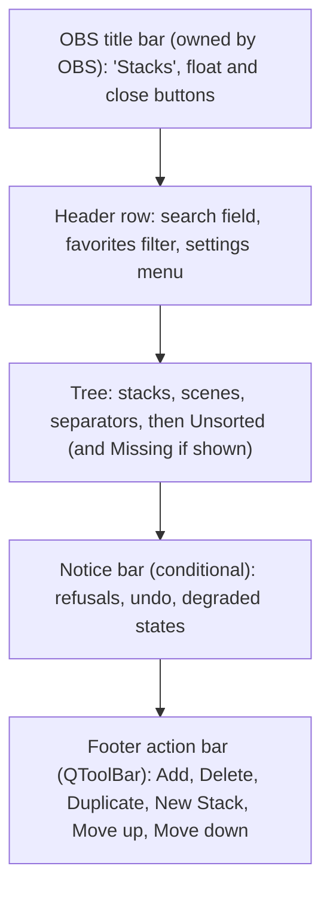
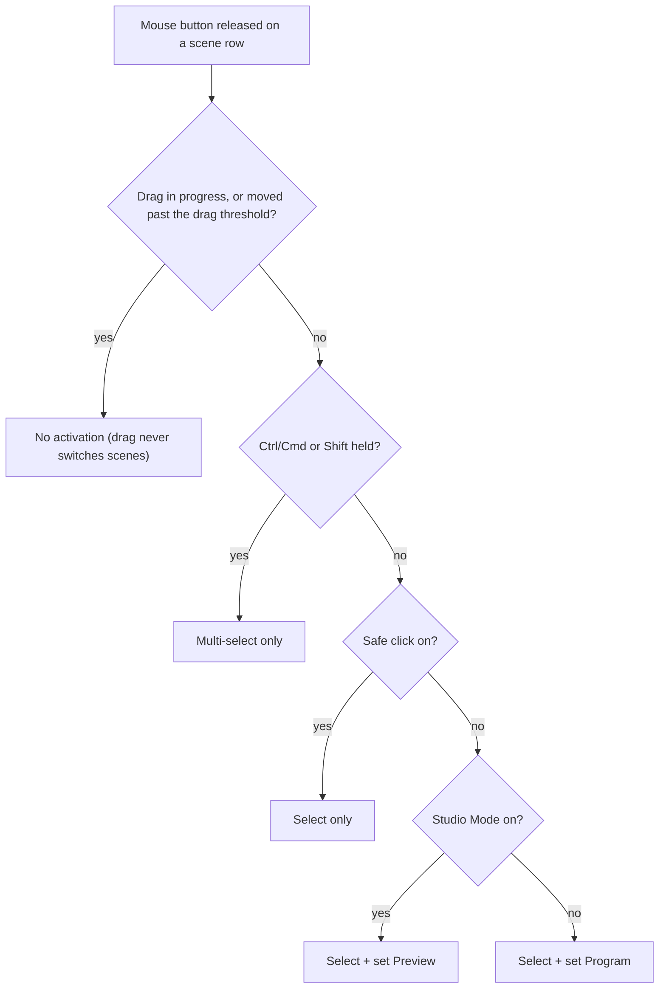
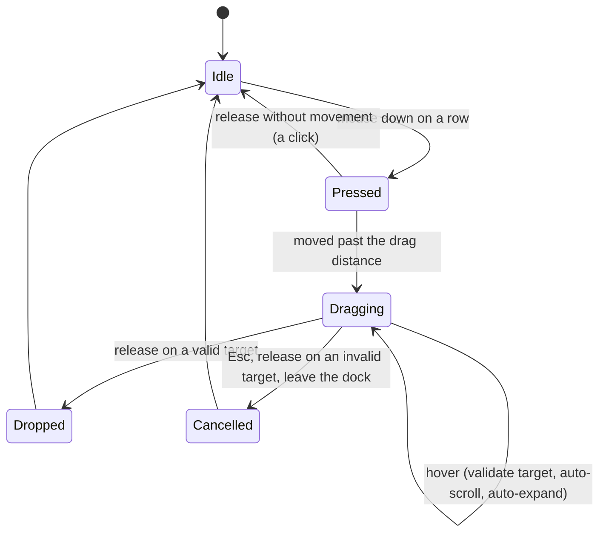
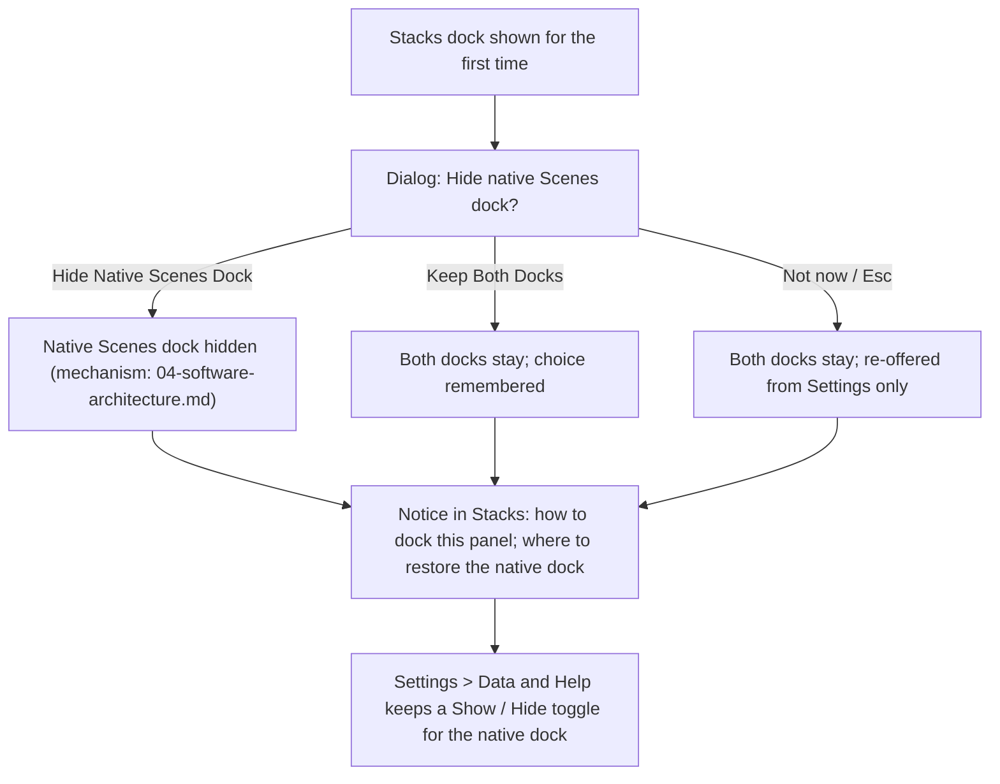

# Stacks for OBS — UX/UI Specification

Status: Draft — pending product-owner validation (Phase 1)  
Target: OBS Studio 33.0.1+  
Last updated: 2026-11-04

> A better way to organize your OBS scenes.

This document specifies the user experience and the visual design of the **Stacks** dock: anatomy, layout, tokens, components, states, interactions, menus, dialogs, keyboard, accessibility, motion, theming and localization. It is the UX/UI half of the Phase 1 deliverables and sits next to the other documents of this set:

| Document | Role |
|---|---|
| [01-technical-feasibility.md](01-technical-feasibility.md) | What OBS 33.0.1 allows, with source evidence |
| [02-product-requirements.md](02-product-requirements.md) | Scope, requirements, acceptance criteria |
| **03-ux-ui-specification.md** (this document) | How the dock looks and behaves |
| [04-software-architecture.md](04-software-architecture.md) | Modules, data model, threading, persistence |
| [05-implementation-plan.md](05-implementation-plan.md) | Phases, milestones, work breakdown |
| [06-testing-strategy.md](06-testing-strategy.md) | Test plans, benchmarks, recette |

> **Important — design values are proposals.** Every concrete design value in this document (colors, sizes, spacing, radii, type, timings, thresholds, wording of microcopy) is **Proposed — pending design review**. None is final. Section 20 lists every value that must go through the design review page before implementation. Behavioral rules (what a click does, what may never switch a scene) are product decisions already validated by the product owner on 2026-11-04 and are marked as such.

**Confidence labels** used throughout: **Verified in source** (read in OBS 33.0.1), **Documented** (official documentation), **Third-party** (competitor code, issue trackers, forums), **Hypothesis** (not verified; a verification method is given).

Terminology follows the shared brief: **Stack** (never "group"), **Separator** (`line`, `labeled`, `spacer`), **Scene entry**, **Unsorted**, **Organized order** vs **Native order**, display modes **Compact** and **Organized**, color display modes **Color Strip** (default), **Tinted Background**, **Color Dot**, **Combined**.

---

## Contents

1. [Scope and inputs](#1-scope-and-inputs)
2. [Design principles](#2-design-principles)
3. [Native baseline: the OBS 33.0.1 Scenes dock](#3-native-baseline-the-obs-3301-scenes-dock)
4. [Dock anatomy](#4-dock-anatomy)
5. [Layout and responsive rules](#5-layout-and-responsive-rules)
6. [Design tokens](#6-design-tokens)
7. [Color display modes](#7-color-display-modes)
8. [Component specifications](#8-component-specifications)
9. [State matrix](#9-state-matrix)
10. [Interactions](#10-interactions)
11. [Context menus](#11-context-menus)
12. [Dialogs and pickers](#12-dialogs-and-pickers)
13. [Settings](#13-settings)
14. [Keyboard map](#14-keyboard-map)
15. [Accessibility](#15-accessibility)
16. [Motion](#16-motion)
17. [Theming](#17-theming)
18. [Internationalization](#18-internationalization)
19. [Degraded and error states](#19-degraded-and-error-states)
20. [Design review checklist](#20-design-review-checklist)
21. [Open points and hypotheses to verify](#21-open-points-and-hypotheses-to-verify)
- [Appendix A: UI string table (EN + FR)](#appendix-a-ui-string-table-en--fr)
- [Appendix B: Icon set](#appendix-b-icon-set)
- [Appendix C: Evidence index](#appendix-c-evidence-index)

---

## 1. Scope and inputs

### 1.1 In scope

The **Stacks dock** (id `obs-stacks-dock`) and everything it opens: its context menus, dialogs, pickers and settings. v1 covers the main canvas only.

### 1.2 Out of scope

- **Presets** (save/reuse an organization): shown in the product owner's mockup but out of scope for v1 (see Future ideas in [02-product-requirements.md](02-product-requirements.md)).
- Nested stacks (depth is limited to 1 level in v1).
- A grid mode like the native Scenes dock's "Grid Mode" ([Yami.obt grid rules][themes-grid]); Stacks is list-only in v1.
- Per-scene transition overrides, "Show in Multiview", copy/paste filters: they remain available in the native Scenes dock menu (see [section 21](#21-open-points-and-hypotheses-to-verify), point P-6).
- Reordering OBS's native scene list. Order is organization-only (decision 2): Multiview, obs-websocket, Stream Deck and Companion keep the native order.

### 1.3 Inputs used

| Input | How it is used |
|---|---|
| Product owner's mockup (dark, neon-style, French) | Visual direction: spirit retained, adapted to the active OBS theme (decision 7). See [1.4](#14-what-is-taken-from-the-mockup) |
| OBS 33.0.1 sources (`frontend/forms/OBSBasic.ui`, `frontend/widgets/OBSBasic_Scenes.cpp`, `frontend/data/themes/*`) | Native metrics, QSS classes, click and menu behavior to match |
| Shared brief and fact sheet | Validated decisions, terminology, technical constraints |

### 1.4 What is taken from the mockup

| Mockup element | Decision | Rationale |
|---|---|---|
| Header with title "Scènes", search button, settings button | **Adapted.** The title is drawn by OBS in the dock's title bar (the plugin cannot remove it, see [3.2](#32-how-a-plugin-dock-is-hosted)). The header row keeps search and settings | Avoid a duplicated title; keep the mockup's two header actions |
| Collapsible stack headers with chevron, folder-type icon, bold name | **Adopted** | Core feature |
| Tinted stack header backgrounds | **Adopted as an option** (Tinted Background / Combined) | Spirit of the mockup; off by default to stay native-like |
| Colored strip on the left of every scene row | **Adopted** (default color mode) | Spirit of the mockup |
| Selected row filled with the theme's highlight color | **Adopted**, using the OBS theme highlight, not a fixed blue | Native first |
| Monochrome line icons | **Adopted** (Lucide, recolored at runtime) | Consistent with the OBS look |
| Row height about 48 px, radius about 10 px, large type | **Reduced** to native-like metrics (26–36 px rows, 4–6 px radius) | A dock must fit many scenes; the mockup is a stylized render |
| Neon glow, gradients, glassy panels | **Dropped** | Not native; costs contrast and readability |
| Footer `[+ v] [trash] [duplicate] [new stack] [up] [down]` with dividers | **Adopted** as specified in the brief | Matches native toolbar structure |
| Right-hand feature cards | **Not a dock element.** The "Display options" card inspires the settings dialog's two layout thumbnails; the **Presets** card is out of scope | See [section 13](#13-settings) |

---

## 2. Design principles

| # | Principle | What it means in this product | Consequences (testable) |
|---|---|---|---|
| 1 | **Native first** | The dock must feel like part of OBS: same fonts, same palette sources, same toolbar metrics and icons classes, same footer height, same keyboard conventions where they do not endanger a live show. Compact mode is visually close to the native list | Colors are derived from `QPalette` and the OBS theme, not hard-coded; footer uses the OBS dock toolbar metrics; no custom window chrome; no neon effects |
| 2 | **Organization without pollution** | Organization is metadata. Stacks and separators are never scenes, never reach Multiview, websocket, transitions or Stream Deck. The UI never files anything silently, never reorders OBS, and never adds noise (empty sections hidden, badges only when informative) | Unsorted shows only when non-empty; no persistent banners except degraded states; native order is explained, not hidden |
| 3 | **Fast under pressure** | Operators use the dock live. Common actions need one gesture; nothing destructive is one click away; nothing can switch the Program scene by accident. Program and Preview are identifiable at a glance in every mode, density and theme | Right-click, drag, search, keyboard focus moves and programmatic selection never switch scenes (decision 11); the on-air scene is identifiable even when its stack is collapsed; refusals are non-modal notices, never blocking dialogs |
| 4 | **Progressive complexity** | A new user sees a clean list with a footer. Stacks, colors, icons, favorites, search and density reveal themselves through the footer, context menus and one settings dialog. Defaults are conservative (Color Strip, no scene icons until one is chosen, favorites invisible until used) | The first-run experience contains one dialog and one dismissible hint; all advanced features are reachable from context menus; settings are grouped and explained |

Secondary rules applied everywhere:

- **Never rely on color alone** (see [15.3](#153-non-color-cues)).
- **Never invent state.** The dock shows what OBS reports (Program, Preview) and what the plugin stores (organization); it does not guess.
- **Every action has a keyboard path** and a mouse path; every drag has a menu equivalent.
- **Honest wording about order**: the dock says "organized order"; settings explain that other tools keep the native order.

---

## 3. Native baseline: the OBS 33.0.1 Scenes dock

Stacks replaces the native dock for daily use, so it must reproduce what operators already rely on and match its metrics.

### 3.1 Structure and metrics (Verified in source)

| Aspect | Native behavior | Evidence |
|---|---|---|
| Container | A `QDockWidget` subclass (`OBSDock`) containing a vertical layout with 1 px side and bottom margins, 0 spacing, no frame around the list | [OBSBasic.ui L973-L1100][ui-dock] |
| List | `SceneTree` (a `QListWidget`), no frame, `InternalMove` drag and drop, `spacing = 0` because of a Qt bug (QTBUG-106395), custom context menu | [OBSBasic.ui L1019-L1052][ui-tree] |
| Footer | A `QToolBar` named `scenesToolbar`, icon size 16×16, not floatable. Actions in order: Add, Remove, separator, Filters, separator, Up, Down | [OBSBasic.ui L1055-L1078][ui-toolbar] |
| Footer styling | Dock toolbars are 32 px high with a 1 px top border; tool buttons are transparent, with a 1 px transparent border that shows the grey border on hover and a grey fill when disabled | [Yami.obt L877-L915][themes-toolbar] |
| Footer icons | Native actions use the QSS class mechanism (`class="icon-plus"`, `icon-trash`, `icon-up`, `icon-down`, `icon-filter`) which swaps the icon per theme | [OBSBasic.ui L1496-L1510][ui-addscene]; [Yami.obt L486-L536][themes-icons] |
| Row | `QListWidget::item` with padding `--padding_large` and a minimum height `--padding_menu`; radius `--border_radius` (4 px) | [Yami.obt L734-L855][themes-list]; [layout variables L120-L215][themes-vars] |
| Row states | selected: `--primary` fill; hover: grey fill with border; focus: 1 px light border; disabled: transparent, muted text | [Yami.obt L803-L841][themes-states] |
| Inline rename | A line edit inside the list item with a 1 px border; theme rules exist for it | [Yami.obt L843-L855][themes-edit] |
| Dock title bar | Drawn by OBS (`QDockWidget::title`), small bold font, rounded top-left corner | [Yami.obt L921-L940][themes-title] |
| Palette | OBS builds a `QPalette` from theme variables (`--palette_window`, `--palette_base`, `--palette_highlight`, ...) | [Yami.obt L255-L275][themes-palette]; [OBSApp_Themes.cpp L803-L840][app-palette] |

### 3.2 How a plugin dock is hosted

| Fact | Consequence for the design | Evidence |
|---|---|---|
| `obs_frontend_add_dock_by_id(id, title, widget)` wraps the plugin widget in an `OBSDock`, sets the window title from `title`, then **hides it and makes it floating** | The title shown in the title bar is the string passed at registration ("Stacks", the same in English and French, so it is distinct from the native "Scenes" entry in the Docks menu; see design review item DR-28). A first-run flow must tell the user how to dock it. The plugin cannot draw its own title bar | [OBSStudioAPI.cpp L338-L359][api-adddock] |
| The dock is added to the **Docks menu** with a toggle action, and uses the "lock docks" feature flags | Showing Stacks again is always possible from Docks. When docks are locked, the title bar buttons disappear (no float/close) | [OBSBasic_Docks.cpp L143-L181][docks-add] |
| `OBSDock > QWidget` receives the dock background, a 1 px border and bottom radius from the theme; `OBSDock QToolBar` and `OBSDock QToolBar QToolButton` rules apply to any toolbar placed inside | A footer built as a `QToolBar` of `QToolButton`s inherits native metrics for free | [Yami.obt L877-L915][themes-toolbar] |

### 3.3 Native click and keyboard behavior (Verified in source)

| Behavior | Native | Evidence |
|---|---|---|
| Single click / selection change | Selecting a row calls `SetCurrentScene`: outside Studio Mode the scene goes to **Program**; in Studio Mode it becomes **Preview**. Arrow-key navigation changes selection and therefore switches scenes | [OBSBasic_Scenes.cpp L508-L535][scenes-click] |
| Double-click | Only acts in Studio Mode, and only when the preference `BasicWindow/TransitionOnDoubleClick` is on: it triggers the transition | [OBSBasic_Scenes.cpp L769-L783][scenes-dbl]; setting at [OBSBasicSettings.cpp L1380-L1381][settings-dbl] |
| Rename | F2 on Windows/Linux; **Return on macOS** (`#ifdef __APPLE__`). The action is attached to the Scenes dock with `Qt::WidgetWithChildrenShortcut`, i.e. **dock-scoped**, the same technique Stacks uses | [OBSBasic.cpp L355-L380][basic-shortcuts] |
| Delete | `Delete` on all platforms (declared in the UI file); `Backspace` is added explicitly on macOS, where the Delete key reports as Backspace | [OBSBasic.cpp L355-L380][basic-shortcuts]; [OBSBasic.ui L1525-L1565][ui-remove] |
| Name validation | Renaming to an existing source name or to an empty name reverts with a message. The existence check uses `obs_get_source_by_name`, so the name must be unique among **all sources**, not only scenes | [OBSBasic_Scenes.cpp L889-L899][scenes-rename]; strings at [en-US.ini L390-L394][loc-names] |
| Context menu | Add, Duplicate, Copy/Paste Filters, Rename, Remove, Order submenu (Up, Down, Top, Bottom), Scene Projector submenu, Screenshot, Filters, Per-scene Transition submenu, Show in Multiview, Grid/List mode | [OBSBasic_Scenes.cpp L548-L634][scenes-ctx] |
| Undo / Redo | `Ctrl+Z`, `Ctrl+Shift+Z`, `Ctrl+Y` are **application-wide** shortcuts | [OBSBasic.cpp L424-L430][basic-undo] |

### 3.4 OBS shortcuts Stacks must not collide with

Main-window shortcuts declared in the UI file, plus rename and delete handling (all Verified in source):

| Shortcut | OBS action | Evidence |
|---|---|---|
| `Ctrl+F` | Fit to Screen | [OBSBasic.ui L1756-L1762][ui-fit] |
| `Ctrl+D` | Center to Screen | [OBSBasic.ui L1780-L1786][ui-center] |
| `Ctrl+S`, `Ctrl+R`, `Ctrl+E` | Stretch, Reset Transform, Edit Transform | [OBSBasic.ui L1718-L1778][ui-transform] |
| `Ctrl+Up/Down/Home/End` | Source order Move Up/Down/Top/Bottom | [OBSBasic.ui L1808-L1840][ui-order] |
| `Ctrl+C`, `Ctrl+V`, `Ctrl+Shift+C/V` | Copy/Paste source, copy/paste transform | [OBSBasic.ui L818-L840][ui-copy], [L1722-L1740][ui-xcopy] |
| `Del` (`Backspace` too on macOS) | Remove Scene, Remove Source | [OBSBasic.ui L1525-L1565][ui-remove]; [OBSBasic.cpp L355-L380][basic-shortcuts] |
| `F2` (Return on macOS) | Rename scene / source | [OBSBasic.cpp L355-L380][basic-shortcuts] |
| `Ctrl+Z`, `Ctrl+Shift+Z`, `Ctrl+Y` | Undo, Redo (application-wide) | [OBSBasic.cpp L424-L430][basic-undo] |
| `Ctrl+Q` (Linux), `F11` | Quit, Fullscreen interface | [OBSBasic.cpp L381-L383][basic-quit]; [OBSBasic.ui L922-L928][ui-fullscreen] |

On macOS Qt maps `Ctrl` to `Cmd`. The **`Ctrl/Cmd+F` conflict is real**: the brief asks for `Ctrl/Cmd+F` to focus search, and OBS binds the same sequence to Fit to Screen. [Section 14](#14-keyboard-map) specifies how it is resolved (dock-scoped handling, with a fallback) and flags it for prototype verification (P-1).

### 3.5 What Stacks reproduces, changes, or leaves to the native dock

| Native capability | In Stacks | Notes |
|---|---|---|
| Select scene, switch Program / Preview | **Reproduced** (default click behavior); see [10.1](#101-click-behavior) | Arrow keys deliberately **do not** switch (decision 11) |
| Add scene | Reproduced (`+`, Add menu) | Placement differs: selected stack, else the end of the top level; inline rename (decision 12, 02-product-requirements.md FR-09) |
| Remove scene | **Reimplemented safely**: confirmation, undo, refuses on-air and last scene (decision 10) | Native `Remove` is not called |
| Duplicate | Reproduced; copy goes right after the original in the same stack (decision 12) | |
| Rename | Reproduced, inline, with validation | |
| Move up / down / top / bottom | Reproduced **in organized order only** | Never touches the native list |
| Filters, Scene Projector, Screenshot | Reproduced from the scene context menu through public API | `obs_frontend_open_source_filters`, `obs_frontend_open_projector`, `obs_frontend_take_source_screenshot` ([L201][api-proj], [L230][api-shot], [L240][api-filters]) |
| Copy / Paste Filters, Per-scene Transition, Show in Multiview | **Not in v1** | Use the native dock (Docks menu). Tracked as P-6 |
| Grid mode | Not in v1 | |

---

## 4. Dock anatomy

### 4.1 Structure

The dock is hosted by OBS inside an `OBSDock` (title bar owned by OBS). The plugin owns everything below the title bar.



The notice bar sits between the tree and the footer so that it never moves the footer buttons (muscle memory under pressure).

### 4.2 Header row

| Element | Behavior | Notes |
|---|---|---|
| Search field | Always visible, single line, placeholder "Search scenes…", clear button inside the field when it has text, result count ("3 of 42") shown at the trailing edge while filtering | Collapses to an icon button under a minimum width ([5.2](#52-responsive-breakpoints)). Mockup used an icon button; see design review item DR-4 |
| Favorites filter | Toggle button with a star icon. Pressed state = only favorites shown | Hidden when the "Show favorite stars" setting is off |
| Settings | Menu button with a sliders icon. Menu: Organized / Compact (checkable), Color Display submenu, Settings… | Quick access to the two most-used display choices without opening the dialog |

The title ("Stacks") is **not** repeated in the header row: OBS already draws it in the title bar. This is the one deliberate deviation from the mockup.

### 4.3 Tree

Rows in order, top to bottom:

1. The **organized tree**: stacks (with children), loose scenes and separators in the order the user chose.
2. **Unsorted** section (only when it has at least one scene).
3. **Missing scenes** section (only when the "Show missing scenes" setting is on and tombstones exist).

Depth is limited to one level: a stack contains scenes and separators; stacks cannot contain stacks.

### 4.4 Footer action bar

A `QToolBar` inside the dock so that OBS's own `OBSDock QToolBar` rules (32 px high, transparent buttons, border on hover) apply automatically ([Yami.obt L877-L915][themes-toolbar]). Order and grouping follow the brief and the mockup:

`[ + v ]  [ Delete ]  [ Duplicate ]  |  [ New Stack ]  |  [ Move up ]  [ Move down ]`

| Button | Icon (class / asset) | Primary action | Enabled when | Tooltip (EN) | Shortcut |
|---|---|---|---|---|---|
| **Add ▾** (split button) | `icon-plus` (OBS class) + menu arrow | Click on `+`: add a scene (new row at the insertion point in inline rename, no dialog; see [12.2](#122-add-scene)). Arrow: menu **Scene…**, **Stack**, **Separator ▸ Line / Labeled / Spacer** | Always (read-only mode: Scene… only) | "Add Scene (arrow: Stack, Separator)" | None for the menu; see [14](#14-keyboard-map) |
| **Delete** | `icon-trash` | Scene: delete with confirmation. Stack: dissolve (scenes kept). Separator: remove. Tooltip changes with the selection | A deletable row is selected and the selection does not contain the Program scene, and more than one scene exists | "Delete Scene" / "Dissolve Stack" / "Remove Separator" / "Delete Selected Scenes" | `Delete`, `Backspace` |
| **Duplicate** | Stacks asset `copy` (no native class exists) | Duplicate the selected scene; the copy goes right after the original, same stack | Exactly one scene selected | "Duplicate Scene" | none by default (`Ctrl+D` is taken by OBS) |
| **New Stack** | Stacks asset `folder-plus` | Create a stack named "New Stack" (unique) at the insertion point and enter inline rename; no dialog | Always (not in read-only mode) | "New Stack" | `Ctrl/Cmd+Shift+N` (dock-scoped) |
| **Move up** | `icon-up` | Move the selected row up inside its container (organized order only) | Selection can move | "Move Up" | `Alt/Option+Up` |
| **Move down** | `icon-down` | Same, downward | Selection can move | "Move Down" | `Alt/Option+Down` |

Rules:

- `icon-plus`, `icon-trash`, `icon-up`, `icon-down` are native QSS classes ([Yami.obt L486-L536][themes-icons]); using them keeps theme variants (Dark, Light, Yami variants) automatic. `Duplicate` and `New Stack` have no native class, so Stacks ships them as recolorable SVG tinted with `palette(ButtonText)` ([17](#17-theming)).
- Footer button clusters are separated by toolbar separators, as in the mockup and the native toolbar.
- **Moving never crosses a container boundary** with the buttons: moving down on the last scene of a stack stops there. Crossing is done by drag and drop or **Move to Stack** in the menu. This keeps the result predictable under pressure.
- When the dock is too narrow, buttons overflow into the toolbar's extension menu in this keep-last order: Move down, Move up, Duplicate, New Stack, Delete, Add ([5.2](#52-responsive-breakpoints)).

### 4.5 Wireframes

Legend for all wireframes (ASCII, monospace; widths are illustrative):

| Symbol | Meaning |
|---|---|
| `#` | color strip (3–4 px in reality) |
| `v` / `>` | chevron, expanded / collapsed |
| `[x]` | 16/20 px icon |
| `*` / `.` | favorite star (filled) / star shown on hover (outline) |
| `[LIVE]` / `[PVW]` | Program / Preview badges |
| `=====` | selected row fill (theme highlight) |
| `!` | warning glyph (missing scene, notice) |
| `~` | matched search text |

#### 4.5.1 Organized mode (default density), Studio Mode on

Program = "Live" (inside the stack Production), Preview = "MASTER" (selected). Stack "Games" is collapsed and contains no marked scene.

```
+----------------------------------------------+
| Stacks                                [^][x] |
+----------------------------------------------+
| [ Q Search scenes...             ]  [*]  [=] |
+----------------------------------------------+
| v [F] Production                          4  |
|  #[M] MASTER ================== [PVW]     *  |
|  #[>] Pre-roll                            .  |
|  #[)] Live                       [LIVE]   *  |
|  #[ ] Outro                               .  |
|                                              |
| v [L] Interludes                          2  |
|  #[c] Waiting                             .  |
|  #[m] BRB                                 .  |
| > [G] Games                               3  |
| ------------- Technical ------------------   |
| v [T] Tools                               1  |
|  #[t] Test                                .  |
|                                              |
| v Unsorted                                2  |
|    [ ] Scene 7                               |
|    [ ] Scene 8                               |
+----------------------------------------------+
| [+v] [del] [dup] | [stack+] | [up] [down]    |
+----------------------------------------------+
```

Notes: the selected row carries the highlight fill and the `[PVW]` badge; the Program row carries `[LIVE]` and an outline (not drawn here). Star glyphs: `*` favorite, `.` shown only on hover or when the row has focus.

#### 4.5.2 Compact mode

Close to the native list: flat rows, no tint, no header decoration beyond a chevron and a bold name; color strips thinner; icons optional.

```
+----------------------------------------------+
| Stacks                                [^][x] |
+----------------------------------------------+
| [ Q Search scenes...             ]  [*]  [=] |
+----------------------------------------------+
| v Production                                 |
|  #MASTER ===================== [PVW]         |
|  #Pre-roll                                   |
|  #Live                          [LIVE]       |
|  #Outro                                      |
| v Interludes                                 |
|  #Waiting                                    |
|  #BRB                                        |
| > Games (3)                                  |
| ------------- Technical ------------------   |
| v Tools                                      |
|  #Test                                       |
| v Unsorted (2)                               |
|   Scene 7                                    |
|   Scene 8                                    |
+----------------------------------------------+
| [+v] [del] [dup] | [stack+] | [up] [down]    |
+----------------------------------------------+
```

#### 4.5.3 Search active (query "bre", accent- and case-insensitive)

Matches are shown with their stack, even if the stack is saved as collapsed. Saved collapsed state is untouched. Separators are hidden while searching.

```
+----------------------------------------------+
| Stacks                                [^][x] |
+----------------------------------------------+
| [ Q bre                    (x) 2 of 14 ] [*] |
+----------------------------------------------+
| v [L] Interludes                             |
|  #[m] ~BRE~ak                             .  |
| v [G] Games                                  |
|  #[?] Quiz ~bre~ ak                       .  |
|                                              |
+----------------------------------------------+
| [+v] [del] [dup] | [stack+] | [up] [down]    |
+----------------------------------------------+
```

Stacks revealed only by the search are drawn with a subtle "revealed" cue (their chevron is dimmed) and return to their saved state when the query is cleared (`Esc` or the clear button).

#### 4.5.4 Favorites filter on

Same mechanism as search (filtered tree). Stars are always visible in this mode.

```
+----------------------------------------------+
| Stacks                                [^][x] |
+----------------------------------------------+
| [ Q Search scenes...             ]  [**] [=] |
+----------------------------------------------+
| v [F] Production                          2  |
|  #[M] MASTER ================== [PVW]     *  |
|  #[)] Live                       [LIVE]   *  |
| v [L] Interludes                          1  |
|  #[m] BRB                                 *  |
|                                              |
+----------------------------------------------+
| [+v] [del] [dup] | [stack+] | [up] [down]    |
+----------------------------------------------+
```

`[**]` denotes the pressed favorites toggle.

#### 4.5.5 Empty state (collection with no scene)

```
+----------------------------------------------+
| Stacks                                [^][x] |
+----------------------------------------------+
| [ Q Search scenes...             ]  [*]  [=] |
+----------------------------------------------+
|                                              |
|                                              |
|              No scenes yet                   |
|        Add a scene to get started.           |
|                                              |
|              [ Add Scene ]                   |
|                                              |
+----------------------------------------------+
| [+v] [del] [dup] | [stack+] | [up] [down]    |
+----------------------------------------------+
```

Related empty states (all text in [Appendix A](#appendix-a-ui-string-table-en--fr)): **first-run hint** (scenes exist, no stack yet: a dismissible card at the top of the tree offering "New Stack"), **no match** (search), **no favorites**, **empty stack** ("Empty — drag scenes here" placeholder row inside an expanded empty stack).

First-run hint (scenes exist, nothing organized yet; everything is in Unsorted):

```
+----------------------------------------------+
| [ Q Search scenes...             ]  [*]  [=] |
+----------------------------------------------+
| +------------------------------------------+ |
| | Organize your scenes                 [x] | |
| | Create a stack to keep related scenes    | |
| | together. Stacks only change how scenes  | |
| | are shown here, never OBS itself.        | |
| |                 [ New Stack ]  [Got it]  | |
| +------------------------------------------+ |
| v Unsorted                               5   |
|    [ ] MASTER                                |
|    [ ] Pre-roll                              |
|    [ ] Live                                  |
+----------------------------------------------+
```

#### 4.5.6 Unsorted section (a scene just arrived from outside)

An externally created scene ("Scene 9", for example from obs-websocket) lands in Unsorted. The section header shows its count; a one-time attention highlight draws the eye (disabled when animations are off), and a notice appears.

```
+----------------------------------------------+
| ...organized tree...                         |
|                                              |
| v Unsorted                                1  |
|    [ ] Scene 9                               |
+----------------------------------------------+
| ! 1 new scene was added to Unsorted.   [x]   |
+----------------------------------------------+
| [+v] [del] [dup] | [stack+] | [up] [down]    |
+----------------------------------------------+
```

Scenes in Unsorted are shown in **arrival order** (native order at the time they arrived) and are not reorderable inside Unsorted (they are not organized yet); they can be dragged out, or moved with **Move to Stack**.

#### 4.5.7 Narrow dock (160 px minimum, Proposed)

Icons stay; names elide in the middle; badges shrink to shapes with the text kept in the tooltip and accessible name; the star appears on hover or focus only; the footer overflows into the extension menu.

```
+------------------------+
| Stacks         [^][x]  |
+------------------------+
| [Q]           [*] [=]  |
+------------------------+
| v [F] Produc…         4|
|  #[M] MAS…er       [o] |
|  #[>] Pre-…ll          |
|  #[)] Live         [@] |
| > [G] Games           3|
| v Unsorted            2|
+------------------------+
| [+v][del][dup]  [>>]   |
+------------------------+
```

`[o]` hollow circle = Preview, `[@]` filled circle = Program (shape cue, [8.7](#87-program-and-preview-badges)). `[>>]` is the toolbar extension menu holding the remaining buttons.

#### 4.5.8 Wide dock (420 px and more, Proposed)

More breathing room; stack headers show the full count label; in filtered views each scene shows its stack as muted trailing text; hover reveals the star and, for stack headers, the add-scene shortcut `+`.

```
+----------------------------------------------------------------------+
| Stacks                                                         [^][x]|
+----------------------------------------------------------------------+
| [ Q Search scenes...                                     ]  [*]  [=] |
+----------------------------------------------------------------------+
| v [F] Production                                        4 scenes  [+]|
|  #[M] MASTER ============================== [PVW]               *    |
|  #[>] Pre-roll                                                  .    |
|  #[)] Live                                   [LIVE]             *    |
|  #[ ] Outro                                                     .    |
| > [G] Games                                             3 scenes     |
| ------------------------- Technical -------------------------------- |
| v [T] Tools                                             1 scene      |
|  #[t] Test                                                      .    |
+----------------------------------------------------------------------+
| [+v]  [del]  [dup]  |  [stack+]  |  [up]  [down]                     |
+----------------------------------------------------------------------+
```

---

## 5. Layout and responsive rules

> **Proposed — pending design review.** All widths, thresholds and metrics below.

### 5.1 Size constraints

| Rule | Value (Proposed) | Reason |
|---|---|---|
| Minimum dock width | 160 px logical | The native layout reserves a 150 px spacer ([OBSBasic.ui L1081-L1094][ui-spacer]); 160 px keeps one icon, a shortened name and a status shape visible |
| Default (floating) size | 280 × 480 px | Fits about 14 organized rows plus header and footer |
| Minimum tree height | 2 rows | Header and footer never scroll away; the tree scrolls |
| Footer | Fixed 32 px, never scrolls | Native dock toolbar height ([Yami.obt L886-L893][themes-toolbar-h]) |
| Header row | Fixed height (search field height + 8 px padding) | |

### 5.2 Responsive breakpoints

| Dock width (logical px) | Layout |
|---|---|
| **< 160** | Not allowed (minimum width) |
| **160–219 (narrow)** | Search collapses to an icon button that expands over the header row when clicked or when `Ctrl/Cmd+F` is pressed. Badges become shapes (filled circle Program, hollow circle Preview). Star only on hover/focus. Stack count hidden except when collapsed. Footer keeps Add, Delete, Duplicate; the rest sits in the extension menu |
| **220–359 (regular)** | Everything visible: search field, text badges, stars (filled always, outline on hover), counts. Full footer |
| **≥ 360 (wide)** | As regular, plus: "N scenes" text on stack headers, stack name shown as muted suffix on scene rows in filtered views, stack-header quick add (`+`) on hover |

Breakpoints are evaluated on the tree's viewport width (not the window) and re-evaluated live on resize; no animation on breakpoint change.

### 5.3 Truncation, elision and tooltips

| Element | Elision | Tooltip |
|---|---|---|
| Scene name | **Middle** (`Cam 1 - W…ide`): scene names are often distinguished by their suffix (numbers, variants) | Full name when elided, plus stack name and state ("On air (Program)", "Preview") |
| Stack name | Right | Full name when elided, plus "N scenes" |
| Separator label | Right | Full label when elided |
| Badges | Never elided; they lose their text before they lose their shape ([5.2](#52-responsive-breakpoints)) | Full state name |
| Settings, filter, footer buttons | Not applicable | Name plus shortcut |

Tooltips appear after the platform's standard delay, never over an active drag or inline editor, and include the shortcut in parentheses when one exists. Tooltips are plain text and localized.

### 5.4 Vertical rhythm

- Row spacing: 2 px between rows (the native list uses spacing 0 with padding, a Qt workaround; Stacks draws its own spacing in its delegate).
- Stack blocks are visually separated by an 8 px gap above each **expanded** stack header (not above the first), so stacks read as blocks without extra separator rows.
- Scroll: no horizontal scroll ever. Vertical scroll uses the theme's scrollbar; when scrolled, the header row keeps a 1 px bottom border as a shadow cue.
- On expand/collapse, the scroll position keeps the stack header at the same screen position.

### 5.5 Floating versus docked

The same layout is used. When floating, the user can resize freely down to the minimum. When docks are locked, OBS removes title-bar buttons ([OBSBasic_Docks.cpp L143-L181][docks-add]); nothing in Stacks depends on them.

---
## 6. Design tokens

> **Proposed — pending design review.** Every value in this section. Token names are conceptual (they map to constants in the delegate and style code, not to QSS variables: OBS does not expose its theme variables to plugins, see [17](#17-theming)).

### 6.1 Sources of truth

| Kind | Source | Rule |
|---|---|---|
| Font family, base size | `QApplication::font()` (OBS applies its font and the Appearance "Font Size", default 10) | Never set a family. Never hard-code a point size; derive from the application font ([OBSApp.cpp L420-L421][app-defaults]) |
| Surface and text colors | `qApp->palette()` (OBS fills it from theme variables) | Use roles, not literals ([Yami.obt L255-L275][themes-palette]) |
| Density | OBS Appearance "Density" (default) or the Stacks setting | See [6.3](#63-row-heights-by-density) |
| Icons | Lucide SVG, rendered monochrome with the role color | [Appendix B](#appendix-b-icon-set) |

### 6.2 Color roles (derived from `QPalette` and the OBS theme)

Reference values are what Yami Dark and Yami Light produce today (Verified in source: [Yami.obt L100-L118][themes-colors], [Yami_Light.ovt L27-L55][themes-light]); they are for review only, never literals in code.

| Role | Derivation (Proposed) | Yami Dark (reference) | Yami Light (reference) |
|---|---|---|---|
| `surface` | `QPalette::Base` | #272A33 | #E5E5E5 |
| `surfaceWindow` | `QPalette::Window` | #1D1F26 | #D3D3D3 |
| `text` | `QPalette::Text` | #FFFFFF | #0A0A0A |
| `textMuted` | `text` blended over the actual background at 65 %, then validated: raise opacity until 4.5:1 | #B3B4B8 (6.9:1) | #575757 (5.7:1) |
| `selection` / `selectionText` | `QPalette::Highlight` / `HighlightedText` (group-aware: Inactive group when the window is inactive) | #284CB8 / #FFFFFF (7.5:1) | #8CB5FF / #0A0A0A (9.6:1) |
| `hover` | `text` at 8 % (dark) or 6 % (light) over the row background | #383B43 | #D7D7D7 |
| `border` | `surface` blended with `text` at 14 % | about #3C404D | about #C3C3C3 |
| `accent` (focus ring, drop indicator, links) | `selection` shifted in lightness until ≥ 3:1 against `surface` | #718CDC (OBS `--primary_lighter`, 4.4:1) | #284CB8 (5.9:1) |
| `focusRing` | `text` | #FFFFFF | #0A0A0A |
| `programFill` / `programRing` | Fixed semantic colors, per theme darkness | fill #C62828, ring #EF4444 | fill #B91C1C, ring #B91C1C |
| `previewInk` | Fixed semantic color, per theme darkness | #22C55E (6.3:1 on surface) | #166534 (5.7:1 on surface) |
| `warning` (glyph only; text stays `text`) | Fixed semantic | #FBBF24 (8.6:1) | #B45309 (4.0:1, glyph use only) |
| `matchFill` (search highlight) | Amber #F4D13D at 35 % (dark) / 60 % (light) over the row | text 5.9:1 | text 14.0:1 |
| `placeholder` | `text` at 70 % | 6.0:1 on the input field | n/a (computed at runtime) |

Contrast ratios in parentheses are **computed** with the WCAG relative-luminance formula against the reference surfaces. The runtime **contrast guard** ([17.4](#174-runtime-contrast-guard)) recomputes them for the actual palette.

### 6.3 Row heights by density

Native row height is derived from the font and the theme padding: `H_native = fontHeight + 2 × padding_large + 2 × border`. OBS maps its Appearance density ids to a padding value: -2 → 0.25 (Classic), -3 → 2 (Compact), -4 → 4 (Normal), -5 → 6 (Comfortable) (Verified in source: [OBSApp_Themes.cpp L863-L878][app-density]); `padding_large` is that value clamped to 1–5 px ([Yami.obt L153-L156][themes-pad]). Stacks follows OBS by default and maps Classic and Compact to its **Compact** level.

Stacks rows never drop below **24 px** (target size, [15.5](#155-hit-targets)).

`baseRow = max(24, H_native)`. Example values below assume a font height of 16 px at the default font size (Hypothesis: confirm by measuring the native row in the prototype).

| Token | Formula | Compact density | Normal density | Comfortable density |
|---|---|---|---|---|
| `padding_large` (OBS) | 1–5 px | 2 | 4 | 5 |
| `baseRow` | `max(24, H_native)` | 24 | 26 | 28 |
| `row.scene` — Compact display mode | `baseRow` | 24 | 26 | 28 |
| `row.scene` — Organized display mode | `baseRow + 4` | 28 | 30 | 32 |
| `row.stack` — Compact display mode | `baseRow + 2` | 26 | 28 | 30 |
| `row.stack` — Organized display mode | `baseRow + 8` | 32 | 34 | 36 |
| `row.unsorted` (Organized) | `baseRow + 2` | 26 | 28 | 30 |
| `row.sep.labeled` | `round(0.8 × baseRow)` | 19 | 21 | 22 |
| `row.sep.line` | `round(0.5 × baseRow) + 2` | 14 | 15 | 16 |
| `row.sep.spacer` Small / Medium / Large | fixed | 8 / 16 / 24 | 8 / 16 / 24 | 8 / 16 / 24 |
| `icon.size` | fixed | 16 | 16 | 20 |
| Footer height | native dock toolbar | 32 | 32 | 32 |
| Header row | input height + 8 | input + 8 | input + 8 | input + 8 |

The input height follows OBS (`--input_height_base`, about 30 px at Normal; [Yami.obt L192-L196][themes-input]) so the search field matches native text inputs.

### 6.4 Spacing, indentation and shape

| Token | Compact display mode | Organized display mode | Notes |
|---|---|---|---|
| `strip.width` | 3 px | 4 px | Within the brief's 3–4 px range |
| `strip.inset.v` | 2 px | 3 px | Vertical inset inside the row |
| `strip.radius` | 2 px | 2 px | |
| `row.pad.left` | 6 px | 8 px | Between strip column and content |
| `row.pad.right` | 6 px | 8 px | |
| `gap.icon-name` | 6 px | 8 px | |
| `gap.badges` | 4 px | 4 px | |
| `indent.child` | 10 px | 12 px | Scenes inside a stack. Loose scenes and stack headers: 0 |
| `chevron.box` | 16 px (glyph 12 px) | 16 px (glyph 12 px) | Hit area 24 × row height |
| `row.gap` | 1 px | 2 px | Vertical space between rows |
| `stack.gap.above` | 0 | 8 px | Above each expanded stack header except the first |
| `tree.pad.h` | 4 px | 4 px | Horizontal padding of the tree viewport |
| `radius.row` | 4 px | 4 px | Equals OBS `--border_radius` ([Yami.obt L185-L187][themes-radius]) |
| `radius.stack` | 4 px | 6 px | Equals OBS `--border_radius_large` in Organized |
| `radius.badge` | 3 px | 3 px | |
| `ring.focus` | 2 px inset | 2 px inset | |
| `ring.program` | 2 px inset | 2 px inset | |
| `ring.preview` | 1 px inset, dashed | 1 px inset, dashed | Dashed = non-color cue |
| `dropline` | 2 px with 4 px end dot | 2 px with 4 px end dot | |
| `dot.size` (Color Dot mode) | 8 px | 8 px | 10 px at Comfortable |
| `notice.h` | row height | row height | Single line, wraps to two on narrow docks |

### 6.5 Type

| Token | Value (Proposed) | Notes |
|---|---|---|
| `type.row` | Application font, regular, 1.0 × base | Scene names |
| `type.stack` | Application font, **DemiBold** (600, fall back to Bold), 1.0 × base | Stack names |
| `type.sep` | Application font, regular, `max(0.85 × base, 8 pt)` | Labeled separator, Unsorted header, counts |
| `type.badge` | Application font, Bold, `max(0.8 × base, 7 pt)`, tracking +0.3 px | LIVE / PVW; the 7 pt floor equals OBS's smallest dock text (`--font_small`, [Yami.obt L137-L141][themes-font]) |
| `type.match` | Same as row, **bold** on the matched span | Plus `matchFill` background |
| No all-caps transforms | | Avoids locale problems (French accents) |

### 6.6 Proposed palette: 8 colors with theme-adjusted variants

> **Proposed — pending design review.** The "Brief" column is the product owner's indicative palette. Variants are adjusted so that the **color strip, dot and swatch outline reach ≥ 3:1 against the theme surface** (WCAG 1.4.11, non-text contrast). Ratios are **computed** against Yami Dark `surface` #272A33 and Yami Light `surface` #E5E5E5.

| Name (EN / FR) | Brief (indicative) | Dark variant | Ratio on dark | Light variant | Ratio on light |
|---|---|---|---|---|---|
| Blue / Bleu | #3478F6 | #3478F6 | 3.52 | #2970F5 | 3.52 |
| Violet / Violet | #8957E5 | #9162E7 | 3.48 (brief value: 3.11) | #8957E5 | 3.66 |
| Pink / Rose | #D946A6 | #D946A6 | 3.67 | #D5339D | 3.48 |
| Red / Rouge | #EF4444 | #EF4444 | 3.81 | #EC2222 | 3.46 (brief value: 2.99) |
| Orange / Orange | #F59E42 | #F59E42 | 6.72 | #B7630A | 3.47 (brief value: 1.69) |
| Yellow / Jaune | #F4D13D | #F4D13D | 9.58 | #907608 | 3.49 (brief value: 1.19) |
| Green / Vert | #22C55E | #22C55E | 6.29 | #188A42 | 3.51 (brief value: 1.81) |
| Teal / Turquoise | #20C5B5 | #20C5B5 | 6.63 | #16867B | 3.52 (brief value: 1.72) |

Rules:

- The palette entry is stored by **id** (`blue`, `violet`, ...), not by hex, so each theme shows the right variant. A **custom** color is stored as hex and adjusted at render time by the contrast guard (lightness shifted until ≥ 3:1), the stored value is never rewritten ([12.5](#125-color-picker)). Data-model detail belongs to [04-software-architecture.md](04-software-architecture.md).
- Tints stay legible: for **Tinted Background** the variant is blended at **14 %** over the surface. Computed text contrast on those tints: primary text ≥ 10.2:1 (dark) and ≥ 12.9:1 (light); `textMuted` ≥ 4.9:1 in both. Above 16 % the dark theme's muted text on yellow falls under 4.5:1 (4.43:1 at 18 %), so **16 % is the ceiling**.
- The Blue entry is intentionally close to OBS's own highlight blue. This is why the strip needs the halo rule on selected rows ([7.3](#73-interaction-with-selection-hover-program-and-preview)).
- All 8 colors stay distinguishable for the common color-vision deficiencies only if paired with the swatch **name** in tooltips and the accessible name; colors are never the only cue.

### 6.7 Icons

| Token | Value (Proposed) |
|---|---|
| Sizes | 16 px (Compact and Normal density), 20 px (Comfortable). Logical pixels; rendered at the device pixel ratio |
| Source | Lucide, 24-unit grid; **stroke width is raised to 2.5 units at 16 px** so the rendered stroke stays ≥ 1.5 px (default 2 units renders at 1.33 px at 16 px). Hypothesis: confirm visually in the review page |
| Color | `text` by default (neutral, monochrome). Optional setting "Icon color: Item color" tints with the item's color variant |
| Alignment | Optical center on the row's vertical middle; 1 px nudge allowed per icon if the glyph is bottom-heavy |
| Imported icons | Normalized to the same box; SVG can be recolored with the theme color ([12.6](#126-icon-picker)) |

---

## 7. Color display modes

Colors are **organization metadata**: they are stored by the plugin and never change an OBS source or scene. Four display modes, one active at a time (setting "Color display"); the default is **Color Strip** (brief).

### 7.1 Mode definitions

| Mode | Scene row | Stack header | Separator | Typical look |
|---|---|---|---|---|
| **Color Strip** (default) | Strip at the row's left edge (`strip.width`, inset vertically) | Strip (same width) | none | Closest to native, the strongest scan cue |
| **Tinted Background** | Row background tinted at 10 % | Header tinted at 14 % (ceiling 16 %) | none | Soft, large color areas; hides when the row is selected |
| **Color Dot** | 8 px dot before the icon | Dot before the icon | none | Quietest option; best for very dense lists |
| **Combined** | Strip | Strip **and** 14 % tint | none | Spirit of the mockup (strips on scenes, tinted stack headers) |

A scene without a color shows nothing, but **the strip column is reserved** so icons and names stay aligned. Separators are never colored in v1.

### 7.2 Rules

1. Colors apply to the **item itself**: a stack's color does not tint its scenes (inheritance is a future idea, not v1).
2. When "Show colors" is off, nothing is drawn and the stored colors are untouched.
3. In **Compact display mode** the strip is 3 px, the tint is 10 % and stack headers stay flat.
4. A **dimmed** item (missing, disabled) draws its color at 50 % saturation.
5. In high-contrast situations ([17.4](#174-runtime-contrast-guard)) tints are dropped and the strip gets +1 px.

### 7.3 Interaction with selection, hover, Program and Preview

Color must never hide state. Rules, in priority order:

| Situation | Rule |
|---|---|
| **Selected** row | The selection fill (`selection`) replaces any tint. The strip stays and gains a **1 px halo** in `selectionText` at 70 % whenever its contrast against `selection` is below 3:1 (computed 1.8–2.2:1 for Blue, Violet, Pink, Red in Yami Dark and for every color in Yami Light, so the halo is drawn for them). A dot gains a 1 px ring in the same way |
| **Hover** | Tinted modes brighten the tint by 4 points; strip and dot are unchanged |
| **Program** | Never expressed by color alone and never by tinting: ring + badge ([8.7](#87-program-and-preview-badges)). The scene's own color stays visible |
| **Preview** | Dashed ring + outlined badge. Same independence |
| **Collapsed stack** | Aggregates the Program/Preview badges of its children ([8.2](#82-stack-header)); its own color is unchanged |
| **Dragging** | Source rows at 40 % opacity; their color indicator fades with them |

---

## 8. Component specifications

All dimensions are the tokens of [section 6](#6-design-tokens) (**Proposed — pending design review**). "R" is `row.scene`.

### 8.1 Scene row

Anatomy, left to right (Organized mode):

`[indent][strip column][pad][icon?][gap][name … elided in the middle][gap][badges][gap][star][pad]`

| Part | Spec |
|---|---|
| Indent | `indent.child` when inside a stack or Unsorted; 0 for a loose scene |
| Strip column | `strip.width`, reserved even when empty |
| Icon | Optional (setting "Show icons"); `icon.size`. A scene without an icon does **not** reserve an icon slot: its name starts right after the strip. Mixed rows (some with icons, some without) therefore align per row, not per column; design review item DR-9 asks whether to reserve the slot instead |
| Name | `type.row`, single line, middle elision, highlighted span when searching |
| Badges | Program / Preview ([8.7](#87-program-and-preview-badges)) |
| Star | Favorite toggle ([8.8](#88-favorite-star)) |
| Hit regions | star (24 px wide), everything else = row |

Behavior: see [section 10](#10-interactions). Tooltip: name, stack, state.

### 8.2 Stack header

Anatomy: `[pad][chevron 16][gap][icon?][gap][name][gap][aggregate badges][gap][count][pad]`

| Part | Spec |
|---|---|
| Chevron | Down when expanded, right when collapsed (right-to-left locales mirror). Rotates ≤ 120 ms ([16](#16-motion)). Click toggles. Hidden if "Show collapse arrows" is off (then a click on the header toggles) |
| Icon | Optional; folder-type default glyph when "Show icons" is on and none is chosen (Lucide `folder`) |
| Name | `type.stack`, right elision |
| Aggregate badges | When **collapsed**, a stack that contains the Program scene shows the **LIVE** badge; one that contains the Preview scene shows **PVW**. The on-air scene must never be invisible because its stack is collapsed (principle 3) |
| Contains-selection cue | When collapsed and the selected scene is inside: 1 px `border` outline in `accent` around the header |
| Count | Number of scenes (`type.sep`), muted; on wide docks "4 scenes" |
| Background | Per color mode: none (Strip, Dot), 14 % tint (Tinted, Combined); in Organized mode a neutral raised fill (`surface` blended with `text` at 6 %) so headers read as headers even without color |
| Radius | `radius.stack` |
| Hit regions | Chevron (toggle), whole header (select), double-click on the name (inline rename) |
| Drop target | Whole header = "inside" target ([10.2](#102-drag-and-drop)) |
| Hover affordance (wide) | A `+` button at the trailing edge adds a scene to this stack |

### 8.3 Separators

Separators are plugin metadata. They are not scenes, are never broadcastable, never appear in transitions, websocket or Stream Deck, and create no OBS source.

| Variant | Anatomy | Height token | Interaction |
|---|---|---|---|
| **Line** | 1 px horizontal rule in `border`, inset `tree.pad.h + 8`, vertically centered | `row.sep.line` | Selectable (shows a thin selection outline), movable, deletable. Not activatable |
| **Labeled** | Rule – label – rule; label in `type.sep` muted, centered between two rules (left rule 12 px, right rule fills). Right elision of long labels | `row.sep.labeled` | Double-click renames inline |
| **Spacer** | Empty vertical space; shows a dashed 1 px outline only while selected or dragged | `row.sep.spacer` (S/M/L) | Selectable, movable, deletable; height edited in the Separator editor |

A separator **inside a stack** is indented like its sibling scenes; a separator at the top level spans the full width. Separators are hidden during search and when "Show separators" is off (data untouched).

### 8.4 Unsorted header and section

| Part | Spec |
|---|---|
| Visibility | Shown only when Unsorted holds at least one scene. Always last (before Missing) |
| Header | Chevron, optional icon (Lucide `inbox`), name "Unsorted", count; `row.unsorted`; neutral background (never colored, not recolorable); `type.stack` at `textMuted` |
| Children | Scenes at `indent.child`, arrival order (native order at the time each scene arrived), not reorderable inside Unsorted (they can be moved out, or into the top level) |
| Tooltip on header | "Scenes that Stacks hasn't filed yet. Drag them into a stack or to the top level." |
| Arrival cue | When a scene arrives while the dock is visible: count updates, a single highlight on the new row (≤ 150 ms in, 150 ms out; none when animations are off) and a notice ([8.11](#811-notice-bar)) |
| Menu | [11.5](#115-unsorted-header-menu) |

### 8.5 Missing-scene row

Tombstones are organization entries whose scene no longer exists in OBS. They are kept so an OBS undo restores the same entry (shared brief). They are **hidden by default** so that a normal deletion never leaves visual debris.

| Part | Spec |
|---|---|
| Visibility | Only in the **Missing scenes** section, shown when the setting "Show missing scenes" is on (and tombstones exist). Never inside stacks |
| Row | Warning glyph (triangle, non-color cue) instead of the strip, name in `textMuted` italic with a trailing "(missing)" label, `warning` glyph color |
| Behavior | Not activatable, not draggable, no star. Click selects. Tooltip "This scene no longer exists in OBS." |
| Menu | **Remove from Stacks**, **Clean Up Missing Scenes…** ([11.6](#116-missing-scene-menu)) |
| Count and header | "Missing scenes" header with count; same header style as Unsorted |

### 8.6 Search field

| Part | Spec |
|---|---|
| Control | OBS-styled `QLineEdit` (native radius and borders), leading magnifier icon, clear button (visible when text is present) |
| Placeholder | "Search scenes…" in `placeholder` |
| Trailing | Result count "2 of 14" in `type.sep` while filtering |
| Focus | Standard native focus border; `Ctrl/Cmd+F` or `/` focuses it ([14](#14-keyboard-map)) |
| Behavior | Section [10.4](#104-search) |
| Narrow | Becomes an icon button; clicking expands the field over the header row |

### 8.7 Program and Preview badges

Program is the on-air scene. The label **LIVE** is the product owner's wording; it names the *Program role*, not the streaming state (Program exists whether or not OBS is streaming or recording). Design review DR-12 asks whether "PGM"/"Program" would be clearer.

| Item | Program badge | Preview badge |
|---|---|---|
| Text | `LIVE` | `PVW` |
| Shape and fill | **Solid** pill (`programFill`, white text) | **Outlined** pill (1 px `previewInk` border, `previewInk` text, transparent fill) |
| Row treatment | 2 px solid inset ring in `programRing` | 1 px dashed inset ring in `previewInk` |
| Narrow dock | Filled circle `●` | Hollow circle `○` |
| Accessible name | "On air (Program)" | "Preview" |
| Shown | Always for the Program scene | Only in Studio Mode |
| Collapsed stack | Aggregated on the stack header | Aggregated on the stack header |

Non-color distinctions between the two: **text**, **filled versus outlined**, **solid versus dashed ring**, **filled versus hollow circle** on narrow docks. Ratios: white on `programFill` 5.6:1 (dark) and 6.5:1 (light); `previewInk` text 6.3:1 / 5.7:1 on the surface (computed).

When one scene is both Program and Preview (Studio Mode, same scene), both badges show, Program first; the ring is the solid Program ring.

### 8.8 Favorite star

| Part | Spec |
|---|---|
| Glyph | Lucide `star`: **filled** when favorite, **outline** otherwise (shape cue). `icon.size` |
| Visibility | Filled stars are always visible (when "Show favorite stars" is on). The outline star appears on row hover and when the row has keyboard focus. Hidden entirely when the setting is off |
| Hit area | 24 px wide, full row height |
| Behavior | Click toggles. Never activates the row, never starts a drag, never changes selection. Tooltip: "Add to Favorites" / "Remove from Favorites" |
| Color | `text` for filled, `textMuted` for outline; Not tinted amber by default (avoids confusion with the warning color) |

### 8.9 Chevron

Lucide `chevron-right` rotated 90° when expanded. 12 px glyph in a 16 px box, hit area 24 px wide. Color `textMuted`, `text` on hover. Stays visible when search reveals a stack, dimmed ([4.5.3](#453-search-active-query-bre-accent--and-case-insensitive)).

### 8.10 Footer buttons

Native-sized `QToolButton`s in a `QToolBar` (section [4.4](#44-footer-action-bar)). Normal: transparent; hover: 1 px `border` outline; pressed: `hover` fill; disabled: native disabled fill and 50 % icon opacity; focus: `ring.focus`. Minimum hit area 24 × 24 (the native toolbar buttons are about 24 px square at Normal density; Hypothesis: measure).

### 8.11 Notice bar

A single-line, non-modal strip between the tree and the footer. It carries **refusals** (can't delete the Program scene), **confirmations with undo** (scene deleted, stack dissolved), **arrivals** (new scene in Unsorted) and **persistent degraded states** ([19](#19-degraded-and-error-states)).

| Part | Spec |
|---|---|
| Anatomy | `[glyph][message … wraps to 2 lines][action?][dismiss]` |
| Glyph | Triangle for refusals and degraded states (`warning`), check-style circle for confirmations, info circle for arrivals; the message text is always `text` |
| Lifetime | Refusals and arrivals auto-dismiss after 6 s (paused on hover and keyboard focus); confirmations with **Undo** stay 8 s; degraded states persist until resolved |
| Stacking | One notice at a time; a new one replaces the previous (queue not needed) |
| Accessibility | Exposed as a status role; announced by screen readers; never steals focus |

### 8.12 Hint card (first-run)

Dismissible card at the top of the tree, shown when scenes exist and no stack exists yet. Content in [4.5.5](#455-empty-state-collection-with-no-scene). Dismissal is remembered per user (not per collection). The card never reappears after "Got it" or after the first stack is created.

### 8.13 Inline editor

Used for scene, stack and separator-label rename. Replaces the name text in place; same height as the row; native line-edit styling inside list items ([Yami.obt L843-L855][themes-edit]); text selected on open; on invalid input shows an error line (glyph + message) directly below the row, rows below shift down. Rules in [10.3](#103-inline-rename).

### 8.14 Drop indicator

Insertion line (`dropline`) in `accent`, from the content start to the row's right edge, with a 4 px dot at the start. Dropping **inside** a stack outlines the header 2 px in `accent` and fills it with `accent` at 12 %. Invalid targets show no indicator and the forbidden cursor. See [10.2](#102-drag-and-drop).

---

## 9. State matrix

### 9.1 Scene row states

Each state lists its **visual treatment**. Layers are described bottom to top: background, strip, text/icon, ring, badge. Combination rules follow in [9.3](#93-combination-rules).

| State | Trigger | Background | Strip / color | Text and icon | Ring / outline | Badge / other |
|---|---|---|---|---|---|---|
| **Normal** | none | transparent (or tint per color mode) | per color mode | `text`, icon `text` | none | star hidden unless favorite |
| **Hover** | pointer over row | `hover` | unchanged | unchanged | none | outline star appears |
| **Pressed** | mouse button down on row | `hover` darkened 4 points | unchanged | unchanged | none | selection already moved here; **activation happens on release** ([10.1](#101-click-behavior)) |
| **Keyboard focus** | row is the current item and focus-visible | unchanged | unchanged | unchanged | `ring.focus` (`focusRing`) | outline star appears |
| **Selected** | row in the selection | `selection` | strip with halo if contrast < 3:1 | `selectionText` | none | |
| **Program (on air)** | scene is the OBS Program scene | unchanged | unchanged | `text` | `ring.program` 2 px solid | **LIVE** badge (solid) |
| **Preview** | Studio Mode and scene is the Preview scene | unchanged | unchanged | `text` | `ring.preview` 1 px dashed | **PVW** badge (outlined) |
| **Selected + Program** | combination | `selection` | strip with halo | `selectionText` | `ring.program` drawn in `selectionText` (2 px) so it stays ≥ 3:1 on the fill | **LIVE** badge keeps `programFill` |
| **Selected + Preview** | combination | `selection` | strip with halo | `selectionText` | dashed ring in `selectionText` | **PVW** badge inverted (`selectionText` outline) |
| **Program + Preview** (same scene) | Studio Mode, both on one scene | unchanged | unchanged | `text` | solid Program ring | **LIVE** then **PVW** badges |
| **Favorite** | `favorite = true` | unchanged | unchanged | unchanged | none | filled star always visible |
| **Context target** | right-click or menu key on a row that is not part of the selection | unchanged | unchanged | unchanged | 1 px `border` outline in `accent` while the menu is open | selection is **not** changed |
| **Search match** | row matches the query | unchanged | unchanged | matched span: bold + `matchFill` | none | |
| **Revealed by search** | ancestor stack shown only because a child matches | unchanged | unchanged | stack chevron dimmed | none | |
| **Dragging (source)** | row is being dragged | 40 % opacity | 40 % | 40 % | none | drag image: up to 3 stacked rows at 85 % plus a count bubble |
| **Drop: before / after** | pointer between two rows | n/a | n/a | n/a | `dropline` between rows | |
| **Drop: inside stack** | pointer over a stack header | header: `accent` 12 % fill | n/a | n/a | header outline 2 px `accent` | auto-expand after 600 ms hover |
| **Drop: invalid** | target not allowed | no change | n/a | n/a | none | forbidden cursor; tooltip after 500 ms explains why |
| **Missing / orphan** | scene no longer exists | transparent | 50 % saturation, warning glyph replaces strip | `textMuted`, italic | none | "(missing)" suffix; not activatable |
| **Disabled during transition** | Studio Mode and a transition is running | unchanged | unchanged | unchanged | none | **Send to Program** and the double-click transition are disabled (menu item grayed, tooltip "A transition is running."); selection and Preview setting remain available. Outside Studio Mode OBS allows scene changes during a transition, so nothing is disabled (this row is the reference for the scoping of FR-47 in [02-product-requirements.md](02-product-requirements.md): the guard applies in Studio Mode only; the OBS guard is read at [OBSBasic_Transitions.cpp L338-L344][transitions-guard]) |
| **Inactive dock** | window or dock without focus | selection uses the Inactive palette group | unchanged | unchanged | Program/Preview rings and badges **unchanged** | live indicators never fade |
| **Read-only** | newer schema, see [19](#19-degraded-and-error-states) | unchanged | unchanged | unchanged | none | flat native-order list (Passthrough); drag, organization rename, color, icon, move disabled; scenes still selectable and activatable |

The Studio Mode transition guard rests on the same condition OBS uses: a Program request while `obs_transition_get_time` is strictly between 0 and 1 is dropped by OBS ([OBSBasic_Transitions.cpp L338-L344][transitions-guard]). Verified in source for OBS's own call path; for Stacks it is implemented by checking the transition time through public API before enabling Send to Program (mechanism: [04-software-architecture.md](04-software-architecture.md); see P-4).

### 9.2 Stack header states

| State | Treatment |
|---|---|
| **Expanded** | Chevron down; children visible; `stack.gap.above` applies |
| **Collapsed** | Chevron right; count shown; aggregate Program/Preview badges; contains-selection outline |
| **Hover** | Same `hover` overlay as rows; wide docks show the quick-add `+` |
| **Selected** | `selection` fill; its color indicator gets the halo; children keep their own states |
| **Keyboard focus** | `ring.focus` |
| **Renaming** | Inline editor |
| **Dragging** | Whole block (header + children) drags as one: header at 40 %, children collapsed in the drag image, count bubble |
| **Drop: inside** | Outlined and filled with `accent` 12 %; auto-expands after 600 ms (spring-loaded) |
| **Drop: invalid** | A stack dropped on a stack header (depth 1) shows no indicator, forbidden cursor |
| **Empty** | Placeholder row "Empty — drag scenes here" inside the expanded stack |
| **Revealed by search** | Expanded for the duration of the query only; dimmed chevron |
| **Read-only** | Not shown: in read-only (Passthrough) mode there are no stack headers, only the flat Unsorted view |

Expand/collapse state is saved in the organization data; **search reveal and drag auto-expand never write it**, except that a successful drop **inside** a collapsed stack leaves it expanded (the user placed something there).

### 9.3 Combination rules

1. **Layer order (bottom → top):** base → color tint → hover → selection fill → strip/dot (with halo) → text and icon → Program/Preview ring → focus ring → drop indicator.
2. **Selection and Program are independent.** In the default click mode outside Studio Mode they usually coincide, but arrow keys and Safe click can separate them. The two are always distinguishable: selection is a **fill**; Program is a **ring plus text badge**.
3. **Program never uses fill.** A fill would be lost under selection; a ring plus a text badge survives it.
4. **Hover is suppressed under a drag** (only the drop indicator reacts) and on selected rows keeps the selection fill (no blended hover on top of selection beyond a 4-point brightening).
5. **Dimmed states** (missing, dragging) reduce opacity of content; they never reduce the opacity of a Program/Preview ring or badge.
6. **Keyboard focus ring** is always drawn last and is visible in every combination, including on a selected row (`selectionText` color).
7. **Color modes** change only the color layer (tint, strip, dot) and never touch rings, badges or selection.
8. **Collapsed stack aggregation:** exactly one LIVE badge and at most one PVW badge are shown per stack header; the header never shows a ring, to avoid ambiguity about which row is on air.

---
## 10. Interactions

Behavioral rules in this section marked **(decision)** come from the product owner's validated decisions of 2026-11-04 and are not open to design review; everything else about timings, thresholds and wording is a proposal.

### 10.1 Click behavior

**Terms.** *Select*: move the highlight (UI only). *Activate*: ask OBS to change scene: outside Studio Mode `obs_frontend_set_current_scene` (the scene goes to Program, through the active transition); in Studio Mode `obs_frontend_set_current_preview_scene` (Preview only; it is a no-op outside Studio Mode) ([facts in 01-technical-feasibility.md](01-technical-feasibility.md), section 2 question 8; header at [obs-frontend-api.h][api-header]). *Send to Program*: Studio Mode only; sets the row as Preview, then calls `obs_frontend_preview_program_trigger_transition` ([header L221][api-trigger]). Hypothesis (P-4): the Preview scene after the transition follows OBS's own swap behavior; Stacks adds nothing to it.

**Golden rule (decision).** Right-click, drag, keyboard focus moves, search and programmatic selection **never** activate a scene. Only an explicit click (default mode), a double-click or Enter (Safe click), or Send to Program can change what is on Program.



Activation happens on **mouse release**, not on press, so that starting a drag from a row never switches scenes.

| Gesture | Default (native-like), outside Studio Mode | Default, Studio Mode | Safe click, outside Studio Mode | Safe click, Studio Mode |
|---|---|---|---|---|
| Single left click on a scene | Select + **Program** | Select + **Preview** | Select only | Select only |
| Double-click on a scene | Same as the single click (no extra action) | If OBS `TransitionOnDoubleClick` is on: **Send to Program** (the first click already set Preview). Otherwise nothing more | **Activate** (Program) | **Activate** (Preview); then, if `TransitionOnDoubleClick` is on, **Send to Program** |
| `Enter` / `Return` | Activate (Program) | Activate (Preview) | Activate (Program) | Activate (Preview) |
| `Ctrl/Cmd` + `Enter` | n/a | **Send to Program** | n/a | **Send to Program** |
| Arrow keys, `Home`, `End`, `PageUp/Down` | Move selection only | Move selection only | Move selection only | Move selection only |
| Right-click / menu key | Opens the menu for the row; no selection change if the row is outside the selection; **never activates** | same | same | same |
| Drag (start, move, drop) | Never activates | same | same | same |
| `Ctrl/Cmd`+click, `Shift`+click | Multi-select only | same | same | same |
| Click on star, chevron, `+` | That control only | same | same | same |
| Click on stack header / separator | Select only | same | same | same |

Notes:

- **Arrow keys deliberately differ from native OBS**, where moving the selection switches scenes ([OBSBasic_Scenes.cpp L508-L535][scenes-click]). Moving through the list with the keyboard is safe under pressure; `Enter` is the explicit action (decision 11).
- **`TransitionOnDoubleClick`** is read from OBS's user config at the time of the double-click (`obs_frontend_get_user_config()`, [header L213][api-userconfig]; key `BasicWindow/TransitionOnDoubleClick`, [OBSBasicSettings.cpp L1380-L1381][settings-dbl]) and never cached, because the user can change it while OBS runs. Native OBS only acts on double-click in Studio Mode ([OBSBasic_Scenes.cpp L769-L783][scenes-dbl]); Stacks keeps that.
- **A double-click on a scene never renames it**: it is reserved for activation so that the transition-on-double-click preference keeps working. Scenes are renamed with `F2` or the menu. Stacks and separator labels rename on double-click (nothing live-critical is bound to them).
- **Send to Program is disabled while a transition is running** in Studio Mode (menu item grayed with the tooltip "A transition is running."; the keyboard shortcut shows a notice instead).
- **Selection follows OBS only in default click mode, and only when it was "following"**: if the selected row was the previously active scene (Program outside Studio Mode, Preview in Studio Mode) and OBS changes scene externally (hotkey, obs-websocket, Stream Deck), the selection moves to the new scene. It never expands a collapsed stack (the stack's aggregate badge shows the change) and scrolls only if the new row is already visible. In Safe click mode the selection never moves on its own. Programmatic selection never calls activation (no echo loops).
- **Program changes are rendered immediately** (no animation) on the `SCENE_CHANGED` and `PREVIEW_SCENE_CHANGED` events.

### 10.2 Drag and drop



**What can be dragged**

| Item | Draggable | Notes |
|---|---|---|
| Scene (in a stack, at top level, in Unsorted) | Yes | From Unsorted it can only go out |
| Stack | Yes | Moves as a block (header and children) |
| Separator | Yes | |
| Unsorted header, Missing rows, hint card | No | |
| Anything in read-only mode ([19](#19-degraded-and-error-states)) | No | |
| Anything while a search or favorites filter is active | No | Hidden siblings make the drop position ambiguous. The cursor shows "not allowed" and the tooltip says "Clear the filter to reorder." Menu actions ("Move to Stack") remain available |

**Where it can be dropped** (depth is limited to 1 level in v1)

| Drop position | Scene | Stack | Separator | Result |
|---|---|---|---|---|
| Between two top-level rows | Valid | Valid | Valid | Inserted at that position |
| Between two children of a stack | Valid | **Invalid** (stacks cannot nest) | Valid | Inserted inside the stack |
| On a stack header ("inside") | Valid | Invalid | Valid | Appended at the end of the stack; auto-expands (below) |
| After the last child of a stack | Valid at the child level when the pointer is within the indented area, otherwise top level | Top level only | Same as scene | Decided by the pointer's horizontal position (as in Finder's list view) |
| On Unsorted (header or children) | **Invalid** | Invalid | Invalid | Nothing can be dropped into Unsorted (04-software-architecture.md, invariant I4). Tooltip: "Scenes can't be moved into Unsorted." |
| Inside Unsorted (reorder) | Invalid | n/a | n/a | Unsorted keeps arrival order |
| On a scene row | Treated as before/after by the row's vertical half | | | There is no "drop onto a scene" |
| On itself or on its own children | No-op | | | |
| Missing section | Invalid | Invalid | Invalid | |

**Feedback**

| Situation | Feedback |
|---|---|
| Valid between rows | `dropline` (2 px, `accent`, 4 px end dot) at the insertion point, indented to the target level |
| Valid inside a stack | Header outlined 2 px in `accent`, filled `accent` at 12 % |
| Invalid | No indicator; forbidden cursor; after 500 ms a tooltip explains: "Stacks can't be placed inside a stack." / "Scenes in Unsorted can't be reordered." / "Scenes can't be moved into Unsorted." |
| Dragged rows | Source rows at 40 % opacity; drag image of up to 3 stacked rows at 85 % opacity with a count bubble for more than one row |

**Multi-selection.** All selected rows move together and keep their relative visual order. If the selection contains a stack and some of that stack's children, the children are ignored (they travel with the stack). If **any** element has no valid position at the target, the whole drop is invalid (nothing moves partially). Mixed selections can be dropped at top level; a selection containing a stack cannot be dropped inside a stack.

**Auto-expand (spring-loaded stacks).** Hovering a collapsed stack header during a drag for **600 ms** expands it so the user can drop between its children. If the pointer leaves without dropping inside, the stack collapses back. A successful drop inside leaves it expanded and saves that. A drop elsewhere never changes the saved collapsed state.

**Auto-scroll.** When the pointer is within **24 px** of the top or bottom edge of the tree during a drag, the list scrolls after a 150 ms dwell, ramping from 80 px/s at the outer edge of the zone to 480 px/s at the viewport edge. It stops when the pointer leaves the zone or the drag ends.

**Cancel.** `Esc`, releasing on an invalid target, or leaving the dock cancels. Nothing is modified; expanded-by-hover stacks collapse back; no notice is shown.

**Never.** A drag never activates a scene, never changes OBS's native order, and never accepts external content (files, text, scenes from other docks): the drag MIME type is private to the dock.

**Keyboard and menu equivalents.** Every drop has a non-drag path: `Alt/Option+Up/Down` (move within the container), **Move ▸ Move to Top / Bottom**, **Move ▸ Move to Stack ▸ (stack names, Top Level, New Stack…)**.

### 10.3 Inline rename

**Triggers.** `F2` on any renamable row; **Rename** in the context menu; double-click on a **stack name** or a **labeled separator's label**. Not on double-click of a scene ([10.1](#101-click-behavior)).

**Behavior.** The name becomes an inline editor, text fully selected, same row height, native line-edit styling. Dock shortcuts are suspended while editing; only `Enter` (commit), `Esc` (cancel) and text editing keys act. During IME composition, `Enter` commits the composition first.

**Validation** (text is trimmed; whitespace-only counts as empty).

| Item | Rule | Message (EN) |
|---|---|---|
| Scene, stack, labeled separator | Empty | "You cannot use empty names." (OBS wording, [en-US.ini L393-L394][loc-empty]) |
| Scene | Equal to the name of **any OBS source** (scene, input, source group...), case-sensitive as in OBS | "The name is already in use." (OBS wording, [en-US.ini L390-L391][loc-exists]) |
| Stack | Equal (case- and accent-insensitive) to another stack's name | "A stack with this name already exists." |
| Stack | Longer than 64 characters (Proposed) | "The name is too long (maximum 64 characters)." |
| Separator label | Empty (labeled variant) | "The title can't be empty." |

OBS silently renames duplicates when `obs_source_set_name` is called with a name already in use, so Stacks **must validate first** ([01-technical-feasibility.md](01-technical-feasibility.md), capabilities table, "Renommer"). Native behavior reverts an invalid rename with a dialog ([OBSBasic_Scenes.cpp L889-L899][scenes-rename]); Stacks keeps the editor open instead.

**Commit and cancel.**

- `Enter` with valid text commits. With invalid text the editor **stays open** and an error line (glyph plus message) appears under the row.
- Clicking elsewhere or focus loss: valid text commits; invalid text **reverts** to the previous name and a notice says "Rename cancelled: …" with the reason.
- `Esc` cancels with no change.
- A scene rename is an OBS operation (`obs_source_set_name`) and is registered with OBS's undo/redo (`obs_frontend_add_undo_redo_action`, [header L253][api-undo]). The editor closes with a notice if the scene disappears while editing (removed from outside).

### 10.4 Search

| Aspect | Rule |
|---|---|
| Matching | Substring, **case-insensitive and accent-insensitive**: both the query and the names are Unicode-normalized (NFD), combining marks removed and case-folded before comparison ("cafe" matches "Café"). Hypothesis (P-7): locale-sensitive corner cases (Turkish dotless i, German ß) are checked with test cases in [06-testing-strategy.md](06-testing-strategy.md) |
| Tokens | Words separated by spaces must **all** match, in any order ("cam wide" matches "Wide Cam 2") |
| Scope | Scene names and stack names, including scenes in Unsorted. Separators are hidden while searching; missing scenes are not matched |
| Stack matches | If a stack's name matches, the stack is shown with **all** its children. If only children match, the stack is shown with **only the matching children** |
| Collapsed stacks | Stacks that hold a match are **revealed for the duration of the query** (temporary state). The **saved collapsed state is never changed**. Clicking a chevron during a search toggles the temporary view only. Clearing the search restores the saved states exactly |
| Highlight | Matched spans in bold with `matchFill` background (two cues: weight and fill) |
| Count | "N of M" in the field: matching scenes of all non-missing scenes |
| Order | Organized order is kept; no relevance ranking |
| Activation | Typing, selecting a result with arrows and `Enter` **in the field** never activate a scene (decision 11). Clicking a result is an explicit click and follows the click mode |
| Keys | `Down` or `Enter` in the field moves the focus and selection to the first match (no activation). `Up` on the first match returns to the field. `Esc`: first press clears the query and keeps focus in the field, second press (empty field) moves focus to the tree. `Tab` moves from the field to the tree |
| Combination | Search and the favorites filter combine with AND |
| Lifetime | The query is cleared on collection change; not persisted across sessions; kept when the dock loses focus |
| After clearing | The selected row is scrolled back into view |
| No result | Message "No scene matches “%1”." with a **Clear search** button, in place of the tree |
| Performance | Target to measure, not a claim: filter update within one frame (≤ 16 ms) at 500 scenes on the reference hardware, no work on keystrokes beyond the filter pass ([06-testing-strategy.md](06-testing-strategy.md)) |

### 10.5 Favorites

- The star toggles the scene's `favorite` flag. A favorite is a **flag on the existing scene entry**, never a copy: no scene is ever duplicated in the tree (brief, module G).
- The header's star toggle **filters** the tree to favorites using the same mechanism as search (ancestors revealed temporarily, saved collapsed states untouched, drag disabled). Not persisted across sessions (so the dock never opens with hidden scenes).
- Alternative considered: a pinned "Favorites" section above the tree with virtual references. Rejected for v1 because a scene would appear twice with two selection/Program states to keep in sync; tracked as DR-14.

### 10.6 Multi-selection

Multi-selection is for **organizing**, not for operating the show.

| Action | With several rows selected |
|---|---|
| Activate, Send to Program, Rename, Duplicate, Filters, Projector, Screenshot | Disabled |
| Color, Icon, Favorite toggle | Applied to all selected scenes and stacks |
| Move ▸ (Up, Down, Top, Bottom, to Stack) and drag | Applied to the whole selection ([10.2](#102-drag-and-drop)) |
| Delete | Scenes only: one confirmation listing the count; disabled if the selection contains the **Program** scene or would remove every scene |
| Mixed selection (stack + scenes) | Delete is disabled; use the stack's own menu |

### 10.7 External changes and loading

| Event (OBS) | Dock behavior |
|---|---|
| Scene created from outside (native dock, obs-websocket, Stream Deck, collection import) | Appears in **Unsorted** with a notice; never filed silently |
| Scene renamed from outside | Row updates live; search results update |
| Scene removed from outside | Row disappears; the entry is kept as a missing-scene tombstone |
| Program or Preview changed from outside | Badges and rings update at once; selection follows per [10.1](#101-click-behavior) |
| Studio Mode toggled | Preview badges appear or disappear; selection is preserved |
| Scene collection changing, loading or cleaning up | The tree is cleared at cleanup and shows a neutral "Loading scenes…" placeholder until OBS finishes loading; the footer is disabled meanwhile. No stale rows are ever shown for a collection that is gone |
| Theme changed | Tokens and icons recomputed ([17.3](#173-theme-changes)) |

---

## 11. Context menus

All menus are native `QMenu`s (themed by OBS). They open with the right mouse button, the **Menu** key, `Shift+F10` (Windows/Linux) or `Ctrl+Return` (macOS, `Qt::META` + Return; Proposed), at the focused row. A menu acts on the **row under the pointer**; if that row is part of the selection the menu acts on the whole selection, otherwise on that row alone **without changing the selection** (decision 11). Disabled items are shown grayed with a tooltip stating why. Ellipsis (…) means a dialog follows.

String keys and full FR translations are in [Appendix A](#appendix-a-ui-string-table-en--fr).

### 11.1 Scene menu

| # | EN | FR | Shortcut | Shown / enabled |
|---|---|---|---|---|
| 1 | Switch to Scene | Basculer vers la scène | `Enter` | Outside Studio Mode |
| 1 | Set as Preview | Définir comme aperçu | `Enter` | Studio Mode |
| 2 | Send to Program | Envoyer au Programme | `Ctrl/Cmd+Enter` | Studio Mode; disabled while a transition runs |
| — | *separator* | | | |
| 3 | Rename | Renommer | `F2` | One scene |
| 4 | Duplicate | Dupliquer | | One scene |
| 5 | Delete… | Supprimer… | `Delete` | Disabled for the Program scene and for the last scene |
| — | *separator* | | | |
| 6 | Color ▸ (8 swatches, No Color, Custom…, Recent) | Couleur ▸ | | |
| 7 | Icon… | Icône… | | |
| 8 | Add to Favorites / Remove from Favorites | Ajouter aux favoris / Retirer des favoris | | |
| — | *separator* | | | |
| 9 | Move ▸ Move Up, Move Down, Move to Top, Move to Bottom, Move to Stack ▸ (stacks…, Top Level, New Stack…) | Déplacer ▸ Monter, Descendre, Déplacer tout en haut, Déplacer tout en bas, Déplacer vers un stack ▸ (stacks…, Niveau principal, Nouveau stack…) | `Alt/Option+Up/Down` | |
| — | *separator* | | | |
| 10 | Filters… | Filtres… | | One scene |
| 11 | Scene Projector ▸ (Fullscreen: <monitor>…, New window) | Projecteur de scène ▸ (Plein écran : <écran>…, Nouvelle fenêtre) | | One scene |
| 12 | Save Scene Screenshot | Capture d'écran (scène) | | One scene |

The projector monitor list is built by the plugin from the available screens and calls `obs_frontend_open_projector` ([header L201][api-proj]). Filters and screenshot use `obs_frontend_open_source_filters` and `obs_frontend_take_source_screenshot` ([header L240][api-filters], [L230][api-shot]). Native-only items not offered in v1: Copy/Paste Filters, Per-scene Transition, Show in Multiview, Grid Mode ([OBSBasic_Scenes.cpp L548-L634][scenes-ctx]); see P-6.

**Multi-selection menu**: Color ▸, Icon…, Add to / Remove from Favorites, Move ▸, then **Delete N Scenes…** (EN "Delete %1 Scenes…", FR "Supprimer %1 scènes…").

### 11.2 Stack menu

| # | EN | FR | Shortcut | Notes |
|---|---|---|---|---|
| 1 | Expand / Collapse | Développer / Réduire | `Right` / `Left` | Label follows the state |
| — | *separator* | | | |
| 2 | Rename | Renommer | `F2` | |
| 3 | Edit Stack… | Modifier le stack… | | Opens the stack editor |
| 4 | Color ▸ | Couleur ▸ | | |
| 5 | Icon… | Icône… | | |
| — | *separator* | | | |
| 6 | Add Scene to Stack… | Ajouter une scène au stack… | | Adds inside this stack |
| 7 | Add Separator ▸ Line, Labeled, Spacer | Ajouter un séparateur ▸ Ligne, Avec titre, Espace | | Adds inside this stack |
| — | *separator* | | | |
| 8 | Move ▸ Move Up, Move Down, Move to Top, Move to Bottom | Déplacer ▸ Monter, Descendre, Déplacer tout en haut, Déplacer tout en bas | `Alt/Option+Up/Down` | |
| 9 | Expand All Stacks / Collapse All Stacks | Tout développer / Tout réduire | | |
| — | *separator* | | | |
| 10 | Dissolve Stack… | Dissoudre le stack… | `Delete` | Never deletes scenes |

### 11.3 Separator menu

| # | EN | FR | Shortcut |
|---|---|---|---|
| 1 | Edit Separator… | Modifier le séparateur… | |
| 2 | Rename (labeled only) | Renommer | `F2` |
| 3 | Type ▸ Line, Labeled, Spacer (checkable) | Type ▸ Ligne, Avec titre, Espace | |
| — | *separator* | | |
| 4 | Move ▸ Move Up, Move Down, Move to Top, Move to Bottom | Déplacer ▸ … | `Alt/Option+Up/Down` |
| — | *separator* | | |
| 5 | Remove Separator | Retirer le séparateur | `Delete` |

### 11.4 Empty-area menu

Right-click on empty tree space (below the last row) or on the empty state.

| # | EN | FR |
|---|---|---|
| 1 | Add Scene… | Ajouter une scène… |
| 2 | New Stack | Nouveau stack |
| 3 | Add Separator ▸ Line, Labeled, Spacer | Ajouter un séparateur ▸ Ligne, Avec titre, Espace |
| — | *separator* | |
| 4 | Expand All Stacks | Tout développer |
| 5 | Collapse All Stacks | Tout réduire |
| — | *separator* | |
| 6 | View ▸ Organized, Compact (radio) | Affichage ▸ Organisé, Compact |
| 7 | Show Favorites Only (checkable) | Favoris uniquement |
| — | *separator* | |
| 8 | Clean Up Missing Scenes… (only if missing entries exist) | Nettoyer les scènes manquantes… |
| 9 | Settings… | Paramètres… |

New items created from this menu go to the insertion point described in [12.2](#122-add-scene): inside the selected stack, otherwise the end of the top level. Unsorted only receives scenes created outside Stacks (decision 12).

### 11.5 Unsorted header menu

| # | EN | FR |
|---|---|---|
| 1 | Expand / Collapse | Développer / Réduire |
| 2 | Move All to Top Level | Tout déplacer au niveau principal |
| 3 | Move All to Stack ▸ (stacks…, New Stack…) | Tout déplacer vers un stack ▸ (stacks…, Nouveau stack…) |

Scenes inside Unsorted use the regular scene menu ([11.1](#111-scene-menu)).

### 11.6 Missing-scene menu

| # | EN | FR |
|---|---|---|
| 1 | Remove from Stacks | Retirer de Stacks |
| 2 | Clean Up Missing Scenes… | Nettoyer les scènes manquantes… |

"Remove from Stacks" forgets the organization entry only; it cannot delete anything in OBS because the scene is already gone.

### 11.7 Settings (gear) menu

| # | EN | FR |
|---|---|---|
| 1 | Organized (radio) | Organisé |
| 2 | Compact (radio) | Compact |
| — | *separator* | |
| 3 | Color Display ▸ Color Strip, Tinted Background, Color Dot, Combined (radio) | Affichage des couleurs ▸ Liseré coloré, Fond teinté, Pastille de couleur, Combiné |
| — | *separator* | |
| 4 | Settings… | Paramètres… |

---

## 12. Dialogs and pickers

All dialogs use OBS's dialog styling (native `QDialog`, no custom chrome), are **window-modal** to the main window, have a safe default button, and close with `Esc`. Refusals and confirmations of non-destructive operations are **notices** ([8.11](#811-notice-bar)), never modal dialogs: a blocking dialog while live is not acceptable.

### 12.1 First run: "Hide native Scenes dock?"

**Purpose.** Stacks replaces the native Scenes dock for daily use (decision 1). The hiding is an **opt-in**; nothing is hidden without consent.

**Trigger.** The first time the Stacks dock becomes visible. OBS registers plugin docks as **hidden and floating** ([OBSStudioAPI.cpp L355-L356][api-adddock-hide]), so the user normally opens Stacks from the **Docks** menu. Hypothesis (P-3): Stacks may show its own dock once on first load so the user does not depend on finding the menu; to verify by toggling the parent dock's visibility from the plugin.



**Dialog content.**

| Part | EN | FR |
|---|---|---|
| Title | Hide native Scenes dock? | Masquer le dock Scènes natif ? |
| Body | Stacks adds its own scene dock, named "Stacks", with stacks, separators and colors. To avoid showing two scene lists, you can hide the native OBS Scenes dock. You can show it again at any time from the Docks menu (the entry named "Scenes"; the Stacks dock is the entry named "Stacks"). | Stacks ajoute son propre dock de scènes, nommé « Stacks », avec des stacks, des séparateurs et des couleurs. Pour éviter d'afficher deux listes de scènes, vous pouvez masquer le dock Scènes natif d'OBS. Vous pouvez le réafficher à tout moment depuis le menu Docks (l'entrée « Scènes » ; le dock Stacks est l'entrée « Stacks »). |
| Order note | Stacks only changes how scenes are organized here. The scene order inside OBS, used by Multiview, obs-websocket and Stream Deck, is not changed. | Stacks ne change que l'organisation affichée ici. L'ordre des scènes dans OBS, utilisé par la Multiview, obs-websocket et Stream Deck, n'est pas modifié. |
| Safety note | If Stacks is ever disabled or removed, the native Scenes dock comes back. | Si Stacks est désactivé ou désinstallé, le dock Scènes natif revient. |
| Primary button (default) | Hide Native Scenes Dock | Masquer le dock Scènes natif |
| Secondary button | Keep Both Docks | Garder les deux docks |
| Tertiary button | Not now | Pas maintenant |

The **safety note is valid only if the restore strategy in [04-software-architecture.md](04-software-architecture.md) guarantees it**; otherwise the sentence is removed (product decision 1 requires the guarantee to be designed). `Esc` and the window close button are equivalent to "Not now" (never hides anything by accident). "Keep Both Docks" is a final answer; "Not now" leaves the question open and the choice is re-offered from Settings only (02-product-requirements.md section 8.1: three options). The answer is stored once; it can be changed later in Settings > Data and Help and from OBS's Docks menu.

**Follow-up notice** (in the notice bar, once, persistent until dismissed): "Drag this panel by its title bar into the OBS window to dock it." / "Faites glisser ce panneau par sa barre de titre dans la fenêtre OBS pour l'ancrer."

### 12.2 Add Scene

Adding a scene is **inline**, not a dialog, as specified in FR-09 of [02-product-requirements.md](02-product-requirements.md). Stacks creates a real OBS scene through the public API with a unique default name ("Scene N", first unused number; FR: "Scène N") and puts the new row straight into inline rename. There is no Add Scene dialog; if the product owner prefers one, it becomes a design-review item (DR-29).

| Part | EN | FR |
|---|---|---|
| Default text | Scene N (first unused number) | Scène N |
| Confirm / cancel | `Enter` confirms, `Esc` cancels (a cancelled rename keeps the scene under its default name; the scene is already created) | `Entrée` valide, `Échap` annule |
| Errors (inline, tooltip on the editor) | "You cannot use empty names." / "The name is already in use." | "Vous ne pouvez pas utiliser de noms vides." / "Ce nom est déjà utilisé." |

Placement: inside the selected stack after the selected scene; if the selected row is a stack header, at the end of that stack (and it expands); if a loose scene is selected, right after it at top level; with **no selection, a separator selected, or a selection in Unsorted, at the end of the top level**. Unsorted is reserved for scenes created outside Stacks or whose organization data was lost (brief, decision 12). The new row is selected but **not activated**.

### 12.3 Delete scene

Deletion is reimplemented safely (decision 10): confirmation, OBS undo/redo through `obs_frontend_add_undo_redo_action` ([header L253][api-undo]), never switches Program.

**Refusals** (non-modal notices; the menu item and footer button are also disabled with the same reason as tooltip):

| Condition | Notice (EN) | Notice (FR) |
|---|---|---|
| The scene is the Program scene | Can't delete “%1”: it is on air. Switch to another scene first. | Impossible de supprimer « %1 » : elle est à l'antenne. Basculez d'abord vers une autre scène. |
| It is the last remaining scene | Stacks won't delete the last remaining scene. Add another scene first. | Stacks ne supprime pas la dernière scène restante. Ajoutez d'abord une autre scène. |
| Selection contains the Program scene (multi) | The selection includes the scene on air, so it can't be deleted. | La sélection contient la scène à l'antenne : suppression impossible. |

**Confirmation dialog** (the scene may be Preview or neither):

| Part | EN | FR |
|---|---|---|
| Title | Delete scene? | Supprimer la scène ? |
| Body (one) | “%1” will be removed from OBS, along with its list of sources. You can undo this with %2. | « %1 » sera retirée d'OBS, avec sa liste de sources. Vous pouvez annuler avec %2. |
| Body (several) | %1 scenes will be removed from OBS, along with their lists of sources. You can undo this with %2. | %1 scènes seront retirées d'OBS, avec leurs listes de sources. Vous pouvez annuler avec %2. |
| Buttons | Delete (destructive style), Cancel (**default**) | Supprimer, Annuler (**par défaut**) |

`%2` is the platform's native Undo shortcut text (`Ctrl+Z` / `⌘Z`). Deleting a scene is **not** configurable away (there is no "don't ask again"). After deletion a notice "Scene “%1” deleted." with an **Undo** action stays 8 s. If the deleted scene was selected, the selection moves to the nearest row **without activating it**.

### 12.4 Dissolve stack

Dissolving removes the stack but **never deletes scenes**.

| Part | EN | FR |
|---|---|---|
| Title | Dissolve stack? | Dissoudre le stack ? |
| Body (one scene) | “%1” will be removed. Its scene stays in place at the top level. No scene is deleted. | « %1 » sera supprimé. Sa scène reste en place au niveau principal. Aucune scène n'est supprimée. |
| Body (several) | “%1” will be removed. Its %2 scenes stay in place at the top level, in the same order. No scene is deleted. | « %1 » sera supprimé. Ses %2 scènes restent en place au niveau principal, dans le même ordre. Aucune scène n'est supprimée. |
| Checkbox | Don't ask again | Ne plus demander |
| Buttons | Dissolve Stack (default), Cancel | Dissoudre le stack (par défaut), Annuler |

An **empty** stack is removed without a dialog. Separators inside the stack move with the scenes. After dissolving, a notice "Stack “%1” dissolved." with **Undo** stays 8 s. The "Don't ask again" choice can be reversed in Settings > Behavior.

### 12.5 Color picker

A popover anchored to the Color menu entry, the stack editor swatch or the context menu.

```
+--------------------------------------+
| Color                                |
| (B) (V) (P) (R) (O) (Y) (G) (T)      |
| [ No Color ]   [ Custom...  ]        |
| Recent                               |
| (c1) (c2) (c3) (c4) (c5) (c6)        |
| [ Reset ]            [ Clear recent ]|
+--------------------------------------+
```

| Part | Spec |
|---|---|
| Palette | The 8 colors of [6.6](#66-proposed-palette-8-colors-with-theme-adjusted-variants), shown with the variant for the current theme. Swatch: 20 px circle, 2 px focus ring, **check mark** on the current one (shape cue), name in tooltip and accessible name |
| No Color | Clears the color (strip/tint/dot disappear) |
| Custom… | Opens the standard color dialog. The chosen hex is stored as is; display uses the contrast-adjusted value, and the picker shows a small note when an adjustment was applied ("Adjusted for readability on this theme.") |
| Recent | Up to 8 most recent custom colors (global, per user). **Clear recent** empties it |
| Reset | Reverts to the color the item had **when the picker opened** (live preview on the row is undone). Disabled until a change was made |
| Live preview | Choosing a swatch applies immediately to the row; closing the popover keeps it; `Esc` reverts |
| Multi-selection | Applies to all selected scenes and stacks |
| Keyboard | Arrow keys move between swatches, `Enter`/`Space` selects, `Esc` closes |

### 12.6 Icon picker

A dialog opened from **Icon…** or the editors.

| Part | Spec |
|---|---|
| Search | "Search icons…" filters by name and keywords in the current language (e.g. "écran" and "screen" both find the monitor icon) |
| Grid | Built-in icons first (18, [Appendix B](#appendix-b-icon-set)), then **Imported** icons. 28 px cells, 16 px glyphs shown at 20 px; the current icon has a check mark and ring; each cell has a tooltip and accessible name |
| No Icon | Removes the icon from the item |
| Import… | "Import SVG or PNG…" opens a file chooser (`*.svg`, `*.png`) |
| Remove | On an imported icon: "Remove Imported Icon" (only when no item uses it, or after confirming that those items revert to no icon) |
| Preview | Large preview of the selected icon with the current text color, in the current theme |
| Buttons | Choose (default), Cancel |

**Safety notes for imported files** (also shown in the dialog as small print: "Imported icons are stored with your organization. SVG files are cleaned: scripts, external links and embedded images are removed. Maximum file size: %1 KB."):

| Rule (Proposed) | Reason |
|---|---|
| Maximum source size **256 KB** (final limit to be settled with the storage design in [04-software-architecture.md](04-software-architecture.md)) | Icons live in the collection data; keep it small |
| SVG is parsed with a **whitelist** (`QXmlStreamReader`): shapes, paths, groups, gradients and basic presentation attributes only. Dropped: `<script>`, `<style>` with `@import`, `<image>`, `<use>` or `href` pointing outside the document, `<foreignObject>`, event attributes, external entities | QtSvg can follow local `<image href>` and CSS references (feasibility fact sheet); an imported file must never read other files or execute anything |
| Alternative path: rasterize to PNG at import with a size cap | Hypothesis: choose in architecture; the UX is identical |
| PNG: maximum 512 × 512 px source, re-encoded and downscaled to 128 × 128 | Predictable memory and rendering |
| "Use theme color" option for single-color SVGs (default on): fills and strokes become the current text color | Keeps imported icons monochrome and legible in both themes |
| Errors: "This file can't be used as an icon." / "This file is larger than %1 KB." | Plain, never technical |

### 12.7 Stack editor

Opened by **Edit Stack…**. (New Stack from the footer does **not** open it: it creates a stack and starts an inline rename, for speed.)

| Field | Spec |
|---|---|
| Name | Text field with the validation of [10.3](#103-inline-rename) |
| Color | A swatch button that opens the color picker ([12.5](#125-color-picker)) |
| Icon | A button showing the current icon that opens the icon picker ([12.6](#126-icon-picker)) |
| Sample | A live row showing the header with the chosen name, icon and color in the current color mode |
| Buttons | Save (default), Cancel |

Title: "Edit Stack" / "Modifier le stack". The label of the live row is "Sample" / "Exemple" (not "Preview": that word names the Studio Mode role).

### 12.8 Separator editor

Opened by **Add Separator** (immediately, with sensible defaults, so it can be confirmed with `Enter`) and **Edit Separator…**.

| Field | Spec |
|---|---|
| Type | Radio: Line, Labeled, Spacer, with small drawings |
| Title | Text field, enabled only for Labeled. Placeholder "Section title" |
| Height | Enabled only for Spacer: Small / Medium / Large (8 / 16 / 24 px, Proposed) |
| Sample | Live row |
| Error | "Enter a title or choose another type." when Labeled and empty |
| Buttons | Save (default), Cancel |

---

## 13. Settings

Opened from the header's gear menu (**Settings…**) or the empty-area menu. A **non-modal** dialog; every change applies **instantly** to the dock (no OK/Apply), which makes experimentation safe. Display settings are per user (global); organization data is per scene collection ([04-software-architecture.md](04-software-architecture.md)).

```
+--------------------------------------------------------------+
| Stacks Settings                                          [x] |
+--------------------------------------------------------------+
| DISPLAY                                                      |
|  Display mode     ( ) Organized     ( ) Compact              |
|                   [ thumbnail A ]   [ thumbnail B ]          |
|  Color display    [ Color Strip                       v ]    |
|  [x] Show icons            [x] Show colors                   |
|  [x] Show separators       [x] Show favorite stars           |
|  [x] Show collapse arrows  [ ] Show missing scenes           |
|  Density          [ Follow OBS                        v ]    |
|  Icon color       [ Neutral                           v ]    |
|  Animations       [ On                                v ]    |
+--------------------------------------------------------------+
| BEHAVIOR                                                     |
|  [ ] Safe click                                              |
|      Single click only selects a scene. Double-click or      |
|      Enter puts it on Program (or Preview in Studio Mode).   |
|  [x] Ask before dissolving a stack                           |
|  Double-click in Studio Mode follows the OBS setting         |
|  "Transition to scene when double-clicked".                  |
+--------------------------------------------------------------+
| DATA AND HELP                                                |
|  Native Scenes dock: Hidden            [ Show it ]           |
|  [ Export organization... ] [ Import organization... ]       |
|  [ Clean Up Missing Scenes... ]                              |
|  About scene order (explanation, below)                      |
|                       [ Restore Defaults ]        [ Done ]   |
+--------------------------------------------------------------+
```

| Setting | Values | Default | Notes |
|---|---|---|---|
| **Display mode** | Organized / Compact (two thumbnails, inspired by the mockup's "Display options" card) | Organized | Also in the gear menu |
| **Color display** | Color Strip / Tinted Background / Color Dot / Combined | Color Strip (brief); DR-2 asks whether Organized should default to Combined to match the mockup | Rules in [7](#7-color-display-modes) |
| Show icons | on/off | on | Off hides all icons, stored icons untouched |
| Show colors | on/off | on | Off hides all colors |
| Show separators | on/off | on | Off hides separators (data untouched) |
| Show favorite stars | on/off | on | Off also hides the header's favorites filter |
| Show collapse arrows | on/off | on | Off: clicking a stack header toggles it |
| Show missing scenes | on/off | off | Shows the Missing scenes section ([8.5](#85-missing-scene-row)) |
| **Density** | Follow OBS / Compact / Normal / Comfortable | Follow OBS | One control for "row size" and "density" (the brief lists both; two controls with overlapping effects would be confusing). Labels reuse OBS's own Appearance terms ([en-US.ini L996-L1000][loc-density]). Follow OBS reads `Appearance/Density` from the user config |
| Icon color | Neutral / Item color | Neutral | Item color tints icons with the item's color variant |
| **Animations** | On / Off | On | Off removes all motion ([16](#16-motion)). Hypothesis (P-8): when the operating system requests reduced motion and the user has not chosen explicitly, treat as Off; to verify per platform |
| **Safe click** | on/off | **off** (decision 11) | Description shown under the toggle |
| Ask before dissolving a stack | on/off | on | The "Don't ask again" in the dialog switches it off |
| Native Scenes dock | Show / Hide button | per first-run answer | Reversible at any time |
| Export / Import organization | JSON file | n/a | Safety feature; phase per [05-implementation-plan.md](05-implementation-plan.md). Import previews counts and never overwrites silently |
| Clean Up Missing Scenes… | action | n/a | Shows how many entries will be forgotten; they cannot be restored afterwards |
| Restore Defaults | action | n/a | Restores display and behavior settings only, never the organization |

**Explanation of order (always visible in Data and Help, and linked from the first-run dialog):**

| | Text |
|---|---|
| EN | Stacks organizes how your scenes are shown here; it never changes OBS's own scene list. Multiview, obs-websocket, Stream Deck and other tools keep using the native OBS order. |
| FR | Stacks organise l'affichage de vos scènes ici ; il ne modifie jamais la liste de scènes d'OBS. La Multiview, obs-websocket, Stream Deck et les autres outils continuent d'utiliser l'ordre natif d'OBS. |

---

## 14. Keyboard map

**Scope rule.** All shortcuts are **dock-scoped**: they act only when keyboard focus is inside the Stacks dock (`Qt::WidgetWithChildrenShortcut` or key handling in the widgets). Stacks registers **no** libobs hotkeys and no application-wide shortcuts in v1; OBS's own hotkeys keep working untouched. Qt's `Ctrl` is `Cmd` on macOS.

### 14.1 Tree

| Key | Action | Notes |
|---|---|---|
| `Up` / `Down` | Move selection to the previous / next visible row | Never activates (decision 11) |
| `Home` / `End` | First / last visible row | |
| `PageUp` / `PageDown` | Move by one page | |
| `Left` | On an expanded stack: collapse. On a child row: select its stack header. On a collapsed stack: nothing | |
| `Right` | On a collapsed stack: expand. On an expanded stack: select its first child | |
| `Enter` / `Return` | Scene: **activate** (Program outside Studio Mode, Preview in Studio Mode). Stack: toggle expand. Separator: nothing | See P-2 about macOS, where OBS's native list renames on Return |
| `Space` | Stack: toggle expand. Scene: nothing (activation gestures are single click, double-click and `Enter` only, decision 11; `Space` also toggles checkboxes and stars elsewhere) | Activation on `Space` would be a design-review item, decision-bound (P-2) |
| `Ctrl+Enter` | Send to Program (Studio Mode, not during a transition) | Proposed |
| `F2` | Rename (inline) | Same on every platform |
| `Delete` / `Backspace` | Delete scene (confirmation) / dissolve stack / remove separator | Same as native OBS on macOS; `Backspace` is added on Windows/Linux (harmless inside the tree, never active in text fields) |
| `Alt+Up` / `Alt+Down` (`Option` on macOS) | Move the selected rows up / down in their container | Same as footer buttons |
| `Ctrl+Shift+N` | New Stack | Proposed; no OBS clash found in the UI file |
| `Ctrl+F` or `/` | Focus the search field | See conflict handling below |
| `Esc` | Cancel drag; cancel inline rename; in the field: clear then leave | |
| `Menu` / `Shift+F10` (Windows, Linux), `Ctrl+Return` (macOS) | Open the context menu for the focused row | |
| `Shift+Up/Down`, `Shift+Click` | Extend selection | Never activates |
| `Ctrl+Click` | Toggle a row in the selection | Never activates |
| `Ctrl+A` | Select all visible scenes | |
| `Tab` / `Shift+Tab` | Header field → favorites → settings → tree → footer buttons | Standard focus order, no focus traps |

### 14.2 Search field and dialogs

| Key | Action |
|---|---|
| `Down` / `Enter` | Move to the first match (no activation) |
| `Esc` | Clear the query (first press), leave the field (second) |
| Dialogs | `Enter` = default button, `Esc` = cancel, `Tab` order follows the layout |

### 14.3 Conflict handling with OBS shortcuts

OBS's main window defines shortcuts that match some of the keys above ([3.4](#34-obs-shortcuts-stacks-must-not-collide-with)).

| Key | OBS meaning | Stacks decision |
|---|---|---|
| `Ctrl+F` | Fit to Screen | **Genuine conflict.** Stacks consumes `Ctrl+F` when focus is in the dock by accepting `QEvent::ShortcutOverride` on the tree and the header, so the main window action does not fire while the user is in the dock. **Hypothesis (P-1)**: to verify on all three platforms with the dock both docked and floating (a floating dock is a separate window, where there is no conflict). **Fallback** if overriding is unreliable: `/` only, plus `Ctrl+Alt+F`, and remove `Ctrl+F` from the spec |
| `Delete` / `Backspace` | Remove Scene, Remove Source (each action is attached to its own widget) | Same keys in the Stacks tree. Hypothesis (P-1): confirm with the Sources dock docked next to Stacks that Delete in Stacks never removes a source |
| `F2` | Rename | Same |
| `Ctrl+D` | Center to Screen | **Not used** (no default Duplicate shortcut) |
| `Ctrl+Up/Down/Home/End` | Source order | **Not used**; Stacks uses `Alt/Option+Up/Down` |
| `Ctrl+Z`, `Ctrl+Shift+Z`, `Ctrl+Y` | Undo/Redo (application-wide) | Not rebound; Stacks' deletions integrate with them (decision 10) |
| `Return` (macOS) | Native Scenes list renames | Stacks activates on `Return`; flagged P-2 |

User-defined OBS hotkeys (Settings > Hotkeys, `obs_hotkey`) may use plain keys. Whether they fire while a Stacks text field has focus is a Hypothesis (P-1): verify by binding a bare key, then typing in the search field; if they fire, document it (same as every other OBS text field) rather than work around it.

---
## 15. Accessibility

Targets: **WCAG 2.2 level AA** for the dock's own UI, within what Qt provides. The dock must be fully usable without a mouse and without perceiving color.

### 15.1 Keyboard and focus

- The tree is **one tab stop** (roving focus: arrow keys move inside it). Focus order: search field → favorites toggle → settings → tree → footer buttons → (extension menu).
- **Visible focus** everywhere: `ring.focus` (2 px, `focusRing`, ≥ 3:1 against every neighboring color), drawn when focus comes from the keyboard. Native focus borders are kept on native controls (search field, buttons).
- Focus is **never lost**: after a dialog closes focus returns to the invoking row; after a row is deleted focus moves to the nearest row; after inline rename focus returns to the row.
- No focus traps: popovers and dialogs close with `Esc`.
- All drag operations have keyboard and menu equivalents ([10.2](#102-drag-and-drop)).

### 15.2 Accessible names, roles and descriptions

Exposed through `QAccessibleInterface` for the tree items (name via `Qt::AccessibleTextRole`, description via `Qt::AccessibleDescriptionRole`, states through the standard accessible states). The name is only the item's own name; kind and status go in the description so screen readers read "name, role, state, description" naturally.

| Element | Role (Qt) | Accessible name | Accessible description (EN) | States |
|---|---|---|---|---|
| Scene row | Tree item | "{scene name}" | "scene[, on air (Program)][, Preview][, favorite][, color {color}][, in stack {stack}]" | selected, focused |
| Stack header | Tree item (expandable) | "{stack name}" | "stack, {n} scenes[, color {color}][, contains the Program scene][, contains the Preview scene]" | expanded or collapsed, selected, focused |
| Line / labeled separator | Separator (labeled: static text) | "{label}" or "separator" | "separator" | focused, selected |
| Spacer | Static text | "spacer" | "spacer, {small, medium, large}" | focused, selected |
| Unsorted / Missing header | Tree item (expandable) | "Unsorted" / "Missing scenes" | "{n} scenes" | expanded or collapsed |
| Missing-scene row | Tree item | "{scene name}" | "missing, this scene no longer exists in OBS" | disabled |
| Search field | Edit | "Search scenes" | result count updates exposed as a value | |
| Favorites toggle | Toggle button | "Show favorites only" | | checked |
| Star (inside a row) | Check box (child of the row) | "Favorite" | | checked |
| Chevron | Button (child of the stack row) | "Expand" / "Collapse" | | |
| Footer buttons | Push button / menu button | Their tooltip text without the shortcut | Shortcut exposed as the accessible shortcut | enabled or disabled |
| Notice bar | Status / alert | The message | | |
| Color swatch | Radio button | Color name ("Blue") | "current color" when selected | checked |
| Icon cell | Radio button | Icon name | | checked |

Strings: [Appendix A](#appendix-a-ui-string-table-en--fr), keys `A11y.*`. All are localized.

**Not verified.** Qt's bridges to VoiceOver (macOS), NVDA and Narrator (Windows) and Orca (Linux) are expected to expose these roles, but this has **not been tested** against this design (Hypothesis, P-12). It is verified by a manual pass with each screen reader, recorded in [06-testing-strategy.md](06-testing-strategy.md).

**No live announcements of Program changes in v1.** Announcing every scene change would be noisy during a show; the Program state is exposed on the row and read on focus. The announcement API that Qt added after 6.5 is not used (project constraint: no API newer than Qt 6.5 without a guard).

### 15.3 Non-color cues

Color is never the only carrier of information.

| Information | Color cue | Non-color cue (always present) |
|---|---|---|
| On air (Program) | red fill / ring | Text "LIVE", solid pill, solid 2 px ring; filled circle on narrow docks; accessible description |
| Preview | green | Text "PVW", outlined pill, dashed 1 px ring; hollow circle on narrow docks |
| Selection | theme highlight | Row fill plus focus ring for keyboard focus; accessible *selected* state |
| Stack or scene color | strip / tint / dot | Color name in tooltip and accessible description; the color is organizational, never essential |
| Favorite | none (monochrome) | Filled versus outline star shape |
| Missing | muted/warning | Warning glyph, italic, "(missing)" suffix, disabled state |
| Drop target | `accent` | Line and dot shape, header outline, cursor change |
| Search match | amber fill | **Bold** weight |
| Error / warning in notices and editors | amber glyph | Triangle glyph and message text in `text` color |
| Collapsed stack contains Program | badge color | Text "LIVE" on the header |
| Current color in the picker | ring | Check mark |

### 15.4 Contrast targets

| Pair | Target | Computed with the reference themes |
|---|---|---|
| Text (`text`, `selectionText`) on any row background | **≥ 4.5:1** (1.4.3) | text on surface 14.3:1 (dark) / 15.7:1 (light); on selection 7.5:1 / 9.6:1 |
| Secondary text (`textMuted`) on every surface it can sit on (surface, tints up to 16 %, hover) | **≥ 4.5:1** | ≥ 4.9:1 on 14 % tints (dark), ≥ 5.4:1 (light) |
| Badge text on `programFill` | ≥ 4.5:1 | 5.6:1 (dark fill #C62828), 6.5:1 (light fill #B91C1C) |
| `previewInk` text/outline on surface | ≥ 4.5:1 text, 3:1 outline | 6.3:1 (dark), 5.7:1 (light) |
| Strip, dot, swatch outline on surface | **≥ 3:1** (1.4.11) | 3.46–9.58:1 with the adjusted variants ([6.6](#66-proposed-palette-8-colors-with-theme-adjusted-variants)) |
| Strip on selection fill | 3:1 or add the halo | Halo applied where computed 1.8–2.2:1 |
| Focus ring, drop indicator, chevron | ≥ 3:1 | `focusRing` 14.3:1 / 15.7:1; `accent` 4.4:1 / 5.9:1 |
| Placeholder text in the search field | ≥ 4.5:1 | 6.0:1 on the dark input background |

All values are **computed** from the reference themes (WCAG relative luminance); the runtime guard ([17.4](#174-runtime-contrast-guard)) enforces the same targets on whatever palette OBS applies, and unit tests check the derivation ([06-testing-strategy.md](06-testing-strategy.md)).

### 15.5 Hit targets

| Element | Hit area (logical px) |
|---|---|
| Rows | Full width × row height (≥ 24 high, [6.3](#63-row-heights-by-density)) |
| Star | 24 wide × row height |
| Chevron | 24 wide × row height |
| Footer buttons | ≥ 24 × 24 (native toolbar buttons are about this size; Hypothesis: measure, P-14) |
| Header buttons | ≥ 24 × 24 |
| Palette swatch | 20 px visual, 24 × 24 hit |
| Icon cell | 28 × 28 |
| Notice action | ≥ 24 high |

This meets WCAG 2.2 SC 2.5.8 (target size, minimum 24 × 24 CSS px) for pointer input.

### 15.6 Text scaling and HiDPI

- All metrics are in **logical pixels**; text and row heights derive from font metrics, so OBS's Appearance "Font Size" scales the dock coherently. Row height tokens scale with `baseRow` ([6.3](#63-row-heights-by-density)).
- Icons and the strip are rendered at the device pixel ratio; 1 px lines (rules, rings, halos) snap to a device pixel; SVG pixmap caches are keyed by (icon, color, size, device pixel ratio).
- Verify on 100 %, 125 %, 150 %, 200 % scaling (Windows, Linux fractional) and Retina (macOS), docked and floating, and when the dock moves between screens of different scale ([06-testing-strategy.md](06-testing-strategy.md)).

### 15.7 Other

- **High contrast / forced colors**: handled by the contrast guard ([17.4](#174-runtime-contrast-guard)): tints are dropped, strips thicken, badges stay text-based.
- **Reduced motion**: see [16](#16-motion).
- **Direction**: left-to-right layouts only in v1 (the two shipped languages are LTR); no RTL work is planned.
- **Language**: names of scenes and stacks are user data and are displayed as typed, in any script.

---

## 16. Motion

Principle: motion is **discreet and informative**, never decorative. Every animation is **≤ 150 ms**, finite, event-driven (no timers or polling while idle, no looping effect such as a pulsing "live" light), runs on the UI thread only, and never touches OBS's render, encode or transition paths.

> **Proposed — pending design review** (all durations and easings).

| Element | Animation | Duration | Easing | Notes |
|---|---|---|---|---|
| Chevron | Rotate 90° | 120 ms | ease-out | |
| Stack expand / collapse | Height of the children block | 150 ms | ease-in-out | Skipped (instant) for stacks with more than 30 visible children, to protect frame time |
| Hover tint | Fade of the hover overlay | 80 ms in, 80 ms out | linear | |
| Notice bar | Fade and 4 px slide | 120 ms | ease-out | |
| Unsorted arrival | One highlight pulse on the new row | 150 ms in, 150 ms out | ease-in-out | Once per arrival |
| Popovers and dialogs | Platform default | n/a | n/a | Not customized |
| **Program / Preview badges and rings** | **None** | 0 | n/a | A live indicator must be immediate and unambiguous |
| Selection, focus ring, drop indicator, search reveal, drag feedback | None | 0 | n/a | Instant |

**Animations off.** When the setting "Animations" is **Off**, every animation above is replaced by its end state immediately. Hypothesis (P-8): when the operating system reports reduced motion and the user has not chosen explicitly, behave as Off; the detection API differs per platform and is verified at implementation.

---

## 17. Theming

### 17.1 Approach

**Dark first**: Yami Dark (OBS's default theme) is the reference for design review and the first validated theme. **Light** is validated second but ships in v1. The dock **derives everything from `QPalette` and the active OBS theme** instead of shipping its own theme ([6.2](#62-color-roles-derived-from-qpalette-and-the-obs-theme)), because OBS does not expose its theme variables to plugins; it does build the application palette from them ([Yami.obt L255-L275][themes-palette]; [OBSApp_Themes.cpp L803-L840][app-palette]), which makes the palette the reliable bridge.

### 17.2 Themes to support and test

OBS 33.0.1 ships the base themes **Yami** and **System**, and the Yami variants **Light, Grey, Classic, Acri, Rachni, Default** (Verified in source: [themes directory][themes-dir]; variant metadata for Light at [Yami_Light.ovt L19-L25][themes-light-meta]).

| Theme | Dark? | Notes for Stacks |
|---|---|---|
| Yami (Dark) | yes | Reference |
| Yami Light | no | Palette: surface #E5E5E5, highlight #8CB5FF ([Yami_Light.ovt L27-L55][themes-light]); light color variants apply |
| Yami Grey, Classic, Acri, Rachni, Default | yes | Different `primary` hues; the highlight differs, so the strip halo rule matters (selection hue may equal a palette color) |
| System | OS-driven | Minimal QSS; the palette comes from the OS. Footer icon classes may not exist in this theme (Hypothesis: if absent, the bundled icons in `ButtonText` color are used; test explicitly) |
| User-installed themes | either | Same palette-derived logic; the contrast guard protects readability |

Dark or light is decided from `obs_frontend_is_theme_dark()` ([header L247][api-theme]) and cross-checked with the palette's luminance.

### 17.3 Theme changes

OBS emits `OBS_FRONTEND_EVENT_THEME_CHANGED` after the application style changes ([OBSBasic.cpp L468][basic-theme]; enum in the [frontend header][api-header]).

1. Receive the event through `obs_frontend_add_event_callback` and re-post to the Qt main thread.
2. Defer one event-loop turn so the new palette and stylesheet are in place. Hypothesis (P-5): the ordering of the style-changed signal relative to palette application is verified in the prototype; the dock also reacts to `QEvent::PaletteChange` / `StyleChange` as a safety net.
3. Re-derive all color roles from `qApp->palette()` and decide dark/light.
4. Invalidate the icon and pixmap caches, swap the 8-color variants.
5. Run the contrast guard, then repaint. No restart is ever required.

### 17.4 Runtime contrast guard

After roles are derived, the guard checks the pairs of [15.4](#154-contrast-targets). For any failing pair it adjusts lightness (small steps, bounded), and if it still cannot pass it switches to a **safe set**: no tints, strip +1 px, text-only badges, solid focus ring. The same safe set is used when OS-level high contrast is on. OBS composes its own high-contrast layer when the system requests it ([OBSApp_Themes.cpp L926-L938][app-hc]); a plugin has no documented way to read that decision (Hypothesis, P-13), hence the contrast-driven approach rather than a flag.

### 17.5 Light theme specifics

Light variants of the 8 colors ([6.6](#66-proposed-palette-8-colors-with-theme-adjusted-variants)); `programFill`/`previewInk` light values; muted text uses a darker derivation; tints at 14 % never exceed the 16 % ceiling; hover is a 6 % overlay.

### 17.6 Icons and toolbar glyphs

Lucide SVGs are recolored by replacing `currentColor` with the role color and cached per (icon, color, size, device pixel ratio). Footer glyphs that have OBS classes (`icon-plus`, `icon-trash`, `icon-up`, `icon-down`) use them so each theme supplies its own artwork ([Yami.obt L486-L536][themes-icons]); the others use the bundled glyphs in `ButtonText`.

---

## 18. Internationalization

### 18.1 Mechanism

UI languages: **English (en-US) and French (fr-FR)**. Strings live in `data/locale/en-US.ini` and `data/locale/fr-FR.ini` and are read with `obs_module_text` (the module uses `OBS_MODULE_USE_DEFAULT_LOCALE`; there is no `QTranslator`). Documentation is English only. Hypothesis (P-9): a key missing from `fr-FR.ini` falls back to the en-US text (libobs loads the default locale first); verified at implementation, with a test that deletes a key.

### 18.2 Key naming convention

`Area.Element[.Variant]`, dot-separated, **PascalCase** segments, ASCII only, no spaces.

| Area | Content | Example |
|---|---|---|
| `Dock` | Dock-level | `Dock.Title` |
| `Header`, `Footer` | Header row and footer tooltips | `Footer.NewStack` |
| `Tree`, `Badge`, `Tooltip` | Tree text, badges, tooltips | `Tree.Unsorted.Title` |
| `Menu` | Menu items | `Menu.Scene.SendToProgram` |
| `Dialog` | Dialog parts: `Dialog.<Name>.<Part>` | `Dialog.Dissolve.Body.Many` |
| `Notice` | Notice bar messages | `Notice.Refuse.Program` |
| `Rename` | Inline-editor messages | `Rename.Error.InUse` |
| `Setting` | Settings dialog | `Setting.SafeClick` |
| `Color`, `Icon` | Pickers | `Color.None` |
| `Empty`, `Hint` | Empty states and hints | `Empty.NoMatch` |
| `A11y` | Accessible names and descriptions | `A11y.State.Live` |
| `Common` | Shared button labels | `Common.Cancel` |
| `Plural` | Locale plural rules | `Plural.ZeroIsSingular` |

Rules:

1. **No concatenation.** Sentences are whole strings with positional placeholders `%1`, `%2` (`QString::arg`), so translators can reorder.
2. **No reuse across contexts.** A word with different meanings gets separate keys (e.g. `Setting.Density.Compact` versus `Menu.View.Compact`).
3. **Plurals** use `.One` / `.Other` keys and the locale rule `Plural.ZeroIsSingular` (`false` in en-US where "0 scenes" is plural; `true` in fr-FR where "0 scène" is singular). The code picks `.One` when `n == 1`, or when `n == 0` and the rule is `true`.
4. **No keyboard accelerators** (`&`) in strings; shortcuts come from `QKeySequence` and are shown by Qt.
5. **Typography.** Ellipsis is U+2026 on labels that open a dialog. English quotes “ ”; French guillemets « » with non-breaking spaces inside, and a non-breaking space before `:` `;` `?` `!` (the tables in this document show normal spaces; the `.ini` files use U+00A0).
6. **Shortcut text in strings** is a placeholder (`%2`), never typed literally (`Ctrl` is `Cmd` on macOS).
7. **Brand and role words** kept in both languages: "Stacks", "LIVE", "PVW".
8. Every key used in this specification exists in both files; a CI check compares the key sets of the two `.ini` files ([06-testing-strategy.md](06-testing-strategy.md)).

### 18.3 Length expansion

French strings are typically **15–35 % longer** than English. Rules:

- Buttons, labels and menu items must tolerate **+40 %** without clipping: dialogs wrap, buttons size to content with a minimum width, menus grow.
- Rows never wrap: long names elide ([5.3](#53-truncation-elision-and-tooltips)).
- Badges and counters contain no translated words (LIVE, PVW, digits) so they do not change width between languages.
- Test with a pseudo-localization of `en-US.ini` (+40 % padding, accents, bracket markers) loaded temporarily as the active locale ([06-testing-strategy.md](06-testing-strategy.md)).

### 18.4 Terminology (EN → FR)

| EN | FR | Source / note |
|---|---|---|
| Stack | **Stack** (kept) | Product term (decisions 5). The mockup said "groupe"; "groupe" collides with OBS Groups, "pile" suggests a LIFO structure and "dossier" suggests files. Open decision P-10 for the product owner |
| Separator | Séparateur | |
| Unsorted | Non classées | The section holds scenes (feminine plural) |
| Program | Programme | OBS FR usage |
| Preview | Aperçu | OBS FR usage ("Activer l'aperçu") |
| Studio Mode | Mode studio | OBS FR string ("Mode studio") |
| Favorites | Favoris | |
| Dissolve | Dissoudre | |
| Top level | Niveau principal | |
| Color Strip | Liseré coloré | Mockup wording |
| Scene | Scène | OBS FR |
| Delete / Remove | Supprimer | OBS FR uses "Supprimer" for Remove |

---

## 19. Degraded and error states

Degraded states are shown by a **persistent notice** (never a modal dialog) and by disabling only what is unsafe. Scene operations (select, activate, delete with confirmation, duplicate, rename) keep working in every degraded state, because they act on OBS, not on the plugin's data.

| State | Trigger | UI | Allowed | Guarantee |
|---|---|---|---|---|
| **Read-only organization** | The saved data has a newer `schema_version` than this build understands | Persistent notice: "Organization is read-only: it was saved by a newer version of Stacks. Update Stacks to edit it." The newer data is **not decoded** (Passthrough mode, 04-software-architecture.md section 9.2): the list is flat, all scenes in native order under a read-only Unsorted view; drag, stack rename, color, icon, move, new stack and separator disabled | Scenes selectable and activatable; search; scene actions (rename, duplicate, delete) | The stored block is re-saved untouched |
| **Unreadable organization** | Parse or migration failure | Persistent notice: "Stacks couldn't read the saved organization. Your scenes and the saved data are untouched." All scenes appear in **Unsorted**; organization edits are disabled | As above | The original object is re-saved untouched ([01-technical-feasibility.md](01-technical-feasibility.md)) |
| **Loading** | Collection change, cleanup, startup | "Loading scenes…" placeholder; footer disabled | none | No stale rows |
| **No scenes** | Collection without scenes | Empty state ([4.5.5](#455-empty-state-collection-with-no-scene)) | Add Scene | |
| **Scene removed under an open editor** | External removal while renaming or confirming | Editor or dialog closes; notice "“%1” no longer exists." | | |
| **Missing icon file or corrupted import** | Stored icon cannot be decoded | Default glyph shown; no error dialog | Choose another icon | Never crashes the dock |
| **Operation refused** | Delete Program/last scene, Send to Program during a transition (Studio Mode only; see FR-47 in 02-product-requirements.md) | Notice (non-modal) with the reason | | |

---
## 20. Design review checklist

> No value below is final. Before implementation, each item goes through a **design review page** (one card per item, with options, an OK / To revisit / KO decision and a free comment, exported as JSON). Items marked **Decision-bound** also depend on a product-owner choice. The behavioral rules validated on 2026-11-04 (click behavior, Safe click, no-switch rules, deletion safety, Unsorted placement, native order untouched) are **not** on this list.

| ID | Item | Where | Proposed value(s) | Question for the review | Options to show |
|---|---|---|---|---|---|
| DR-1 | Overall visual translation of the mockup | [1.4](#14-what-is-taken-from-the-mockup), [8](#8-component-specifications) | Native-scale rows, theme highlight, no glow | Is the reduced scale acceptable versus the mockup's large rows? | Mockup scale vs native scale, both themes |
| DR-2 | Default color display mode | [7](#7-color-display-modes), [13](#13-settings) | Color Strip (brief) | Should Organized default to Combined (strips on scenes + tinted stack headers) as in the mockup? **Decision-bound** | Strip, Tinted, Dot, Combined on the same list |
| DR-3 | Row heights and density mapping | [6.3](#63-row-heights-by-density) | 24 / 26 / 28 base; +4 scene, +8 stack header (Organized); 24 px floor | Are the heights comfortable and still dense enough for 50+ scenes? | The three densities, Compact vs Organized |
| DR-4 | Header row: persistent search field vs icon button | [4.2](#42-header-row) | Persistent field (collapses to icon under 220 px) | Field (discoverable, taller) or icon button as in the mockup (cleaner)? | Two variants, narrow and regular |
| DR-5 | Color strip geometry and selection halo | [6.4](#64-spacing-indentation-and-shape), [7.3](#73-interaction-with-selection-hover-program-and-preview) | 4 px (Organized), 3 px (Compact), 3 px vertical inset, 2 px radius; 1 px halo at 70 % when < 3:1 | Width, inset, halo style | 3/4/5 px; with/without halo on Blue selected |
| DR-6 | The 8-color palette and its theme variants | [6.6](#66-proposed-palette-8-colors-with-theme-adjusted-variants) | Variants listed; tints 14 % (stack) / 10 % (rows); ceiling 16 % | Are the adjusted variants still recognizably the brief's colors? | Brief vs adjusted, dark and light |
| DR-7 | Color roles and derivations | [6.2](#62-color-roles-derived-from-qpalette-and-the-obs-theme) | Hover 8 % / 6 %, muted 65 %, border 14 %, accent shift | Hover, border and muted strength per theme | Yami Dark, Light, Grey, System |
| DR-8 | Stack header treatment | [8.2](#82-stack-header) | Neutral raised fill, DemiBold name, chevron 16, radius 6, 8 px gap above | Header weight and separation without color | With/without raised fill, with/without gap |
| DR-9 | Icons: slot reservation, sizes, stroke, default stack glyph | [8.1](#81-scene-row), [6.7](#67-icons) | No reserved slot; 16/20 px; stroke 2.5 at 16 px; folder glyph on stacks | Aligned column versus compact rows; stroke weight | Reserved vs not reserved; stroke 2 vs 2.5 |
| DR-10 | Typography | [6.5](#65-type) | Stack DemiBold; separators 0.85 ×; badges 0.8 × bold, 7 pt floor | Readability of badges and separators at 100 % scale | Badge sizes 7/8/9 pt |
| DR-11 | Spacing and indentation tokens | [6.4](#64-spacing-indentation-and-shape) | Indent 12 / 10, paddings 8 / 6, gaps, `row.gap` 2 / 1 | Overall rhythm | Tight / proposed / airy |
| DR-12 | Program and Preview indicators | [8.7](#87-program-and-preview-badges) | "LIVE" solid red pill + solid 2 px ring; "PVW" outlined green pill + dashed 1 px ring; circles when narrow | Label "LIVE" versus "PGM" or "Program" (Program is not streaming status); colors; ring weights. **Decision-bound** | LIVE / PGM / Program; ring styles |
| DR-13 | Favorite star | [8.8](#88-favorite-star) | Filled always, outline on hover, monochrome | Monochrome or amber star | Monochrome / amber |
| DR-14 | Favorites mechanism | [10.5](#105-favorites) | Header filter toggle | Filter, or pinned virtual "Favorites" section, or both. **Decision-bound** | Filter only / pinned section |
| DR-15 | Motion | [16](#16-motion) | 120 / 150 / 80 ms; instant for live indicators | Perceived speed; skip threshold of 30 children | Animated prototypes at 0 / 100 / 150 ms |
| DR-16 | Drag feedback and thresholds | [10.2](#102-drag-and-drop) | 2 px line + dot, header outline + 12 % fill, 600 ms auto-expand, 24 px zone, 80–480 px/s | Indicator style; delays | Line styles; 400 / 600 / 800 ms |
| DR-17 | Notice bar | [8.11](#811-notice-bar) | Single line, 6 s / 8 s lifetimes, glyphs | Placement above the footer; lifetimes | Above footer / overlay |
| DR-18 | Footer glyphs and grouping | [4.4](#44-footer-action-bar) | Native classes for plus/trash/up/down; custom copy and folder-plus; overflow order | Visual match of custom glyphs with OBS's | Glyph alternatives for Duplicate and New Stack |
| DR-19 | Responsive thresholds and sizes | [5](#5-layout-and-responsive-rules) | Min 160, narrow < 220, wide ≥ 360, default 280 × 480 | Are the breakpoints right for typical docks? | Docked left/right, floating |
| DR-20 | Copy: dialogs, notices, menus (EN and FR), and the French word for "Stack" | [12](#12-dialogs-and-pickers), [18.4](#184-terminology-en--fr), [Appendix A](#appendix-a-ui-string-table-en--fr) | Strings in Appendix A; FR keeps "Stack". **Decision-bound** | Wording; "Stack" vs an alternative in French | Native-speaker review |
| DR-21 | Settings dialog layout | [13](#13-settings) | Three sections, instant apply, two layout thumbnails | Grouping; thumbnails vs radio buttons | Layout A/B |
| DR-22 | Pickers | [12.5](#125-color-picker), [12.6](#126-icon-picker) | Swatch 20/24, cell 28, popover for color, dialog for icons | Sizes and layout | Popover vs dialog for icons |
| DR-23 | Separator visuals | [8.3](#83-separators) | Line inset 12 px, labeled with 12 px left rule, spacer 8/16/24 | Line weight, label size | Three weights |
| DR-24 | Unsorted and Missing sections | [8.4](#84-unsorted-header-and-section), [8.5](#85-missing-scene-row) | Neutral muted header, icon `inbox`; italic missing rows with triangle | How loud Unsorted should be | Muted vs accented |
| DR-25 | Light theme and contrast guard thresholds | [17](#17-theming), [15.4](#154-contrast-targets) | Targets 4.5:1 / 3:1; safe set when failing | Safe set appearance | Safe set mock |
| DR-26 | Keyboard proposals | [14](#14-keyboard-map) | `Alt/Option+Up/Down`, `Ctrl+Shift+N`, `Ctrl+Enter`, macOS `Ctrl+Return` | Memorability; platform conventions | Alternatives list |
| DR-27 | First-run flow and hint card | [12.1](#121-first-run-hide-native-scenes-dock), [4.5.5](#455-empty-state-collection-with-no-scene) | One dialog, one dismissible card | Tone, order and placement | Card vs inline text |
| DR-28 | Dock title | [3.2](#32-how-a-plugin-dock-is-hosted), [Appendix A](#appendix-a-ui-string-table-en--fr) | Proposed "Stacks" (distinct from the native "Scenes" Docks menu entry) | Whether the title should mention scenes | "Stacks" vs "Scenes (Stacks)" |
| DR-29 | Add Scene flow | [12.2](#122-add-scene) | Proposed inline rename, end of top level when nothing is selected | Inline vs dialog; **Decision-bound** | Inline vs small dialog |

---

## 21. Open points and hypotheses to verify

Nothing below changes a validated decision; each point is a Hypothesis or an open product question with the way it will be verified. Technical verification feeds [04-software-architecture.md](04-software-architecture.md), [05-implementation-plan.md](05-implementation-plan.md) and [06-testing-strategy.md](06-testing-strategy.md).

| ID | Point | Label | How it will be verified |
|---|---|---|---|
| P-1 | `Ctrl/Cmd+F` conflicts with OBS Fit to Screen; `Delete` and `F2` coexist with Sources dock actions; whether user-defined OBS hotkeys fire while typing in the search field | Verified (the conflict exists in source); **Hypothesis** (the `ShortcutOverride` resolution works docked and floating on all three platforms) | Prototype dock beside the Sources dock; test docked and floating; fallback to `/` + `Ctrl+Alt+F` |
| P-2 | On macOS the native Scenes list renames with `Return`; Stacks activates on `Return` (brief says Enter activates). Under pressure a macOS user pressing Return to rename would put a scene on Program. **Decision-bound**: keep brief's behavior, or use `Return` = rename and `Space` / `Cmd+Return` = activate on macOS | Verified (native); open product question | Product-owner choice before implementation |
| P-3 | Whether the plugin can show its own dock once at first load (toggle the parent dock's visibility) so first-run does not depend on the Docks menu | Hypothesis | Prototype: `obs_module_load` + `FINISHED_LOADING` |
| P-4 | Send to Program mechanics: setting Preview then `obs_frontend_preview_program_trigger_transition()`; the Preview scene after the transition follows OBS; checking the transition state through public API before enabling the action | Verified (API exists, transition guard in OBS); **Hypothesis** (public-API equivalent of the guard) | Prototype with a long transition; test spam clicks |
| P-5 | Ordering of `THEME_CHANGED` versus palette/QSS application | Hypothesis | Log palette values at event time and one loop turn later across theme switches |
| P-6 | Native menu items missing from Stacks v1: Copy/Paste Filters, per-scene Transition, Show in Multiview. "Show in Multiview" writes `show_in_multiview` into the scene's private settings and calls an internal static refresh ([OBSBasic_Scenes.cpp L548-L634][scenes-ctx]); the refresh is not reachable from plugins | Verified (native); product question whether to add the others in Phase 3 | Decide with [02-product-requirements.md](02-product-requirements.md) |
| P-7 | Accent- and case-insensitive matching on corner cases (Turkish dotless i, German ß, ligatures, decomposed input) and span mapping for highlight | Hypothesis | Unit tests with a fixture list |
| P-8 | Reduced-motion detection per platform; Qt offers no portable API within the Qt 6.5 constraint | Hypothesis | Per-platform spike; fallback = explicit setting only |
| P-9 | Missing-key fallback from `fr-FR.ini` to `en-US.ini` via `obs_module_text` | Hypothesis | Remove a key and observe |
| P-10 | French word for "Stack" | Open product question | Native-speaker review (DR-20) |
| P-11 | With `sceneDuplicationMode` in Studio Mode the Program source can be a private copy ([OBSBasic_Transitions.cpp L295-L345][transitions-all]); the Program badge must still land on the right row | Verified (copy exists); **Hypothesis** (name- or UUID-based matching suffices) | Test with the OBS "scene duplication" option |
| P-12 | Screen-reader exposure of tree roles, states, descriptions | Hypothesis | Manual pass with VoiceOver, NVDA, Narrator, Orca |
| P-13 | Detecting OBS's high-contrast layer from a plugin | Hypothesis (no documented API found) | Rely on the contrast guard; test with OS high-contrast on Windows |
| P-14 | Native row and toolbar-button sizes at each density (the example `H_native` values assume a 16 px font height) | Hypothesis | Measure the native `QListWidget` row and `QToolButton` in the prototype |
| P-15 | Exact Lucide icon names for the 18 built-in icons in the pinned Lucide release | Hypothesis | List the release's icon names and map in [Appendix B](#appendix-b-icon-set) |
| P-16 | Which organization operations (move, create stack, dissolve) are registered with OBS undo/redo versus only deletions (decision 10 covers scene deletion) | Open architecture question | [04-software-architecture.md](04-software-architecture.md) |
| P-17 | Initial state at first launch: all existing scenes land in Unsorted (current spec), versus offering a one-click "Move All to Top Level" (provided in the Unsorted menu) | Product question | Review with the first-run flow (DR-27) |

---

## Appendix A: UI string table (EN + FR)

Keys follow [18.2](#182-key-naming-convention). This table is the master list of every visible string specified in this document. `%1`, `%2` are positional placeholders. French typography (non-breaking spaces before `:` `;` `?` `!`) is applied in the `.ini` file and omitted here. **All wording is Proposed — pending design review (DR-20).**

### A.1 Dock, header, footer

| Key | EN | FR |
|---|---|---|
| `Dock.Title` | Stacks | Stacks |
| `Header.Search.Placeholder` | Search scenes… | Rechercher une scène… |
| `Header.Search.Clear` | Clear search | Effacer la recherche |
| `Header.Search.Count` | %1 of %2 | %1 sur %2 |
| `Header.Favorites.Show` | Show favorites only | Afficher uniquement les favoris |
| `Header.Favorites.ShowAll` | Show all scenes | Afficher toutes les scènes |
| `Header.Settings` | Stacks settings | Paramètres de Stacks |
| `Footer.Add` | Add Scene (arrow: Stack, Separator) | Ajouter une scène (flèche : stack, séparateur) |
| `Footer.Delete.Scene` | Delete Scene | Supprimer la scène |
| `Footer.Delete.Scenes` | Delete Selected Scenes | Supprimer les scènes sélectionnées |
| `Footer.Delete.Stack` | Dissolve Stack | Dissoudre le stack |
| `Footer.Delete.Separator` | Remove Separator | Retirer le séparateur |
| `Footer.Delete.Disabled.Program` | The Program scene can't be deleted | La scène du Programme ne peut pas être supprimée |
| `Footer.Delete.Disabled.Last` | The last scene can't be deleted | La dernière scène ne peut pas être supprimée |
| `Footer.Duplicate` | Duplicate Scene | Dupliquer la scène |
| `Footer.NewStack` | New Stack | Nouveau stack |
| `Footer.MoveUp` | Move Up | Monter |
| `Footer.MoveDown` | Move Down | Descendre |
| `Menu.Add.Scene` | Scene… | Scène… |
| `Menu.Add.Stack` | Stack | Stack |
| `Menu.Add.Separator` | Separator | Séparateur |
| `Separator.Line` | Line | Ligne |
| `Separator.Labeled` | Labeled | Avec titre |
| `Separator.Spacer` | Spacer | Espace |

### A.2 Tree, badges, tooltips, defaults

| Key | EN | FR |
|---|---|---|
| `Badge.Live` | LIVE | LIVE |
| `Badge.Preview` | PVW | PVW |
| `Tooltip.Badge.Live` | On air (Program) | À l'antenne (Programme) |
| `Tooltip.Badge.Preview` | Preview | Aperçu |
| `Tree.Unsorted.Title` | Unsorted | Non classées |
| `Tree.Unsorted.Tooltip` | Scenes that Stacks hasn't filed yet. Drag them into a stack or to the top level. | Scènes que Stacks n'a pas encore classées. Faites-les glisser dans un stack ou au niveau principal. |
| `Tree.Missing.Title` | Missing scenes | Scènes manquantes |
| `Tree.Missing.Row` | (missing) | (manquante) |
| `Tree.Missing.Tooltip` | This scene no longer exists in OBS. | Cette scène n'existe plus dans OBS. |
| `Tree.Stack.Count.One` | 1 scene | 1 scène |
| `Tree.Stack.Count.Other` | %1 scenes | %1 scènes |
| `Tree.Stack.Empty` | Empty — drag scenes here | Vide — glissez des scènes ici |
| `Tree.Loading` | Loading scenes… | Chargement des scènes… |
| `Tooltip.Scene.InStack` | Stack: %1 | Stack : %1 |
| `Tooltip.Stack.ContainsLive` | Contains the Program scene | Contient la scène du Programme |
| `Tooltip.Stack.ContainsPreview` | Contains the Preview scene | Contient la scène en aperçu |
| `Tooltip.Favorite.Add` | Add to Favorites | Ajouter aux favoris |
| `Tooltip.Favorite.Remove` | Remove from Favorites | Retirer des favoris |
| `Tooltip.QuickAdd` | Add scene to this stack | Ajouter une scène à ce stack |
| `Tooltip.Transition` | A transition is running. | Une transition est en cours. |
| `Tooltip.Drop.NoNesting` | Stacks can't be placed inside a stack. | Un stack ne peut pas être placé dans un stack. |
| `Tooltip.Drop.Unsorted` | Scenes in Unsorted can't be reordered. | Les scènes non classées ne peuvent pas être réordonnées. |
| `Tooltip.Drop.IntoUnsorted` | Scenes can't be moved into Unsorted. | Les scènes ne peuvent pas être déplacées dans Non classées. |
| `Tooltip.Drop.Filter` | Clear the filter to reorder. | Effacez le filtre pour réorganiser. |
| `Scene.DefaultName` | Scene %1 | Scène %1 |
| `Stack.DefaultName` | New Stack | Nouveau stack |
| `Stack.DefaultName.Numbered` | New Stack %1 | Nouveau stack %1 |
| `Separator.DefaultLabel` | Section | Section |

### A.3 Empty states and hint

| Key | EN | FR |
|---|---|---|
| `Empty.NoScenes.Title` | No scenes yet | Aucune scène pour l'instant |
| `Empty.NoScenes.Body` | Add a scene to get started. | Ajoutez une scène pour commencer. |
| `Empty.NoScenes.Button` | Add Scene | Ajouter une scène |
| `Empty.NoMatch` | No scene matches “%1”. | Aucune scène ne correspond à « %1 ». |
| `Empty.NoMatch.Clear` | Clear search | Effacer la recherche |
| `Empty.NoFavorites` | No favorites yet. Click the star on a scene to add it. | Aucun favori pour l'instant. Cliquez sur l'étoile d'une scène pour l'ajouter. |
| `Hint.Title` | Organize your scenes | Organisez vos scènes |
| `Hint.Body` | Create a stack to keep related scenes together. Stacks only change how scenes are shown here, never OBS itself. | Créez un stack pour garder des scènes liées ensemble. Les stacks ne changent que l'affichage ici, jamais OBS lui-même. |
| `Hint.Button` | New Stack | Nouveau stack |
| `Hint.Dismiss` | Got it | Compris |
| `Hint.Close` | Dismiss | Fermer |

### A.4 Notices and rename errors

| Key | EN | FR |
|---|---|---|
| `Notice.Unsorted.One` | 1 new scene was added to Unsorted. | 1 nouvelle scène a été ajoutée à Non classées. |
| `Notice.Unsorted.Other` | %1 new scenes were added to Unsorted. | %1 nouvelles scènes ont été ajoutées à Non classées. |
| `Notice.Undo` | Undo | Annuler |
| `Notice.Dismiss` | Dismiss | Fermer |
| `Notice.Deleted` | Scene “%1” deleted. | Scène « %1 » supprimée. |
| `Notice.Dissolved` | Stack “%1” dissolved. | Stack « %1 » dissous. |
| `Notice.SceneGone` | “%1” no longer exists. | « %1 » n'existe plus. |
| `Notice.RenameCancelled` | Rename cancelled: %1 | Renommage annulé : %1 |
| `Notice.Refuse.Program` | Can't delete “%1”: it is on air. Switch to another scene first. | Impossible de supprimer « %1 » : elle est à l'antenne. Basculez d'abord vers une autre scène. |
| `Notice.Refuse.Last` | Stacks won't delete the last remaining scene. Add another scene first. | Stacks ne supprime pas la dernière scène restante. Ajoutez d'abord une autre scène. |
| `Notice.Refuse.ProgramMulti` | The selection includes the scene on air, so it can't be deleted. | La sélection contient la scène à l'antenne : suppression impossible. |
| `Notice.Refuse.Mixed` | Select scenes only to delete several items. | Sélectionnez uniquement des scènes pour en supprimer plusieurs. |
| `Notice.Refuse.Transition` | A transition is running. Try again in a moment. | Une transition est en cours. Réessayez dans un instant. |
| `Notice.Dock.Hint` | Drag this panel by its title bar into the OBS window to dock it. | Faites glisser ce panneau par sa barre de titre dans la fenêtre OBS pour l'ancrer. |
| `Notice.ReadOnly` | Organization is read-only: it was saved by a newer version of Stacks. Update Stacks to edit it. | L'organisation est en lecture seule : elle a été enregistrée par une version plus récente de Stacks. Mettez Stacks à jour pour la modifier. |
| `Notice.LoadFailed` | Stacks couldn't read the saved organization. Your scenes and the saved data are untouched. | Stacks n'a pas pu lire l'organisation enregistrée. Vos scènes et les données enregistrées sont intactes. |
| `Rename.Error.Empty` | You cannot use empty names. | Vous ne pouvez pas utiliser de noms vides. |
| `Rename.Error.InUse` | The name is already in use. | Ce nom est déjà utilisé. |
| `Rename.Error.StackExists` | A stack with this name already exists. | Un stack porte déjà ce nom. |
| `Rename.Error.TooLong` | The name is too long (maximum %1 characters). | Le nom est trop long (%1 caractères maximum). |
| `Rename.Error.LabelEmpty` | The title can't be empty. | Le titre ne peut pas être vide. |

### A.5 Menus

| Key | EN | FR |
|---|---|---|
| `Menu.Scene.SwitchTo` | Switch to Scene | Basculer vers la scène |
| `Menu.Scene.SetPreview` | Set as Preview | Définir comme aperçu |
| `Menu.Scene.SendToProgram` | Send to Program | Envoyer au Programme |
| `Menu.Rename` | Rename | Renommer |
| `Menu.Duplicate` | Duplicate | Dupliquer |
| `Menu.Delete` | Delete… | Supprimer… |
| `Menu.DeleteMany` | Delete %1 Scenes… | Supprimer %1 scènes… |
| `Menu.Color` | Color | Couleur |
| `Menu.Icon` | Icon… | Icône… |
| `Menu.Favorite.Add` | Add to Favorites | Ajouter aux favoris |
| `Menu.Favorite.Remove` | Remove from Favorites | Retirer des favoris |
| `Menu.Move` | Move | Déplacer |
| `Menu.Move.Up` | Move Up | Monter |
| `Menu.Move.Down` | Move Down | Descendre |
| `Menu.Move.Top` | Move to Top | Déplacer tout en haut |
| `Menu.Move.Bottom` | Move to Bottom | Déplacer tout en bas |
| `Menu.Move.ToStack` | Move to Stack | Déplacer vers un stack |
| `Menu.Move.TopLevel` | Top Level | Niveau principal |
| `Menu.Move.NewStack` | New Stack… | Nouveau stack… |
| `Menu.Filters` | Filters… | Filtres… |
| `Menu.Projector` | Scene Projector | Projecteur de scène |
| `Menu.Projector.Fullscreen` | Fullscreen: %1 | Plein écran : %1 |
| `Menu.Projector.Window` | New window | Nouvelle fenêtre |
| `Menu.Screenshot` | Save Scene Screenshot | Capture d'écran (scène) |
| `Menu.Stack.Expand` | Expand | Développer |
| `Menu.Stack.Collapse` | Collapse | Réduire |
| `Menu.Stack.Edit` | Edit Stack… | Modifier le stack… |
| `Menu.Stack.AddScene` | Add Scene to Stack… | Ajouter une scène au stack… |
| `Menu.Stack.ExpandAll` | Expand All Stacks | Tout développer |
| `Menu.Stack.CollapseAll` | Collapse All Stacks | Tout réduire |
| `Menu.Stack.Dissolve` | Dissolve Stack… | Dissoudre le stack… |
| `Menu.AddSeparator` | Add Separator | Ajouter un séparateur |
| `Menu.AddScene` | Add Scene… | Ajouter une scène… |
| `Menu.NewStack` | New Stack | Nouveau stack |
| `Menu.Separator.Edit` | Edit Separator… | Modifier le séparateur… |
| `Menu.Separator.Type` | Type | Type |
| `Menu.Separator.Remove` | Remove Separator | Retirer le séparateur |
| `Menu.View` | View | Affichage |
| `Menu.View.Organized` | Organized | Organisé |
| `Menu.View.Compact` | Compact | Compact |
| `Menu.ShowFavoritesOnly` | Show Favorites Only | Favoris uniquement |
| `Menu.CleanUpMissing` | Clean Up Missing Scenes… | Nettoyer les scènes manquantes… |
| `Menu.Settings` | Settings… | Paramètres… |
| `Menu.Unsorted.MoveAllTop` | Move All to Top Level | Tout déplacer au niveau principal |
| `Menu.Unsorted.MoveAllStack` | Move All to Stack | Tout déplacer vers un stack |
| `Menu.Missing.Remove` | Remove from Stacks | Retirer de Stacks |
| `Menu.ColorDisplay` | Color Display | Affichage des couleurs |

### A.6 Dialogs and pickers

| Key | EN | FR |
|---|---|---|
| `Common.Save` | Save | Enregistrer |
| `Common.Cancel` | Cancel | Annuler |
| `Common.Add` | Add | Ajouter |
| `Common.Delete` | Delete | Supprimer |
| `Common.Done` | Done | Terminé |
| `Common.Choose` | Choose | Choisir |
| `Dialog.FirstRun.Title` | Hide native Scenes dock? | Masquer le dock Scènes natif ? |
| `Dialog.FirstRun.Body` | Stacks adds its own scene dock, named "Stacks", with stacks, separators and colors. To avoid showing two scene lists, you can hide the native OBS Scenes dock. You can show it again at any time from the Docks menu (the entry named "Scenes"; the Stacks dock is the entry named "Stacks"). | Stacks ajoute son propre dock de scènes, nommé « Stacks », avec des stacks, des séparateurs et des couleurs. Pour éviter d'afficher deux listes de scènes, vous pouvez masquer le dock Scènes natif d'OBS. Vous pouvez le réafficher à tout moment depuis le menu Docks (l'entrée « Scènes » ; le dock Stacks est l'entrée « Stacks »). |
| `Dialog.FirstRun.OrderNote` | Stacks only changes how scenes are organized here. The scene order inside OBS, used by Multiview, obs-websocket and Stream Deck, is not changed. | Stacks ne change que l'organisation affichée ici. L'ordre des scènes dans OBS, utilisé par la Multiview, obs-websocket et Stream Deck, n'est pas modifié. |
| `Dialog.FirstRun.Safety` | If Stacks is ever disabled or removed, the native Scenes dock comes back. | Si Stacks est désactivé ou désinstallé, le dock Scènes natif revient. |
| `Dialog.FirstRun.Hide` | Hide Native Scenes Dock | Masquer le dock Scènes natif |
| `Dialog.FirstRun.Keep` | Keep Both Docks | Garder les deux docks |
| `Dialog.FirstRun.Later` | Not now | Pas maintenant |
| `Dialog.DeleteScene.Title` | Delete scene? | Supprimer la scène ? |
| `Dialog.DeleteScene.Body.One` | “%1” will be removed from OBS, along with its list of sources. You can undo this with %2. | « %1 » sera retirée d'OBS, avec sa liste de sources. Vous pouvez annuler avec %2. |
| `Dialog.DeleteScene.Body.Many` | %1 scenes will be removed from OBS, along with their lists of sources. You can undo this with %2. | %1 scènes seront retirées d'OBS, avec leurs listes de sources. Vous pouvez annuler avec %2. |
| `Dialog.Dissolve.Title` | Dissolve stack? | Dissoudre le stack ? |
| `Dialog.Dissolve.Body.One` | “%1” will be removed. Its scene stays in place at the top level. No scene is deleted. | « %1 » sera supprimé. Sa scène reste en place au niveau principal. Aucune scène n'est supprimée. |
| `Dialog.Dissolve.Body.Many` | “%1” will be removed. Its %2 scenes stay in place at the top level, in the same order. No scene is deleted. | « %1 » sera supprimé. Ses %2 scènes restent en place au niveau principal, dans le même ordre. Aucune scène n'est supprimée. |
| `Dialog.Dissolve.DontAsk` | Don't ask again | Ne plus demander |
| `Dialog.Dissolve.Button` | Dissolve Stack | Dissoudre le stack |
| `Dialog.StackEditor.Title` | Edit Stack | Modifier le stack |
| `Dialog.StackEditor.Name` | Name | Nom |
| `Dialog.StackEditor.Color` | Color | Couleur |
| `Dialog.StackEditor.Icon` | Icon | Icône |
| `Dialog.StackEditor.Sample` | Sample | Exemple |
| `Dialog.SeparatorEditor.Title` | Edit Separator | Modifier le séparateur |
| `Dialog.SeparatorEditor.Type` | Type | Type |
| `Dialog.SeparatorEditor.Label` | Title | Titre |
| `Dialog.SeparatorEditor.Label.Placeholder` | Section title | Titre de la section |
| `Dialog.SeparatorEditor.Height` | Height | Hauteur |
| `Dialog.SeparatorEditor.Height.Small` | Small | Petite |
| `Dialog.SeparatorEditor.Height.Medium` | Medium | Moyenne |
| `Dialog.SeparatorEditor.Height.Large` | Large | Grande |
| `Dialog.SeparatorEditor.Error.NoTitle` | Enter a title or choose another type. | Saisissez un titre ou choisissez un autre type. |
| `Color.Title` | Color | Couleur |
| `Color.Blue` | Blue | Bleu |
| `Color.Violet` | Violet | Violet |
| `Color.Pink` | Pink | Rose |
| `Color.Red` | Red | Rouge |
| `Color.Orange` | Orange | Orange |
| `Color.Yellow` | Yellow | Jaune |
| `Color.Green` | Green | Vert |
| `Color.Teal` | Teal | Turquoise |
| `Color.None` | No Color | Aucune couleur |
| `Color.Custom` | Custom… | Personnalisée… |
| `Color.Recent` | Recent | Récentes |
| `Color.Reset` | Reset | Réinitialiser |
| `Color.ClearRecent` | Clear Recent | Effacer les récentes |
| `Color.Adjusted` | Adjusted for readability on this theme. | Ajustée pour rester lisible avec ce thème. |
| `Color.Mode.Strip` | Color Strip | Liseré coloré |
| `Color.Mode.Tinted` | Tinted Background | Fond teinté |
| `Color.Mode.Dot` | Color Dot | Pastille de couleur |
| `Color.Mode.Combined` | Combined | Combiné |
| `Icon.Title` | Choose Icon | Choisir une icône |
| `Icon.Search.Placeholder` | Search icons… | Rechercher une icône… |
| `Icon.Section.Builtin` | Built-in | Intégrées |
| `Icon.Section.Imported` | Imported | Importées |
| `Icon.None` | No Icon | Aucune icône |
| `Icon.Import` | Import SVG or PNG… | Importer un SVG ou un PNG… |
| `Icon.Import.Note` | Imported icons are stored with your organization. SVG files are cleaned: scripts, external links and embedded images are removed. Maximum file size: %1 KB. | Les icônes importées sont enregistrées avec votre organisation. Les fichiers SVG sont nettoyés : scripts, liens externes et images intégrées sont supprimés. Taille maximale : %1 Ko. |
| `Icon.Import.Error.TooLarge` | This file is larger than %1 KB. | Ce fichier dépasse %1 Ko. |
| `Icon.Import.Error.Invalid` | This file can't be used as an icon. | Ce fichier ne peut pas être utilisé comme icône. |
| `Icon.UseThemeColor` | Use theme color | Utiliser la couleur du thème |
| `Icon.Remove.Imported` | Remove Imported Icon | Supprimer l'icône importée |
| `Icon.Name.Screen` | Screen | Écran |
| `Icon.Name.Camera` | Camera | Caméra |
| `Icon.Name.Microphone` | Microphone | Microphone |
| `Icon.Name.Broadcast` | Broadcast | Diffusion |
| `Icon.Name.Play` | Play | Lecture |
| `Icon.Name.Pause` | Pause | Pause |
| `Icon.Name.Timer` | Timer | Minuteur |
| `Icon.Name.Game` | Game | Jeu |
| `Icon.Name.Gamepad` | Gamepad | Manette |
| `Icon.Name.Coffee` | Coffee | Café |
| `Icon.Name.Moon` | Moon | Lune |
| `Icon.Name.Image` | Image | Image |
| `Icon.Name.Folder` | Folder | Dossier |
| `Icon.Name.Tools` | Tools | Outils |
| `Icon.Name.Settings` | Settings | Réglages |
| `Icon.Name.Test` | Test | Test |
| `Icon.Name.Video` | Video | Vidéo |
| `Icon.Name.Music` | Music | Musique |

### A.7 Settings

| Key | EN | FR |
|---|---|---|
| `Setting.Title` | Stacks Settings | Paramètres de Stacks |
| `Setting.Section.Display` | Display | Affichage |
| `Setting.Section.Behavior` | Behavior | Comportement |
| `Setting.Section.Data` | Data and Help | Données et aide |
| `Setting.Mode` | Display mode | Mode d'affichage |
| `Setting.ColorMode` | Color display | Affichage des couleurs |
| `Setting.ShowIcons` | Show icons | Afficher les icônes |
| `Setting.ShowColors` | Show colors | Afficher les couleurs |
| `Setting.ShowSeparators` | Show separators | Afficher les séparateurs |
| `Setting.ShowFavorites` | Show favorite stars | Afficher les étoiles de favoris |
| `Setting.ShowChevrons` | Show collapse arrows | Afficher les flèches de repli |
| `Setting.ShowMissing` | Show missing scenes | Afficher les scènes manquantes |
| `Setting.Density` | Density | Densité |
| `Setting.Density.Follow` | Follow OBS | Comme OBS |
| `Setting.Density.Compact` | Compact | Compacte |
| `Setting.Density.Normal` | Normal | Normale |
| `Setting.Density.Comfortable` | Comfortable | Confortable |
| `Setting.IconColor` | Icon color | Couleur des icônes |
| `Setting.IconColor.Neutral` | Neutral | Neutre |
| `Setting.IconColor.Item` | Item color | Couleur de l'élément |
| `Setting.Animations` | Animations | Animations |
| `Setting.Animations.On` | On | Activées |
| `Setting.Animations.Off` | Off | Désactivées |
| `Setting.SafeClick` | Safe click | Clic sécurisé |
| `Setting.SafeClick.Help` | Single click only selects a scene. Double-click or Enter puts it on Program (or Preview in Studio Mode). | Un simple clic ne fait que sélectionner une scène. Un double-clic ou Entrée l'envoie au Programme (ou à l'aperçu en mode studio). |
| `Setting.AskDissolve` | Ask before dissolving a stack | Demander avant de dissoudre un stack |
| `Setting.DoubleClickInfo` | Double-click in Studio Mode follows the OBS setting “Transition to scene when double-clicked”. | Le double-clic en mode studio suit le réglage OBS « Effectuer la transition vers la scène en cas de double clic ». |
| `Setting.NativeDock` | Native Scenes dock | Dock Scènes natif |
| `Setting.NativeDock.Hidden` | Hidden | Masqué |
| `Setting.NativeDock.Shown` | Shown | Affiché |
| `Setting.NativeDock.Show` | Show it | Afficher |
| `Setting.NativeDock.Hide` | Hide it | Masquer |
| `Setting.Export` | Export organization… | Exporter l'organisation… |
| `Setting.Import` | Import organization… | Importer l'organisation… |
| `Setting.RestoreDefaults` | Restore Defaults | Rétablir les valeurs par défaut |
| `Setting.OrderNote.Title` | About scene order | À propos de l'ordre des scènes |
| `Setting.OrderNote` | Stacks organizes how your scenes are shown here; it never changes OBS's own scene list. Multiview, obs-websocket, Stream Deck and other tools keep using the native OBS order. | Stacks organise l'affichage de vos scènes ici ; il ne modifie jamais la liste de scènes d'OBS. La Multiview, obs-websocket, Stream Deck et les autres outils continuent d'utiliser l'ordre natif d'OBS. |

### A.8 Accessibility

| Key | EN | FR |
|---|---|---|
| `A11y.Tree` | Scenes and stacks | Scènes et stacks |
| `A11y.Search` | Search scenes | Rechercher une scène |
| `A11y.Role.Scene` | scene | scène |
| `A11y.Role.Stack` | stack | stack |
| `A11y.Role.Separator` | separator | séparateur |
| `A11y.Role.Spacer` | spacer | espace |
| `A11y.Spacer.Small` | small | petit |
| `A11y.Spacer.Medium` | medium | moyen |
| `A11y.Spacer.Large` | large | grand |
| `A11y.State.Live` | on air (Program) | à l'antenne (Programme) |
| `A11y.State.Preview` | Preview | aperçu |
| `A11y.State.Favorite` | favorite | favori |
| `A11y.State.Missing` | missing, this scene no longer exists in OBS | manquante, cette scène n'existe plus dans OBS |
| `A11y.Color` | color %1 | couleur %1 |
| `A11y.InStack` | in stack %1 | dans le stack %1 |
| `A11y.Star` | Favorite | Favori |
| `A11y.Swatch.Current` | current color | couleur actuelle |
| `Plural.ZeroIsSingular` | false | true |

---

## Appendix B: Icon set

Icons are **Lucide** (ISC license, compatible with the project's GPL-2.0-or-later; compatibility: Hypothesis pending license review, 01 §14 #26), bundled as Qt resources and recolored at runtime. The ISC notice ships with the plugin. The Lucide names below are a **proposed mapping from the brief's list** and must be checked against the pinned Lucide release (P-15).

### B.1 Built-in picker icons (the brief's 18)

| Brief name | Proposed Lucide name | Keywords (EN / FR) |
|---|---|---|
| screen | `monitor` | screen, display, desktop / écran, bureau |
| camera | `camera` | camera, webcam, photo / caméra, webcam |
| microphone | `mic` | microphone, audio, voice / micro, voix |
| broadcast | `radio` | broadcast, live, stream / diffusion, direct |
| play | `play` | play, start / lecture, démarrer |
| pause | `pause` | pause, hold / pause, attente |
| timer | `timer` | timer, countdown, clock / minuteur, compte à rebours |
| game | `joystick` | game, play / jeu |
| gamepad | `gamepad-2` | gamepad, controller / manette |
| coffee | `coffee` | coffee, break, brb / café, pause |
| moon | `moon` | moon, night, away / lune, nuit, absent |
| image | `image` | image, picture / image, photo |
| folder | `folder` | folder / dossier |
| tools | `wrench` | tools, technical / outils, technique |
| settings | `settings` | settings, gear / réglages, engrenage |
| test | `flask-conical` | test, lab / test, labo |
| video | `video` | video, film / vidéo, film |
| music | `music` | music, audio / musique, son |

### B.2 Interface icons (not user-selectable)

`search`, `sliders-horizontal` (settings), `star` (outline and filled), `chevron-right`, `copy` (Duplicate), `folder-plus` (New Stack), `inbox` (Unsorted), `triangle-alert`, `check`, `x`. Footer `plus`, `trash`, `up`, `down` come from the OBS theme classes.

### B.3 Candidate extras derived from the mockup (not in the brief; for the review)

`clapperboard`, `layers`, `waves`, `circle-help`, `layout-grid`. Included only if the product owner asks for them (DR-9, DR-22).

---

## Appendix C: Evidence index

All OBS links point to the tag **33.0.1** of `obsproject/obs-studio`. Confidence is **Verified in source** unless stated.

| Claim | Source | Label |
|---|---|---|
| Native dock structure, list and toolbar | [OBSBasic.ui L973-L1100][ui-dock], [L1019-L1052][ui-tree], [L1055-L1078][ui-toolbar] | Verified in source |
| Native footer actions use `icon-*` classes | [OBSBasic.ui L1496-L1510][ui-addscene], [Yami.obt L486-L536][themes-icons] | Verified in source |
| Dock toolbar metrics (32 px, hover border) | [Yami.obt L877-L915][themes-toolbar] | Verified in source |
| Row padding, radius and states | [Yami.obt L734-L855][themes-list], [L185-L187][themes-radius] | Verified in source |
| Palette built from theme variables | [Yami.obt L255-L275][themes-palette], [OBSApp_Themes.cpp L803-L840][app-palette] | Verified in source |
| Density ids and padding values | [OBSApp_Themes.cpp L863-L878][app-density] | Verified in source |
| Plugin docks are hidden and floating | [OBSStudioAPI.cpp L338-L359][api-adddock] | Verified in source |
| Click selects and switches scene; arrows switch | [OBSBasic_Scenes.cpp L508-L535][scenes-click] | Verified in source |
| Double-click only in Studio Mode with `TransitionOnDoubleClick` | [OBSBasic_Scenes.cpp L769-L783][scenes-dbl], [OBSBasicSettings.cpp L1380-L1381][settings-dbl] | Verified in source |
| Rename and delete shortcuts, macOS Return | [OBSBasic.cpp L355-L380][basic-shortcuts] | Verified in source |
| Name uniqueness among all sources | [OBSBasic_Scenes.cpp L889-L899][scenes-rename] | Verified in source |
| `Ctrl+F`, `Ctrl+D`, `Ctrl+Up/Down` etc. taken by OBS | [OBSBasic.ui L1756-L1762][ui-fit], [L1780-L1786][ui-center], [L1808-L1840][ui-order] | Verified in source |
| Transition guard in Studio Mode | [OBSBasic_Transitions.cpp L338-L344][transitions-guard] | Verified in source |
| Public API for projector, screenshot, filters, undo, theme, user config, trigger transition | [obs-frontend-api.h][api-header] (lines [201][api-proj], [213][api-userconfig], [221][api-trigger], [230][api-shot], [240][api-filters], [247][api-theme], [253][api-undo]) | Verified in source |
| WCAG success criteria cited (1.4.3, 1.4.11, 2.5.8) | W3C WCAG 2.2 | Documented |
| Contrast ratios in this document | WCAG relative-luminance formula applied to the reference theme colors | Computed (not measured in a running OBS) |
| Competitor behaviors (lessons only) | See [01-technical-feasibility.md](01-technical-feasibility.md) | Third-party |

<!-- Link reference definitions -->

[ui-dock]: https://github.com/obsproject/obs-studio/blob/33.0.1/frontend/forms/OBSBasic.ui#L973-L1100
[ui-tree]: https://github.com/obsproject/obs-studio/blob/33.0.1/frontend/forms/OBSBasic.ui#L1019-L1052
[ui-toolbar]: https://github.com/obsproject/obs-studio/blob/33.0.1/frontend/forms/OBSBasic.ui#L1055-L1078
[ui-spacer]: https://github.com/obsproject/obs-studio/blob/33.0.1/frontend/forms/OBSBasic.ui#L1081-L1094
[ui-addscene]: https://github.com/obsproject/obs-studio/blob/33.0.1/frontend/forms/OBSBasic.ui#L1496-L1510
[ui-fit]: https://github.com/obsproject/obs-studio/blob/33.0.1/frontend/forms/OBSBasic.ui#L1756-L1762
[ui-center]: https://github.com/obsproject/obs-studio/blob/33.0.1/frontend/forms/OBSBasic.ui#L1780-L1786
[ui-transform]: https://github.com/obsproject/obs-studio/blob/33.0.1/frontend/forms/OBSBasic.ui#L1718-L1778
[ui-xcopy]: https://github.com/obsproject/obs-studio/blob/33.0.1/frontend/forms/OBSBasic.ui#L1722-L1740
[ui-order]: https://github.com/obsproject/obs-studio/blob/33.0.1/frontend/forms/OBSBasic.ui#L1808-L1840
[ui-copy]: https://github.com/obsproject/obs-studio/blob/33.0.1/frontend/forms/OBSBasic.ui#L818-L840
[ui-remove]: https://github.com/obsproject/obs-studio/blob/33.0.1/frontend/forms/OBSBasic.ui#L1525-L1565
[ui-fullscreen]: https://github.com/obsproject/obs-studio/blob/33.0.1/frontend/forms/OBSBasic.ui#L922-L928
[scenes-click]: https://github.com/obsproject/obs-studio/blob/33.0.1/frontend/widgets/OBSBasic_Scenes.cpp#L508-L535
[scenes-dbl]: https://github.com/obsproject/obs-studio/blob/33.0.1/frontend/widgets/OBSBasic_Scenes.cpp#L769-L783
[scenes-rename]: https://github.com/obsproject/obs-studio/blob/33.0.1/frontend/widgets/OBSBasic_Scenes.cpp#L889-L899
[scenes-ctx]: https://github.com/obsproject/obs-studio/blob/33.0.1/frontend/widgets/OBSBasic_Scenes.cpp#L548-L634
[basic-shortcuts]: https://github.com/obsproject/obs-studio/blob/33.0.1/frontend/widgets/OBSBasic.cpp#L355-L380
[basic-quit]: https://github.com/obsproject/obs-studio/blob/33.0.1/frontend/widgets/OBSBasic.cpp#L381-L383
[basic-undo]: https://github.com/obsproject/obs-studio/blob/33.0.1/frontend/widgets/OBSBasic.cpp#L424-L430
[basic-theme]: https://github.com/obsproject/obs-studio/blob/33.0.1/frontend/widgets/OBSBasic.cpp#L468
[transitions-guard]: https://github.com/obsproject/obs-studio/blob/33.0.1/frontend/widgets/OBSBasic_Transitions.cpp#L338-L344
[transitions-all]: https://github.com/obsproject/obs-studio/blob/33.0.1/frontend/widgets/OBSBasic_Transitions.cpp#L295-L345
[docks-add]: https://github.com/obsproject/obs-studio/blob/33.0.1/frontend/widgets/OBSBasic_Docks.cpp#L143-L181
[api-adddock]: https://github.com/obsproject/obs-studio/blob/33.0.1/frontend/OBSStudioAPI.cpp#L338-L359
[api-adddock-hide]: https://github.com/obsproject/obs-studio/blob/33.0.1/frontend/OBSStudioAPI.cpp#L355-L356
[api-header]: https://github.com/obsproject/obs-studio/blob/33.0.1/frontend/api/obs-frontend-api.h
[api-proj]: https://github.com/obsproject/obs-studio/blob/33.0.1/frontend/api/obs-frontend-api.h#L201
[api-userconfig]: https://github.com/obsproject/obs-studio/blob/33.0.1/frontend/api/obs-frontend-api.h#L213
[api-trigger]: https://github.com/obsproject/obs-studio/blob/33.0.1/frontend/api/obs-frontend-api.h#L221
[api-shot]: https://github.com/obsproject/obs-studio/blob/33.0.1/frontend/api/obs-frontend-api.h#L230
[api-filters]: https://github.com/obsproject/obs-studio/blob/33.0.1/frontend/api/obs-frontend-api.h#L240
[api-theme]: https://github.com/obsproject/obs-studio/blob/33.0.1/frontend/api/obs-frontend-api.h#L247
[api-undo]: https://github.com/obsproject/obs-studio/blob/33.0.1/frontend/api/obs-frontend-api.h#L253-L255
[settings-dbl]: https://github.com/obsproject/obs-studio/blob/33.0.1/frontend/settings/OBSBasicSettings.cpp#L1380-L1381
[app-defaults]: https://github.com/obsproject/obs-studio/blob/33.0.1/frontend/OBSApp.cpp#L420-L421
[app-density]: https://github.com/obsproject/obs-studio/blob/33.0.1/frontend/OBSApp_Themes.cpp#L863-L878
[app-palette]: https://github.com/obsproject/obs-studio/blob/33.0.1/frontend/OBSApp_Themes.cpp#L803-L840
[app-hc]: https://github.com/obsproject/obs-studio/blob/33.0.1/frontend/OBSApp_Themes.cpp#L926-L938
[themes-dir]: https://github.com/obsproject/obs-studio/tree/33.0.1/frontend/data/themes
[themes-grid]: https://github.com/obsproject/obs-studio/blob/33.0.1/frontend/data/themes/Yami.obt#L2224-L2250
[themes-toolbar]: https://github.com/obsproject/obs-studio/blob/33.0.1/frontend/data/themes/Yami.obt#L877-L915
[themes-toolbar-h]: https://github.com/obsproject/obs-studio/blob/33.0.1/frontend/data/themes/Yami.obt#L886-L893
[themes-title]: https://github.com/obsproject/obs-studio/blob/33.0.1/frontend/data/themes/Yami.obt#L921-L940
[themes-icons]: https://github.com/obsproject/obs-studio/blob/33.0.1/frontend/data/themes/Yami.obt#L486-L536
[themes-list]: https://github.com/obsproject/obs-studio/blob/33.0.1/frontend/data/themes/Yami.obt#L734-L855
[themes-states]: https://github.com/obsproject/obs-studio/blob/33.0.1/frontend/data/themes/Yami.obt#L803-L841
[themes-edit]: https://github.com/obsproject/obs-studio/blob/33.0.1/frontend/data/themes/Yami.obt#L843-L855
[themes-vars]: https://github.com/obsproject/obs-studio/blob/33.0.1/frontend/data/themes/Yami.obt#L120-L215
[themes-colors]: https://github.com/obsproject/obs-studio/blob/33.0.1/frontend/data/themes/Yami.obt#L100-L118
[themes-pad]: https://github.com/obsproject/obs-studio/blob/33.0.1/frontend/data/themes/Yami.obt#L153-L156
[themes-radius]: https://github.com/obsproject/obs-studio/blob/33.0.1/frontend/data/themes/Yami.obt#L185-L187
[themes-input]: https://github.com/obsproject/obs-studio/blob/33.0.1/frontend/data/themes/Yami.obt#L192-L196
[themes-font]: https://github.com/obsproject/obs-studio/blob/33.0.1/frontend/data/themes/Yami.obt#L137-L141
[themes-palette]: https://github.com/obsproject/obs-studio/blob/33.0.1/frontend/data/themes/Yami.obt#L255-L275
[themes-light]: https://github.com/obsproject/obs-studio/blob/33.0.1/frontend/data/themes/Yami_Light.ovt#L27-L55
[themes-light-meta]: https://github.com/obsproject/obs-studio/blob/33.0.1/frontend/data/themes/Yami_Light.ovt#L19-L25
[loc-names]: https://github.com/obsproject/obs-studio/blob/33.0.1/frontend/data/locale/en-US.ini#L390-L394
[loc-exists]: https://github.com/obsproject/obs-studio/blob/33.0.1/frontend/data/locale/en-US.ini#L390-L391
[loc-empty]: https://github.com/obsproject/obs-studio/blob/33.0.1/frontend/data/locale/en-US.ini#L393-L394
[loc-addscene]: https://github.com/obsproject/obs-studio/blob/33.0.1/frontend/data/locale/en-US.ini#L613-L614
[loc-density]: https://github.com/obsproject/obs-studio/blob/33.0.1/frontend/data/locale/en-US.ini#L996-L1000
