# Stacks for OBS — Software Architecture

> Status: Draft — pending product-owner validation (Phase 1)  
> Target: OBS Studio 33.0.1+  
> Last updated: 2026-11-04

This document defines how Stacks for OBS is built: the layers, the modules and classes, the data model and its persisted JSON schema, the identity and reconciliation algorithm, the event flows, the threading and synchronization rules, the persistence and recovery strategy, the safety-critical actions, the build integration, the test seams and the architecture decisions (ADRs).

It is a **design**. Class names, signatures, pseudocode and numeric defaults are proposals that guide Phase 2; none of it is implemented yet. Every numeric default (debounce delays, caps, cache sizes, retry counts) is a **proposal** to be validated by measurement or by the product owner. Every design value for the interface (colors, sizes, spacing, radii, type) is owned by [03-ux-ui-specification.md](03-ux-ui-specification.md) and remains a **proposal pending a design review page**.

Sibling documents: [01-technical-feasibility.md](01-technical-feasibility.md) (verified facts and evidence), [02-product-requirements.md](02-product-requirements.md) (requirements FR-xx, safety contract SC-xx), [03-ux-ui-specification.md](03-ux-ui-specification.md), [05-implementation-plan.md](05-implementation-plan.md), [06-testing-strategy.md](06-testing-strategy.md).

Confidence labels used throughout: *Verified in source* (OBS Studio 33.0.1 code read for this document), *Documented* (official OBS or Qt documentation), *Third-party* (other projects, to be re-checked), *Hypothesis* (not verified; the verification method is stated and collected in [section 19](#19-hypothesis-register-and-open-points)). Evidence references such as [E12] resolve to permalinks in the [evidence index](#20-evidence-index).

---

## Table of contents

1. [Scope and reading guide](#1-scope-and-reading-guide)
2. [Architecture overview and guiding principles](#2-architecture-overview-and-guiding-principles)
3. [Repository and module layout](#3-repository-and-module-layout)
4. [Data model](#4-data-model)
5. [Identity and reconciliation](#5-identity-and-reconciliation)
6. [Runtime lifecycle and event flows](#6-runtime-lifecycle-and-event-flows)
7. [Synchronization strategy and loop prevention](#7-synchronization-strategy-and-loop-prevention)
8. [Threading model](#8-threading-model)
9. [Persistence strategy](#9-persistence-strategy)
10. [Actions, click semantics and undo/redo](#10-actions-click-semantics-and-undoredo)
11. [Native Scenes dock: hide and restore design](#11-native-scenes-dock-hide-and-restore-design)
12. [Error handling, logging and recovery](#12-error-handling-logging-and-recovery)
13. [Migration strategy](#13-migration-strategy)
14. [Performance design](#14-performance-design)
15. [Security](#15-security)
16. [Build and CMake integration](#16-build-and-cmake-integration)
17. [Testability](#17-testability)
18. [Architecture Decision Records](#18-architecture-decision-records)
19. [Hypothesis register and open points](#19-hypothesis-register-and-open-points)
20. [Evidence index](#20-evidence-index)

---

## 1. Scope and reading guide

**In scope (v1):** a native C++17/Qt 6 module for OBS Studio 33.0.1+ that adds one dock, `obs-stacks-dock`, organizing the **main canvas** scenes into Stacks, Separators, colors, icons and favorites. Organization metadata is stored in the scene collection under `modules["obs-stacks"]`.

**Out of scope (v1):** reordering OBS's native scene list; presets; nested stacks; non-main canvases (the schema is ready for a `canvas_uuid`, see [4.4](#44-json-schema-v1-draft-2020-12)); any use of OBS internal widgets or private slots ([ADR-010](#adr-010--public-api-only-no-internal-widgets)).

**Terminology** follows the brief: *Stack* (never "group"), *Separator* (`line`, `labeled`, `spacer`), *Scene entry*, *Unsorted*, *Organized order* (what Stacks displays) versus *Native order* (OBS's own list, used by Multiview, obs-websocket, Stream Deck, Companion).

---

## 2. Architecture overview and guiding principles

### 2.1 The one-sentence architecture

Stacks is a **view and an annotation layer** on top of OBS: OBS remains the single source of truth for which scenes exist, what they are called and which one is live; the plugin owns only *organization metadata* (where scenes are filed, how they look) and the *commands* a user explicitly issues on scenes.

### 2.2 Guiding principles

| # | Principle | Consequence in the design |
|---|---|---|
| P1 | **Public API only.** Only `libobs` and `obs-frontend-api` headers plus Qt. | No `findChild` on OBS widgets for content, no private slots, no OBS private headers. One narrowly scoped, optional exception for the native dock's *visibility* ([section 11](#11-native-scenes-dock-hide-and-restore-design), [ADR-010](#adr-010--public-api-only-no-internal-widgets)). |
| P2 | **OBS is the source of truth for scenes.** | The plugin never caches `obs_source_t*`. It keeps a *snapshot of strings* (uuid, name, native index) and re-reads OBS rather than trusting its own copy. |
| P3 | **The plugin owns organization metadata only.** | Stacks, separators, placement, color, icon, favorite, collapsed state. Nothing else is persisted, and only under `modules["obs-stacks"]`. |
| P4 | **Strings, not references.** | A held `obs_source_t` past `SCENE_COLLECTION_CLEANUP` makes OBS fail the collection switch and exit ([E11], [E38]). References are acquired and released inside a single bridge call. |
| P5 | **Main-thread model.** | libobs signals can fire on any thread and hold a signal mutex ([E27]); handlers copy strings and post to the Qt main thread with `Qt::QueuedConnection`, never `BlockingQueuedConnection`. All model, UI and OBS-API work happens on the main thread. |
| P6 | **One mutation path, idempotent.** | Events only *trigger* a re-read; a single reconcile step compares the OBS snapshot with the model and applies the minimal change. Missed, duplicated or reordered events cannot corrupt state. |
| P7 | **Never touch live output without an explicit user action.** | Selection is decoupled from activation. Right-click, drag, focus moves, search, rebuilds and undo never switch Program or Preview (SC-04). |
| P8 | **Never lose organization data.** | Tombstones instead of purges, pass-through of unknown data, read-only mode on newer schemas, rolling backups, no erase of the key (SC-08 to SC-10). |
| P9 | **Isolate what will change.** | Every OBS call lives behind `IObsBridge`; every unsupported-but-necessary Qt lookup lives in one adapter class; every reimplemented OBS behavior (safe delete) lives in one operation class with parity notes. |
| P10 | **Testable without OBS.** | Core, model, persistence and actions depend on `IObsBridge`, not on libobs. A fake bridge replays the event flows in unit tests. |

### 2.3 Component diagram

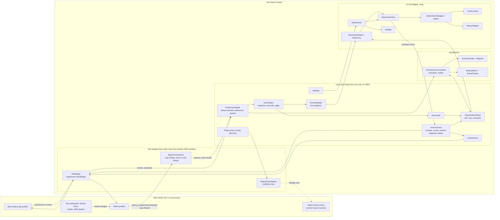

### 2.4 Layering and dependency rules

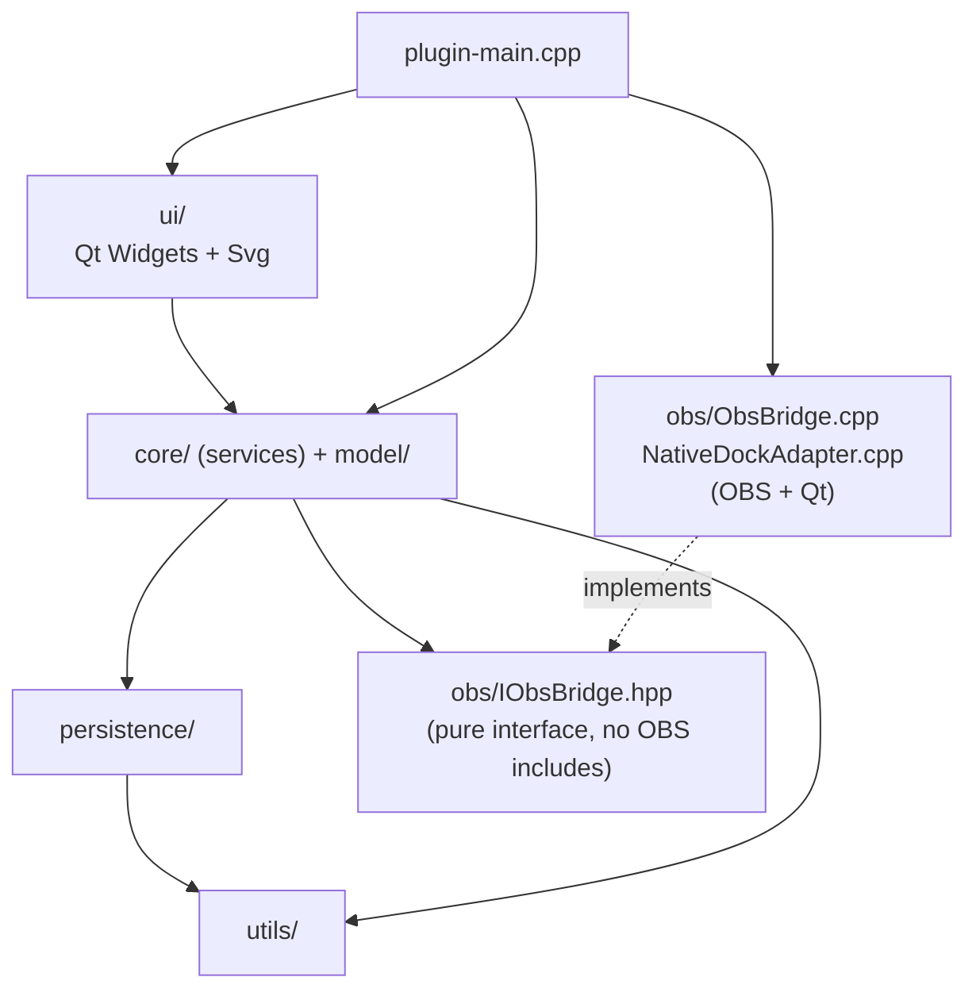

Rules, enforced by CMake target boundaries ([section 16](#16-build-and-cmake-integration)) rather than by convention:

1. `utils/`, `model/`, `persistence/`, `core/` link **Qt6::Core only** and do not see OBS include directories. Including `<obs.h>` there is a compile error.
2. `ui/` links Qt6::Widgets and Qt6::Svg, never libobs. It talks to `ActionService` and the item model, not to the bridge.
3. Only `obs/ObsBridge.cpp`, `obs/SignalTrampolines.cpp` and `obs/NativeDockAdapter.cpp` include OBS headers (the adapter includes only Qt, but is placed in `obs/` because it is the single unsupported-lookup site).
4. Dependencies point downward. No lower layer knows a higher one. Notifications travel upward by Qt signals.

### 2.5 Ownership of data

| Datum | Owner | What the plugin keeps | Notes |
|---|---|---|---|
| Existence, name, UUID of a scene | OBS | Snapshot strings in `SceneRegistry`; stamped copies (`uuid`, `name`) on scene entries | Re-read on every sync and every save |
| Native order of scenes | OBS | Read-only index in the snapshot | Never written ([ADR-002](#adr-002--organization-only-order)). No public reorder API (*Verified in source*, [E36]) |
| Program and Preview scene | OBS | Two UUID strings plus names | Highlight roles only; refreshed on events |
| Studio Mode, transition running | OBS | Booleans refreshed per use | Transition test at call time |
| Stacks, separators, placement, color, icon, favorite, collapsed | Plugin | In-memory `OrganizationModel` | Persisted in `modules["obs-stacks"]` |
| Display preferences, Safe click, backup count, native-dock choice | Plugin | `Settings` | Plugin config directory, not the collection |
| Selection, scroll, expansion while searching | View | Transient widget state | Never persisted |
| Undo/redo history | OBS | Entries added through the public API | Cleared by OBS at every collection cleanup ([E11]) |
| Rolling backups | Plugin | Files in the plugin config directory | Disposable; never read automatically |

---

## 3. Repository and module layout

### 3.1 Tree

The repository is the `obs-plugintemplate` scaffold updated for OBS 33.0.1 (`buildspec.json`, `CMakePresets.json`, OBS 33 plugin layout with `manifest.json`).

```text
obs-stacks/
├─ CMakeLists.txt                 # options ENABLE_FRONTEND_API=ON, ENABLE_QT=ON (presets)
├─ buildspec.json  manifest.json  CMakePresets.json
├─ src/
│  ├─ plugin-main.cpp             # obs_module_load / unload, exception boundary (was plugin-main.c)
│  ├─ plugin-support.h / .c.in    # template: obs_log() adds the "[obs-stacks]" prefix
│  ├─ core/                       # services; Qt Core only
│  │  ├─ Plugin.{hpp,cpp}
│  │  ├─ EventCoordinator.{hpp,cpp}
│  │  ├─ SyncEngine.{hpp,cpp}
│  │  ├─ ActionService.{hpp,cpp}  ActivationPolicy.hpp
│  │  ├─ ops/                     # SceneCreateOp, SceneRenameOp, SceneDuplicateOp, SceneDeleteOp
│  │  ├─ UndoService.{hpp,cpp}
│  │  ├─ Settings.{hpp,cpp}
│  │  └─ Diagnostics.{hpp,cpp}    # log policy, notices, recovery state
│  ├─ model/                      # pure domain; Qt Core only
│  │  ├─ Node.hpp  NodeTypes.hpp
│  │  ├─ OrganizationModel.{hpp,cpp}   # tree, operations, inverse operations, invariants
│  │  ├─ Operations.{hpp,cpp}
│  │  ├─ SceneRegistry.{hpp,cpp}
│  │  ├─ Reconciler.{hpp,cpp}
│  │  └─ SearchIndex.{hpp,cpp}
│  ├─ persistence/                # Qt Core only
│  │  ├─ PersistenceCoordinator.{hpp,cpp}
│  │  ├─ SchemaCodec.{hpp,cpp}    # v1 encode/decode, opaque-node pass-through
│  │  ├─ Migrator.{hpp,cpp}  migrations/V1ToV2.cpp ...
│  │  ├─ Validator.{hpp,cpp}
│  │  ├─ BackupStore.{hpp,cpp}
│  │  └─ ExportImport.{hpp,cpp}
│  ├─ obs/                        # the only code that includes OBS headers
│  │  ├─ IObsBridge.hpp  IObsEventSink.hpp  ICollectionIo.hpp   # pure interfaces
│  │  ├─ ObsBridge.{hpp,cpp}
│  │  ├─ SignalTrampolines.{hpp,cpp}
│  │  └─ NativeDockAdapter.{hpp,cpp}
│  ├─ ui/                         # Qt Widgets + Svg
│  │  ├─ StacksDock.{hpp,cpp}
│  │  ├─ StacksTreeView.{hpp,cpp}
│  │  ├─ StacksItemModel.{hpp,cpp}  StacksFilterProxy.{hpp,cpp}
│  │  ├─ StacksItemDelegate.{hpp,cpp}  editors/
│  │  ├─ IconProvider.{hpp,cpp}  ThemeAdapter.{hpp,cpp}
│  │  └─ dialogs/                 # FirstRun, DeleteScene, Settings, ImportPreview, Cleanup, Recovery
│  └─ utils/
│     ├─ TextFolding.{hpp,cpp}    # accent/case folding with index map
│     ├─ SvgSanitizer.{hpp,cpp}   # whitelist sanitizer
│     ├─ Result.hpp  ScopeGuard.hpp  Uuid.hpp  JsonLimits.hpp
├─ resources/
│  ├─ stacks.qrc
│  └─ icons/lucide/*.svg  LICENSE   # ISC notice shipped with the binary
├─ data/locale/en-US.ini  fr-FR.ini # obs_module_text keys
├─ tests/
│  ├─ unit/                       # core, model, persistence, utils (no OBS)
│  ├─ model/                      # QAbstractItemModelTester, filter proxy
│  ├─ ui/                         # delegate and view geometry, offscreen QPA
│  ├─ scenarios/                  # event-flow scripts on FakeObsBridge
│  ├─ fakes/                      # FakeObsBridge, FakeClock, FakeFs
│  └─ fixtures/                   # golden JSON: v1, corrupt, newer, oversized, hostile SVG
└─ docs/
```

### 3.2 Build targets

| Target | Contents | Links | OBS headers |
|---|---|---|---|
| `stacks_core` (static) | `utils/`, `model/`, `persistence/`, `core/` | Qt6::Core | No |
| `stacks_ui` (static) | `ui/`, `resources/` | `stacks_core`, Qt6::Widgets, Qt6::Svg | No |
| `stacks_obs` (static) | `obs/` | `stacks_core`, Qt6::Widgets, `OBS::libobs`, `OBS::obs-frontend-api` | Yes |
| `obs-stacks` (module) | `plugin-main.cpp` | the three above | Yes (through `stacks_obs` only) |
| `stacks_tests` (executables) | `tests/` | `stacks_core`, `stacks_ui`, Qt6::Test | No |

### 3.3 Class catalogue and responsibilities

#### Entry and wiring (`plugin-main.cpp`, `core/`)

| Class | Responsibility | Must not |
|---|---|---|
| **Plugin entry** (`obs_module_load/unload`) | Version gate (OBS ≥ 33.0.1), construct `Plugin`, register callbacks and dock, install the exception boundary. `obs_module_unload` only releases static state. | Use frontend API after `EXIT` (the frontend is destroyed first; *Verified in source*, [E41]) |
| **Plugin** | Owns and wires all services in a fixed order; owns the shutdown sequence: on `OBS_FRONTEND_EVENT_EXIT` it marks the bridge dead (an atomic flag makes the signal trampolines no-ops), stops timers and drops UI references; in `obs_module_unload` it disconnects the libobs signal handlers, because modules are freed before libobs destroys its signal handler ([E45]). | Hold OBS objects |
| **Settings** | Global preferences in `obs_module_config_path("config.json")` (atomic write via `QSaveFile`): Safe click, display mode and toggles, color mode, backup count, native-dock choice, first-run flag, debug logging. Emits `changed(key)`. | Write any OBS config file |
| **Diagnostics** | Log policy (levels, prefix, rate limiting), user-visible notices, recovery state ([section 12](#12-error-handling-logging-and-recovery)). | Show modal dialogs during live operation |

#### OBS adapter (`obs/`)

| Class | Responsibility |
|---|---|
| **IObsBridge** | Pure interface: the only way core code reads or changes OBS state ([3.4](#34-iobsbridge-contract)). |
| **ObsBridge** | Implements `IObsBridge` with `libobs` and `obs-frontend-api`. Each method acquires and releases `obs_source_t` references inside the call; converts `obs_data_t` to and from JSON strings; registers the save/load callback and the event callback ([E03]) and the libobs signal handlers; delivers events to an `IObsEventSink`. |
| **SignalTrampolines** | Static C functions for `source_create`, `source_remove`, `source_rename`. Each first checks that the source is a scene (`obs_scene_from_source`, as the native handlers do, [E24]), copies the strings it needs (UUID, names), then `QMetaObject::invokeMethod(sink, ..., Qt::QueuedConnection)`. Wrapped in `try/catch(...)`. No logging beyond DEBUG, no allocation beyond the copies, no lock. |
| **NativeDockAdapter** | The single class allowed to look up the native Scenes dock by object name and change its visibility ([section 11](#11-native-scenes-dock-hide-and-restore-design)). Self-checks and degrades to "manual instructions". |

#### Domain (`model/`)

| Class | Responsibility |
|---|---|
| **SceneRegistry** | Live snapshot of OBS scenes: `uuid`, `name`, `nativeIndex`, plus `programUuid/Name`, `previewUuid/Name`, `studioMode`. O(1) lookup by uuid and by name. Produces a `RegistryDiff` against a fresh snapshot (added, removed, renamed, reindexed, presence changed). |
| **OrganizationModel** | The tree of nodes (`scene`, `stack`, `separator`, `unsorted`, plus `opaque` pass-through nodes). Pure operations with inverse operations (`MoveNodes`, `CreateStack`, `DissolveStack`, `Rename`, `SetColor`, `SetIcon`, `SetFavorite`, `SetCollapsed`, `CreateSeparator`, `EditSeparator`, `RemoveSeparator`, `FileScene`, `Restamp`, `Tombstone`). Enforces the invariants of [4.2](#42-invariants) on every operation. Emits fine-grained change sets for the UI. Knows nothing about OBS or Qt Widgets. |
| **Reconciler** | Pure function: given the persisted tree and a live snapshot, produces the reconciled tree and a report ([section 5](#5-identity-and-reconciliation)). |
| **SearchIndex** | Folded (case and accent insensitive) copies of names with an index map back to the original for highlighting; updated incrementally on rename, insert and remove. |

#### Services (`core/`)

| Class | Responsibility |
|---|---|
| **EventCoordinator** | Receives every hint (frontend events, queued signal hints) on the main thread; owns the collection phase machine ([6.1](#61-collection-phase-machine)); debounces bursts; discards hints while no collection is loaded; applies re-entrancy and loop guards ([section 7](#7-synchronization-strategy-and-loop-prevention)). Never mutates the model directly: it asks `SyncEngine` to run. |
| **SyncEngine** | Takes a fresh snapshot through the bridge, diffs it against `SceneRegistry`, runs `Reconciler` in the right mode, applies the result to `OrganizationModel` as one batched change, asks `PersistenceCoordinator` to schedule a save only if organization content changed. |
| **ActionService** | Every user command that touches OBS: activate (with `ActivationPolicy`), create, rename, duplicate, safe delete, open filters, projector, screenshot, send to Program. Validates, executes through the bridge, updates the model immediately and registers undo. Refuses unsafe requests with a typed reason. |
| **ActivationPolicy** | Pure decision table: `(studioMode, safeClick, transitionOnDoubleClick, transitionRunning, intent) → {None, Program, Preview, PreviewThenTransition}`. Exhaustively unit-tested. |
| **UndoService** | Registers undo/redo actions with `obs_frontend_add_undo_redo_action` (through the bridge) and dispatches the static callbacks back into `ActionService` with a JSON payload ([10.6](#106-undoredo-integration)). |
| **PersistenceCoordinator** | Connects the model to the save/load hook: parse, validate, migrate, choose the mode (Normal or Passthrough), serialize on save, schedule saves, trigger backups ([section 9](#9-persistence-strategy)). |

#### UI (`ui/`)

| Class | Responsibility |
|---|---|
| **StacksDock** | Root widget given to `obs_frontend_add_dock_by_id`: header (search, favorites filter, settings menu; the title is drawn by OBS in the dock title bar), the tree, the bottom action bar, a notice bar. Handles the dock-close custom event to pause cosmetic work. |
| **StacksTreeView** (`QTreeView`) | Emits `activateRequested(index, intent)` only for a left-button release without drag and without Ctrl/Shift, for double-click and for Enter; never from selection or current-index signals. Owns drag and drop, keyboard map (dock-scoped), expansion handling (search forces expansion without touching saved state). |
| **StacksItemModel** (`QAbstractItemModel`) | Adapter over `OrganizationModel` plus `SceneRegistry` flags. Roles: node type, node id, uuid, color, icon, favorite, collapsed, Program, Preview, missing, search ranges, accessible text. Batches changes as `rowsInserted/Removed/Moved/dataChanged`, or one reset above a threshold. |
| **StacksFilterProxy** (`QSortFilterProxyModel`) | Search and favorites filter using `SearchIndex`; recursive filtering so stacks containing matches stay visible. |
| **StacksItemDelegate** and editors | Painting per node type and state; inline rename editors; sizeHint cache. |
| **IconProvider** | Lucide and custom icons, recolored at render time, cached by `(icon, color, size, dpr)`. |
| **ThemeAdapter** | Derives the color tokens from `qApp->palette()` and `obs_frontend_is_theme_dark()` (through the bridge); notifies on `THEME_CHANGED` and `QEvent::PaletteChange`. |
| **Dialogs** | First-run (opt-in native dock), delete confirmation, settings, import preview, cleanup of missing scenes, recovery. |

### 3.4 IObsBridge contract

Illustrative interface (design, not final). Everything returns plain values; no OBS type crosses this boundary.

```cpp
// obs/IObsBridge.hpp  (no OBS includes)
struct SceneInfo      { QString uuid; QString name; int nativeIndex; };
struct Presence       { QString programUuid, programName, previewUuid, previewName;
                        bool studioMode; };
struct SceneUsage     { QStringList usedByScenes;     // names of scenes that contain it
                        bool usedByProgram; };        // transitively
struct ActionError    { enum Kind { NameEmpty, NameInUse, NotFound, OnAir, LastScene,
                                    UsedByProgram, TransitionRunning, StudioPreview,
                                    ObsRefused } kind; QString detail; };

class IObsBridge {
public:
  virtual ~IObsBridge() = default;
  // --- queries (main thread) ---
  virtual QVector<SceneInfo> listScenes() = 0;                 // native order, main canvas
  virtual Presence           presence() = 0;
  virtual bool               nameInUse(const QString&) = 0;    // all public sources share one namespace
  virtual bool               transitionRunning() = 0;
  virtual bool               transitionOnDoubleClick() = 0;    // read-only read of OBS user config
  virtual bool               isThemeDark() = 0;
  virtual QString            currentCollectionName() = 0;
  virtual SceneUsage         sceneUsage(const QString& uuid) = 0;
  // --- explicit user commands (main thread) ---
  virtual Result<void>       activateProgram(const QString& uuid) = 0;
  virtual Result<void>       activatePreview(const QString& uuid) = 0;
  virtual Result<void>       triggerTransition() = 0;          // Preview to Program
  virtual Result<SceneInfo>  createScene(const QString& name) = 0;
  virtual Result<SceneInfo>  duplicateScene(const QString& uuid, const QString& newName) = 0;
  virtual Result<void>       renameScene(const QString& uuid, const QString& newName) = 0;
  virtual Result<QByteArray> captureSceneForUndo(const QString& uuid) = 0;   // JSON
  virtual Result<void>       removeScene(const QString& uuid) = 0;
  virtual Result<SceneInfo>  restoreScene(const QByteArray& snapshotJson) = 0;
  virtual void               openFilters(const QString& uuid) = 0;
  virtual void               takeScreenshot(const QString& uuid) = 0;
  virtual void               requestSave() = 0;                // obs_frontend_save()
  virtual void               deferSaveBegin() = 0;
  virtual void               deferSaveEnd() = 0;
  virtual void               addUndoAction(const QString& label, const QByteArray& undoData,
                                           const QByteArray& redoData, bool repeatable) = 0;
};

// Events are delivered on the Qt main thread, never inside libobs signal context
// (exceptions, delivered synchronously on the main thread: Cleanup, Exit, and the collection I/O hook).
class IObsEventSink {
public:
  virtual void onSceneHint(HintKind kind, const QString& uuid, const QString& name,
                           const QString& prevName) = 0;      // Created, Removed, Renamed
  virtual void onFrontendEvent(FrontendEvent e) = 0;          // SceneChanged, PreviewChanged, StudioOn/Off,
                                                              // CollectionChanged, FinishedLoading,
                                                              // TransitionStopped, ThemeChanged
  virtual void onCleanup() = 0;                               // synchronous
  virtual void onExit() = 0;                                  // synchronous
};

class ICollectionIo {                                         // synchronous, main thread
public:
  virtual std::optional<QByteArray> onSave() = 0;             // nullopt = leave the key untouched
  virtual void onLoad(const std::optional<QByteArray>& blob) = 0;   // nullopt = key absent
};
```

The scenes returned by `listScenes()` come from `obs_frontend_get_scenes` and are freed with `obs_frontend_source_list_free` inside the call ([E15]). `sceneUsage` and `captureSceneForUndo` reproduce the data gathering of OBS's own delete path ([E19]).

---

## 4. Data model

### 4.1 Node types and fields

| Type | Where | Fields | Notes |
|---|---|---|---|
| `scene` | Root, inside a stack, inside Unsorted | `uuid`, `name`, optional `color`, `icon`, `favorite`, `missing_since`, reserved `canvas_uuid` | `uuid` and `name` are *stamped* from OBS at every save ([5.2](#52-algorithm-design-not-implementation)). A scene entry whose scene no longer exists is a **tombstone** (`missing_since` set). |
| `stack` | Root only | `id` (UUID), `name`, optional `color`, `icon`, `collapsed`, `children[]` | `children` are `scene` or `separator`. Never `stack`. |
| `separator` | Root or inside a stack | `id` (UUID), `variant` (`line`, `labeled`, `spacer`), `label` (required for `labeled`), optional `size` (`small`, `medium`, `large`; **values pending design review**) | Never a scene, never activatable, never exists in OBS. |
| `unsorted` | Root, singleton, last | `id` (UUID), `collapsed`, `children[]` (scenes only) | Receives scenes created outside Stacks and scenes with lost organization. Cannot be deleted, moved, renamed or dropped into. |
| *opaque* (in memory only) | Anywhere | `raw` JSON | Unknown node type or structurally unusable node from a newer or hand-edited file; preserved and re-emitted verbatim, not rendered. |

### 4.2 Invariants

Enforced by `OrganizationModel` on every operation and re-checked by `Validator` on load and before save. A violation on load is repaired and logged; a violation produced by code is a bug (assert in debug, repair and log in release).

| ID | Invariant |
|---|---|
| I1 | **Depth ≤ 1.** Root nodes are depth 0. Only `stack` and `unsorted` have children, and a stack's children are never stacks. |
| I2 | **Each scene UUID appears at most once** in the whole tree (including Unsorted and tombstones). A scene entry with an empty `uuid` (legacy or hand-edited) is allowed but is matched by name only. |
| I3 | Plugin ids (`id` of stacks, separators, unsorted) are unique across the tree. |
| I4 | `unsorted` is a singleton and the last root node. Its children are scenes only. Nothing can be dropped into it. |
| I5 | **Separators are never activatable.** `ActionService` rejects them by type; the item model returns `Qt::NoItemFlags` for selection-to-activation on them. |
| I6 | A `labeled` separator has a non-empty `label`. A stack has a non-empty `name`. |
| I7 | `color` is `#RRGGBB`. Anything else is treated as absent. |
| I8 | Strings and counts respect the limits of [4.6](#46-validation-and-size-limits). |
| I9 | The model never contains a node for something that is not a scene, stack, separator or Unsorted, except `opaque` pass-through nodes. |

### 4.3 In-memory model

Illustrative (design, not final):

```cpp
using NodeId = quint64;                       // runtime id, never persisted

enum class NodeType { Scene, Stack, Separator, Unsorted, Opaque };

struct Node {
  NodeId   id;
  NodeType type;
  QString  persistId;                         // stack/separator/unsorted: UUID string
  QString  uuid, name;                        // scene: stamped from OBS
  std::optional<QColor>  color;               // user color, not a theme color
  std::optional<IconRef> icon;
  bool     favorite = false;
  bool     collapsed = false;                 // stack/unsorted: the SAVED state
  std::optional<QDateTime> missingSince;      // scene tombstone
  SeparatorVariant variant; QString label; SeparatorSize size;
  QJsonObject extras;                         // unknown keys preserved verbatim
  QJsonObject rawOpaque;                      // type == Opaque
  Node* parent = nullptr;  QVector<std::unique_ptr<Node>> children;
};
```

Operations are command objects with an `apply()` that returns a `ChangeSet` (inserted, removed, moved, changed rows) and an `inverse()`. The inverse is what undo uses ([10.6](#106-undoredo-integration)). Operations reference nodes by plugin id or scene UUID, never by pointer or row, so a stale undo degrades safely (missing target falls back to Unsorted or the root and is logged).

### 4.4 JSON Schema v1 (draft 2020-12)

The schema describes the **shape** of `modules["obs-stacks"]`. Uniqueness rules (I2, I3), depth beyond the declared structure, and cross-references (custom icon ids) are enforced by `Validator`, because JSON Schema cannot express them. The `$id` is a proposed repository location. `additionalProperties` is left open on purpose: unknown fields are preserved ([9.2](#92-failure-modes-and-pass-through)).

```json
{
  "$schema": "https://json-schema.org/draft/2020-12/schema",
  "$id": "https://github.com/TheOnAirCompany/obs-stacks/docs/schema/collection-v1.schema.json",
  "title": "Stacks for OBS organization data, schema_version 1",
  "type": "object",
  "required": ["schema_version", "writer_version", "nodes"],
  "properties": {
    "schema_version": { "const": 1 },
    "writer_version": { "type": "string", "pattern": "^[0-9]+\\.[0-9]+\\.[0-9]+([-+][0-9A-Za-z.-]+)?$" },
    "nodes": {
      "type": "array",
      "maxItems": 5000,
      "items": { "$ref": "#/$defs/rootNode" }
    },
    "custom_icons": {
      "type": "object",
      "maxProperties": 64,
      "propertyNames": { "pattern": "^[0-9a-f]{8,64}$" },
      "additionalProperties": { "$ref": "#/$defs/customIcon" }
    },
    "unknown": {
      "type": "object",
      "description": "Reserved namespace for data written by newer minor versions or other tools. Never interpreted by v1, always preserved verbatim."
    }
  },
  "additionalProperties": true,
  "$defs": {
    "pluginId": { "type": "string", "pattern": "^[0-9a-f]{8}-[0-9a-f]{4}-[0-9a-f]{4}-[0-9a-f]{4}-[0-9a-f]{12}$" },
    "obsUuid":  { "type": "string", "maxLength": 64, "pattern": "^[0-9A-Fa-f-]*$",
                  "description": "OBS source UUID. May be empty for legacy data: then matching falls back to name." },
    "color":    { "type": "string", "pattern": "^#[0-9A-Fa-f]{6}$" },
    "timestamp":{ "type": "string", "format": "date-time" },
    "icon": {
      "type": "object",
      "required": ["kind"],
      "oneOf": [
        { "properties": { "kind": { "const": "builtin" },
                          "name": { "type": "string", "pattern": "^[a-z0-9-]{1,48}$" } },
          "required": ["name"] },
        { "properties": { "kind": { "const": "custom" },
                          "id":   { "type": "string", "pattern": "^[0-9a-f]{8,64}$" } },
          "required": ["id"] }
      ],
      "properties": {
        "color": { "$ref": "#/$defs/color" },
        "size":  { "enum": ["small", "medium", "large"], "description": "Values are proposals pending design review." }
      }
    },
    "sceneNode": {
      "type": "object",
      "required": ["type", "uuid", "name"],
      "properties": {
        "type":          { "const": "scene" },
        "uuid":          { "$ref": "#/$defs/obsUuid" },
        "name":          { "type": "string", "maxLength": 1024 },
        "color":         { "$ref": "#/$defs/color" },
        "icon":          { "$ref": "#/$defs/icon" },
        "favorite":      { "type": "boolean" },
        "missing_since": { "$ref": "#/$defs/timestamp" },
        "canvas_uuid":   { "type": "string", "description": "Reserved for a future multi-canvas version. Not written in v1." }
      }
    },
    "separatorNode": {
      "type": "object",
      "required": ["type", "id", "variant"],
      "properties": {
        "type":    { "const": "separator" },
        "id":      { "$ref": "#/$defs/pluginId" },
        "variant": { "enum": ["line", "labeled", "spacer"] },
        "label":   { "type": "string", "minLength": 1, "maxLength": 256 },
        "size":    { "enum": ["small", "medium", "large"] }
      },
      "if": { "properties": { "variant": { "const": "labeled" } } },
      "then": { "required": ["label"] }
    },
    "stackChild": {
      "description": "Depth limit: a stack contains scenes and separators only.",
      "oneOf": [ { "$ref": "#/$defs/sceneNode" }, { "$ref": "#/$defs/separatorNode" } ]
    },
    "stackNode": {
      "type": "object",
      "required": ["type", "id", "name", "children"],
      "properties": {
        "type":      { "const": "stack" },
        "id":        { "$ref": "#/$defs/pluginId" },
        "name":      { "type": "string", "minLength": 1, "maxLength": 256 },
        "color":     { "$ref": "#/$defs/color" },
        "icon":      { "$ref": "#/$defs/icon" },
        "collapsed": { "type": "boolean", "default": false },
        "children":  { "type": "array", "maxItems": 5000, "items": { "$ref": "#/$defs/stackChild" } }
      }
    },
    "unsortedNode": {
      "type": "object",
      "required": ["type", "id", "children"],
      "properties": {
        "type":      { "const": "unsorted" },
        "id":        { "$ref": "#/$defs/pluginId" },
        "collapsed": { "type": "boolean", "default": false },
        "children":  { "type": "array", "maxItems": 5000, "items": { "$ref": "#/$defs/sceneNode" } }
      }
    },
    "rootNode": {
      "oneOf": [
        { "$ref": "#/$defs/sceneNode" },
        { "$ref": "#/$defs/stackNode" },
        { "$ref": "#/$defs/separatorNode" },
        { "$ref": "#/$defs/unsortedNode" }
      ]
    },
    "customIcon": {
      "type": "object",
      "required": ["mime", "encoding", "data"],
      "properties": {
        "mime":     { "enum": ["image/svg+xml", "image/png"] },
        "encoding": { "enum": ["utf8", "base64"] },
        "data":     { "type": "string", "maxLength": 65536 },
        "name":     { "type": "string", "maxLength": 64 }
      }
    }
  }
}
```

Reading rules that the schema cannot state:

- A node whose `type` is not one of the four known values, or that fails its definition in a way that cannot be repaired, becomes an **opaque node**: kept in place, re-emitted byte-for-byte equivalent, not rendered.
- A recoverable defect (for example an invalid `color`) drops that single attribute and logs once; it never drops the node.
- `schema_version` greater than the supported version selects **Passthrough** mode ([9.2](#92-failure-modes-and-pass-through)); the schema above is not applied.
- Additive changes (new optional fields, new optional node attributes) do **not** bump `schema_version`; removals, renames and semantic changes do ([section 13](#13-migration-strategy)).

### 4.5 Annotated example

```jsonc
{
  "schema_version": 1,                      // integer; newer than supported => read-only Passthrough
  "writer_version": "0.3.0",                // plugin semver that last wrote this object (diagnostics)
  "nodes": [
    {
      "type": "stack",
      "id": "6b1f0c9e-3a52-4d6e-9b1a-0f5d2c7e8a41",   // plugin id, stable across renames
      "name": "Production",
      "color": "#3478F6",                              // custom or palette color, stored as hex
      "icon": { "kind": "builtin", "name": "broadcast" },
      "collapsed": false,                              // the SAVED state; search never changes it
      "children": [
        { "type": "scene", "uuid": "0c43a5e1-8d0e-4f7e-a3a6-5e0a1c2b9d77", "name": "Intro",
          "favorite": true },
        { "type": "separator", "id": "a9d8e7c6-5b4a-4938-8271-6f5e4d3c2b1a", "variant": "line" },
        { "type": "scene", "uuid": "f1b2c3d4-e5f6-4a7b-8c9d-0e1f2a3b4c5d", "name": "Main camera",
          "color": "#22C55E" }
      ]
    },
    { "type": "separator", "id": "11111111-2222-4333-8444-555555555555",
      "variant": "labeled", "label": "Interludes" },
    { "type": "scene", "uuid": "9a8b7c6d-5e4f-4321-9abc-def012345678", "name": "BRB",
      "icon": { "kind": "builtin", "name": "coffee" } },           // a scene filed at the root
    {
      "type": "stack",
      "id": "22222222-3333-4444-8555-666666666666",
      "name": "Archive",
      "collapsed": true,
      "children": [
        { "type": "scene", "uuid": "deadbeef-0000-4000-8000-000000000001", "name": "Old promo",
          "missing_since": "2026-11-02T18:40:12Z" }              // tombstone: scene no longer in OBS
      ]
    },
    {
      "type": "unsorted",                                         // singleton, always last
      "id": "33333333-4444-4555-8666-777777777777",
      "collapsed": false,
      "children": [
        { "type": "scene", "uuid": "c0ffee00-1111-4222-8333-444455556666", "name": "Scene 7" }
      ]
    }
  ],
  "custom_icons": {                                               // optional, Phase 3
    "5f3a9c1b2d4e6f80": { "mime": "image/svg+xml", "encoding": "utf8",
                          "data": "<svg ...sanitized...></svg>", "name": "logo" }
  },
  "unknown": {}                                                   // preserved verbatim, never interpreted
}
```

The colors above come from the brief's indicative palette and are **proposals pending the design review page**; the schema stores whatever hex value the user picked, so changing the palette later never rewrites existing data. This example validates against the schema of [4.4](#44-json-schema-v1-draft-2020-12) (checked with a draft 2020-12 validator, together with negative cases: nested stack, labeled separator without a label, invalid color, unsupported `schema_version`, mismatched icon fields).

### 4.6 Validation and size limits

All limits are **proposals** (pending OP-4 and measurement). They protect against hostile or corrupt collection files, which can arrive through Import ([section 15](#15-security)).

| Limit | Proposed value | On excess |
|---|---|---|
| Whole `modules["obs-stacks"]` object, serialized | 8 MiB | Passthrough (parse failure class `TooLarge`), original untouched |
| Nodes per container | 5,000 | Passthrough |
| String length: scene name | 1,024 | Truncate in display only; value preserved |
| String length: stack name, label | 256 | Reject on input; on load keep first 256 and log |
| Nesting depth of the JSON | 8 | Passthrough |
| Custom icons: count / size each / total | 64 / 64 KiB / 512 KiB | Icon dropped (fallback glyph), data kept in `unknown` pass-through |
| Tombstones | soft 200 (notice), hard 2,000 (trim oldest, log) | See [5.4](#54-tombstone-lifecycle-and-caps) |

---

## 5. Identity and reconciliation

### 5.1 Identity facts (all *Verified in source* unless noted)

- `obs_source_get_uuid` is saved in the collection and restored on load; it identifies a scene across restarts ([E26], [E34]).
- **Scene Collection > Duplicate regenerates every UUID** in `sources` while copying `modules` verbatim ([E09]). Import keeps UUIDs verbatim ([E09] context).
- When a saved source has no valid 36-character UUID, OBS generates a random one at load, so it changes on every launch until the collection is saved; a duplicated UUID inside one file is regenerated with a warning ([E42]). Collections last saved before OBS 29.1 are the known case; the exact version boundary is a *Hypothesis* (H-12). The design does not depend on it because name fallback covers it.
- A scene source carries a `canvas_uuid` in its saved data and falls back to the main canvas when unknown ([E43]); this is why the schema reserves `canvas_uuid` for a future multi-canvas version.
- Scene names are unique among all public sources in one OBS session; `obs_source_set_name` silently renames a duplicate (appending a suffix) instead of failing ([E26], [E42]).
- Native `Rename` and `Duplicate` of a collection copy the file, so data under `modules` travels, but write **no `.bak`** ([E10]).

Therefore: **key = UUID, fallback key = unique name, stamps refreshed at every save.**

### 5.2 Algorithm (design, not implementation)

Two modes: **LoadClass** (data came from a file: startup, collection switch, Duplicate, Rename, Import, restore from backup) and **Runtime** (the live session changed a scene). Name fallback is allowed only in LoadClass: it exists to survive UUID regeneration, and applying it at runtime would silently file a brand-new scene that merely reuses an old name ("nothing is ever filed silently").

```text
RECONCILE(tree P, live L, mode) -> (P', report)
  # L: scenes from the OBS snapshot, unique by uuid and by name (OBS invariant)
  liveByUuid <- index(L by uuid);  liveByName <- index(L by name)
  entries    <- all scene entries of P in depth-first order
               (root, stack children, Unsorted children, tombstones)
  claimed    <- {}                                    # live uuids already bound

  # 0. hygiene
  for each uuid appearing in more than one entry: keep the first, drop later ones, LOG(warn)

  # 1. UUID pass: a UUID match is authoritative
  for e in entries where e.uuid != "" and liveByUuid has e.uuid and e.uuid not in claimed:
      s <- liveByUuid[e.uuid];  bind(e, s);  claimed += s.uuid
      if e.name != s.name: e.name <- s.name; report.renamed += 1
      clear e.missing_since

  # 2. Name pass (LoadClass only)
  if mode == LoadClass:
      unbound <- [e in entries if not bound(e)]
      for each name n having exactly ONE unbound entry e:     # ambiguity => do not guess
          s <- liveByName.get(n)
          if s exists and s.uuid not in claimed:
              bind(e, s); claimed += s.uuid
              e.uuid <- s.uuid;  report.rekeyed += 1           # re-stamp the key
              clear e.missing_since

  # 3. New scenes go to Unsorted, in native order, never into a stack
  for s in L ordered by nativeIndex where s.uuid not in claimed:
      append scene entry(s.uuid, s.name) to Unsorted;  report.added += 1

  # 4. Missing scenes become tombstones (position kept)
  for e in entries where not bound(e):
      if e is in Unsorted and e has no user data (no color/icon/favorite):
          remove e                                            # nothing to remember
      else:
          if e.missing_since is empty: e.missing_since <- now
          report.tombstoned += 1

  # 5. housekeeping
  enforce tombstone caps (5.4);  ensure Unsorted is a singleton and last;  assert invariants I1..I9
  return (P, report)
```

Properties the implementation must satisfy (property-based tests, [section 17](#17-testability)):

1. **Idempotent:** `reconcile(reconcile(P, L), L) == reconcile(P, L)`.
2. **Complete:** every live scene appears exactly once among bound entries; no live scene is dropped.
3. **Conservative:** no entry carrying user data is deleted by reconcile except through the cap trim of [5.4](#54-tombstone-lifecycle-and-caps).
4. **Pure:** no I/O, no clock except an injected `now`.

The **save callback** runs its own `RECONCILE(Runtime)` against a fresh `listScenes()` right before serializing. This re-stamps `uuid` and `name` from OBS at every save, so stamps are correct even if a rename event is still queued.

### 5.3 Scenarios

| Scenario | What happens | Result |
|---|---|---|
| **Normal load** | UUID pass binds everything | Identical tree |
| **Scene Collection > Duplicate** | New UUIDs in `sources`, old UUIDs in `modules`. UUID pass binds nothing; name pass re-keys every entry | Tree intact, report `rekeyed = N`; first save writes the new UUIDs. The source collection's file is untouched |
| **Import of a collection** | Data and UUIDs travel together | Identical tree. If the importer renamed the collection file only, nothing changes |
| **Pre-29.1 collection** | Sources may have no stable UUID. The first Stacks save writes whatever UUIDs OBS currently exposes, in the same save OBS writes them to `sources` | Consistent from the first save; name pass is the safety net ([H-12](#19-hypothesis-register-and-open-points)) |
| **Scene renamed while the plugin was disabled** | UUID pass binds it; name restamped | Keeps its place; `renamed = 1` |
| **Scene deleted and recreated by name while disabled** | New UUID, same name. Name pass binds by name | Keeps the old place; counted in `rekeyed`, shown in the load notice (the user can see that matching was by name) |
| **Scene created externally while running** (websocket, Stream Deck, native dock) | Runtime mode; step 3 | Appears in **Unsorted** with a subtle "new" marker |
| **New scene at runtime reuses the name of a tombstone** | Runtime mode: no name pass | Goes to Unsorted; the tombstone stays until cleanup. Never silently inherits a place |
| **Two entries with the same name, neither UUID-bound** (hand-edited or corrupt) | Name pass sees two unbound entries for one name | Not guessed: the live scene goes to Unsorted, both entries are tombstones |
| **Scene deleted in OBS, then OBS undo** | `source_remove` hint, snapshot lacks it, entry becomes a tombstone in place. Undo restores the same UUID ([E19]); UUID pass revives the entry | Back in its stack and position |
| **Scene deleted, plugin disabled, restored later by undo-less recreate** | Name pass at next load, or Unsorted | As above |
| **Collection switch or OBS exit** | OBS removes every scene, firing `source_remove` for each ([E11]) | **No purge.** Hints are ignored outside `Ready`; tombstoning happens only in reconcile against a loaded collection |
| **Tombstone cleanup** | Explicit user action with preview | Entries removed; pre-operation backup taken |

### 5.4 Tombstone lifecycle and caps

- Created by reconcile when an entry has no live scene. Persisted with `missing_since`.
- Hidden from the main tree by default (the item model filters `missing`); shown only in the 'Missing scenes' section of the tree, which appears when the "Show missing scenes" setting is on (03 §8.5), plus a notice when the soft cap is exceeded. Presentation is specified in [03-ux-ui-specification.md](03-ux-ui-specification.md).
- Revived by a UUID match at any time (OBS undo, re-import of the collection).
- **Soft cap 200:** a non-blocking notice offers "Clean up missing scenes". **Hard cap 2,000:** reconcile trims the oldest tombstones (by `missing_since`) and logs one line; active entries are never trimmed. Both values are proposals (OP-4).
- Unsorted entries with no user data are dropped instead of tombstoned (step 4), so external create/delete cycles cannot grow the file.

---

## 6. Runtime lifecycle and event flows

### 6.1 Collection phase machine

`EventCoordinator` owns one state machine. Everything else (sync, save, undo callbacks, actions) consults it.

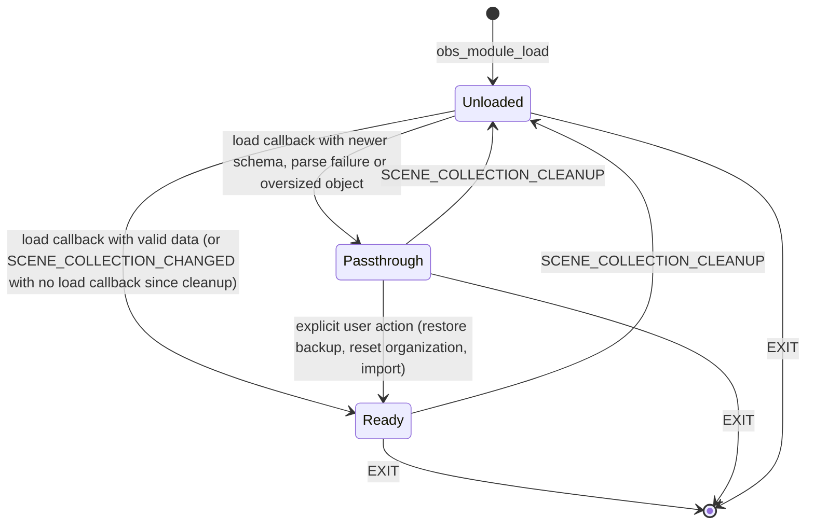

| Phase | Scene hints and frontend events | Save callback | Model and UI | Actions |
|---|---|---|---|---|
| **Unloaded** | Discarded (OBS is tearing a collection down or loading a new one) | Writes nothing | Reset, shows an empty/loading state | Disabled |
| **Ready** | Processed | Reconciles and serializes | Normal | Enabled |
| **Passthrough** | Processed for the scene list only | Writes nothing; OBS re-saves the original object it holds | Every cause (newer schema, parse failure, too large, migration failure): all scenes under a read-only Unsorted view in native order; the stored organization is never decoded (03 §19, 05 D-06) | Scene actions enabled; organization edits disabled with an explanation |

Why `Unloaded` exists: after `SCENE_COLLECTION_CLEANUP`, a **brand-new collection triggers no load callback** (OBS creates a default scene and does not call the load path; *Verified in source*, [E12]), so a stale tree from the previous collection must never survive and be written into the new one. `SCENE_COLLECTION_CHANGED` is the fallback transition to `Ready` with an empty tree.

### 6.2 Threads and triggers

| Trigger | Thread | Delivered to the plugin as | Handling |
|---|---|---|---|
| libobs `source_create` (main canvas scenes) | Any thread, including obs-websocket pool threads, signal mutex held ([E25], [E26], [E27], [E32]) | `SignalTrampolines` copy uuid and name, `QueuedConnection` hint | Debounced sync |
| libobs `source_remove` | Same. Fires for **every** scene on collection switch and exit ([E11]) | Hint | Ignored outside `Ready`; otherwise tombstones through reconcile, never a purge |
| libobs `source_rename` | Same. The only trigger for an API/websocket rename: `SCENE_LIST_CHANGED` is emitted only by the native UI path ([E23], [E24], [E26]) | Hint with new and previous name | Debounced sync |
| libobs `source_destroy` | The libobs destruction task thread ([E26]) | **Not subscribed**: `source_remove` already covers deletion and `destroy` adds no information | n/a |
| Frontend `SCENE_CHANGED`, `PREVIEW_SCENE_CHANGED`, `STUDIO_MODE_ENABLED/DISABLED`, `TRANSITION_STOPPED` | Main thread in the paths reviewed; the API does not promise it (H-05), so the coordinator re-posts if it is not on the main thread | Queued hint | Refresh presence (Program/Preview/Studio flags) only |
| Frontend `SCENE_LIST_CHANGED` | Main thread | Queued hint | Redundant trigger for native-UI add/remove/rename; not required for correctness |
| Frontend `SCENE_COLLECTION_CLEANUP` | Main thread, always emitted, even during load suppression ([E04], [E11]) | **Synchronous** `onCleanup()` | Phase = `Unloaded`, drop queued hints, cancel timers, reset the model, release anything held |
| Frontend `SCENE_COLLECTION_CHANGED`, `FINISHED_LOADING` | Main thread; suppressed during load by OBS ([E04]); `CHANGED` also emitted at startup ([E14]) | Queued hint | Idempotent sync; first-run flow on `FINISHED_LOADING` |
| Frontend `SCENE_COLLECTION_CHANGING` | Main thread, **only for a user-driven switch** ([E13]) | Not relied upon | May be used for a pre-switch flush only as an optimization |
| Frontend `THEME_CHANGED` | Main thread | Queued hint | `ThemeAdapter` re-derives tokens, clears icon cache |
| Frontend `EXIT` | Main thread, after `saveAll` and `ClearSceneData` ([E41]) | **Synchronous** `onExit()` | Mark dead, stop timers, native-dock normalization ([section 11](#11-native-scenes-dock-hide-and-restore-design)) |
| Save/load callback | Main thread ([E04], [E05], [E08]) | **Synchronous** `ICollectionIo` | See [section 9](#9-persistence-strategy) |
| User input | Main thread | Qt events | `StacksTreeView` and actions |

### 6.3 Flows

#### Startup and `FINISHED_LOADING`

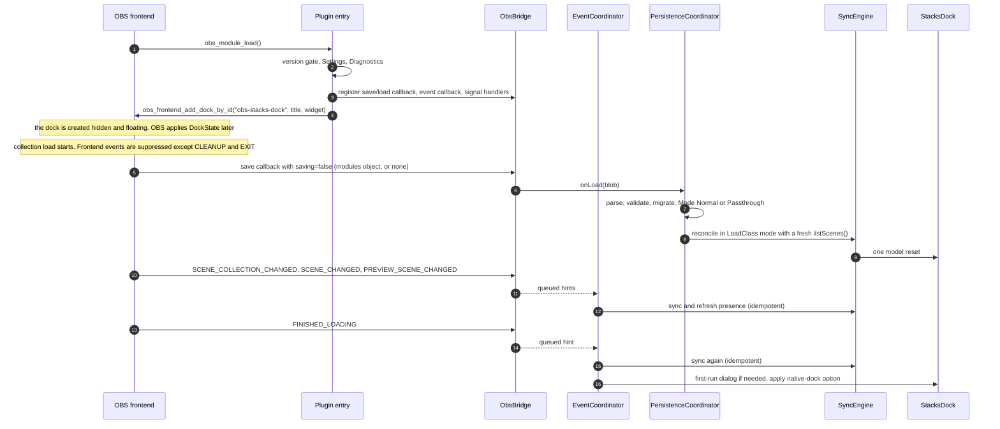

The native scene list is complete when the load callback runs: scenes are added by the native handler during source loading and `scene_order` is applied before `on_load` (*Verified in source*, [E23], [E08]). `modulesObj` can be absent: the load path must accept "no blob" (H-06: `obs_data_get_obj` on a missing key returns no object, to be confirmed by a unit test against a fake and a runtime check).

#### Scene created externally

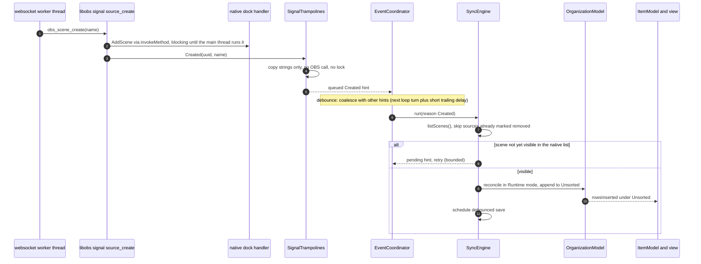

Why the retry exists: the native handler uses `WaitConnection()`, which is a direct call on the main thread and a **blocking queued call from any other thread** ([E24], [E44]). Our queued hint and the native `AddScene` are both posted to the main thread; their relative order is not guaranteed, so the snapshot may not contain the new scene yet. The sync step keeps a small set of *pending hints* (uuids it was told about but did not see) and retries a bounded number of times (proposal: at the next loop turn, then after 20 ms and 50 ms) before logging a DEBUG line and giving up until the next trigger. This is bounded work after an event, not polling.

#### Scene renamed through obs-websocket on a worker thread

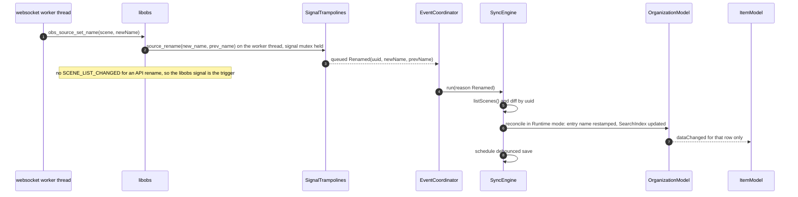

#### Scene removed, then OBS undo

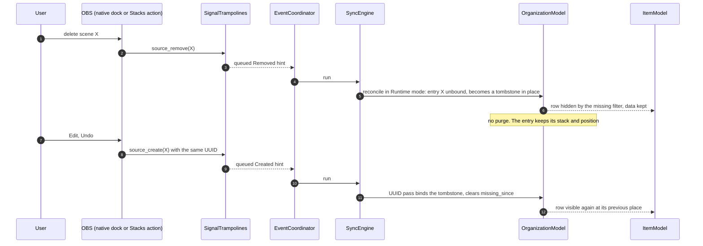

OBS's own undo of a native delete re-creates the scene with its saved UUID and then selects it, which changes Program outside Studio Mode ([E19]); that is OBS's behavior when the delete was done in the native dock and is outside our control. Stacks' own delete ([10.5](#105-safe-delete)) restores without selecting.

#### Collection switch

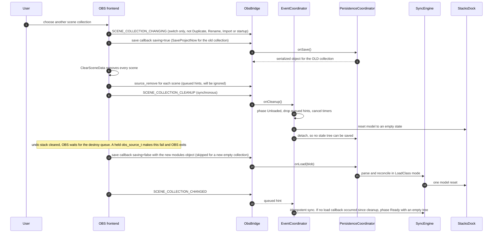

*Verified in source*: save before switch ([E13]), removal loop then `CLEANUP` then `undo_s.clear()` ([E11]), failure when a source survives ([E11], [E38]), `CHANGED` always emitted after activation ([E13]), no load callback for a collection created from a default scene ([E12]).

#### Studio Mode toggle

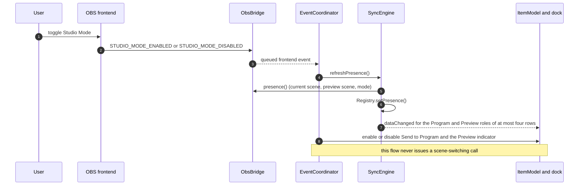

#### User activates a scene

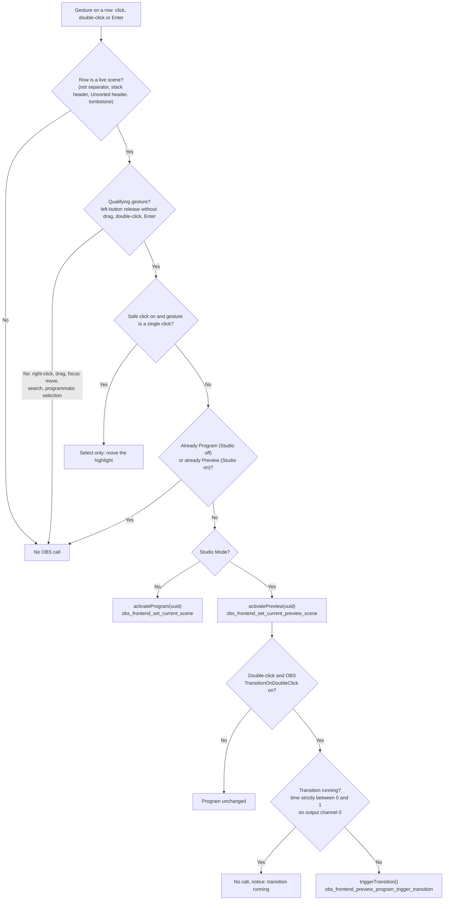

Rules: outside Studio Mode a double-click on a scene adds nothing when Safe click is off, because the first click already activated it (OBS's native double-click handler acts only in Studio Mode, [E22]). The transition guard mirrors OBS's own test, which reads `obs_transition_get_time` on the channel-0 output source ([E18], [E39]). Both the check and the call run on the main thread without yielding, so no transition can start between them (transitions are started from the main thread).

#### Drag and drop reorder

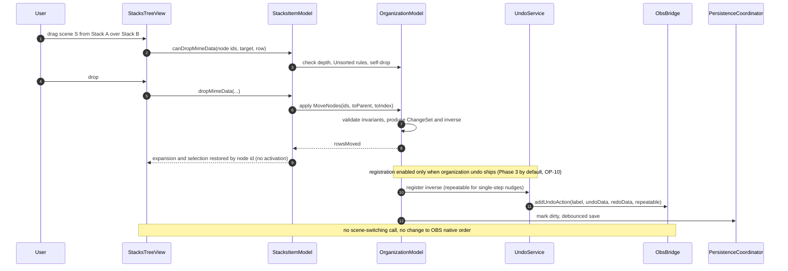

#### Save

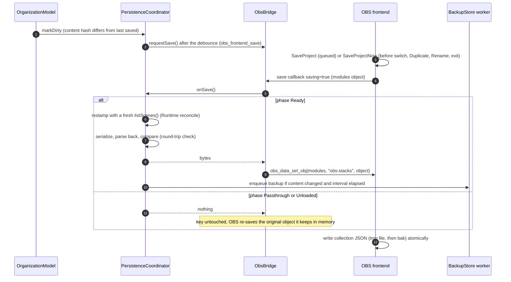

---

## 7. Synchronization strategy and loop prevention

### 7.1 Idempotent rebuild versus incremental diff

| | Apply event payloads as deltas | **Hint, then snapshot-and-reconcile (chosen)** |
|---|---|---|
| Missed or reordered event | State drifts until next restart | Self-heals at the next trigger |
| Native `AddScene` racing our hint ([E24], [E44]) | Order-dependent bugs | Handled by pending-hint retry |
| Burst of 500 `source_create` during a load | 500 mutations | One snapshot, one batch |
| Thread safety | Payload objects cross threads | Only copied strings cross threads |
| Cost | O(1) per event | O(n) per sync, n ≤ a few hundred scenes ([section 14](#14-performance-design)) |
| Testability | Many interleavings | One pure function (`Reconciler`) plus a trigger |

**Decision:** events are *hints*; one `SyncEngine.run()` re-reads OBS and reconciles. The UI model update is still **incremental**: `SyncEngine` converts the reconcile result into a minimal change set (row inserts, removals, renames), and falls back to a single model reset only above a threshold (proposal: more than 64 changed rows or more than a quarter of all rows).

### 7.2 Pipeline

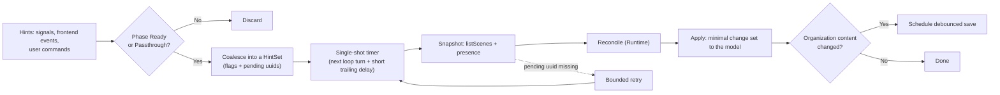

### 7.3 Debounce and burst handling (proposals)

| Mechanism | Value | Purpose |
|---|---|---|
| Hint coalescing | One timer: fire on the next event-loop turn, with a 25 ms trailing delay while hints keep arriving, 250 ms maximum wait | Collapse a load or import into one sync |
| Pending-hint retry | At most 3 attempts (next turn, 20 ms, 50 ms) | Native handler race |
| Save debounce | 750 ms trailing, 5 s maximum wait; flushed by OBS's own save before a switch, Duplicate, Rename and at exit | Avoid rewriting the whole collection file for every drag step |
| Presence refresh | No debounce (two string reads); coalesced with a sync if one is pending | Highlight latency |
| Backup | At most one per 5 minutes for periodic backups; always for pre-operation snapshots | [9.3](#93-rolling-backups) |

All timers are single-shot, event-driven and armed only by an incoming hint. There is no periodic timer and no polling (NFR-10).

### 7.4 Loop prevention

| Potential loop | Guard |
|---|---|
| Model change → OBS → event → model change | The model never writes to OBS automatically. OBS is written only by explicit `ActionService` commands. |
| Selection ↔ Program/Preview highlight | Selection (`QItemSelectionModel`) and highlight (item roles) are separate. OBS events update roles only. Activation is requested only by `activateRequested` from the view (qualifying gestures), never by `currentChanged` or `selectionChanged`. |
| Save callback → restamp → "dirty" → `obs_frontend_save` → save callback | Restamping inside the save callback carries `Origin::Save` and never marks the model dirty. Dirtiness is the difference between the serialized content hash and the last saved hash, not "a mutation happened". |
| Our own action → echo event → second reconcile | The echo reconcile is idempotent: the model already holds the new state, the diff is empty, nothing is saved. Undo registration happens in `ActionService` at the moment of the command, never on events, so echoes cannot register undo entries twice. |
| Model change signals → sync scheduling | A scoped `ApplyingSnapshot` guard on the main thread makes `SyncEngine::schedule()` ignore calls while a snapshot is being applied. |
| Load-time signal storm | Phase gating: hints are discarded in `Unloaded`. The load callback performs one reconcile; the following `CHANGED` and `FINISHED_LOADING` syncs are no-ops. |
| Debounced timers firing after collection change or exit | Each timer callback re-checks the phase and the `alive` flag. `onCleanup()` cancels timers and clears the HintSet. |

**Origin tagging.** Every model mutation carries an `Origin` (`User`, `Obs`, `Load`, `Save`, `Undo`, `Import`). Origins decide only: whether the change is registered for undo (`User` only), whether the model is marked dirty (not for `Save`), and what is logged. They never feed back into OBS.

### 7.5 Program and Preview highlight

`SceneRegistry` stores `programUuid`, `programName`, `previewUuid`, `previewName`, `studioMode`, read from `obs_frontend_get_current_scene`, `obs_frontend_preview_program_mode_active` and `obs_frontend_get_current_preview_scene` ([E15], [E16], [E17]). Outside Studio Mode the current scene is the Program; in Studio Mode `get_current_scene` returns the Program and `get_current_preview_scene` the Preview.

With OBS's scene-duplication mode in Studio Mode, the Program can be a **private copy** of the scene with the same name and a different UUID ([E18]). *Hypothesis* (H-09, also PRD OP-5): the copy emits no global signal and `obs_frontend_get_current_scene` returns it. Design response: highlight by UUID first, then fall back to a match by **name** when the Program UUID is not in the registry. The same fallback is used by the delete guard ([10.5](#105-safe-delete)).

---

## 8. Threading model

### 8.1 Where each callback runs

| Entry point | Thread | Rule |
|---|---|---|
| `obs_module_load` / `obs_module_unload` | Main thread | Construct and register; no blocking work |
| libobs signals `source_create/remove/rename` | **Any** (websocket pool, UI, scripts), signal mutex held ([E27], [E32]) | Copy strings, post with `QueuedConnection`, return. No OBS call except getters on the argument, no lock, no logging above DEBUG, wrapped in `try/catch(...)` |
| libobs signal `source_destroy` | libobs destruction task thread ([E26]) | Not subscribed |
| Frontend event callback | Main thread in reviewed paths, not promised (H-05) | Check `QThread::currentThread()`; re-post when needed. `CLEANUP` and `EXIT` are handled synchronously because they must complete before OBS continues |
| Save / load callback | Main thread ([E04], [E05], [E08]) | Synchronous, short, no event-loop spinning |
| Undo/redo callbacks | Main thread, called from OBS's Edit menu ([E28]) | Static trampolines with a JSON payload; no-op when the plugin is not alive |
| Qt widget events | Main thread | All model and UI work |
| `BackupStore` worker (`QThreadPool`) | Worker | Receives an immutable `QByteArray` and a path. **Never** calls OBS or touches the model or any QObject of the UI |
| Icon rasterization | Main thread (QPixmap) | Cached; image-only work could move to a worker later (not planned) |

### 8.2 Rules

| # | Rule |
|---|---|
| R1 | **No blocking connection types**, anywhere. `BlockingQueuedConnection` from a signal handler could deadlock against the signal mutex and the native handler's own blocking invoke ([E24], [E27], [E44]). |
| R2 | Handlers that run off the main thread only copy data and post. They never touch `QObject` children, the model or the registry. |
| R3 | Every queued call targets a context `QObject` that lives on the main thread, so Qt drops it safely if the object is destroyed. |
| R4 | **No `obs_source_t*` is retained** past the bridge call that obtained it. Use `obs_frontend_source_list_free` or `obs_source_release` before returning ([E15]). Types holding strong source references never appear in `core/`, `model/`, `ui/`. |
| R5 | **CLEANUP release rule:** on `SCENE_COLLECTION_CLEANUP` nothing in the plugin may still hold a source. By construction nothing does (R4); the handler additionally clears pending hints and cancels timers, and logs at DEBUG that the model was detached. A leak would make OBS refuse the switch and exit ([E11], [E37], [E38]). |
| R6 | No work is ever done from OBS's graphics, audio or encode threads. |
| R7 | Shutdown: `onExit()` marks the bridge dead (atomic flag), stops timers and drops UI references; libobs signal handlers are disconnected in `obs_module_unload` ([E45]). A soak test with a websocket client creating scenes during shutdown guards the deadlock window (H-14). |
| R8 | Exceptions never cross a C callback boundary; every trampoline and hook catches, logs once and degrades ([section 12](#12-error-handling-logging-and-recovery)). |

---

## 9. Persistence strategy

### 9.1 What OBS does, and what we do

- On save, OBS calls every registered save callback with the **modules object** and then writes the collection with `obs_data_save_json_pretty_safe(..., "tmp", "bak")` ([E05], [E06]).
- On load, OBS keeps a reference to the whole `modules` object in memory, so data of absent or disabled plugins is written back unchanged on every save ([E07]). The reference is dropped at cleanup ([E11]).
- `SaveProjectNow` runs before a collection switch, Duplicate, Rename and at exit, so the in-memory model must be serializable at any moment ([E13]).
- Duplicate and Rename write the new file without `.bak` ([E10]).

Design: **the collection JSON is the single source of truth** for organization. The save callback writes `modules["obs-stacks"]` only. A disposable rolling backup is a safety net, never a second source ([ADR-003](#adr-003--persistence-in-collection-modules-plus-disposable-backups)).

### 9.2 Failure modes and pass-through

`PersistenceCoordinator.onLoad(blob)` decides one of two modes. **Passthrough** means: the stored object is never modified, the key is never touched by our save callback, and organization editing is disabled. Because OBS keeps the original `modules` object in memory and rewrites it on every save ([E07]), "do nothing" is exactly "re-save the original untouched". As defense in depth the coordinator also keeps the raw bytes and re-sets the key if it is found missing.

| Situation | Mode | User-visible | What is saved |
|---|---|---|---|
| No `obs-stacks` key | Normal, empty tree, every scene in Unsorted | None | New object at next save |
| Valid v1 | Normal | None | Re-serialized current model |
| Valid older schema with a migration | Normal after migration | One-line notice | Pre-migration backup first, then migrated object at next save |
| Unknown fields, unknown node types | Normal | None | Preserved verbatim (`extras`, opaque nodes, `unknown`) |
| Recoverable defect (bad color, bad size) | Normal | None (logged once) | Attribute dropped, node kept |
| **`schema_version` newer than supported** | **Passthrough (NewerSchema)** | Banner: "Organization data was written by a newer Stacks; editing is disabled to protect it" | Nothing: original object stays |
| **Not parseable, wrong top-level type, over limits, migration failure** | **Passthrough (ParseFailure / TooLarge / MigrationFailure)** | Banner with actions: Restore from backup, Export raw data, Reset organization | Nothing: original object stays |
| Round-trip check fails while saving (serializer bug, or JSON drift through `obs_data`, H-13) | Behaves as Passthrough for this save | Logged at ERROR; banner | Nothing: previous object stays |
| `obs_data` creation from our JSON fails | As above | As above | Nothing |

"Reset organization" and "Restore from backup" are explicit, confirmed actions; they first write a pre-operation backup of the raw object and only then replace the key. The key is **never erased** otherwise (SC-08).

### 9.3 Rolling backups

| Aspect | Design (all numbers are proposals, OP-4) |
|---|---|
| Location | `obs_module_config_path("backups/")`, i.e. `<OBS user config>/plugin_config/obs-stacks/backups/` (*Documented*; the directory is created on first use with `os_mkdirs`) |
| File name | `<slug>-<hash8>__<yyyyMMdd'T'HHmmss'Z'>__<reason>.stacks.json` where `slug` is the ASCII-folded collection name (at most 40 characters) and `hash8` the first 8 hex digits of SHA-256 of the exact collection name (so two collections with the same slug never collide) |
| Content | An envelope: `{ "format": "obs-stacks-backup", "format_version": 1, "created_utc": "…", "reason": "…", "collection_name": "…", "writer_version": "…", "data": { exact serialized modules["obs-stacks"] } }` |
| Reasons | `session-start` (raw object as loaded, only if it differs from the newest backup), `periodic`, `pre-operation:<op>` (dissolve, cleanup, import, restore, reset, migration) |
| Triggers | After the first successful save of a session; at most every 5 minutes on content change; before every destructive plugin operation |
| Rotation | Keep the newest **10** per collection (configurable 3 to 50). Pruning runs after a successful write and never deletes the file just written |
| Dedup | Skipped when the content hash equals the newest backup's |
| Write path | Serialized bytes handed to a worker; `QSaveFile` (temp file plus rename); failures logged at WARNING once, never blocking |
| Never automatic | A backup is **never** read, applied or merged automatically. It cannot overwrite collection data. Restoring is an explicit dialog that previews matches and takes a pre-operation backup first (SC-10) |
| Renamed collection | New name means a new series; old files become orphans and are listed under "other collections" for manual cleanup |
| Privacy | Contains scene names (already in the collection). Never uploaded; the plugin has no network code |

### 9.4 Export and import

- **Export** writes the same envelope with `reason: "export"` to a user-chosen `.stacks.json` file. Phase placement is for [05-implementation-plan.md](05-implementation-plan.md); recommendation: **automatic backups in Phase 2** (they protect the MVP in production, and OBS writes no `.bak` for Duplicate and Rename), **manual export/import in Phase 3** (needs dialogs, a preview and a restore list; the envelope is already defined).
- **Import** validates the envelope and the payload with the same limits as load ([4.6](#46-validation-and-size-limits)), reconciles in **LoadClass** mode against the current scenes, shows a preview (counts of matched by UUID, matched by name, unmatched, stacks, separators), and applies only after confirmation, as one undoable step, after a pre-operation backup. Imported content is never executed; icons are re-sanitized ([section 15](#15-security)).
- **Importers for other tools** (DigitOtter, StreamUP) are a post-v1 extension point: an `Importer` interface in `persistence/` that yields a v1 tree; nothing in v1 depends on it.

### 9.5 Settings

Global preferences live in `obs_module_config_path("config.json")` with its own `settings_version`, written atomically, tolerant of unknown keys, with defaults for missing ones. They never contain organization data. OBS's own configuration files are only **read** (for `TransitionOnDoubleClick`, through `obs_frontend_get_user_config`, [E46]) and never written by the plugin (SC-07).

### 9.6 What is written where

| Data | Location | Writer |
|---|---|---|
| Organization | Collection JSON, `modules["obs-stacks"]` | OBS, from our save callback |
| Global preferences | `<plugin_config>/obs-stacks/config.json` | Plugin |
| Backups, exports | `<plugin_config>/obs-stacks/backups/`, user-chosen path | Plugin |
| Logs | OBS log via `obs_log` | OBS |
| Anything else (other modules' data, scene settings, OBS configs) | n/a | **Never written by the plugin** |

---

## 10. Actions, click semantics and undo/redo

### 10.1 Command pipeline

Every user command goes through `ActionService`:

1. **Validate** against the model and a fresh read of OBS (existence, name rules, on-air state). Return a typed `ActionError` instead of throwing.
2. **Execute** through `IObsBridge` on the main thread.
3. **Update the model** immediately (so the UI never shows a transient Unsorted placement), then let the echo sync confirm.
4. **Register undo** with `UndoService`.
5. **Request a save** (debounced; `obs_frontend_save`, which only queues OBS's own save, [E40]).

Scene-affecting commands never call a scene-switching API as a side effect (SC-04).

### 10.2 Activation policy

`ActivationPolicy` is a pure function, exhaustively unit-tested as a table:

`decide(intent, studioMode, safeClick, transitionOnDoubleClick, transitionRunning, targetIsProgram, targetIsPreview) → { None, SelectOnly, Program, Preview, PreviewThenTransition, Blocked(reason) }`

| Studio | Safe click | Intent | Result |
|---|---|---|---|
| Off | Off | Click | `Program` unless already Program |
| Off | Off | Double-click, Enter | `None` for double-click (the click already activated), `Program` for Enter unless already Program |
| Off | On | Click | `SelectOnly` |
| Off | On | Double-click, Enter | `Program` unless already Program |
| On | Off | Click | `Preview` unless already Preview |
| On | Off | Double-click | `Preview`, then `PreviewThenTransition` only if `transitionOnDoubleClick` and no transition is running |
| On | Off | Enter | `Preview` |
| On | On | Click | `SelectOnly` |
| On | On | Double-click | As Studio on, Safe click off, double-click |
| On | On | Enter | `Preview` |
| Any | Any | Right-click, drag, focus move, search, programmatic selection | `None` (never reaches the policy: the view does not emit an intent) |

*Verified in source* for the native parity points: single click outside Studio Mode changes the current scene and Program through `currentItemChanged` ([E22]); `set_current_scene` in Studio Mode goes through `TransitionToScene` and corrupts `programScene` if a transition is running because the weak reference is assigned before the running check ([E16], [E18]); `set_current_preview_scene` is a no-op outside Studio Mode ([E17]); the native double-click acts only in Studio Mode and calls `TransitionClicked`, which transitions the current (Preview) scene ([E22], [E18]).

Intentional deviation from the native list: **arrow keys never activate** (the native list switches scenes on `currentItemChanged`); here they only move the highlight (FR-07).

### 10.3 Send to Program

Studio Mode only. Sequence: if the transition-running guard passes, `activatePreview(uuid)` when needed, then `triggerTransition()` (`obs_frontend_preview_program_trigger_transition`). This is what OBS's Transition button and double-click do (Preview to Program, with the configured transition and its swap rules). The action is disabled while a transition is running. *Hypothesis* (H-08): `trigger_transition` is a no-op, not an error, when Preview equals Program; verified by a runtime test.

### 10.4 Create, rename, duplicate

| Command | OBS calls | Rules and pitfalls |
|---|---|---|
| **Create** ("+") | `obs_scene_create(name)` then release | Name checked with `obs_get_source_by_name`: **all public sources share one namespace**, so an input named like the wanted scene also blocks it ([E21]). Native Add calls `SetCurrentScene` on the new scene afterwards, which outside Studio Mode makes it Program ([E21]); Stacks does **not** select or activate the new scene. The node is inserted in the model at the target (inside the selected stack, after the selected scene) right after the call returns, before the queued hint is processed, so there is no flash in Unsorted. |
| **Rename** | `obs_source_set_name` | Validate non-empty and unused first: OBS silently appends a suffix on a duplicate ([E26], [E42]). Read the name back after the call and log any discrepancy. Registered for undo. |
| **Duplicate** | `obs_scene_duplicate(scene, name, OBS_SCENE_DUP_REFS)`, release the returned scene | Same name rules. Native Duplicate selects the copy ([E20]); Stacks does not. The copy is inserted right after the original, in the same stack (explicit user action). The copy has a new UUID and gets a copy of the scene's private settings. Registered for undo (undo removes the copy). |

### 10.5 Safe delete

Reimplemented because the native path selects before deleting and its undo selects the restored scene, both of which can switch Program ([E19]). This is the highest-maintenance code in the plugin ([ADR-007](#adr-007--safe-delete-reimplementation-with-obs-undo)); it lives in one class, `SceneDeleteOp`, with parity notes against OBS 33.0.1's `RemoveSelectedScene`.

**Guards** (evaluated at confirmation time and again at execution time):

| Guard | Rule |
|---|---|
| On air | Refuse if the scene is the Program, matched by UUID **or by name** (scene-duplication mode, [7.5](#75-program-and-preview-highlight)). |
| Last scene | Refuse if it is the only scene. |
| Used by Program | **Design extension, pending product-owner confirmation (OP-8):** refuse if the Program scene contains it, directly or transitively, because removing it would change the on-air picture (OBS's own delete prunes nested references). |
| Studio Mode Preview | OBS changes the list selection (hence Preview) when the current item is removed ([E23]). Allowed only after H-10 is verified (it must not change Program); until then refused. Feature flag `allow_delete_of_preview`, default off. |
| Transition running | Refuse while a transition runs, as a precaution. |

**Confirmation:** a dialog naming the scene, its item count and every scene that nests it.

**Execution:**

1. `captureSceneForUndo(uuid)`: reproduce OBS's data gathering: all sources used by the scene (including groups' members), the scene itself via `obs_save_source`, and the saved data of every other scene or group that contains it. Serialized as one JSON string ([E19]).
2. `removeScene(uuid)`: `obs_source_remove(scene)` followed by `obs_scene_prune_sources` on the remaining scenes, as OBS does ([E19]). The model keeps the entry as a tombstone in place.
3. `UndoService.add(label, undo = snapshot, redo = uuid)`.

**Undo:** `restoreScene(snapshot)` recreates missing sources with `obs_load_source` + `obs_source_load2`, re-adds the scene to the scenes that contained it with `obs_sceneitems_add`, and restores the scene **with its original UUID** (`obs_load_source` passes the saved `uuid` to source creation, which keeps it when it is a valid 36-character UUID, [E42], [E43]). It does **not** call `SetCurrentScene`. The UUID pass then revives the tombstone at its original stack and position ([5.3](#53-scenarios)). **Redo:** remove by UUID.

Known limits, to be covered by the test matrix (nested scenes, groups, shared sources, Studio Mode, restore after the tombstone was cleaned): the native list position of the restored scene is decided by OBS's native handler (it inserts after the current row, [E23]) and cannot be set with the public API; this affects only the native order, never the organized order.

### 10.6 Undo/redo integration

**What OBS provides** (*Documented* and *Verified in source*): `obs_frontend_add_undo_redo_action(name, undo, redo, undo_data, redo_data, repeatable)` since 29.1 ([E33]). Callbacks are plain function pointers receiving a string; the entry is pushed on the main window's single stack, which is capped at 5,000 entries and cleared at every collection cleanup ([E28], [E11]). With `repeatable`, consecutive actions with the same name within 3 seconds merge: the undo of the first and the redo of the last are kept ([E28]).

**What is undoable**

| Action | Undoable | Undo data | Notes |
|---|---|---|---|
| Create scene | Yes | scene name | Undo removes by name/UUID; redo recreates (new UUID) and files it at the recorded place |
| Rename scene | Yes | previous name, UUID | Fails with a notice if the name is taken at undo time |
| Duplicate scene | Yes | UUID of the copy, placement | |
| Delete scene | Yes | full snapshot ([10.5](#105-safe-delete)) | |
| Move scene or separator between/within stacks, reorder | Yes (`repeatable` for Move up/down) | `MoveNodes` inverse | |
| Create stack, dissolve stack | Yes | Stack id, name, color, icon, children order | Dissolve never deletes scenes; undo re-creates the stack with the same id |
| Rename stack, set/clear color, set/clear icon, edit separator | Yes (`repeatable` for color picking) | Previous value | |
| Collapse/expand, favorite toggle, search, display settings | **No** | | View state or instantly reversible toggles would flood the stack |
| Reconcile, restamp, tombstoning, tombstone cleanup, import, restore from backup | **No** | | Not user edits (reconcile) or protected by pre-operation backup and confirmation (the others) |

**Decision: organization edits go into OBS's undo stack** ([ADR-007](#adr-007--safe-delete-reimplementation-with-obs-undo) records the scene side; this paragraph the organization side). Justification:

1. **One mental model.** Users expect Ctrl/Cmd+Z to undo the last thing they did, whether it was deleting a scene or filing it. A second, private undo stack would make "undo" ambiguous.
2. **Chronological order is correct.** Scene delete (in OBS's stack) followed by a stack edit (ours) must undo in reverse; only a single stack guarantees it.
3. **Lifecycle matches.** OBS clears its stack at every collection cleanup, exactly when our model resets ([E11]); no stale undo can survive a switch.
4. **The inverse operations already exist** (drag and drop correctness and tests need them, [4.3](#43-in-memory-model)), so the cost is registration only.
5. **Robust by construction.** Operations are *patches keyed by ids*, not snapshots, so unrelated changes (a scene created externally in between) do not break an undo. A target that no longer exists degrades to the root or Unsorted with a log line.

Risks and mitigations: the stack is shared with OBS's own actions and its menu text comes from our `name` (localized phrase built at registration with `obs_module_text`); undo callbacks may arrive when the phase is not `Ready` (no-op plus notice); a floating dock may not receive the main window's shortcut (H-11; the Edit menu always works). Registration is gated by a setting so the behavior can be switched off if field feedback requires it. The placement in phases is for the implementation plan: scene actions in Phase 2; organization edits may follow in Phase 3 (PRD FR-56, OP-3), the architecture does not prevent earlier.

**Dispatch:** `UndoService` registers two static C trampolines. Each parses `{ "v": 1, "op": "…", … }`, checks `Plugin::alive()` and the phase, then calls `ActionService::applyUndo/applyRedo`. Payloads are small (a few hundred bytes) except scene deletion, whose snapshot is as large as OBS's own.

---

## 11. Native Scenes dock: hide and restore design

Product decision 1: Stacks replaces the native Scenes dock for daily use. On first launch it **offers** (opt-in) to hide the native dock; the user can show it again from the Docks menu; the user must never be left without a Scenes panel after uninstall or disable (FR-17, FR-57, SC-11).

### 11.1 Verified facts that constrain the design

| Fact | Evidence |
|---|---|
| The native dock is an `OBSDock` named `scenesDock`. The name is defined in OBS's form file and is **not** public API. | *Verified in source* [E31] |
| The main docks have the *Closable* feature removed, so visibility is changed through the **Docks menu toggle action**; each main dock has one (`setupDockAction`, `SETUP_DOCK`). | *Verified in source* [E29], [E30] |
| **Docks > Reset Docks** (also run by **View > Reset UI**; both call `on_resetDocks_triggered`) restores the layout and calls `scenesDock->setVisible(true)`. It also hides and floats plugin docks, including the Stacks dock. It always exists, with or without plugins. | *Verified in source* [E30] |
| OBS persists the layout in the user config key `BasicWindow/DockState` (base64 of `QMainWindow::saveState`). It is written **only inside `saveAll()`**, which first calls `SaveProjectNow()` (our save callback), then `saveState()`, then saves the config, all in one call. | *Verified in source* [E29] |
| `OBS_FRONTEND_EVENT_EXIT` is emitted **after** `saveAll()` ([E41]). A plugin cannot change `DockState` through a later event without writing OBS's own config file, which SC-07 forbids. | *Verified in source* [E41] |
| `restoreState` runs during `OBSInit` after the collection is loaded and before `FINISHED_LOADING`; the main window is already shown by then. | *Verified in source* [E29], [E14] |
| `saveAll()` is also called directly from signal handlers (SIGINT, SIGTERM) before `close()`, without a preceding close event. | *Verified in source* (`OBSApp.cpp` L1920-L2030, listed in [E41]) |
| `obs_frontend_add_dock_by_id` creates our dock hidden and floating; a closed dock receives a custom `QEvent::User + QEvent::Close`. | *Verified in source* [E02]; *Documented* [E35] |
| Open upstream PR #13328 replaces the native Scenes dock implementation; the object name may not survive it. | *Third-party* (PR) |

### 11.2 Requirements

N1 opt-in only; N2 reversible from Settings and from the Docks menu; N3 the user is never left without a Scenes panel; N4 public API and Qt only; N5 never touch the native dock's content, model or slots; N6 fail soft: if anything is uncertain, the native dock stays visible.

### 11.3 Options evaluated

| Option | Mechanism | Guarantee after uninstall | SC-07 | Verdict |
|---|---|---|---|---|
| **O1** Guarded hide | Locate `scenesDock` by object name from `obs_frontend_get_main_window()`, hide/show through its toggle-view action. Runtime invariants plus documented recovery. | Recoverable by menu; **not** automatic (the hidden state is persisted by OBS) | Compliant | Baseline |
| **O2** O1 + close-intent normalization | Event filter on the main window: on `QEvent::Close`, show the native dock *before* OBS runs `saveAll`; re-show Stacks' choice if the close is cancelled. | Automatic on normal quit paths; not on SIGINT/SIGTERM/crash | Compliant (only live Qt state is changed; OBS writes its own config) | **Recommended** with safe-biased failure behavior |
| **O3** Rewrite `DockState` at `EXIT` | At `EXIT`, show the dock, call `saveState`, write `BasicWindow/DockState` and `config_save_safe` on OBS's user config. | Automatic on every exit path that reaches `EXIT` | **Violates** (edits an OBS config key) | Rejected |
| **O4** Tabify | `QMainWindow::tabifyDockWidget(native, stacks)`: the native dock is never hidden, only behind a tab. | By construction, if tabbed docks persist as visible | Compliant | *Hypothesis* (H-17); spike S-3. Costs a visible second tab |
| **O5** Keep both | Do nothing. The user hides the native dock manually if they want. | Same as the user's manual choice | Compliant | Always available (first-run choice "Keep both") |

### 11.4 Recommended design: layered guard

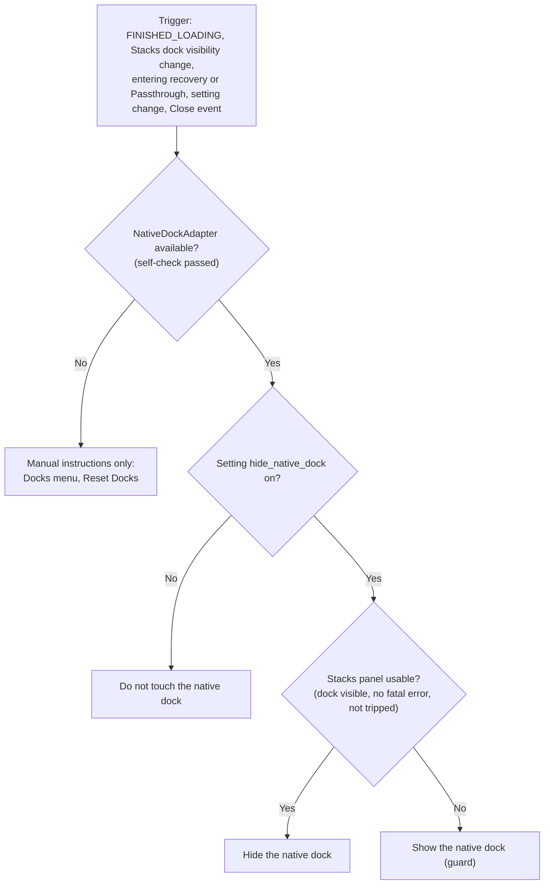

| Layer | Behavior |
|---|---|
| **L0 Default** | First launch: both docks visible. A three-button dialog (Hide, Keep both, Not now) explains the recovery path in one sentence. Nothing is hidden automatically. |
| **L1 Locate and self-check** (`NativeDockAdapter`) | `mainWindow->findChild<QDockWidget*>("scenesDock", Qt::FindDirectChildrenOnly)`; verify the type, the parent, a non-empty title and the toggle-view action. Any failure marks the feature `Unavailable` (PRD OP-1 fallback: instructions only). The adapter uses only `isVisible`, `setVisible`/`toggleViewAction`; it never reads children, models or slots. Compiled out with `STACKS_NATIVE_DOCK_CONTROL=OFF`. |
| **L2 Apply** | At `FINISHED_LOADING`, when the setting is on and the Stacks panel is usable, hide. After hiding, read the state back; if it is still visible, revert and mark `Unavailable`. |
| **L3 Invariant guard** | "At least one Scenes panel is visible." Re-evaluated on `FINISHED_LOADING`, on the Stacks dock's visibility change and close event, on entering Passthrough or a tripped exception boundary ([section 12](#12-error-handling-logging-and-recovery)), and when the setting changes. If the Stacks panel is not usable, the native dock is shown. |
| **L4 Close-intent normalization (best effort, safe-biased)** | An event filter sees `QEvent::Close` before OBS's `closeEvent`. It shows the native dock immediately, so a following `saveAll` persists a layout with the native dock visible. If the close is cancelled (OBS's confirm-on-exit prompt), the next `QEvent::WindowActivate` on the main window with no `EXIT` seen re-applies L2. **Every failure of this layer leaves the native dock visible**, which is the safe direction. Gap: close paths without a close event (SIGINT/SIGTERM) and crashes; the previous clean-exit layout then stays. |
| **L5 Recovery documentation** | README, first-run dialog and Settings state: *Docks > Scenes* (the Scenes toggle) or *Docks > Reset Docks* (also run by *View > Reset UI*). Both are verified to exist ([E29], [E30]). Safe Mode is not listed as a recovery path: *Hypothesis: verify in MT-19 whether Safe Mode shows the native Scenes dock*, since `DockState` is user config restored independently of plugins. |
| **L6 Immediate undo** | Turning the setting off, or pressing "Restore native Scenes dock" in Settings or in a recovery banner, shows the native dock at once. |

### 11.5 What is and is not guaranteed

| Scenario | Outcome |
|---|---|
| Normal quit, then uninstall or disable | Native dock visible on next start if L4 works on that OS; otherwise recoverable by L5 |
| SIGINT/SIGTERM, crash, power loss, then uninstall | Last clean-exit layout (visible if L4 worked then). A SIGINT/SIGTERM exit writes the current layout, so it can persist a hidden native dock: recoverable by L5 |
| Stacks fails to load (version gate, missing Qt feature) | Module not loaded; layout from the last clean exit; visible if L4 worked |
| Stacks loads but its UI fails | L3 shows the native dock |
| User hid the native dock manually, without Stacks | Not our business; never touched (L0 and the "do not touch" branch) |

**An absolute, automatic guarantee is not achievable with public API alone**: OBS writes `DockState` inside `saveAll()` before any plugin-visible exit event, and the only ways to influence it are a live-state change before the save (O2) or a config rewrite (O3, rejected). The design therefore guarantees **recoverability by construction** (three independent paths, all verified) plus **automatic restoration on normal exit paths**, and the verification of that claim is an explicit release gate (PRD FR-17 uninstall-scenario test on all three OS).

### 11.6 Spikes before Phase 2 exit

| Spike | Question | Pass criterion |
|---|---|---|
| S-1 | Does hiding via the toggle action behave identically to the user's Docks-menu click on macOS, Windows, Linux? (H-18) | Check state, persistence in `DockState`, restore by Reset Docks |
| S-2 | Does the L4 filter run before `saveAll` on window-close, File > Exit and macOS Cmd+Q? Is cancel detection reliable? (H-16) | `DockState` after exit has the native dock visible in 100% of 30 trials per OS; cancel returns to the user's choice |
| S-3 | Do tabified docks persist as visible, and does a missing plugin dock leave the native dock visible? (H-17) | Native dock visible after removing Stacks |
| S-4 | Does the native dock flash between `restoreState` and the first hide? (H-15) | Not visible for more than one frame, or an accepted threshold |

If S-2 fails on an OS, ship O1 + L3 + L5 on that OS and say so in the documentation. If S-3 passes cleanly, O4 may replace O2 as the default for users who accept a second tab.

---

## 12. Error handling, logging and recovery

### 12.1 Logging

- All logging goes through `obs_log` from the template's `plugin-support` (it prepends `[obs-stacks] ` and calls `blogva`), through thin `STACKS_LOG_*` macros. No other output channel.
- Levels: **ERROR** data-integrity risk or refused save; **WARNING** recoverable anomaly (repair on load, backup failure, retry exhausted); **INFO** lifecycle and counts (loaded N scenes, reconcile report counters, backup written); **DEBUG** verbose flow (hints, retries). INFO and above carry **no scene names** (proposal, FR-58); DEBUG may include them only when the `debug_logging` setting is on.
- Rate limiting: a given (code, key) pair is logged once per session at WARNING and above, then counted; the counter is logged at exit.
- No logging inside signal trampolines above DEBUG.

### 12.2 Error taxonomy

| Code | Cause | Handling | Visible |
|---|---|---|---|
| `E-PARSE` | Unparseable or wrong-typed stored object | Passthrough (ParseFailure) | Banner with Restore / Export raw / Reset |
| `E-NEWER` | `schema_version` above supported | Passthrough (NewerSchema) | Banner |
| `E-MIGRATE` | Migration step failed validation | Passthrough (MigrationFailure) | Banner |
| `E-LIMIT` | Object, node count or depth over limits | Passthrough (TooLarge) | Banner |
| `E-REPAIR` | Invariant violated on load and repaired (duplicate uuid, bad attribute) | Repair, log once | Count in the load notice only when something moved |
| `E-ROUNDTRIP` | Serialize-parse-compare failed | Skip this save, keep previous object | Banner |
| `E-BACKUP` | Backup write or rotate failed | Log once, retry on next trigger | None (Settings shows last backup status) |
| `E-ACTION` | User command refused (name in use, on air, last scene, transition running) | Typed `ActionError`, no OBS change | Inline message or notice |
| `E-OBS` | Unexpected null or failure from an OBS call | Abort that command, log, no partial state | Notice |
| `E-ICON` | Icon failed sanitize or render | Fallback glyph, keep data | None |
| `E-EXC` | Exception caught at a callback boundary | Count; see 12.4 | Notice after the first |

### 12.3 User-visible errors

A **notice bar** inside the dock: one line, severity icon plus text, at most one action button, dismissible, never modal. Modal dialogs are reserved for confirmations (delete scene, dissolve, cleanup, restore, reset) and the first-run choice. During live operation the dock never steals focus and never blocks.

### 12.4 Exception boundary and recovery mode

Every C entry point (module load/unload, save/load hook, event callback, signal trampolines, undo trampolines) is wrapped in `try/catch(...)`. After **3 unhandled exceptions within 60 seconds** (proposal) the plugin enters **tripped mode**: it stops syncing, disables organization edits, shows a banner, lets the L3 guard show the native dock, and leaves stored data untouched (Passthrough semantics). A restart clears it.

| State | Meaning | Scenes still listed and activatable | Data |
|---|---|---|---|
| Normal | | Yes | Read/write |
| Passthrough | Stored data cannot be trusted or is newer | Yes (flat, native order, for every cause; 05 D-06) | Untouched |
| Tripped | Internal fault | Native dock restored by L3 | Untouched |
| Unavailable | OBS older than 33.0.1, or Qt runtime older than the minimum | Module does not register UI; `obs_module_load` logs the reason and returns `false` | Untouched |

### 12.5 Startup self-checks

1. `obs_get_version() >= MAKE_SEMANTIC_VERSION(33, 0, 1)` ([E48]).
2. `qVersion()` is at least the minimum supported Qt (6.5, proposal) at runtime.
3. `obs_frontend_get_main_window()` is a `QMainWindow`.
4. Config directory creation with `os_mkdirs` ([E47]); failure disables backups and settings persistence only.

---

## 13. Migration strategy

### 13.1 Versioning policy

| Change | `schema_version` | Rule |
|---|---|---|
| New optional field or optional node attribute | No bump | Older versions preserve it as unknown |
| New node type that older versions may safely ignore | No bump | Older versions keep it as an opaque node |
| Field removed, renamed, retyped; changed invariant (for example allowing nested stacks, which breaks I1); changed meaning | **Bump** | A migration is mandatory |

`writer_version` is the plugin's semantic version and is informational (diagnostics, support); logic never branches on it.

### 13.2 Pipeline

`Migrator::run(raw) → Result<Migrated>` applies registered steps `vN → vN+1` in order on a **deep copy**:

1. Each step is a pure function that touches only the fields it knows. Unknown fields travel through.
2. Input is checked against the vN invariants; output against the vN+1 invariants and schema.
3. Any failure aborts the whole run: mode becomes Passthrough (MigrationFailure), the original object is untouched.
4. On success the migrated tree is held in memory. A pre-migration backup (`pre-operation:migration-vN`) is written **before** the first save that would replace the object. The migrated format is persisted only by the next normal save; there is no separate rewrite on load.
5. Downgrade is unsupported: an older plugin reads a newer schema as Passthrough. Users are advised to export before downgrading.

### 13.3 Tests required for every migration

| Test | Purpose |
|---|---|
| Golden pair | A frozen vN fixture migrates to a frozen vN+1 fixture (byte-comparable after canonical sorting) |
| Idempotence | Running the migrator on already-current data changes nothing |
| Chain | Every historical fixture migrates to the latest in one run |
| Unknown preservation | Unknown fields at every level survive |
| Invariants | Output satisfies I1 to I9 and the vN+1 schema |
| No loss | Counts of scenes, stacks, separators, colors, favorites preserved unless the migration documents otherwise |
| Failure injection | A deliberately failing step leaves the original untouched and yields Passthrough |
| Fuzz | Random mutations of fixtures never crash and never produce a tree that violates invariants |

A migration is not merged without its fixtures, a changelog entry, and an update to [4.4](#44-json-schema-v1-draft-2020-12).

---

## 14. Performance design

Targets are in PRD section 10.1 (NFR-01 to NFR-11) and are **targets to measure** at 10, 50, 100, 250 and 500 scenes on the reference hardware, not claims. This section is how the design makes them reachable.

### 14.1 Principles

- **No work in the render or encode path**; nothing runs on OBS's graphics, audio or encode threads (R6).
- **No polling**: every timer is single-shot and armed by an event ([7.3](#73-debounce-and-burst-handling-proposals)).
- Work is proportional to *what changed*, with O(n) bounds only for the explicit rebuild and reconcile steps.

### 14.2 Complexity

| Operation | Design | Bound |
|---|---|---|
| Snapshot | `obs_frontend_get_scenes` plus presence | O(n) |
| Reconcile | Hash maps by uuid and name; depth-first walk | O(n) |
| Apply to the model | Minimal change set: inserts, removals, renames, moves | O(changed); one reset above the threshold (proposal: more than 64 rows or a quarter of rows) |
| Row lookup by uuid, name, node id | Hash indexes in `SceneRegistry` and `OrganizationModel` | O(1) |
| Collapse/expand | Row visibility only; no model rebuild | O(children) |
| Search keystroke | Substring on pre-folded strings, recursive filter proxy | O(n) per keystroke, no allocation per row |
| Save | Serialize one tree | O(n) |
| Hint burst | Coalesced | One sync per burst |

### 14.3 Model and view

- `StacksItemModel` emits fine-grained `rowsInserted/Removed/Moved` and `dataChanged(roles)`; Program/Preview changes touch at most four rows.
- Selection and expansion are restored **by node id** after structural changes, without activation.
- `setUniformRowHeights` is used only when all visible rows share a height; the delegate caches `sizeHint` per node type and display mode.
- The model keeps tracking OBS while the dock is hidden (cheap), but icon rendering and animations pause (the dock-close custom event, [E35]).

### 14.4 Icons

- **Lazy:** an icon is rasterized the first time a visible row paints it.
- **Cache:** `QCache<IconKey, QPixmap>` keyed by `(iconId, rgba color, logical size, devicePixelRatio)`, with a cost cap (proposal: 4 MiB and 512 entries). Theme changes and DPR changes simply produce new keys; the cache is also cleared on `THEME_CHANGED`.
- **Recolor:** render the monochrome SVG once to an alpha mask, then tint with `QPainter::CompositionMode_SourceIn`. `QSvgRenderer` instances are cached per icon id. Whether QtSvg's `currentColor` could replace the tint is a *Hypothesis* (H-07) and is not relied on.

### 14.5 Search

`SearchIndex` stores, per scene and stack, the folded name and an index map from folded to original positions (for highlighting). Folding, applied per code point:

```text
fold(s): for each code point c of NFKD(s)            # QString::normalized(NormalizationForm_KD)
           skip c if category(c) == Mark_NonSpacing  # strips accents
           append toCaseFolded(c)                    # QString::toCaseFolded
           record original index
         then apply a small explicit map for letters that do not decompose
           (ae, oe, o-slash, d-stroke, l-stroke, dotless i, sharp s)
```

*Hypothesis* (H-03, PRD OP-5): NFKD plus mark stripping plus case folding gives the expected results for French, Spanish, German and Polish names; verified by a test table. The index is updated incrementally on rename, insert and remove. Searching expands stacks **in the view only** (forced expansion); the saved `collapsed` flag is never modified by a search (PRD module F).

### 14.6 Startup

`obs_module_load` registers callbacks and creates the dock widget shell only. Settings are read once. Icons, the model and the filter proxy are populated by the load callback; nothing is preloaded. Target NFR-01 (≤ 50 ms) is measured on the reference hardware.

---

## 15. Security

### 15.1 Trust boundaries

Untrusted or semi-trusted inputs: (1) a collection file, including one obtained by Import, whose `modules["obs-stacks"]` we parse; (2) a `.stacks.json` import; (3) a user-imported SVG or PNG icon; (4) scene and stack names rendered in the UI; (5) the backup directory contents.

### 15.2 Rules

| Area | Rule |
|---|---|
| **No network** | The plugin links no network module and makes no request, no telemetry, no update check (OBS's Plugin Manager handles updates). Help links, if any, open in the system browser only on an explicit click. |
| **No execution** | No scripting, no `QProcess`, no plugin loading, no `eval`-like path. Imported content is data. |
| **No external resources** | Icons come from the bundled resources or from sanitized embedded data. No file paths or URLs are ever stored or followed. |
| **Text** | Names are drawn as plain text (`Qt::PlainText`), never as rich text, so a name such as `` cannot load anything. |
| **Writes** | Only the collection key (through OBS), the plugin config directory and a user-chosen export path. Backup file names are generated from a sanitized slug plus a hash, never from raw input; paths are resolved and checked to stay inside the config directory. |
| **JSON** | Hard limits before and during parsing ([4.6](#46-validation-and-size-limits)); depth-bounded recursive descent (depth ≤ 8); no regular expressions on unbounded input. |
| **Logs** | No scene names at INFO or above (proposal, FR-58). |

### 15.3 SVG sanitizer (whitelist)

QtSvg can load local `<image href>` targets and `xml-stylesheet` processing instructions (*Third-party* finding from the Qt source review, to be re-verified: H-07). The sanitizer therefore **rejects rather than filters** anything outside the whitelist, parses with `QXmlStreamReader`, and **re-serializes from the accepted token stream** with `QXmlStreamWriter`, so no unvalidated byte survives. Rasterizing in the UI happens only on sanitized output.

| Aspect | Whitelist |
|---|---|
| Elements | `svg`, `g`, `path`, `circle`, `ellipse`, `rect`, `line`, `polyline`, `polygon` |
| Rejected elements | `script`, `foreignObject`, `image`, `use`, `style`, `a`, `animate*`, `set`, `filter`, `pattern`, `mask`, `clipPath`, `symbol`, `defs`, `text`, `tspan`, anything namespaced other than SVG |
| Rejected constructs | DOCTYPE, entity declarations, processing instructions (including `xml-stylesheet`), CDATA, external references (`href`, `xlink:href`), `style` and `class` attributes, `on*` attributes, `xmlns:*` declarations |
| Attributes | `viewBox`, `width`, `height` (on `svg`); `d`; `cx`, `cy`, `r`, `rx`, `ry`; `x`, `y`, `width`, `height`; `x1`, `y1`, `x2`, `y2`; `points`; `fill`, `stroke`, `stroke-width`, `stroke-linecap`, `stroke-linejoin`, `stroke-miterlimit`, `stroke-dasharray`, `opacity`, `fill-opacity`, `stroke-opacity`, `fill-rule`, `clip-rule`, `transform` |
| Value grammar | Colors: `none`, `currentColor`, `#rgb`, `#rrggbb` only (no `url(...)`, no `var()`). Numbers: finite, bounded (absolute value ≤ 100,000). `d` and `points`: character classes of the path and number grammar only. `transform`: only `translate`, `scale`, `rotate`, `matrix` with numeric arguments |
| Size caps | Input ≤ 64 KiB; ≤ 2,000 elements; depth ≤ 16; `d` or `points` ≤ 16 KiB each; `viewBox` sides within 1 to 4,096; output ≤ 32 KiB |
| Rendering | The displayed size is always the requested icon size; `width` and `height` are never trusted |
| Re-check | Sanitized again when loaded from a collection (a hand-edited file is untrusted); failure yields the fallback glyph |

### 15.4 PNG import

Reject files over 256 KiB or without the PNG signature; read dimensions before decoding and reject anything above 1,024 by 1,024 pixels; downscale to at most 128 by 128 preserving alpha; re-encode as PNG (which drops metadata chunks); reject if the result exceeds 48 KiB. Only the PNG decoder is invoked (explicit format), never format auto-detection.

### 15.5 Supply chain and licensing

Runtime dependencies are only OBS (libobs, obs-frontend-api) and Qt as shipped by OBS. Bundled icons are Lucide (ISC license; GPL compatibility pending license review, 01 §14 #26); the license notice ships with the binary and appears in About. The module is GPL-2.0-or-later, imposed by linking libobs.

---

## 16. Build and CMake integration

### 16.1 Required changes to the scaffold

The scaffold's `CMakePresets.json` `template` preset sets `ENABLE_FRONTEND_API` and `ENABLE_QT` to `false` (*Verified in the repository scaffold*). They must be `true`, and the root `CMakeLists.txt` must add `Qt6::Svg`, a C++17 standard, explicit source lists and the target split of [3.2](#32-build-targets). Illustrative:

```cmake
cmake_minimum_required(VERSION 3.28...3.30)
include("${CMAKE_CURRENT_SOURCE_DIR}/cmake/common/bootstrap.cmake" NO_POLICY_SCOPE)
project(${_name} VERSION ${_version} LANGUAGES C CXX)

option(ENABLE_FRONTEND_API "Use obs-frontend-api for UI functionality" ON)
option(ENABLE_QT           "Use Qt functionality"                      ON)
option(ENABLE_BUILD_LEGACY "Enable legacy build"                       OFF)  # never shipped: OBS 33+ only
option(STACKS_NATIVE_DOCK_CONTROL "Allow hiding the native Scenes dock (SC-14 exception)" ON)
option(BUILD_TESTING "Build tests" OFF)

include(compilerconfig)
include(defaults)
include(helpers)

set(CMAKE_CXX_STANDARD 17)
set(CMAKE_CXX_STANDARD_REQUIRED ON)
set(CMAKE_CXX_EXTENSIONS OFF)
set(CMAKE_CXX_VISIBILITY_PRESET hidden)
set(CMAKE_VISIBILITY_INLINES_HIDDEN ON)
set(CMAKE_AUTOMOC ON)
set(CMAKE_AUTOUIC ON)
set(CMAKE_AUTORCC ON)

find_package(libobs REQUIRED)
find_package(obs-frontend-api REQUIRED)
find_package(Qt6 6.5 REQUIRED COMPONENTS Core Widgets Svg)

add_library(stacks_core STATIC  ...)                 # Qt6::Core only
target_link_libraries(stacks_core PUBLIC Qt6::Core)
add_library(stacks_ui STATIC    ...)                 # no OBS include dirs
target_link_libraries(stacks_ui PUBLIC stacks_core Qt6::Widgets Qt6::Svg)
add_library(stacks_obs STATIC   ...)                 # the only target that sees OBS headers
target_link_libraries(stacks_obs PUBLIC stacks_core Qt6::Widgets OBS::libobs OBS::obs-frontend-api)

add_library(${CMAKE_PROJECT_NAME} MODULE src/plugin-main.cpp resources/stacks.qrc)
target_link_libraries(${CMAKE_PROJECT_NAME} PRIVATE stacks_obs stacks_ui stacks_core)
set_target_properties_plugin(${CMAKE_PROJECT_NAME} PROPERTIES OUTPUT_NAME ${_name})

target_compile_definitions(stacks_core PUBLIC QT_NO_CAST_FROM_ASCII QT_NO_CAST_TO_ASCII
                           QT_USE_QSTRINGBUILDER QT_DISABLE_DEPRECATED_UP_TO=0x060500)
```

Notes:

- **C++ module entry.** `MODULE_EXPORT` expands to `extern "C" EXPORT` under C++ ([E47]), so `plugin-main.c` becomes `plugin-main.cpp` and `OBS_DECLARE_MODULE()` and `OBS_MODULE_USE_DEFAULT_LOCALE(PLUGIN_NAME, "en-US")` are used unchanged.
- **Qt.** Build against the obs-deps Qt pinned in `buildspec.json` (2026-10-23, Qt 6.11.1 on macOS and Windows); never bundle Qt. Linux uses the distribution's Qt, so the minimum is Qt 6.5: `find_package(Qt6 6.5 ...)`, `QT_DISABLE_DEPRECATED_UP_TO`, and a CI job on the oldest supported Qt catch accidental use of newer APIs (*Hypothesis* on how old the system Qt of the target `.deb` can be: PRD OP list).
- **Resources.** AUTORCC is on. A `.qrc` compiled into a *static library* is dropped by the linker unless `Q_INIT_RESOURCE` is called; the `.qrc` is therefore attached to the final module target (as above), which is the simplest correct option. *Documented* Qt behavior.
- **Qt6::Svg** is already linked by the OBS frontend itself (research finding; to be re-checked at the first Phase 2 build, H-07), so no additional runtime library is introduced.
- **Warnings as errors.** The scaffold's CI presets set `CMAKE_COMPILE_WARNING_AS_ERROR` to true (*Verified in the repository scaffold*). The compiler configuration is extended with `-Wall -Wextra -Wshadow -Wnon-virtual-dtor` (and the MSVC equivalents) for project targets only, never for OBS headers (system include paths).
- **Tests.** `BUILD_TESTING` adds `stacks_tests` with Qt6::Test, run with `QT_QPA_PLATFORM=offscreen`; ASan/UBSan and TSan configurations apply to test executables only.
- **Static checks.** `clang-format` (already in the scaffold) and `clang-tidy` run in CI; a script fails the build if a file outside `src/obs/` includes `<obs.h>`, `<obs-frontend-api.h>` or `<obs-module.h>`.
- **Platforms.** macOS universal (arm64 + x86_64, deployment target 13.0), Windows x64, Linux (Ubuntu 26.04 `.deb`, Flatpak later); packaging details are in [05-implementation-plan.md](05-implementation-plan.md).

---

## 17. Testability

### 17.1 Seams

| Seam | Purpose |
|---|---|
| `IObsBridge` and `FakeObsBridge` | The whole core runs against a fake: deterministic native order, scripted transitions, call recording, failure injection, delayed visibility of new scenes (to reproduce the native-handler race), a scene-usage graph for the delete guards |
| `IObsEventSink` | Tests drive hints, frontend events, cleanup and exit exactly as the bridge would, including from another thread to exercise the queued hop |
| `ICollectionIo` | Load and save hooks are plain method calls with byte arrays |
| Injected `Clock`, `UuidGenerator`, `FileSystem` | Deterministic tombstone timestamps, ids, backup names; backup tests run on a temp directory |
| `ActivationPolicy`, `Reconciler`, `SchemaCodec`, `Migrator`, `SvgSanitizer`, `TextFolding` | Pure functions, table-tested |

### 17.2 Layers

| Layer | Tooling | Covers |
|---|---|---|
| Unit | Qt Test, no OBS | Model operations and inverses, invariants, reconcile (including property-based: idempotence, completeness, conservativeness), codec round trip, pass-through, limits, migrations, folding, sanitizer, backup rotation, activation table |
| Model | `QAbstractItemModelTester`, proxy filter tests | Item model contract, batching, search with forced expansion not changing saved state, roles, accessible text |
| UI geometry | Offscreen QPA | Delegate `sizeHint`, hit targets, view activation gating (right-click and drag emit no intent: H-01), focus and keyboard map. No pixel-exact comparison across platforms; token values are checked as numbers |
| Scenario | `FakeObsBridge` scripts | Each flow of [6.3](#63-flows) end to end: startup, external create, websocket rename, remove and undo, collection switch including a new empty collection, Studio Mode toggle, activation matrix, drag and drop, save, newer schema, parse failure, tripped mode |
| Safety contract | Call-recording double | SC-01, SC-03, SC-04 (no scene-switching call from any non-activation path, including rebuild, undo, search), SC-07 (collection diff outside our key), SC-13 (no source held after cleanup) |
| Concurrency | TSan on scenario tests | Signal hints posted from worker threads; shutdown with pending hints |
| Fuzz and hostile fixtures | Seeded random mutation | JSON of every shape, oversized and deep objects, hostile SVG (script, external image, entity bomb, `xml-stylesheet`), bad PNG |
| Real OBS | Manual and scripted, defined in [06-testing-strategy.md](06-testing-strategy.md) | What a fake cannot prove: 50-switch soak, Duplicate/Rename/Import/Export matrix, uninstall scenario, native-dock spikes, Studio Mode matrix, performance at 10/50/100/250/500 scenes |

### 17.3 Proposed quality gates (to be agreed in 06)

Core, model and persistence code is expected to be covered by unit and scenario tests with a line-coverage target (proposal: 90% or more); every safety-contract clause maps to at least one automated test; every migration ships its fixtures; the hostile-fixture suite runs on every pull request.

---

## 18. Architecture Decision Records

Status values: *Accepted* (validated by the product owner on 04 Nov 2026, see the brief) or *Proposed* (technical decision pending product-owner review in Phase 1).

### ADR-001 — Custom dock (Option A)

**Status:** Accepted (decision 1).

**Context.** OBS exposes no extension point for the native Scenes list: no hook for the menu, delegate, model or roles, and no API to reorder scenes ([E36]; fact sheet question 1). The only supported UI extension is a dock.

**Decision.** Register one dock with `obs_frontend_add_dock_by_id("obs-stacks-dock", title, widget)` from `obs_module_load` ([E01], [E02]). The id never changes once shipped (it keys the persisted layout). Stacks replaces the native dock for daily use; hiding the native dock is opt-in ([section 11](#11-native-scenes-dock-hide-and-restore-design)).

**Consequences.** (+) Depends only on public API; survives rewrites of the native dock such as PR #13328; folders and separators never touch the native list, so they cannot become scenes. (−) Two Scenes panels coexist until the user hides the native one; the native dock can be hidden but not closed; the dock starts hidden and floating, so first-run flow must show it; the id is permanent.

**Alternatives.** *Option B, extend the native panel*: does not exist. *Option C, manipulate internal widgets* (`findChild("scenes")`, delegates, private slots): legal but unsupported, fragile, broken by PR #13328 ([ADR-010](#adr-010--public-api-only-no-internal-widgets)). *`obs_frontend_add_custom_qdock`*: no Docks-menu toggle. *Separate top-level window*: not integrated with docking and layouts.

### ADR-002 — Organization-only order

**Status:** Accepted (decision 2).

**Context.** The native order lives in the native dock's list, saved by name as `scene_order` ([E36]). Multiview, obs-websocket, Stream Deck and Companion follow it ([E32]). Reordering it needs internal Qt manipulation, has no undo, no event, and does not refresh the Multiview.

**Decision.** Stacks never reorders OBS's native list. Order shown by Stacks is organizational. The UI explains this (settings help text, first-run note, SC-15). A future opt-in "Apply Stacks order to OBS" would sit behind an isolated adapter and is out of scope for v1.

**Consequences.** (+) Zero modification of the collection, zero live risk. (−) Users may expect external tools to follow the Stacks order; the documentation and UI must say they do not.

**Alternatives.** *Push the flattened order into the native list automatically*: unsupported, no refresh of Multiview, persists after uninstall, breaks with #13328. *Opt-in apply action in v1*: deferred, needs diff preview, live-state guards and undo.

### ADR-003 — Persistence in collection `modules` plus disposable backups

**Status:** Proposed.

**Context.** Organization must follow Rename, Duplicate, Export and Import of a collection and survive plugin removal. OBS preserves the `modules` block of absent plugins ([E07]) and writes the collection atomically ([E06]) except for Duplicate and Rename ([E10]). A side file keyed by collection name loses data on Rename and Duplicate (the failure mode of the abandoned competitor, fact sheet section 6).

**Decision.** `modules["obs-stacks"]`, written from `obs_frontend_add_save_callback`, is the single source of truth. Add a disposable rolling backup per collection in `obs_module_config_path` and manual export/import. A backup never overwrites the collection automatically.

**Consequences.** (+) Data travels with the collection; uninstall-safe; atomic writes by OBS. (−) Two formats to maintain (collection object and backup envelope); edits made while the plugin is disabled are not seen; the whole collection file is rewritten on each save, hence the save debounce.

**Alternatives.** *Side file only*: orphaned by Rename/Duplicate, absent from exports. *Both as co-equal sources*: ambiguous precedence, silent overwrites. *Per-scene private settings*: modifies scenes (violates SC-01) and cannot hold stacks and separators. *OBS user config*: not per collection.

### ADR-004 — UUID plus name identity with tombstones

**Status:** Proposed.

**Context.** `obs_source_get_uuid` persists across save and load, but Duplicate regenerates every UUID ([E09]) and legacy collections may lack them ([E42]); names are unique per session ([E42]) but change.

**Decision.** Key by UUID, fall back to a unique name in load-class reconciliation only, re-stamp both at every save, keep entries of vanished scenes as tombstones until a manual cleanup, never purge on `source_remove`, never guess when a name is ambiguous ([section 5](#5-identity-and-reconciliation)).

**Consequences.** (+) Survives Duplicate, Rename, renames while disabled, deletion plus OBS undo. (−) A tombstone list that needs a cap and a cleanup action; a name fallback can re-attach a re-created scene of the same name (reported, never silent).

**Alternatives.** *Name only*: breaks on rename while disabled. *UUID only*: breaks on Duplicate. *Content hash of scene settings*: unstable, expensive. *Purge on remove*: loses all data at every collection switch ([E11]).

### ADR-005 — OBS 33+ only

**Status:** Accepted (decision 3).

**Context.** OBS 33 introduced the new plugin layout with `manifest.json` and the Plugin Manager; the frontend dock API by id exists since 30, undo/redo since 29.1 ([E33]); canvases arrive in recent versions ([E43]); the template is at 33.0.1.

**Decision.** Target 33.0.1 and later. `ENABLE_BUILD_LEGACY` stays off; no legacy build is shipped. A runtime gate refuses to load on older versions ([12.5](#125-startup-self-checks)).

**Consequences.** (+) One code path, current Qt, simpler tests. (−) Users on 30 to 32 are not served.

**Alternatives.** Support 30 to 32 with a legacy build: doubles packaging and testing for a shrinking audience.

### ADR-006 — Stacks terminology

**Status:** Accepted (decision 5).

**Context.** OBS already uses "Groups" for scene-item groups in the Sources dock (a hidden scene of id `group`).

**Decision.** The product concept is a **Stack**; separators are **Separators**; the never-filed section is **Unsorted**. The word "group" does not appear in UI or docs for this concept. UI strings: New Stack, Rename Stack, Dissolve Stack, Collapse/Expand.

**Consequences.** (+) No confusion with OBS Groups. (−) The term is new to users, so the first-run text and documentation introduce it once.

**Alternatives.** *Group*: collides. *Folder*, *Section*, *Category*: usable but rejected by the product owner in favor of Stacks.

### ADR-007 — Safe delete reimplementation with OBS undo

**Status:** Accepted (decision 10); design proposed here.

**Context.** The native delete selects the scene first (which switches Program outside Studio Mode), has no guard for the on-air scene, and its undo selects the restored scene ([E19]). Calling `obs_source_remove` alone loses confirmation, undo and pruning of nested references.

**Decision.** Reimplement delete in one class (`SceneDeleteOp`): explicit confirmation; refuse the Program scene and the last scene; never select or activate; save the data OBS saves for undo; register undo and redo with `obs_frontend_add_undo_redo_action`; restore with the original UUID; keep the organization entry as a tombstone so undo restores the place. Dissolving a stack never deletes scenes. Pending confirmation: refuse when the scene is nested in the Program scene (OP-8); allow Preview deletion only after H-10.

**Consequences.** (+) Closes the competitor's worst failure (deleting scenes with folders) and the live-switch hazard. (−) The highest-maintenance code: parity with OBS's delete path must be re-verified for every OBS release; a feature flag can fall back to "use the native dock".

**Alternatives.** *Do not offer delete in v1*: leaves users unable to finish a cleanup in Stacks (considered by the fact sheet). *Delegate to the native dock*: not possible once the native dock is hidden, and its selection side effect remains. *Call `obs_source_remove` only*: no undo, no confirmation.

### ADR-008 — Click behavior and Safe click

**Status:** Accepted (decision 11).

**Context.** The native list activates on selection. Accidental Program switches during a live show are the main user risk.

**Decision.** Default equals OBS: outside Studio Mode a single click sets Program; in Studio Mode a single click sets Preview; a double-click transitions to Program only if OBS's `TransitionOnDoubleClick` preference is on. Setting **Safe click**: a single click only selects; double-click or Enter activates. Right-click, drag, focus moves, search and programmatic selection **never** activate. "Send to Program" exists in Studio Mode and is disabled while a transition runs. Implemented by `ActivationPolicy` ([10.2](#102-activation-policy)).

**Consequences.** (+) Parity by default, a safe mode for operators, a single testable decision table. (−) Deviates from the native list on arrow keys (they never activate); the UI documents it.

**Alternatives.** *Always safe*: surprising for users migrating from OBS. *Native parity with no safe mode*: leaves the live-risk unaddressed.

### ADR-009 — Unsorted section

**Status:** Accepted (decision 12 and the brief's terminology).

**Context.** Scenes appear from outside Stacks (native dock, obs-websocket, Stream Deck, import) and organization data can be lost. Filing them silently into a stack would surprise users; hiding them would make scenes unreachable.

**Decision.** A persistent, visible **Unsorted** node at the bottom receives every scene not otherwise filed. Scenes created with "+" in Stacks go to the selected stack after the selected scene; a duplicate made from Stacks goes right after its original. Nothing is ever filed silently; the name fallback never applies at runtime ([5.2](#52-algorithm-design-not-implementation)).

**Consequences.** (+) Every OBS scene is always visible and reachable; predictable. (−) Users must file new external scenes by hand; the singleton node adds a structural rule (I4).

**Alternatives.** *Root, top or bottom*: mixes unfiled scenes with the user's own root scenes. *Inherit the folder of the scene next to it in the native list*: guesswork. *Hidden until filed*: unsafe.

### ADR-010 — Public API only, no internal widgets

**Status:** Accepted in principle (decision 1, no Option C); one narrow exception **pending explicit product-owner acceptance** (PRD OP-1).

**Context.** OBS internals (`OBSBasic`, the native list, private slots, `GetOBSRef`) are not a plugin interface, change between releases, and are being rewritten (PR #13328). Option C is excluded for v1.

**Decision.** Use only `libobs`, `obs-frontend-api` and Qt. No private headers, no `findChild` on OBS content, no private slots, no `QListWidget` access. **Single exception**, isolated in `NativeDockAdapter` and compile-time switchable: locating the dock named `scenesDock` to change its visibility ([section 11](#11-native-scenes-dock-hide-and-restore-design)), with a self-check and a fallback to manual instructions. A CI script enforces that OBS headers are included only from `src/obs/`.

**Consequences.** (+) Maintenance cost limited to API changes announced by OBS; the exception fails soft. (−) Some conveniences are impossible (reordering native scenes, enriching the native list); the exception depends on an object name that OBS may change.

**Alternatives.** *Allow Option C with tests*: rejected for v1. *No exception at all*: forces the user to hide the native dock by hand, against decision 1.

---

## 19. Hypothesis register and open points

### 19.1 Hypotheses and how each will be verified

| ID | Hypothesis | Verification | Phase |
|---|---|---|---|
| H-01 | `QAbstractItemView::clicked` can be emitted for non-left buttons; the view must filter by button itself | Offscreen UI test with synthesized right/middle releases; the view emits no intent regardless | 2 |
| H-02 | `QSortFilterProxyModel` with recursive filtering meets NFR-03 at 500 scenes | Benchmark at 10/50/100/250/500 | 3 |
| H-03 | NFKD + mark stripping + case folding gives the expected results for FR/ES/DE/PL names | Table test; PRD OP-5 | 3 |
| H-04 | A dock registered in `obs_module_load` keeps its layout through OBS's `restoreState` | Runtime check on three OS (fact sheet section 8: expected to hold) | 2 |
| H-05 | Frontend event callbacks always run on the main thread | Debug assertion in the bridge on every event during manual and scenario runs; the coordinator re-posts anyway | 2 |
| H-06 | The load callback may receive no modules object (null) and `obs_data_get_obj` on a missing key returns null | Unit test against the fake; runtime check on a collection without the key | 2 |
| H-07 | QtSvg follows local `<image href>` and `xml-stylesheet`; `currentColor` tinting via mask is sufficient; Qt6::Svg is shipped by OBS on all OS | Hostile-SVG fixtures against the real QtSvg; inspect OBS bundles | 3 |
| H-08 | `obs_frontend_preview_program_trigger_transition` is a harmless no-op when Preview equals Program | Runtime test in Studio Mode | 2 |
| H-09 | With scene-duplication mode the Program is a private copy with the same name and another UUID; matching by name highlights it correctly | Runtime test with duplication on and off | 2 |
| H-10 | Deleting the Preview scene in Studio Mode changes Preview only, never Program; and OBS's undo restore does not alter Program when our restore does not select | Runtime test matrix (PRD OP-2) | 2 |
| H-11 | Ctrl/Cmd+Z reaches OBS's Edit > Undo when focus is inside a floating Stacks dock | Manual test, docked and floating | 2 to 3 |
| H-12 | Collections saved before OBS 29.1 may lack UUIDs; name fallback covers them | Test with a pre-29.1 fixture | 2 |
| H-13 | `obs_data` JSON round trip (`obs_data_create_from_json` / `obs_data_get_json`) preserves our schema (integers, nested arrays, Unicode, large strings, no nulls) | Unit and runtime test; the round-trip check at save time detects any drift | 2 |
| H-14 | Disconnecting libobs signal handlers in `obs_module_unload` cannot deadlock against a worker thread inside a signal while the main thread waits | Soak test with a websocket client creating scenes during shutdown | 2 |
| H-15 | The native dock does not flash visibly between `restoreState` and the first hide | Video capture on three OS (spike S-4) | 2 |
| H-16 | A main-window close filter sees `QEvent::Close` before `saveAll` on window close, File > Exit and macOS Cmd+Q; cancel detection by `WindowActivate` is reliable | Spike S-2 | 2 |
| H-17 | Tabified docks persist as visible; a missing plugin dock leaves the native dock visible | Spike S-3 | 2 |
| H-18 | Hiding through the toggle-view action equals the user's Docks-menu click | Spike S-1 | 2 |
| H-19 | The object name `scenesDock` is stable through OBS 33.x; PR #13328 may change it | Startup self-check; recheck at each OBS release | ongoing |
| H-20 | Restoring expansion and selection by node id after a model reset at 500 rows stays within budget | Benchmark | 3 |

### 19.2 Open points raised or refined by this document

| ID | Point | Proposed resolution | Decider |
|---|---|---|---|
| OP-1 | Narrow exception to "public API only" to locate the native dock by object name (PRD OP-1) | Accept as isolated, optional, fail-soft ([ADR-010](#adr-010--public-api-only-no-internal-widgets)) | Product owner |
| OP-4 | Tombstone and backup numbers (PRD OP-4) | Soft 200 / hard 2,000 tombstones; 10 backups per collection; 5 minute backup interval | Product owner |
| OP-8 (new) | Refuse to delete a scene nested in the Program scene ([10.5](#105-safe-delete)) | Accept: safe by default, can be relaxed later | Product owner |
| OP-9 (new) | Close-intent normalization (L4) changes live Qt state of the native dock just before OBS saves; acceptable under SC-14 and SC-07? | Accept: no OBS file is written by the plugin; failure leaves the native dock visible | Product owner |
| OP-10 (new) | Whether organization undo ships in Phase 2 or Phase 3 (PRD OP-3) | Architecture supports either; recommend Phase 2 if scheduling allows, since drag and drop already needs inverses | Product owner, plan |

---

## 20. Evidence index

All permalinks refer to tag `33.0.1` of `obsproject/obs-studio`. obs-websocket is a git submodule of obs-studio (`plugins/obs-websocket`, see `.gitmodules`), so its files are cited as plain-text paths inside the 33.0.1 tree, not as obs-studio blob links. Labels: *Verified in source* unless stated.

| ID | What it shows | Permalink |
|---|---|---|
| E01 | Dock API declarations | [frontend/api/obs-frontend-api.h L156-L162](https://github.com/obsproject/obs-studio/blob/33.0.1/frontend/api/obs-frontend-api.h#L156-L162) |
| E02 | `add_dock_by_id`: hidden, floating, id check | [frontend/OBSStudioAPI.cpp L338-L359](https://github.com/obsproject/obs-studio/blob/33.0.1/frontend/OBSStudioAPI.cpp#L338-L359) |
| E03 | Event and save callback types | [obs-frontend-api.h L164-L172](https://github.com/obsproject/obs-studio/blob/33.0.1/frontend/api/obs-frontend-api.h#L164-L172) |
| E04 | `on_load`, `on_preload`, `on_save`, `on_event` and the event suppression while `disableSaving` | [OBSStudioAPI.cpp L730-L763](https://github.com/obsproject/obs-studio/blob/33.0.1/frontend/OBSStudioAPI.cpp#L730-L763) |
| E05 | Save: modules object handed to callbacks and set in the collection | [OBSBasic_SceneCollections.cpp L946-L954](https://github.com/obsproject/obs-studio/blob/33.0.1/frontend/widgets/OBSBasic_SceneCollections.cpp#L946-L954) |
| E06 | Atomic write with `tmp` and `bak` | [OBSBasic_SceneCollections.cpp L985](https://github.com/obsproject/obs-studio/blob/33.0.1/frontend/widgets/OBSBasic_SceneCollections.cpp#L985) |
| E07 | Preload, and the kept reference to the `modules` object | [OBSBasic_SceneCollections.cpp L1213-L1219](https://github.com/obsproject/obs-studio/blob/33.0.1/frontend/widgets/OBSBasic_SceneCollections.cpp#L1213-L1219) |
| E08 | Load callback after scenes are loaded | [OBSBasic_SceneCollections.cpp L1470-L1472](https://github.com/obsproject/obs-studio/blob/33.0.1/frontend/widgets/OBSBasic_SceneCollections.cpp#L1470-L1472) |
| E09 | Duplicate: `SaveProjectNow`, copy, UUID regeneration in `sources` | [OBSBasic_SceneCollections.cpp L159-L206](https://github.com/obsproject/obs-studio/blob/33.0.1/frontend/widgets/OBSBasic_SceneCollections.cpp#L159-L206) |
| E10 | Duplicate and Rename write without `.bak` | [L198](https://github.com/obsproject/obs-studio/blob/33.0.1/frontend/widgets/OBSBasic_SceneCollections.cpp#L198) and [L208-L237](https://github.com/obsproject/obs-studio/blob/33.0.1/frontend/widgets/OBSBasic_SceneCollections.cpp#L208-L237) |
| E11 | Cleanup: modules reference dropped, every scene removed, `CLEANUP` emitted, undo cleared | [OBSBasic_SceneCollections.cpp L1590-L1616](https://github.com/obsproject/obs-studio/blob/33.0.1/frontend/widgets/OBSBasic_SceneCollections.cpp#L1590-L1616) |
| E12 | Default scene creation and `Load` without a file (no load callback) | [L1030-L1050](https://github.com/obsproject/obs-studio/blob/33.0.1/frontend/widgets/OBSBasic_SceneCollections.cpp#L1030-L1050), [L1128-L1161](https://github.com/obsproject/obs-studio/blob/33.0.1/frontend/widgets/OBSBasic_SceneCollections.cpp#L1128-L1161) |
| E13 | `CHANGING` only on user switch; `ActivateSceneCollection` saves then loads then emits `CHANGED` | [L338-L373](https://github.com/obsproject/obs-studio/blob/33.0.1/frontend/widgets/OBSBasic_SceneCollections.cpp#L338-L373), [L770-L789](https://github.com/obsproject/obs-studio/blob/33.0.1/frontend/widgets/OBSBasic_SceneCollections.cpp#L770-L789) |
| E14 | Startup emits `CHANGED`, `SCENE_CHANGED`, `PREVIEW_SCENE_CHANGED` | [OBSBasic.cpp L995-L1014](https://github.com/obsproject/obs-studio/blob/33.0.1/frontend/widgets/OBSBasic.cpp#L995-L1014) |
| E15 | `obs_frontend_get_scenes`: native list order, references | [OBSStudioAPI.cpp L44-L55](https://github.com/obsproject/obs-studio/blob/33.0.1/frontend/OBSStudioAPI.cpp#L44-L55) |
| E16 | Current scene getter and setter (blocking call; transition in Studio Mode) | [OBSStudioAPI.cpp L57-L76](https://github.com/obsproject/obs-studio/blob/33.0.1/frontend/OBSStudioAPI.cpp#L57-L76) |
| E17 | Preview scene getter and setter (no-op outside Studio Mode) | [OBSStudioAPI.cpp L568-L583](https://github.com/obsproject/obs-studio/blob/33.0.1/frontend/OBSStudioAPI.cpp#L568-L583) |
| E18 | `TransitionToScene` (weak ref set before the running check, scene duplication, running test), `SetCurrentScene`, `TransitionClicked` | [OBSBasic_Transitions.cpp L295-L345](https://github.com/obsproject/obs-studio/blob/33.0.1/frontend/widgets/OBSBasic_Transitions.cpp#L295-L345), [L684-L731](https://github.com/obsproject/obs-studio/blob/33.0.1/frontend/widgets/OBSBasic_Transitions.cpp#L684-L731), [L739-L744](https://github.com/obsproject/obs-studio/blob/33.0.1/frontend/widgets/OBSBasic_Transitions.cpp#L739-L744) |
| E19 | Native delete: data gathering, nested usage, undo, pruning, selection on undo | [OBSBasic_Scenes.cpp L321-L479](https://github.com/obsproject/obs-studio/blob/33.0.1/frontend/widgets/OBSBasic_Scenes.cpp#L321-L479) |
| E20 | Native duplicate: `obs_scene_duplicate`, `SetCurrentScene(..., true)`, undo | [OBSBasic_Scenes.cpp L240-L342](https://github.com/obsproject/obs-studio/blob/33.0.1/frontend/widgets/OBSBasic_Scenes.cpp#L240-L342) |
| E21 | Native add scene: name rules, `SetCurrentScene` | [OBSBasic_Scenes.cpp L664-L713](https://github.com/obsproject/obs-studio/blob/33.0.1/frontend/widgets/OBSBasic_Scenes.cpp#L664-L713) |
| E22 | Click activates through `currentItemChanged`; double-click only in Studio Mode with `TransitionOnDoubleClick` | [L508-L535](https://github.com/obsproject/obs-studio/blob/33.0.1/frontend/widgets/OBSBasic_Scenes.cpp#L508-L535), [L769-L781](https://github.com/obsproject/obs-studio/blob/33.0.1/frontend/widgets/OBSBasic_Scenes.cpp#L769-L781) |
| E23 | Native `AddScene` (inserts after the current row), `RemoveScene` (emits `SCENE_LIST_CHANGED`) | [OBSBasic_Scenes.cpp L105-L199](https://github.com/obsproject/obs-studio/blob/33.0.1/frontend/widgets/OBSBasic_Scenes.cpp#L105-L199) |
| E24 | Native handlers for `source_create/remove/rename` (`WaitConnection` for create) | [OBSBasic_SceneItems.cpp L200-L229](https://github.com/obsproject/obs-studio/blob/33.0.1/frontend/widgets/OBSBasic_SceneItems.cpp#L200-L229) |
| E25 | Global libobs signals | [libobs/obs.c L1083-L1118](https://github.com/obsproject/obs-studio/blob/33.0.1/libobs/obs.c#L1083-L1118) |
| E26 | `source_create` emission (main canvas only), deferred destroy on the destruction thread, `source_remove`, `source_rename` | [obs-source.c L541-L546](https://github.com/obsproject/obs-studio/blob/33.0.1/libobs/obs-source.c#L541-L546), [L798-L809](https://github.com/obsproject/obs-studio/blob/33.0.1/libobs/obs-source.c#L798-L809), [L964-L981](https://github.com/obsproject/obs-studio/blob/33.0.1/libobs/obs-source.c#L964-L981), [L4286-L4313](https://github.com/obsproject/obs-studio/blob/33.0.1/libobs/obs-source.c#L4286-L4313) |
| E27 | Signal mutex held while callbacks run | [libobs/callback/signal.c L290-L320](https://github.com/obsproject/obs-studio/blob/33.0.1/libobs/callback/signal.c#L290-L320) |
| E28 | Undo stack: cap, repeatable merge, push | [frontend/utility/undo_stack.cpp L34-L67](https://github.com/obsproject/obs-studio/blob/33.0.1/frontend/utility/undo_stack.cpp#L34-L67) |
| E29 | Dock setup, `restoreState`, `saveAll` order | [OBSBasic.cpp L408-L420](https://github.com/obsproject/obs-studio/blob/33.0.1/frontend/widgets/OBSBasic.cpp#L408-L420), [L1118-L1126](https://github.com/obsproject/obs-studio/blob/33.0.1/frontend/widgets/OBSBasic.cpp#L1118-L1126), [L1739-L1773](https://github.com/obsproject/obs-studio/blob/33.0.1/frontend/widgets/OBSBasic.cpp#L1739-L1773) |
| E30 | `setupDockAction`, Reset Docks shows Scenes (also run by View > Reset UI, [OBSBasic_MainControls.cpp L526-L528](https://github.com/obsproject/obs-studio/blob/33.0.1/frontend/widgets/OBSBasic_MainControls.cpp#L526-L528)), it hides and floats plugin docks, main docks not closable | [OBSBasic_Docks.cpp L24-L44](https://github.com/obsproject/obs-studio/blob/33.0.1/frontend/widgets/OBSBasic_Docks.cpp#L24-L44), [L77-L90](https://github.com/obsproject/obs-studio/blob/33.0.1/frontend/widgets/OBSBasic_Docks.cpp#L77-L90), [L111-L114](https://github.com/obsproject/obs-studio/blob/33.0.1/frontend/widgets/OBSBasic_Docks.cpp#L111-L114) |
| E31 | `scenesDock` definition | [frontend/forms/OBSBasic.ui L973](https://github.com/obsproject/obs-studio/blob/33.0.1/frontend/forms/OBSBasic.ui#L973) |
| E32 | obs-websocket: rename by `obs_source_set_name`, worker thread pool, scene list from `obs_frontend_get_scenes` | obs-studio 33.0.1: `plugins/obs-websocket/src/requesthandler/RequestHandler_Scenes.cpp:347`, obs-studio 33.0.1: `plugins/obs-websocket/src/websocketserver/WebSocketServer.cpp:352`, obs-studio 33.0.1: `plugins/obs-websocket/src/utils/Obs_ArrayHelper.cpp:87-109` |
| E33 | Undo API reference (since 29.1, `repeatable` semantics); API declaration | [docs/sphinx/reference-frontend-api.rst L955-L966](https://github.com/obsproject/obs-studio/blob/33.0.1/docs/sphinx/reference-frontend-api.rst#L955-L966) (*Documented*), [obs-frontend-api.h L253-L255](https://github.com/obsproject/obs-studio/blob/33.0.1/frontend/api/obs-frontend-api.h#L253-L255) |
| E34 | Name and UUID getters, `obs_scene_duplicate` | [libobs/obs.h L1198-L1207](https://github.com/obsproject/obs-studio/blob/33.0.1/libobs/obs.h#L1198-L1207), [L1701-L1711](https://github.com/obsproject/obs-studio/blob/33.0.1/libobs/obs.h#L1701-L1711) |
| E35 | Dock API reference: close event delivered to the widget | [docs/sphinx/reference-frontend-api.rst L469-L489](https://github.com/obsproject/obs-studio/blob/33.0.1/docs/sphinx/reference-frontend-api.rst#L469-L489) (*Documented*) |
| E36 | Native order saved by name; reorder via the native list only (no event, no API) | [OBSBasic_Scenes.cpp L60-L69](https://github.com/obsproject/obs-studio/blob/33.0.1/frontend/widgets/OBSBasic_Scenes.cpp#L60-L69), [L720-L741](https://github.com/obsproject/obs-studio/blob/33.0.1/frontend/widgets/OBSBasic_Scenes.cpp#L720-L741) |
| E37 | `LoadData` starts with `ClearSceneData` and closes OBS if clearing failed | [OBSBasic_SceneCollections.cpp L1191-L1201](https://github.com/obsproject/obs-studio/blob/33.0.1/frontend/widgets/OBSBasic_SceneCollections.cpp#L1191-L1201) |
| E38 | A source that survives cleanup sets `clearingFailed`; saving stays disabled | [OBSBasic_SceneCollections.cpp L1632-L1668](https://github.com/obsproject/obs-studio/blob/33.0.1/frontend/widgets/OBSBasic_SceneCollections.cpp#L1632-L1668) |
| E39 | Transition time and output channel getters | [libobs/obs.h L1663](https://github.com/obsproject/obs-studio/blob/33.0.1/libobs/obs.h#L1663), [L753](https://github.com/obsproject/obs-studio/blob/33.0.1/libobs/obs.h#L753) |
| E40 | `obs_frontend_save` and deferred save | [OBSStudioAPI.cpp L463-L477](https://github.com/obsproject/obs-studio/blob/33.0.1/frontend/OBSStudioAPI.cpp#L463-L477) |
| E41 | Close sequence: `saveAll` then `EXIT`; signal paths call `saveAll` directly | [OBSBasic.cpp L1827-L1914](https://github.com/obsproject/obs-studio/blob/33.0.1/frontend/widgets/OBSBasic.cpp#L1827-L1914), [OBSApp.cpp L1920-L2030](https://github.com/obsproject/obs-studio/blob/33.0.1/frontend/OBSApp.cpp#L1920-L2030) |
| E42 | UUID assignment, duplicate-UUID regeneration, name de-duplication | [libobs/obs.c L2648-L2655](https://github.com/obsproject/obs-studio/blob/33.0.1/libobs/obs.c#L2648-L2655), [L2780-L2793](https://github.com/obsproject/obs-studio/blob/33.0.1/libobs/obs.c#L2780-L2793), [L2855-L2877](https://github.com/obsproject/obs-studio/blob/33.0.1/libobs/obs.c#L2855-L2877) |
| E43 | Scene `canvas_uuid` with main-canvas fallback | [libobs/obs.c L2280-L2293](https://github.com/obsproject/obs-studio/blob/33.0.1/libobs/obs.c#L2280-L2293) |
| E44 | `WaitConnection()`: direct on the main thread, blocking queued otherwise | [shared/qt/wrappers/qt-wrappers.hpp L82-L85](https://github.com/obsproject/obs-studio/blob/33.0.1/shared/qt/wrappers/qt-wrappers.hpp#L82-L85) |
| E45 | Modules are freed before `obs_free_data` and signal-handler destruction; no `dlclose` | [libobs/obs.c L1426-L1447](https://github.com/obsproject/obs-studio/blob/33.0.1/libobs/obs.c#L1426-L1447), [libobs/obs-module.c L868-L873](https://github.com/obsproject/obs-studio/blob/33.0.1/libobs/obs-module.c#L868-L873) |
| E46 | Config getters (`obs_frontend_get_user_config`) | [obs-frontend-api.h L210-L213](https://github.com/obsproject/obs-studio/blob/33.0.1/frontend/api/obs-frontend-api.h#L210-L213) |
| E47 | `MODULE_EXPORT` under C++, config path macro, `os_mkdirs` | [libobs/obs-module.h L23-L27](https://github.com/obsproject/obs-studio/blob/33.0.1/libobs/obs-module.h#L23-L27), [L177](https://github.com/obsproject/obs-studio/blob/33.0.1/libobs/obs-module.h#L177), [libobs/util/platform.h L162](https://github.com/obsproject/obs-studio/blob/33.0.1/libobs/util/platform.h#L162) |
| E48 | `obs_get_version` returns `LIBOBS_API_VER` | [libobs/obs.c L1486-L1489](https://github.com/obsproject/obs-studio/blob/33.0.1/libobs/obs.c#L1486-L1489), [libobs/obs-config.h L46-L48](https://github.com/obsproject/obs-studio/blob/33.0.1/libobs/obs-config.h#L46-L48) |

Other sources: obs-studio pull request [#13328](https://github.com/obsproject/obs-studio/pull/13328) (replaces the native Scenes dock implementation, open, *Third-party*) and [#12488](https://github.com/obsproject/obs-studio/pull/12488) (removed the legacy `obs_frontend_add_dock`, merged 2025-08-20). Verified facts and their original evidence: [01-technical-feasibility.md](01-technical-feasibility.md).

