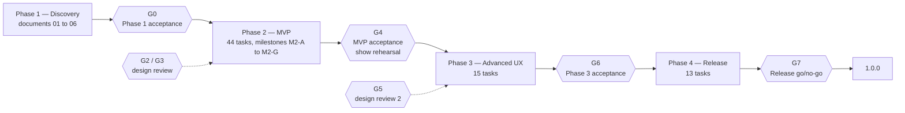
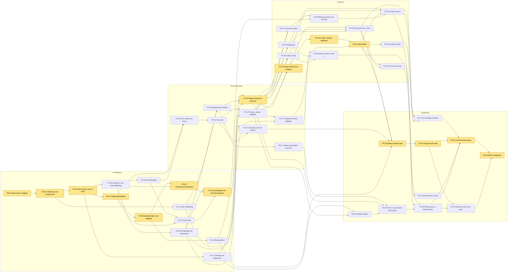
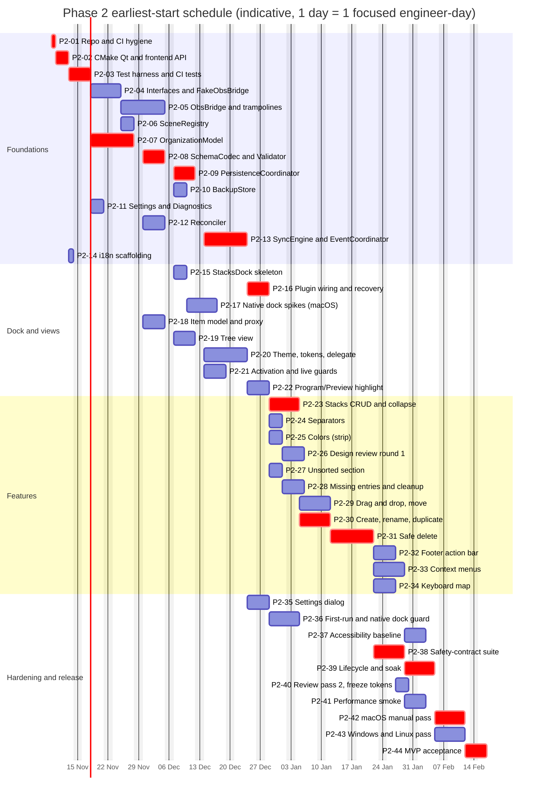
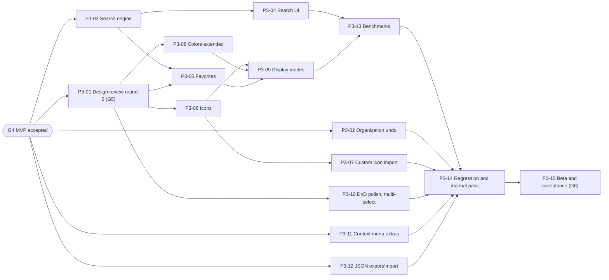

# Stacks for OBS — Implementation Plan

> Status: Draft — pending product-owner validation (Phase 1)  
> Target: OBS Studio 33.0.1+  
> Last updated: 2026-11-04

This document turns the Phase 1 findings into an executable plan: phases, milestones and exit criteria, the ordered task list of Phase 2 (MVP) in full detail, the task lists of Phase 3 (advanced UX) and Phase 4 (release), the critical path, the validation gates with the product owner, and the working conventions (definition of done, branches, commits).

It is a **plan**, not a commitment. Every duration, threshold and numeric default quoted here is a **proposal** to be calibrated after the first milestones; every design value (colors, sizes, spacing, radii, type) stays a **proposal pending the design review page** owned by [03-ux-ui-specification.md](03-ux-ui-specification.md).

Sibling documents: [01-technical-feasibility.md](01-technical-feasibility.md) (verified facts and evidence), [02-product-requirements.md](02-product-requirements.md) (user stories US-xx, functional requirements FR-xx, non-functional requirements NFR-xx, safety contract SC-xx, risks R-xx), [03-ux-ui-specification.md](03-ux-ui-specification.md), [04-software-architecture.md](04-software-architecture.md) (component and class names, hypotheses H-xx, open points OP-xx), [06-testing-strategy.md](06-testing-strategy.md) (test catalogue).

Confidence labels follow the other documents: *Verified in source*, *Documented*, *Third-party*, *Hypothesis* (with the way it will be verified).

---

## Table of contents

1. [Scope, inputs and planning assumptions](#1-scope-inputs-and-planning-assumptions)
2. [Phase overview](#2-phase-overview)
3. [Risk-driven ordering rationale](#3-risk-driven-ordering-rationale)
4. [Conventions: priorities, complexity, test references, definition of done](#4-conventions-priorities-complexity-test-references-definition-of-done)
5. [Phase 2 — MVP: task list](#5-phase-2--mvp-task-list)
6. [Critical path and parallelization](#6-critical-path-and-parallelization)
7. [Validation gates with the product owner](#7-validation-gates-with-the-product-owner)
8. [Phase 3 — Advanced UX: task list](#8-phase-3--advanced-ux-task-list)
9. [Phase 4 — Release: task list](#9-phase-4--release-task-list)
10. [Branch, commit and review conventions](#10-branch-commit-and-review-conventions)
11. [Plan risks, open points and hypotheses to verify](#11-plan-risks-open-points-and-hypotheses-to-verify)
12. [Traceability: requirements to tasks](#12-traceability-requirements-to-tasks)

---

## 1. Scope, inputs and planning assumptions

**What this plan covers.** Phases 2, 3 and 4 of the roadmap in the brief. Phase 1 (Discovery and feasibility) is the set of documents 01 to 06 and is complete once the product owner validates it (gate G0, [section 7](#7-validation-gates-with-the-product-owner)).

**Inputs.** The validated decisions of 04 Nov 2026 (custom dock, organization-only order, OBS 33+ only, Stacks terminology, safe scene deletion, click behavior, Unsorted), the requirements of [02](02-product-requirements.md), the design of [04](04-software-architecture.md) and the UX proposals of [03](03-ux-ui-specification.md). Class and component names in the task tables are the names of 04 (`ObsBridge`, `FakeObsBridge`, `SceneRegistry`, `OrganizationModel`, `Reconciler`, `SyncEngine`, `EventCoordinator`, `PersistenceCoordinator`, `SchemaCodec`, `Validator`, `Migrator`, `BackupStore`, `ExportImport`, `Settings`, `Diagnostics`, `ActionService`, `ActivationPolicy`, `UndoService`, `StacksDock`, `StacksTreeView`, `StacksItemModel`, `StacksFilterProxy`, `StacksItemDelegate`, `IconProvider`, `ThemeAdapter`, `NativeDockAdapter`, `SignalTrampolines`, `SceneDeleteOp` and the `ops/` classes).

**Starting state of the repository** (*Verified in the repository scaffold*, 2026-11-04):

- The working copy is the obs-plugintemplate scaffold already updated to OBS 33.0.1: `buildspec.json` pins obs-studio 33.0.1 and obs-deps / Qt6 2026-10-23, `manifest.json` (version 0.1.0, id, authors, URLs) exists, the macOS bundle id is `company.theonair.obs-stacks`, and the CI workflows target `macos-26`, `ubuntu-26.04` and `windows-2025-vs2026`.
- `CMakeLists.txt` still has `ENABLE_FRONTEND_API` and `ENABLE_QT` set to `OFF` and compiles `src/plugin-main.c` (the template stub). The git repository has no commit yet.
- The documentation set (01 to 06) is in `docs/`.

**Planning assumptions (all proposals).**

| # | Assumption | Consequence if wrong |
|---|---|---|
| A1 | Development happens on the product owner's MacBook Pro M1 Max (dev reference). The Mac mini M4 is the production reference for performance numbers. | If the dev machine changes, the benchmark baselines (P2-41, P3-13) are re-taken. |
| A2 | Windows x64 and Ubuntu 26.04 test environments (physical, virtual or cloud) are available by the time P2-43 starts. Builds for both OS come from CI artifacts. | P2-43 is blocked; the MVP can still be accepted on macOS only, but the release (Phase 4) cannot. Open point OP-P1 ([section 11](#11-plan-risks-open-points-and-hypotheses-to-verify)). |
| A3 | Staffing is not specified. The plan is therefore expressed as dependencies plus a complexity scale, and the calendar is derived for three staffing levels ([6.4](#64-indicative-duration)). | Calibrate after milestone M2-C. |
| A4 | No code-signing certificate exists yet (decision 8). Early builds are unsigned (Windows, Linux) or ad-hoc signed (macOS). | None for the MVP; documented install steps are required ([P4-06](#9-phase-4--release-task-list)). |
| A5 | Everything runs against OBS 33.0.1. Later 33.x releases are re-checked in Phase 4 (P4-09). | A newer OBS release inside Phase 2 triggers a one-day re-check, not a re-plan. |

---

## 2. Phase overview



| Phase | Goal | Main outputs | Gate to leave |
|---|---|---|---|
| **1 — Discovery and feasibility** | Decide what can be built on public OBS 33.0.1 API and how. | Documents 01 to 06; validated decisions of 04 Nov 2026. | G0 |
| **2 — MVP** | A dock that can be used in production after validation: scene list and selection, stacks, real separators, colors (strip), organized order, persistence, OBS synchronization, collection lifecycle, safe scene operations, first-run native-dock opt-in. | Plugin version 0.2.x, test suites, safety-contract automated tests, recette log, design decisions frozen. | G4 (show rehearsal) |
| **3 — Advanced UX** | Everything that makes the dock pleasant at scale: search, favorites, icons, color display modes, Compact/Organized, preferences, DnD polish, organization undo, JSON export/import, measured performance. | Plugin version 0.3.x, benchmark report, second design review decisions. | G6 |
| **4 — Release** | Publishable product on three OS. | Recette on three OS, FR/EN completion, accessibility audit, packaging, docs, CI/CD, public beta, 1.0.0. | G7 |

### 2.1 Phase 2 milestones and exit criteria

| Milestone | Tasks | What exists at the end | Exit criteria |
|---|---|---|---|
| **M2-A Foundations and data safety** | P2-01 to P2-14 | The engine runs headless against `FakeObsBridge`: model, codec, persistence, backups, reconciliation, sync, event coordination, i18n scaffold, CI building and testing on three OS. | All core, model and persistence unit tests and scenario tests green in CI on three OS; round trip of every golden fixture; property tests of `Reconciler` green; TSan clean on hint-posting scenarios; SC-07, SC-08, SC-09, SC-10 and SC-13 automated tests present. |
| **M2-B Walking skeleton in real OBS** | P2-15 to P2-17 | `obs-stacks` loads in OBS 33.0.1 on macOS, registers `obs-stacks-dock`, persists an empty model under `modules["obs-stacks"]`, survives collection switches, and the native-dock spikes S-1 to S-4 have verdicts. | Dock listed in the Docks menu and placement persisted (H-04); 10 consecutive collection switches with the plugin attached succeed (R-03); spike report written and the native-dock design option chosen (gate G1); injected exceptions are contained. |
| **M2-C Safe scene list** | P2-18 to P2-22 | The dock shows the organized tree (read-only organization), activates scenes with the click rules, Safe click, Studio Mode and transition guard, and highlights Program and Preview. | `ActivationPolicy` table exhaustively tested; call-recording tests prove no scene switch from non-activation paths (SC-04); manual click matrix passed on macOS (MT-05 to MT-09); `QAbstractItemModelTester` green. This is the first point where Stacks can replace the native list for **switching only**. |
| **M2-D Organization features** | P2-23 to P2-28 | Stacks CRUD and collapse, real separators, color strips, Unsorted, missing entries and cleanup; design review round 1. | SC-02 and SC-05 tests green; organization survives restart; gate G2 (design review round 1) answered by the product owner. |
| **M2-E Editing and scene operations** | P2-29 to P2-34 | Drag and drop, Move up/down, create, rename, duplicate, safe delete with OBS undo, footer, context menus, keyboard map. | SC-03 and SC-06 tests green; MT-13 matrix (including OP-2 / H-10) recorded; every FR of module A and B has a passing acceptance check. |
| **M2-F Hardening and release candidate** | P2-35 to P2-41 | Settings, first-run and native-dock guard, accessibility baseline, safety-contract suite complete, lifecycle soak, visual token freeze (gate G3), performance smoke baseline. | All of SC-01 to SC-15 mapped to at least one passing automated test (SC-14 and SC-15 by review and UI check); 50-switch soak without failure; tokens frozen; release candidate build `0.2.0-rc.1` produced by CI. |
| **M2-G Validation** | P2-42 to P2-44 | macOS manual pass, Windows and Linux pass from CI artifacts, MVP rehearsal. | Recette log complete on three OS with no open P0/P1 defect; uninstall-scenario test passed on three OS; gate G4 passed. |

### 2.2 Phase 3 exit criteria

| # | Criterion |
|---|---|
| E3-1 | Every Phase 3 Must/Should story (US-23, US-32 to US-48, US-57, US-59, US-64) has a passing acceptance check; Could items (US-37, US-44) are either done or explicitly deferred by the product owner. |
| E3-2 | Performance targets NFR-01 to NFR-11 measured at 10/50/100/250/500 scenes on the dev reference and the production reference, and met or explicitly renegotiated with the product owner. |
| E3-3 | Hostile-fixture suite (SVG, PNG, JSON) green; SC-12 verified by test. |
| E3-4 | Organization undo registered through OBS's undo stack, with inverse-operation tests (FR-56). |
| E3-5 | Second design review (round 2) answered; display, icon and picker values frozen. |
| E3-6 | Beta use by the product owner on real productions for at least two weeks (proposal) without data loss and without accidental Program switch (gate G6). |

### 2.3 Phase 4 exit criteria

| # | Criterion |
|---|---|
| E4-1 | Full recette passed on macOS, Windows and Linux (collection operations matrix, uninstall scenario, soak, Studio Mode matrix). |
| E4-2 | Locale files complete in en-US and fr-FR; French reviewed by a native speaker; layouts tolerate +40 % string length (NFR-15). |
| E4-3 | Accessibility checklist passed (FR-60, NFR-14). |
| E4-4 | Installable packages for three OS from CI; installation and removal documented, including Gatekeeper and SmartScreen steps for unsigned builds; CI prepared to plug Developer ID notarization and Windows signing. |
| E4-5 | Documentation published: user guide, safety contract, recovery paths, native-order explanation, developer guide, security policy. |
| E4-6 | Public beta feedback triaged: zero open data-loss defects, zero open accidental-switch defects. |
| E4-7 | Gate G7 passed; tag `v1.0.0`. |

---

## 3. Risk-driven ordering rationale

The plan orders work by what can hurt a live show or destroy user data first, then by what unblocks the most other work, and only then by visible features. Visible polish is deliberately late: the item delegate is built early enough to review, but its values stay replaceable until the design review.

| Priority of protection | Risks addressed (02) | What is built first | Why this early | Where it is proven |
|---|---|---|---|---|
| **1. Data safety** | R-05 (purge on signals), R-06 (older version overwrites newer data), R-17 (no `.bak` on Duplicate/Rename), SC-07 to SC-10 | P2-07 `OrganizationModel` and invariants, P2-08 `SchemaCodec`/`Validator` with golden fixtures, P2-09 `PersistenceCoordinator`, P2-10 `BackupStore`, P2-12 `Reconciler` | Every later feature writes through these. A bug here corrupts a collection silently; a bug in a button is visible and cheap. They are pure code, so they can be proven headless before any UI exists. | SC-07 tests, SC-08 tests, SC-09 tests, SC-10 tests; property tests of `Reconciler`; golden fixtures |
| **2. Live safety** | R-01 (unintended Program switch), R-02 (transition corruption), SC-04, SC-06 | P2-04 call-recording `FakeObsBridge`, P2-19 view activation gating, P2-21 `ActivationPolicy`, P2-31 `SceneDeleteOp` (built after the highlight and activation, with the OP-2 verification) | The call-recording double is the instrument that proves SC-01, SC-03, SC-04. It exists before any feature that could call OBS. | SC-04 tests, UT-ACT exhaustive table, MT-05 to MT-09 matrix |
| **3. OBS lifecycle safety** | R-03 (source reference leak at CLEANUP), R-04 (blocking signal callback), H-05, H-14 | P2-05 `ObsBridge` with `SignalTrampolines`, P2-13 `EventCoordinator`, P2-16 shutdown sequence | The "strings only, post to main thread" rule is cheap to follow from the first line and expensive to retrofit. A collection-switch soak test runs as soon as the bridge exists (P2-05) and again at the end (P2-39). | IT-CONC (TSan), IT-06; IT-09 |
| **4. Reversibility of the native dock decision** | R-07, R-09, SC-11, SC-14, OP-1, OP-9 | P2-17 spikes S-1 to S-4 right after the dock skeleton; P2-36 only after the spike verdict and the product owner's acceptance (G1) | The guard design depends on runtime facts that cannot be read from source (close-event ordering, toggle behavior). Learning them in week 6 instead of week 14 avoids rework. | MT-03; MT-04; MT-37; MT-38, uninstall scenario |
| **5. Visible value** | US-01 to US-34 | P2-18 to P2-25 (model/view/delegate, stacks, separators, strip colors), reviewed at G2 | Built on top of safe foundations, with design values behind a single `Tokens` source so the review can change them without touching logic. | Design review round 1, manual pass |
| **6. Convenience** | Search, favorites, icons, display modes | Phase 3 | Not needed to replace the native list safely. | Phase 3 gates |

**Consequences that shape the schedule**

1. **No UI before the headless engine is green.** The item model (P2-18) starts after `OrganizationModel` and `SceneRegistry`; the dock skeleton (P2-15) is the only UI task that runs in parallel with the engine, because it validates real-OBS assumptions (H-04, H-05) early.
2. **The OBS adapter is written in two steps.** P2-05 delivers read-only access and events; the mutating scene operations (create, rename, duplicate, delete, restore) are added in P2-30 and P2-31, next to the UI that needs them, so that no mutating bridge method exists without its guard and its test.
3. **Safe delete is late on purpose** (P2-31). It is the highest-maintenance code ([04, section 10.5](04-software-architecture.md#105-safe-delete)) and depends on runtime verification (OP-2, H-10) that needs the highlight (P2-22) and scene creation (P2-30) to be in place. It is still on the critical path, so it starts as soon as P2-30 is done.
4. **Spikes are timeboxed and their code is not merged.** Spike branches (`spike/...`) produce a verdict and a report; production code is written after the verdict.

---

## 4. Conventions: priorities, complexity, test references, definition of done

### 4.1 Priorities

| Level | Meaning |
|---|---|
| **P0** | The MVP cannot be accepted without it. Protects live safety or data safety, sits on the critical path, or is a validation gate. |
| **P1** | Required by the MVP scope (a "Must" in 02) but not safety-critical on its own; a slip delays the milestone, not the safety argument. |
| **P2** | "Should" or "Could": can be descoped from the phase by the product owner without blocking acceptance. |

### 4.2 Complexity scale (planning proposal)

| Size | Meaning | Focused engineer-days (used for the schedule estimate) |
|---|---|---|
| **S** | Small, well understood, one component | 1 |
| **M** | A component or two, some design choices | 3 |
| **L** | A subsystem, several interacting parts, non-trivial tests | 5 |
| **XL** | Core subsystem with concurrency, safety or many edge cases | 8 |

The day values are used only to compute the indicative schedule in [6.4](#64-indicative-duration). They are calibrated after milestone M2-C.

### 4.3 Test references

[06-testing-strategy.md](06-testing-strategy.md) owns the test catalogue and the final numbering. This plan references the **families and ranges of 06**: `UT-nn` (unit, no OBS; 06 section 4), `MV-nn` (model, view and UI geometry on offscreen Qt; 06 section 5.1), `ST-nn` (scenarios on `FakeObsBridge`; 06 section 5.2), `IT-nn` (integration against real OBS; 06 section 6.3), `MT-nn` (manual scripts; 06 section 7.2), plus `PT-nn` (performance), `CR-nn` (crash recovery), `DN-nn` (data non-destruction) and `SK-n` (structural checks). A trailing `*` means "all tests of the family or section that concern the task". Where a safety-contract clause is meant, the reference is written **`SC-NN` tests (06 section 14)**, the traceability table that maps each clause to its UT, ST, MV, IT, DN, CR and MT tests. Exact numbers are assigned in 06; a section reference such as `UT §4.1-4.3` means "the unit tests of that section of 06".

| Reference used in the task tables | Meaning in 06 | Layer in [04, section 17.2](04-software-architecture.md#172-layers) |
|---|---|---|
| `UT §4.1-4.3` | Model invariants, ordering and drag-and-drop rules, separator constraints | Unit |
| `UT §4.4` | `SceneRegistry` diff and `Reconciler` (including property tests) | Unit |
| `UT §4.5-4.7` | `SchemaCodec`, `Validator`, limits, forward compatibility, corrupted data, fuzz and hostile fixtures | Unit |
| `UT §4.8`, `UT §4.9` | Text folding and search index; SVG sanitizer and PNG import (Phase 3) | Unit |
| `UT §4.10` | Backups, export, import, settings and diagnostics | Unit |
| `UT §4.11` | `ActivationPolicy` table, `ActionService` validation, safe delete rules | Unit |
| `UT §2.4` | Utilities and fakes (the "keeping the fake honest" contract suite) | Unit |
| `SK-3` | Locale key parity and placeholder checks | Static |
| `MV-*` | `QAbstractItemModelTester` and proxy filter (MV-01 to MV-03), delegate geometry, view gating, keyboard map, theme, icons, settings round trip (MV-04 to MV-18) | Model and UI geometry |
| `ST-*` | Event-flow scenarios on `FakeObsBridge` (one per flow of [04, section 6.3](04-software-architecture.md#63-flows)) | Scenario |
| `ST-18`, `ST-19` | Concurrency under TSan, shutdown with pending hints | Concurrency |
| `SC-NN` tests (06 section 14) | Safety-contract tests, traced per clause | Safety contract |
| `MT-05` to `MT-09` | Click, Studio Mode, Safe click, transition guard, non-activating interactions | Real OBS |
| `MT-13` | Delete, undo and redo matrix, OP-2 / H-10 | Real OBS |
| `MT-14` to `MT-18` | Collection operations (switch, Duplicate, Rename, Export, Import, new collection) | Real OBS |
| `MT-03`, `MT-04`, `MT-37`, `MT-38` | Native-dock hide and restore, recovery paths, layout persistence, quit paths (spikes S-1 to S-4 are `IT-19`) | Real OBS |
| `IT-06`, `IT-09` | 50-switch collection soak; shutdown and unload under obs-websocket activity | Real OBS |
| `IT-01`, `MT-19` to `MT-21` | Load and unload, Safe Mode, Plugin Manager disable, uninstall and reinstall | Real OBS |
| `MT-26`, `MT-29` | Colors and state legibility; theme switch | Real OBS |
| `MT-31`, `MT-32` | Keyboard-only operation; screen-reader smoke test | Real OBS |
| `PT-*` | Performance benchmarks (06 section 9) | Real OBS |
| `MT-34` | French and English UI pass | Real OBS |
| G4 protocol ([section 7.2](#72-g4-mvp-acceptance-protocol-show-rehearsal)) | Show rehearsal with the product owner | Real OBS |

Manual tests are logged in a **recette log** (date, build hash, OBS version, OS, tester, result, evidence). A manual test without a log entry did not happen.

### 4.4 Definition of done

**A task is done when all of the following hold.**

| # | Criterion |
|---|---|
| D1 | The change is merged to `main` through a pull request; CI is green on macOS, Windows and Linux (build, format, include-boundary check, unit and scenario tests). |
| D2 | Every acceptance criterion of the task is met and demonstrable (an automated test, or a recette-log entry for manual checks). |
| D3 | Every test listed for the task exists and passes. Where the task touches a safety-contract clause, the matching `SC-NN` test is added or updated in the same pull request. |
| D4 | No new compiler warning (warnings are errors in CI); `clang-format` and `gersemi` clean; no file outside `src/obs/` includes `<obs.h>`, `<obs-frontend-api.h>` or `<obs-module.h>`. |
| D5 | Code review checklist passed: no `obs_source_t*` retained beyond one bridge call; no blocking connection type; no work in render, audio or encode threads; no timer or polling added (NFR-10); every C callback wrapped against exceptions. |
| D6 | All user-visible strings exist in `en-US.ini` and `fr-FR.ini` (CI key-parity check); no hard-coded UI text. |
| D7 | Design values are read from the single `Tokens` source and remain marked as proposals until gate G3. |
| D8 | `CHANGELOG.md` (Unreleased) updated for user-visible changes; [04](04-software-architecture.md) updated, or an ADR added, when the implementation deviates from the design. |
| D9 | Logging uses the plugin prefix and the policy of [04, section 12](04-software-architecture.md#12-error-handling-logging-and-recovery); errors degrade, never crash. |

**A milestone is done** when its exit criteria ([2.1](#21-phase-2-milestones-and-exit-criteria)) are met and the recette log shows the manual checks.

**The MVP (Phase 2) is done** when: every task of [section 5](#5-phase-2--mvp-task-list) is done or has an explicit product-owner waiver; SC-01 to SC-15 each have a passing test or a recorded review; the macOS, Windows and Linux passes are logged with no open P0/P1 defect; the uninstall scenario leaves a visible Scenes panel on three OS; the design values are frozen (G3); and gate G4 (show rehearsal) is passed.

---

## 5. Phase 2 — MVP: task list

Reading the tables: **Deps** are task IDs; **Tests** use the families of [4.3](#43-test-references); **Cx** is the complexity. Class names are those of [04, section 3.3](04-software-architecture.md#33-class-catalogue-and-responsibilities). Numeric defaults quoted in acceptance criteria (debounce, caps, retention, thresholds) are the **proposals** of 04 and 02, pending measurement or product-owner validation (OP-4). The product-owner gates G0 to G4 are defined in [section 7](#7-validation-gates-with-the-product-owner).

### 5.1 M2-A Foundations and data safety (P2-01 to P2-14)

| ID | Title and description | Pri | Deps | Acceptance criteria | Tests | Cx |
|---|---|---|---|---|---|---|
| **P2-01** | **Repository and CI hygiene.** Make the first commit from the scaffold (already on OBS 33.0.1, obs-deps/Qt6 2026-10-23, CI on `macos-26`, `ubuntu-26.04`, `windows-2025-vs2026`). Add `.editorconfig`, `CONTRIBUTING.md` (conventions of [section 10](#10-branch-commit-and-review-conventions)), pull request and issue templates, `CODEOWNERS`, SPDX header convention (`GPL-2.0-or-later`), branch protection with required checks, and a script that fails CI if a file outside `src/obs/` includes an OBS header. Set the git identity. | P0 | G0 | 1. `main` exists and the unmodified scaffold builds green on macOS universal, Ubuntu 26.04 and Windows x64, producing artifacts.<br/>2. Branch protection requires the build and format checks.<br/>3. `git log` shows author `ValentinOgier`; commit messages follow conventional commits.<br/>4. The include-boundary script runs in CI.<br/>5. `CHANGELOG.md` and `README.md` already present are kept. | CI (build, `check-format`, include boundary) | S |
| **P2-02** | **CMake: frontend API, Qt, target split, module entry.** Turn `ENABLE_FRONTEND_API` and `ENABLE_QT` on (in `CMakeLists.txt`, the `template` preset and CI presets), find Qt 6 (minimum 6.5) with Core, Widgets, Svg and Test, set C++17 and visibility, split targets `stacks_core`, `stacks_ui`, `stacks_obs`, module `obs-stacks` and `stacks_tests` ([04, section 16](04-software-architecture.md#16-build-and-cmake-integration)), rename `plugin-main.c` to `plugin-main.cpp`, attach the `.qrc` to the module target, add the OBS version gate (refuse to load below 33.0.1) and a load/unload log line with the `[obs-stacks]` prefix. Document the safe test profile (separate OBS config, `OBS_PLUGINS_PATH`, Safe Mode). | P0 | P2-01 | 1. The module builds on three OS with Qt and the frontend API on; `stacks_core` has no OBS include directory.<br/>2. OBS 33.0.1 on macOS loads the module, logs load and unload with the prefix, and exits cleanly.<br/>3. The Ubuntu job installs the Qt 6 development packages it needs (*Hypothesis*: what the template's Ubuntu script installs; verify in this task) and Qt6::Svg is confirmed available (H-07 part 1).<br/>4. A "test profile" procedure is documented and used (dedicated config; production collections untouched).<br/>5. Warnings-as-errors stay on. | CI; IT-01; MT-19 to MT-21 (macOS load/unload) | M |
| **P2-03** | **Test harness and CI test jobs.** Add `BUILD_TESTING`, `stacks_tests`, Qt Test, `QT_QPA_PLATFORM=offscreen`, `utils/` primitives (`Result`, `Uuid`, `ScopeGuard`, `JsonLimits`), injectable `Clock`, `UuidGenerator`, `FileSystem` with fakes, CI jobs running tests on three OS, an ASan/UBSan job, a TSan job for concurrency tests, `clang-tidy`, line-coverage report for `core/`, `model/`, `persistence/` (target proposal: 90 %, to be agreed in 06), and a Linux job that builds against the Ubuntu 26.04 system Qt (ceiling Qt 6.5 APIs, [R-16](02-product-requirements.md#12-risks)). | P0 | P2-02 | 1. A sample test runs in CI on three OS.<br/>2. The sanitizer job fails on a deliberately injected defect (verified once, then removed).<br/>3. The coverage report is published as a CI artifact.<br/>4. The Linux job pins the system Qt version and prints it. | UT §2.4 | M |
| **P2-04** | **`IObsBridge`, `IObsEventSink`, `ICollectionIo` and `FakeObsBridge`.** Define the interfaces of [04, section 3.4](04-software-architecture.md#34-iobsbridge-contract) (no OBS types) and the fake: deterministic native order, scripted Studio Mode and transitions, a **call recorder** of every mutating call, failure injection, delayed visibility of new scenes (native-handler race), a scene-usage graph for delete guards, helpers to post hints from another thread. | P0 | P2-03 | 1. The fake can script every flow of [04, section 6.3](04-software-architecture.md#63-flows) at the API level.<br/>2. Every mutating call is recorded with its arguments and order (needed by SC-01, SC-03, SC-04).<br/>3. `stacks_core` compiles without OBS headers.<br/>4. The fake has its own unit tests. | UT §2.4 | L |
| **P2-05** | **`ObsBridge` (real) and `SignalTrampolines`.** Implement the read side and events: `listScenes` (free the source list inside the call), `presence`, `nameInUse`, `transitionRunning`, `transitionOnDoubleClick` (read-only), `isThemeDark`, `currentCollectionName`, `sceneUsage`; `activateProgram`, `activatePreview`, `triggerTransition`; `requestSave`; `addUndoAction`. Register the save/load callback, the frontend event callback and the libobs `source_create`, `source_remove`, `source_rename` handlers through trampolines that check the source is a scene, copy strings, post with `Qt::QueuedConnection` and catch all exceptions. Add the alive flag and the unload-time disconnection. Mutating scene methods are **not** implemented here (P2-30, P2-31). | P0 | P2-04 | 1. No `obs_source_t*` is held beyond one call (review checklist and a grep script in CI for source-holding members outside `obs/`).<br/>2. A debug assertion verifies that frontend events arrive on the main thread; none fires in a manual run (H-05 recorded).<br/>3. Trampolines contain no `BlockingQueuedConnection`, no lock, no logging above DEBUG.<br/>4. With the bridge attached to OBS 33.0.1, ten collection switches succeed (R-03).<br/>5. External scene creation (native dock, an obs-websocket client) produces a queued hint visible in a DEBUG log. | ST-18; ST-19 (trampolines with a fake sink, hints from worker threads, TSan); IT-06; IT-09 (switch loop); MT-14 to MT-18 (external create) | XL |
| **P2-06** | **`SceneRegistry`.** Live snapshot (`uuid`, `name`, `nativeIndex`, Program and Preview uuid and name, `studioMode`), O(1) lookup by uuid and by name, `RegistryDiff` (added, removed, renamed, reindexed, presence changed). | P0 | P2-04 | 1. The diff is correct for create, remove, rename, native reorder and presence changes.<br/>2. Lookup by name works for the scene-duplication fallback (H-09 support).<br/>3. No OBS or Widgets dependency. | UT §4.4 | M |
| **P2-07** | **`OrganizationModel`, operations and invariants.** `Node` and `NodeTypes`, the tree (scene, stack, separator, unsorted, opaque), operation objects with `apply()` returning a `ChangeSet` and `inverse()`: `MoveNodes`, `CreateStack`, `DissolveStack`, `Rename`, `SetColor`, `SetIcon`, `SetFavorite`, `SetCollapsed`, `CreateSeparator`, `EditSeparator`, `RemoveSeparator`, `FileScene`, `Restamp`, `Tombstone`; `Origin` tagging; invariants I1 to I9 ([04, section 4.2](04-software-architecture.md#42-invariants)); operations keyed by ids, never pointers. Icon and favorite operations exist now because they are part of schema v1; their UI is Phase 3. | P0 | P2-03 | 1. For every operation, `apply` then `inverse` restores an identical tree (property test).<br/>2. No random operation sequence can violate I1 to I9 (depth 1, unique scene uuids, singleton last Unsorted, separators never activatable).<br/>3. A stale target (missing id) degrades to root or Unsorted and logs, never crashes.<br/>4. No Widgets or OBS dependency. | UT §4.1-4.3 (including property tests) | XL |
| **P2-08** | **`SchemaCodec`, `Validator`, `Migrator` skeleton and fixtures.** Encode/decode schema v1 ([04, section 4.4](04-software-architecture.md#44-json-schema-v1-draft-2020-12)), opaque-node and `unknown` pass-through, repair of recoverable defects (invalid color drops the attribute), the limits of [04, section 4.6](04-software-architecture.md#46-validation-and-size-limits) (proposals), a committed JSON Schema file validated in CI, a no-op migration registry. Golden fixtures: valid v1, corrupt, newer `schema_version`, oversized, too deep, nested stack, labeled separator without label, legacy scene without uuid. | P0 | P2-07 | 1. Every valid fixture round-trips with unknown fields preserved.<br/>2. Corrupt, oversized, too-deep and newer inputs select Passthrough and keep the original bytes.<br/>3. The committed schema validates the positive fixtures and rejects the negative cases of [04, section 4.5](04-software-architecture.md#45-annotated-example) with an external validator in CI.<br/>4. A seeded fuzz run on the decoder produces no crash. | UT §4.5-4.7; UT §4.7 | L |
| **P2-09** | **`PersistenceCoordinator`.** Connect the model to `ICollectionIo`: parse, validate, migrate, choose the mode (Normal, Passthrough, read-only on newer schema), serialize on save with name restamp (`Origin::Save` never dirties), dirty detection by content hash, debounced save (proposals: 750 ms trailing, 5 s maximum), `requestSave`, round-trip check of the `obs_data` JSON (H-13), never erase the key, handle a null modules object (H-06). | P0 | P2-08, P2-04 | 1. Serialized collection data outside `modules["obs-stacks"]` is byte-identical before and after (SC-07 diff test).<br/>2. Parse or migration failure re-saves the original object untouched; a newer schema opens read-only and is preserved (SC-08).<br/>3. A collection without the key loads an empty model.<br/>4. The save path measures its duration and logs it at DEBUG (NFR-06 baseline later). | UT §4.5-4.7; SC-07, SC-08 tests; ST-* (save) | L |
| **P2-10** | **`BackupStore`.** Rolling backups per collection in `obs_module_config_path` written by a worker from an immutable byte array; at most one periodic backup per 5 minutes plus a snapshot before risky operations; retention 10 (OP-4 proposal); explicit restore that backs up the current state first; never auto-restores. | P0 | P2-08 | 1. Rotation and naming are deterministic under an injected clock.<br/>2. A restore never runs without a pre-restore backup (SC-10).<br/>3. A write failure is contained and noticed, never fatal (NFR-13).<br/>4. The worker touches no OBS call, model or QObject of the UI (review plus TSan). | UT §4.10; SC-10 tests; ST-18; ST-19 | M |
| **P2-11** | **`Settings` and `Diagnostics`.** `Settings` in `obs_module_config_path("config.json")` (atomic write): Safe click, color mode (reserved), backup count, native-dock choice, first-run flag, debug logging, `changed(key)` signal. `Diagnostics`: log policy with rate limiting, user-visible notices, recovery state. | P1 | P2-03 | 1. A corrupt `config.json` yields defaults and one log line, never a failure to load.<br/>2. Unknown keys are preserved on write.<br/>3. All log lines carry the `[obs-stacks]` prefix; repeated errors are rate limited.<br/>4. No modal dialog can be raised by `Diagnostics` during live operation. | UT §4.10 | M |
| **P2-12** | **`Reconciler`.** Pure function (persisted tree plus live snapshot to reconciled tree plus report) with modes Load and Runtime ([04, section 5](04-software-architecture.md#5-identity-and-reconciliation)): match by UUID then unique name, restamp, tombstone entries whose scene vanished (never purge on `source_remove`), route new and unmatched scenes to Unsorted, revive a tombstone when the same UUID returns, handle UUID regeneration after Scene Collection Duplicate (name fallback) and legacy collections without UUID (H-12). | P0 | P2-06, P2-07 | 1. Property tests green: idempotence, completeness (every OBS scene appears exactly once), conservativeness (no organization data lost, unknown nodes untouched).<br/>2. Every scenario of [04, section 5.3](04-software-architecture.md#53-scenarios) has a test.<br/>3. A simulated collection switch and exit never tombstone-purge (SC-09).<br/>4. The report lists every change so that tests and logs can assert it. | UT §4.4; SC-09 tests | L |
| **P2-13** | **`SyncEngine` and `EventCoordinator`.** The collection phase machine ([04, section 6.1](04-software-architecture.md#61-collection-phase-machine)), the `HintSet`, a single coalescing timer (proposals: next loop turn, 25 ms trailing, 250 ms maximum), pending-hint retry (3 attempts: next turn, 20 ms, 50 ms), the `ApplyingSnapshot` guard, discard of hints while no collection is loaded, synchronous handling of `CLEANUP` and `EXIT` (cancel timers, clear hints), minimal change sets to the model (reset above 64 changed rows or a quarter of all rows, proposals), a save scheduled only when organization content changed. | P0 | P2-05, P2-09, P2-12 | 1. Scenario scripts pass for: startup, external create, rename from a worker thread (obs-websocket), remove then OBS undo, collection switch including a new empty collection, Studio Mode toggle ([04, section 6.3](04-software-architecture.md#63-flows)).<br/>2. An echo of our own action produces an empty diff and no save.<br/>3. TSan is clean with hints posted from worker threads and with shutdown while hints are pending.<br/>4. With no hint, no timer is armed (NFR-10 check). | ST-*; ST-18; ST-19; SC-13 tests | XL |
| **P2-14** | **i18n scaffolding (EN/FR).** `data/locale/en-US.ini` and `fr-FR.ini`, key naming convention of [03, section 18.2](03-ux-ui-specification.md), `OBS_MODULE_USE_DEFAULT_LOCALE`, a small text helper over `obs_module_text`, a CI script that fails on a key present in one locale and missing in the other, on a key used in code but undefined, and on placeholder mismatches (`%1`, `%2`), and a development pseudo-locale option (+40 % length) to test layout growth. From this task on, a user-visible string without both locales blocks the merge (D6). | P1 | P2-02 | 1. Switching OBS to French shows French text in a test label.<br/>2. CI fails on each of the three defect types (verified once).<br/>3. The pseudo-locale can be enabled without a rebuild of the locale files. | SK-3; MT-34 | S |

### 5.2 M2-B Walking skeleton in real OBS (P2-15 to P2-17)

| ID | Title and description | Pri | Deps | Acceptance criteria | Tests | Cx |
|---|---|---|---|---|---|---|
| **P2-15** | **`StacksDock` skeleton.** The root widget with header (title, settings button; search slot reserved for Phase 3), a placeholder list area, the bottom action bar (buttons present but disabled), and the notice bar. Registered with `obs_frontend_add_dock_by_id("obs-stacks-dock", ...)` in `obs_module_load`; handles the dock-close custom event to pause cosmetic work; a registration failure logs a warning and OBS continues (FR-01). | P0 | P2-05, P2-14 | 1. The Docks menu lists the dock and toggles it.<br/>2. After moving and resizing the dock, restarting OBS restores the placement (H-04 recorded on macOS).<br/>3. Registering a duplicate id fails softly with a prefixed warning.<br/>4. OBS exits cleanly with the dock open and closed. | MV-* (offscreen construction); MT-03; MT-04; MT-37; MT-38 | M |
| **P2-16** | **`Plugin` wiring, shutdown sequence, exception boundary, recovery mode.** `Plugin` owns and wires all services in a fixed order; `OBS_FRONTEND_EVENT_EXIT` marks the bridge dead, stops timers and drops UI references; `obs_module_unload` disconnects the libobs signal handlers ([04, section 8.2](04-software-architecture.md#82-rules) R7); every C callback is wrapped; recovery mode (Passthrough or tripped boundary) keeps the scene list available and shows a banner ([04, section 12](04-software-architecture.md#12-error-handling-logging-and-recovery)). The dock temporarily shows a flat, read-only list from `SceneRegistry`, replaced by P2-18 and P2-19, so the engine can be exercised in real OBS. | P0 | P2-13, P2-15, P2-09, P2-11 | 1. Real OBS loads a collection, reconciles, persists an empty organization and reloads it after restart.<br/>2. An exception injected in each callback type is caught, logged once, and the plugin degrades without taking OBS down.<br/>3. Shutdown while an obs-websocket client creates scenes does not deadlock (H-14 recorded).<br/>4. In recovery mode the user still sees and can read the scene list (NFR-13). | ST-*; ST-18; ST-19 (shutdown); IT-06; IT-09; MT-14 to MT-18 | M |
| **P2-17** | **Native-dock spikes S-1 to S-4 (macOS) and runtime hypotheses.** Timeboxed spike branch (`spike/p2-17-native-dock`, not merged): S-1 hiding via the toggle action equals the user's Docks-menu click, S-2 the close-intent filter runs before `saveAll` on window close, File > Exit and Cmd+Q and cancel detection is reliable (30 trials), S-3 tabified docks persist as visible and a missing plugin dock leaves the native dock visible, S-4 no visible flash between `restoreState` and the first hide ([04, section 11.6](04-software-architecture.md#116-spikes-before-phase-2-exit)). Also verify H-04 (layout persistence), H-05 (event thread) and record the results. Produce a short spike report committed under `docs/` and a recommended design option (O2, or O1 with the L3 guard and L5 documentation, or O4). | P0 | P2-15 | 1. Each spike has a pass/fail with evidence (log, video, `DockState` observations) on macOS.<br/>2. The report states which option ships on macOS and what remains to verify on Windows and Linux (done in P2-43).<br/>3. The product owner accepts or rejects the narrow exception OP-1 and the close-intent normalization OP-9 (gate G1).<br/>4. No spike code reaches `main`; production code follows in P2-36. | MT-03; MT-04; MT-37; MT-38 (S-1 to S-4) | L |

### 5.3 M2-C Safe scene list (P2-18 to P2-22)

| ID | Title and description | Pri | Deps | Acceptance criteria | Tests | Cx |
|---|---|---|---|---|---|---|
| **P2-18** | **`StacksItemModel` and `StacksFilterProxy` (passthrough).** `QAbstractItemModel` adapter over `OrganizationModel` plus `SceneRegistry` flags, with roles (node type, node id, uuid, color, icon, favorite, collapsed, Program, Preview, missing, search ranges, accessible text), batched `rowsInserted/Removed/Moved/dataChanged` and a reset above the threshold; the proxy is a passthrough until Phase 3. | P0 | P2-06, P2-07, P2-04 | 1. `QAbstractItemModelTester` passes under every model operation and under batches.<br/>2. After a reset, expansion and selection are restored by node id.<br/>3. Separators return no activation flags (I5). | MV-* | L |
| **P2-19** | **`StacksTreeView` with activation gating.** `QTreeView` subclass that emits `activateRequested(index, intent)` only for a left-button release without drag and without Ctrl/Shift, for double-click, and for Enter, and **never** from selection or current-index signals; expansion handling from the saved collapsed state; focus and keyboard navigation base. | P0 | P2-18 | 1. Synthesized right-click, middle-click, drag, arrow navigation, `setCurrentIndex`, and model reset emit zero intents (H-01 verified).<br/>2. A plain left click emits exactly one intent; a click with a modifier changes selection only.<br/>3. Selection and Program/Preview highlight are independent. | MV-*; SC-04 tests (view part) | L |
| **P2-20** | **`ThemeAdapter`, `Tokens` and `StacksItemDelegate`.** Tokens derived from `qApp->palette()` and `obs_frontend_is_theme_dark()` (through the bridge), live update on `THEME_CHANGED` and `QEvent::PaletteChange`; one `Tokens` source holding every design value as a **proposal** from [03, section 6](03-ux-ui-specification.md); delegate painting for scene row, stack header, Unsorted header and missing row base, state matrix (hover, selected, focus), `sizeHint` cache, HiDPI. Dark theme first, then Light. | P1 | P2-19, P2-14 | 1. No size, color or spacing literal outside `Tokens` (lint script).<br/>2. Switching the OBS theme updates the dock without restart (Yami Dark and Light).<br/>3. Delegate geometry tests pass (hit targets, `sizeHint`) with token values checked as numbers.<br/>4. Row painting at 500 rows stays within a smoke budget (measured, not yet a target). | MV-*; MT-26; MT-29 | XL |
| **P2-21** | **`ActivationPolicy` and activation through `ActionService`.** The pure decision table `(studioMode, safeClick, transitionOnDoubleClick, transitionRunning, intent)` to `{None, Program, Preview, PreviewThenTransition}`; `ActionService.activate`; Safe click; Studio Mode single click sets Preview with `obs_frontend_set_current_preview_scene` (never Program); double-click transitions only if OBS's own preference is on; Enter activates; "Send to Program" (set Preview, then trigger the transition) disabled while a transition runs; separators rejected. Verify H-08 (trigger with Preview equal to Program is harmless) in real OBS. | P0 | P2-05, P2-19 | 1. The table is tested exhaustively over all input combinations.<br/>2. The call-recording double shows no scene-switching call from any non-activation path: rebuild, search, drag, right-click, programmatic selection (SC-04).<br/>3. "Send to Program" is disabled during a transition (event-driven guard).<br/>4. Click to API call dispatch fits within one frame in a smoke check (NFR-08 baseline). | UT §4.11 (exhaustive); SC-04 tests; MT-05 to MT-09 (normal and Studio Mode × Safe click on/off × double-click preference × mid-transition) | L |
| **P2-22** | **Program and Preview highlight.** Roles from `SceneRegistry`: match by UUID, fall back to name when the Program uuid is not in the registry (H-09); updates on `SCENE_CHANGED`, `PREVIEW_SCENE_CHANGED`, Studio Mode events; badges and rings carrying **non-color cues** (label and outline style; wording and geometry are proposals, DR-12); independent of selection. | P0 | P2-20, P2-05, P2-06 | 1. Program and Preview are both correct in Studio Mode, and with scene-duplication on and off (H-09 recorded).<br/>2. Indicators stay identifiable on each of the 8 palette colors and in Dark and Light (FR-32 check).<br/>3. Highlight updates trigger no activation call. | MV-*; ST-* (Studio toggle); MT-05 to MT-09; MT-26; MT-29 | M |

### 5.4 M2-D Organization features (P2-23 to P2-28)

| ID | Title and description | Pri | Deps | Acceptance criteria | Tests | Cx |
|---|---|---|---|---|---|---|
| **P2-23** | **Stacks CRUD and collapse.** Create a stack (New Stack), inline rename (double-click), Dissolve Stack (children return to the stack's former position, scenes never deleted), empty stacks valid with a scene count, collapse and expand by chevron, click and arrows with the saved state persisted through `SetCollapsed`, name validation (non-empty, at most 256 characters), depth 1 enforced. Delete on a stack header offers Dissolve (OP-6, pending product-owner confirmation). | P0 | P2-20, P2-16 | 1. Creating, renaming and dissolving a stack produce zero scene-mutating bridge calls and no new OBS scene (SC-02, SC-05).<br/>2. Collapsed state survives restart and collection switch.<br/>3. A stack cannot be created inside a stack.<br/>4. Dissolving a stack with N scenes leaves N scenes in place. | UT §4.1-4.3; SC-02, SC-05 tests; MV-*; MT-14 to MT-18 | L |
| **P2-24** | **Separators.** Create, edit label, convert variant (`line`, `labeled`, `spacer`), move and delete; painting in the delegate; never activatable (I5): `ActionService` rejects them by type and the item model exposes no activation; no OBS source is created. | P1 | P2-20, P2-07, P2-16 | 1. Creating a separator leaves the OBS scene count unchanged (SC-02).<br/>2. An activation request on a separator is rejected (unit) and Enter does nothing.<br/>3. A `labeled` separator requires a label.<br/>4. Separators survive restart and are invisible to Multiview and obs-websocket `GetSceneList` (manual check). | UT §4.1-4.3; UT §4.11; SC-02 tests; MT-14 to MT-18 | M |
| **P2-25** | **Colors, Color Strip mode.** The 8-color palette from `Tokens` (indicative colors of the brief, **proposals** pending DR-6), assign and reset on scenes and stacks via `SetColor`, strip rendering, state legibility (selection, Program, Preview and hover stay identifiable on any color; non-color cues), computed contrast of each palette color against the Yami Dark and Light surfaces. Never alters source colors in OBS. | P1 | P2-20, P2-07, P2-16 | 1. Coloring performs no OBS call (SC-01).<br/>2. A unit test computes and asserts the contrast ratios of the palette (targets NFR-14: 3:1 for strip and dot; values are proposals).<br/>3. Color persists across restart. | UT §4.1-4.3; MV-14; MV-15; SC-01 tests; MV-* | M |
| **P2-26** | **Design review page, round 1 (gate G2).** Produce the design review page from renders of the real delegate (offscreen, Yami Dark and Light, Organized, native-scale comparison): one card per item with options, OK / To revisit / KO, a free comment, JSON export. Items: DR-1, DR-2 (default color mode, decision-bound), DR-3, DR-5, DR-6, DR-7, DR-8, DR-10, DR-11, DR-12, DR-19, DR-23, DR-24, DR-25 and the French word for Stack (DR-20, decision-bound). Dynamic visuals (DR-4, DR-16, DR-17, DR-18, DR-21, DR-27) go to the second pass in P2-40. | P0 | P2-22, P2-24, P2-25 | 1. The page is delivered to the product owner and the JSON answers are returned and filed in the repository.<br/>2. Each item has a recorded decision; decision-bound items are resolved or deferred with an explicit default.<br/>3. No design value is described as final in code or docs before its decision. | none automated (review artifact) | M |
| **P2-27** | **Unsorted section.** `Reconciler` routing surfaced in the UI: header (count), singleton and last, cannot be deleted, moved, renamed or dropped into; scenes created outside Stacks (native dock, obs-websocket, Stream Deck, collection import) and scenes whose organization was lost appear there; "Move to Stack" and drag out; renamed external scenes keep their place; collapsed state persisted. | P0 | P2-20, P2-16, P2-12 | 1. A scene created in the native dock and one created by an obs-websocket client both appear in Unsorted without restart or user action (FR-14, decision 12).<br/>2. Unsorted obeys I4 under every operation (unit).<br/>3. Nothing is ever filed silently into a stack. | ST-*; UT §4.4; UT §4.1-4.3; MT-14 to MT-18 | M |
| **P2-28** | **Missing entries and "Clean up missing scenes".** Tombstone display (read-only, distinct state), revival when OBS's undo restores the same UUID, soft cap 200 (notice) and hard cap 2,000 (trim oldest, log) as proposals pending OP-4, a manual cleanup action with confirmation and a pre-operation backup. Never purge on `source_remove`. | P1 | P2-27, P2-10 | 1. Collection switch and exit simulation purge nothing (SC-09).<br/>2. A scene deleted and restored by undo returns to its original stack and position (scenario on the fake; real OBS in MT-13).<br/>3. Cleanup states the count, takes a backup first and is not undoable by design (documented). | UT §4.4; SC-09 tests; ST-*; MT-13 | M |

### 5.5 M2-E Editing and scene operations (P2-29 to P2-34)

| ID | Title and description | Pri | Deps | Acceptance criteria | Tests | Cx |
|---|---|---|---|---|---|---|
| **P2-29** | **Drag and drop and Move up/down.** Drag scenes, stacks and separators within and between stacks and at root; drop rules (depth 1; no drop onto or into Unsorted, a scene leaves Unsorted only by an explicit move, per decision D-05 of section 7.1; a stack into a stack is refused with an indicator); drop indicator; `MoveNodes` operations with inverses; Move up and Move down actions (shortcut proposal DR-26); Escape cancels; a drag never activates a scene. Single selection in the MVP: multi-selection, auto-expand and auto-scroll are Phase 3 polish (P3-10, US-23). | P1 | P2-23, P2-24, P2-27 | 1. A reorder records no OBS mutating call and leaves the native order untouched (SC-03); the model order changes only.<br/>2. Drag emits no activation (SC-04).<br/>3. Moves persist across restart.<br/>4. Invalid drops are refused with a visible indicator and change nothing. | UT §4.1-4.3; MV-*; SC-03, SC-04 tests; MT-05 to MT-09 | L |
| **P2-30** | **Scene create, rename, duplicate with OBS undo.** Add to `ObsBridge` and `ActionService` the operations `SceneCreateOp`, `SceneRenameOp`, `SceneDuplicateOp` (`obs_scene_create`, `obs_source_set_name` after validation, `obs_scene_duplicate` with `OBS_SCENE_DUP_REFS`); name validation before the API call (empty and duplicate names refused; all public sources share one namespace); "+" creates in the selected stack after the selected scene and at the end of the top level when nothing is selected (FR-09), duplicate lands right after the original (FR-11), new name in inline edit, no dialog (decision D-04 of section 7.1); none of them selects or activates the scene; `UndoService` registers undo and redo with static trampolines and a JSON payload `{v, op, ...}` through the public undo API. | P0 | P2-05, P2-16, P2-23 | 1. Create, rename and duplicate leave Program and Preview unchanged (call recorder; manual Studio Mode check).<br/>2. A duplicate name is refused before any OBS call; the name read back equals the requested one.<br/>3. Undo of create removes the scene; undo of rename restores the name or shows a notice when taken; undo of duplicate removes the copy.<br/>4. Undo callbacks are no-ops with a notice when the plugin is not in the Ready phase. | UT §4.11; ST-*; SC-01, SC-04 tests; MT-05 to MT-09; MT-14 to MT-18 | L |
| **P2-31** | **Safe delete (`SceneDeleteOp`), undo and restore.** Guards evaluated at confirmation and again at execution: refuse the Program scene (match by UUID or by name), the last scene, a scene used by the Program scene directly or transitively (OP-8 proposal, pending product-owner confirmation), a running transition, and the Preview scene in Studio Mode until H-10 is verified (feature flag, default off); confirmation dialog naming the scene, its item count and the scenes that nest it; `captureSceneForUndo` reproduces OBS's data gathering ([native flow, Verified in source](https://github.com/obsproject/obs-studio/blob/33.0.1/frontend/widgets/OBSBasic_Scenes.cpp#L321-L478)); `removeScene` followed by pruning of nested references; `restoreScene` recreates the scene with its original UUID and never selects it; the entry stays a tombstone in place. Parity notes against OBS 33.0.1 are written in the class header. | P0 | P2-30, P2-22 | 1. Deleting the Program scene or the last scene is refused with a message; nothing changes (SC-06).<br/>2. After a confirmed delete, Program is unchanged and an "Undo Delete" entry exists in OBS's Edit menu.<br/>3. Undo restores the scene with its sources, nested usage, UUID and organization position, and does not change Program.<br/>4. The MT-13 matrix (nested scenes, groups, shared sources, Studio Mode, Preview deletion, restore after tombstone cleanup) is run and logged; **OP-2 and H-10 are answered**.<br/>5. Cancel changes nothing. | UT §4.11; ST-*; SC-06 tests; MT-13 | XL |
| **P2-32** | **Footer action bar.** Add ▾ (Scene, Stack, Separator), Delete, Duplicate, New Stack, Move up, Move down, with enable and disable rules per selection and state, accessible names and tooltips, native-looking glyph classes where they exist (glyph choices are proposals, DR-18). | P1 | P2-30, P2-31, P2-29 | 1. Each button runs the same code path as its menu and keyboard equivalents (no second implementation).<br/>2. Disabled states are correct for Studio Mode, Program selection, Unsorted, separators and empty selection.<br/>3. All buttons have accessible names. | MV-*; UT §4.11 | M |
| **P2-33** | **Context menus.** Scene, stack, separator, empty-area, Unsorted-header and missing-entry menus ([03, section 11](03-ux-ui-specification.md)): rename, duplicate, delete, move to stack, color, dissolve, edit separator, clean up. Filters, projector and screenshot entries are Phase 3 (P3-11). Opening a context menu never changes selection-driven activation. | P1 | P2-23, P2-24, P2-25, P2-31, P2-28 | 1. Right-click triggers no scene switch (SC-04).<br/>2. Every entry maps to an existing action path; unavailable entries are disabled, not hidden, with a reason in the tooltip.<br/>3. Menu text is localized in en-US and fr-FR. | MV-*; SC-04 tests; MT-05 to MT-09 | L |
| **P2-34** | **Dock-scoped keyboard map.** F2 rename, Delete (scene delete or stack dissolve prompt), arrows, Left/Right collapse and expand (Left on a child moves to its stack), Enter activate, Escape, Home/End; shortcuts apply only when the dock has focus and do not override OBS global hotkeys; Cmd/Ctrl+F is reserved for Phase 3 search. Verify whether Cmd/Ctrl+Z reaches OBS's Edit > Undo when focus is in a floating dock (H-11). The macOS Return-key question (P-2 in 03) is decided before this task starts. | P1 | P2-19, P2-23, P2-31 | 1. With another OBS dock focused, the same keys do nothing in Stacks.<br/>2. F2 starts inline rename; Delete on a stack asks whether to Dissolve and never deletes scenes.<br/>3. Keyboard focus moves never switch scenes (SC-04).<br/>4. H-11 recorded for docked and floating dock. | MV-*; SC-04 tests; MT-05 to MT-09 | M |

### 5.6 M2-F Hardening and release candidate (P2-35 to P2-41)

| ID | Title and description | Pri | Deps | Acceptance criteria | Tests | Cx |
|---|---|---|---|---|---|---|
| **P2-35** | **Settings dialog and native-order disclosure.** Sections per [03, section 13](03-ux-ui-specification.md): Behavior (Safe click, dissolve confirmation), Data and Help (native Scenes dock restore, backups with count and restore, cleanup, order explanation); the Display section (display options) is Phase 3; a permanent explanation that the Stacks order does not change OBS's native order (Multiview, obs-websocket, Stream Deck, Companion keep the native order), visible in Settings and in the first-run note (FR-16, FR-62, SC-15). Instant apply. | P1 | P2-11, P2-20 | 1. Toggling Safe click changes the behavior of the next click without restart.<br/>2. The native-order text is present in en-US and fr-FR.<br/>3. "Restore from backup" requires confirmation and takes a pre-restore backup (SC-10). | MV-*; SC-10, SC-15 tests; UT §4.10 | M |
| **P2-36** | **First-run dialog, `NativeDockAdapter` and the native-dock guard.** Implement the design chosen at G1: first launch shows an opt-in dialog with three options (Hide, Keep both, Not now; decision D-03 of section 7.1) with the one-sentence recovery path; `NativeDockAdapter` (locate by object name, self-check, visibility only, compiled out with `STACKS_NATIVE_DOCK_CONTROL=OFF`); layered guard L0 to L6 of [04, section 11.4](04-software-architecture.md#114-recommended-design-layered-guard) (apply at `FINISHED_LOADING`, invariant "at least one Scenes panel visible", close-intent normalization, immediate undo from Settings and from a recovery banner); recovery documentation in README, dialog and Settings. | P0 | P2-17, P2-16, P2-35 | 1. "Keep both" leaves the native dock untouched; "Hide" is persisted and Settings shows the option on.<br/>2. Turning the option off shows the native dock at once.<br/>3. With the option on, entering recovery mode or a tripped boundary shows the native dock (L3).<br/>4. Normal quit then disabling the plugin leaves a visible Scenes panel on next start on macOS (the three-OS repetition is P2-43).<br/>5. If the self-check fails the feature degrades to manual instructions and logs once. | MV-*; ST-*; MT-21; MT-03; MT-04; IT-01; MT-19 to MT-21 | L |
| **P2-37** | **Accessibility baseline.** Accessible names and roles on every interactive element and item (`Qt::AccessibleTextRole` / `QAccessible`), visible focus, hit-target sizes, state announced without relying on color, keyboard-only operation of every Phase 2 action. Full audit with screen readers is P4-03. | P1 | P2-29, P2-33, P2-34 | 1. Every Phase 2 action can be performed by keyboard alone.<br/>2. Every row announces name, type, state (Program, Preview, missing, collapsed).<br/>3. The focus indicator is visible in Dark and Light. | MV-*; MT-31; MT-32 (baseline checklist) | M |
| **P2-38** | **Safety-contract automated suite.** Consolidate and close gaps so that **every** SC-01 to SC-13 has at least one passing automated test: before/after snapshot of scenes and sources for every non-scene operation (SC-01), no scene or source for stacks and separators (SC-02), native-order snapshot (SC-03), call-recording for SC-04, collection diff outside the key (SC-07), pass-through and read-only (SC-08), no purge (SC-09), backups (SC-10), uninstall inert data (SC-11 partial), no source held after cleanup (SC-13). SC-12 is Phase 3; SC-14 and SC-15 are covered by review and UI check. | P0 | P2-21, P2-31, P2-29, P2-10 | 1. A traceability table SC-NN to test ID is committed and checked in CI (a missing mapping fails the build).<br/>2. All mapped tests pass on three OS.<br/>3. A mutation sanity check (a deliberately injected forbidden call) makes the corresponding test fail once. | SC-01 tests to SC-13 tests | L |
| **P2-39** | **Collection lifecycle matrix and 50-switch soak.** On real OBS: scene collection switch (50 consecutive), Duplicate, Rename, Export, Import, new empty collection, enable/disable the plugin, startup with a collection that has no Stacks data, startup with a pre-29.1 style collection without UUIDs (H-12), shutdown while an obs-websocket client creates scenes (H-14). | P0 | P2-38, P2-16 | 1. 50 switches without a failed switch or crash (NFR-12, R-03).<br/>2. Organization follows Rename, Duplicate (names fallback after UUID regeneration), Export and Import.<br/>3. Disabling the plugin leaves every scene intact and Stacks data inert in the collection (SC-11).<br/>4. Every run is logged in the recette log with the build hash. | MT-14 to MT-18; IT-06; IT-09; IT-01; MT-19 to MT-21 | L |
| **P2-40** | **Design review pass 2 and visual token freeze (gate G3).** Second, smaller review page for the dynamic and remaining items: DR-4, DR-16, DR-17, DR-18, DR-21, DR-27 and any round 1 item the product owner sent back. Apply decisions to `Tokens`; freeze the Phase 2 token set; the frozen values are recorded in 03. | P1 | P2-26, P2-29, P2-32, P2-35, P2-36 | 1. All DR items of the MVP set have a decision.<br/>2. `Tokens` is the only place that changed; no logic edits.<br/>3. 03 lists the frozen values and the ones still deferred to Phase 3. | none automated; MV-* (token numbers) | M |
| **P2-41** | **Performance smoke baseline.** A reproducible smoke benchmark at 10/50/100/250/500 scenes on the dev reference (M1 Max): module load time, populate after load, collapse and expand, drag frame time, save callback duration, handler time per event, memory, idle wake-ups (NFR-01 to NFR-11). Formal measurement and optimization are P3-13. | P2 | P2-33, P2-13 | 1. A script produces a table per scene count and stores it in the recette log.<br/>2. Any value beyond 2× its target is filed as a defect for Phase 2; others are tracked for Phase 3.<br/>3. No timer wake-ups at idle (NFR-10). | PT-* | M |

### 5.7 M2-G Validation (P2-42 to P2-44)

| ID | Title and description | Pri | Deps | Acceptance criteria | Tests | Cx |
|---|---|---|---|---|---|---|
| **P2-42** | **Manual test pass on macOS (dev M1 Max).** Execute the full manual plan on the release-candidate build: click and Studio Mode matrix, delete and undo matrix, collection matrix, native-dock behavior, uninstall scenario, theme check (Yami Dark and Light), French UI, keyboard, performance smoke. Use the safe test profile; production collections untouched. | P0 | P2-36, P2-37, P2-39, P2-40, P2-41 | 1. Every manual test of the Phase 2 set has a recette-log entry with build hash.<br/>2. No open P0 or P1 defect; remaining defects have a triage decision.<br/>3. Uninstall scenario leaves a visible Scenes panel.<br/>4. SC-04 matrix shows zero accidental Program switch. | MT-05 to MT-09; MT-13; MT-14 to MT-18; MT-03; MT-04; MT-37; MT-38; IT-06; IT-09; MT-26; MT-29; MT-34; IT-01; MT-19 to MT-21 | L |
| **P2-43** | **Windows and Linux pass from CI artifacts.** Repeat the manual plan on Windows x64 and Ubuntu 26.04 with the CI artifacts; repeat the native-dock spikes S-1 to S-4 and the uninstall scenario on both; verify the Linux Qt version assumptions; verify packaging layout loads in OBS 33.0.1. Findings that need a fix return to the owning task, then P2-42 items are re-run on macOS. | P0 | P2-17, P2-39, P2-40 | 1. Recette log complete on both OS.<br/>2. Native-dock verdicts per OS recorded; where S-2 fails, the O1 + L3 + L5 fallback is documented for that OS ([04, section 11.6](04-software-architecture.md#116-spikes-before-phase-2-exit)).<br/>3. No open P0 or P1 defect on either OS. | MT-05 to MT-09; MT-14 to MT-18; MT-03; MT-04; MT-37; MT-38; IT-01; MT-19 to MT-21; IT-06; IT-09 | L |
| **P2-44** | **MVP acceptance: show rehearsal (gate G4).** The product owner runs a full rehearsal of a real show on a copy of a real collection with the release candidate, following the protocol of [7.2](#72-g4-mvp-acceptance-protocol-show-rehearsal). The verdict (go, go with conditions, no-go) is recorded; accepted defects are listed. Produce `0.2.0` (or `0.2.0-rc.n`). | P0 | P2-42, P2-43 | 1. The rehearsal protocol is executed and logged.<br/>2. Zero accidental Program switch and zero data loss during the rehearsal.<br/>3. The product owner records the verdict and any conditions.<br/>4. `CHANGELOG.md` and the release notes list known limitations (including native order, single selection, unsigned builds). | G4 protocol (section 7.2) | M |

---

## 6. Critical path and parallelization

### 6.1 Dependency graph (Phase 2)

Nodes are tasks of [section 5](#5-phase-2--mvp-task-list); the highlighted chain is the critical path ([6.2](#62-critical-path)). Edges are direct dependencies (transitively redundant edges are omitted for readability).



### 6.2 Critical path

The longest dependency chain, using the complexity scale of [4.2](#42-complexity-scale-planning-proposal), is:

**P2-01, P2-02, P2-03, P2-07, P2-08, P2-09, P2-13, P2-16, P2-23, P2-30, P2-31, P2-38, P2-39, P2-42, P2-44** (72 focused engineer-days with unlimited parallelism).

What this says about the plan:

1. **The data path is the critical path** (`OrganizationModel`, codec, persistence, sync). This is by design: it is also the part where a defect costs the most. Any delay there delays everything; any simplification there pays back everywhere.
2. **Safe delete and the safety-contract suite are on the path.** They cannot be shortened by adding people because they depend on runtime verification (OP-2, H-10) and on the integration of everything before them. They can only start earlier if P2-23 and P2-30 finish earlier.
3. **Near-critical chains** (zero or small slack) to watch: the UI chain P2-18, P2-19, P2-20, P2-22 (feeds the design review gate and P2-23, P2-24, P2-25); the native-dock chain P2-15, P2-17, P2-36 (a failed spike changes P2-36 and P2-43).
4. **The design review gate is not on the critical path** as long as `Tokens` isolates design values: functional work continues while the product owner reviews. It becomes critical only if G2 answers send back the delegate structure (not just values).

### 6.3 Schedule view (indicative)

The Gantt below places each task at its earliest start under the complexity scale, assuming enough parallel capacity (three streams get within one day of it, see [6.4](#64-indicative-duration); streams are described in [6.5](#65-what-can-be-parallelized)). Weekends are skipped; holidays and calibration are **not** modeled. It is an illustration of ordering, not a promise of dates.



### 6.4 Indicative duration

Sum of the complexity values of Phase 2 (44 tasks): **187 focused engineer-days**. A greedy schedule over the dependency graph gives the following **indicative** elapsed working days (proposal, to be calibrated after M2-C):

| Staffing | Elapsed working days (approx.) | About |
|---|---|---|
| 1 developer, no parallelism | 187 | 37 weeks |
| 2 parallel streams | 98 | 20 weeks |
| 3 parallel streams | 73 | 15 weeks |
| Unlimited (critical path) | 72 | 14 weeks |

Phase 3 sums to about **63** engineer-days and Phase 4 to about **49** engineer-days by the same scale (Phase 4 also contains calendar time that does not compress: the public beta). These numbers are planning aids. The firm commitments are the gates, not the dates.

### 6.5 What can be parallelized

Three engineering streams and one decision stream are proposed. Join points are marked; a join is where a task needs outputs of more than one stream.

| Stream | Tasks | Notes |
|---|---|---|
| **A. Core and data** (Qt Core only, headless) | P2-04, P2-06, P2-07, P2-08, P2-09, P2-10, P2-11, P2-12, P2-13, then P2-38 | Everything here is testable without OBS. P2-07 and P2-04 can start together once P2-03 is done; P2-06 and P2-11 are small and can interleave. |
| **B. OBS adapter and real-OBS validation** | P2-01, P2-02, P2-03 (shared), P2-05, P2-15, P2-16, P2-17, then P2-30 and P2-31 (bridge side), P2-36 | Requires a real OBS 33.0.1 install and the safe test profile. Spikes (P2-17) are independent of the engine and should start as soon as P2-15 is done. |
| **C. UI** | P2-14, P2-18, P2-19, P2-20, P2-21 (view side), P2-22, P2-23 to P2-25, P2-27 to P2-29, P2-32 to P2-35, P2-37 | P2-18 needs `OrganizationModel` and `SceneRegistry` from stream A (join J1). Everything visual consumes `Tokens`. |
| **D. Product owner and design** (not engineering effort) | G0, G1, G2 (P2-26), G3 (P2-40), G4 (P2-44) | The review pages are prepared by the plan's engineer but decided by the product owner; schedule them so the owner is never the blocker (see [7.4](#74-owner-availability)). |

**Join points**

| Join | Needs | From streams |
|---|---|---|
| J1 | P2-18 (item model) needs P2-06, P2-07 | A to C |
| J2 | P2-16 (wiring) needs P2-13, P2-15, P2-09, P2-11 | A and B |
| J3 | P2-23 and later features need P2-16 (engine in real OBS) and P2-20 (delegate) | A, B, C |
| J4 | P2-31 needs P2-30 and P2-22 (highlight for the Program guard) | B and C |
| J5 | P2-42 needs the hardening tasks of all streams | all |

**What must not be parallelized**

- P2-30 before P2-23: "+" places a scene relative to the selected stack, so the stack operations must exist.
- P2-36 before P2-17 and gate G1: the guard design depends on runtime facts and the owner's acceptance of the narrow exception.
- P2-31 before the highlight and the OP-2 runtime answer.
- Any visual freeze (P2-40) before the design review answers.

---

## 7. Validation gates with the product owner

A gate is a decision, not a meeting. Each gate has an input artifact, pass criteria and an explicit verdict recorded in the repository (`docs/` decision log or issue). Work that does not depend on the gate continues.

| Gate | When | Decision requested | Artifact | Pass criteria | If not passed |
|---|---|---|---|---|---|
| **G0 Phase 1 acceptance** | Before P2-01 | Validate documents 01 to 06; answer the open points that block Phase 2 ([7.1](#71-decisions-to-obtain-before-and-during-phase-2)). | Documents 01 to 06 | Product owner marks Phase 1 accepted; blocking OPs have an answer or a default. | Revise documents; Phase 2 does not start. |
| **G1 Native-dock design acceptance** | After P2-17, before P2-36 | Accept the narrow exception to "public API only" (OP-1), the close-intent normalization (OP-9) and the chosen option (O2, O1 + L3 + L5, or O4). | Spike report (MT-03; MT-04; MT-37; MT-38 results) | Owner accepts one option; fallback documented. | P2-36 ships the always-safe fallback (O5 "keep both" + L5 documentation); the hide feature is postponed. |
| **G2 Design review round 1** | At P2-26 | Decide the static visual items and the decision-bound items (DR-2 default color mode, French word for Stack). | **Design review page** (one card per DR item, options, OK / To revisit / KO, comment, JSON export) | Every item has a decision. | Items marked To revisit go to a new round; the delegate keeps proposal values; P2-40 waits. |
| **G3 Visual token freeze** | At P2-40 | Decide dynamic visuals (DR-4, DR-16, DR-17, DR-18, DR-21, DR-27) and freeze Phase 2 tokens. | Second review page | All MVP DR items decided; tokens frozen in code and recorded in 03. | MVP acceptance (G4) is not allowed on unfrozen values. |
| **G4 MVP acceptance** | At P2-44 | Accept the MVP for production use. | Release candidate, recette log, rehearsal report | See [7.2](#72-g4-mvp-acceptance-protocol-show-rehearsal). | Defects triaged; a fix cycle and a new rehearsal; no production use. |
| **G5 Design review round 2** | Start of Phase 3 (P3-01) | Decide DR-9, DR-13, DR-14 (favorites mechanism, decision-bound), DR-15, DR-22 and remaining items. | Review page with prototypes from the P2 delegate | Every item decided. | Phase 3 UI tasks that depend on the item wait. |
| **G6 Phase 3 acceptance** | At P3-15 | Accept Advanced UX after a beta on real productions. | Beta build, benchmark report, recette log | E3-1 to E3-6. | Fix cycle; extend beta. |
| **G7 Release go/no-go** | At P4-13 | Approve publication of 1.0.0. | Release candidate, E4 checklist, public beta report | E4-1 to E4-7. | Blocking items fixed; new release candidate. |

### 7.1 Decisions to obtain before and during Phase 2

| Decision | Source | Needed by | Proposed default if unanswered |
|---|---|---|---|
| Accept the narrow exception to locate the native Scenes dock by object name for visibility only (OP-1) | [02, section 16.2](02-product-requirements.md#162-open-points-to-resolve-flagged-none-contradicts-the-brief); [04, section 11](04-software-architecture.md#11-native-scenes-dock-hide-and-restore-design) | G1 (before P2-36) | Ship "keep both" and manual instructions only |
| Accept close-intent normalization (OP-9) | [04, section 19.2](04-software-architecture.md#192-open-points-raised-or-refined-by-this-document) | G1 | Do not ship L4; rely on L3 and L5 |
| Refuse deleting a scene nested in the Program scene (OP-8) | [04, section 10.5](04-software-architecture.md#105-safe-delete) | Before P2-31 | Refuse (safe by default) |
| Tombstone caps and backup retention (OP-4) | [04, section 19.2](04-software-architecture.md#192-open-points-raised-or-refined-by-this-document) | Before P2-10 and P2-28 | Soft 200, hard 2,000 tombstones; 10 backups; 5-minute interval |
| Delete on a stack header offers Dissolve (OP-6) | [02, section 16.2](02-product-requirements.md#162-open-points-to-resolve-flagged-none-contradicts-the-brief) | Before P2-23 | Offer Dissolve with confirmation |
| Organization undo in Phase 2 or Phase 3 (OP-3 / OP-10) | [02, section 16.2](02-product-requirements.md#162-open-points-to-resolve-flagged-none-contradicts-the-brief); [04, section 19.2](04-software-architecture.md#192-open-points-raised-or-refined-by-this-document) | End of M2-D | Phase 3 (P3-02); pulled forward only if M2-E finishes with slack. The inverses already exist from P2-07. |
| `Return` key on macOS: activates (brief) or renames (native) (P-2 in [03](03-ux-ui-specification.md)) | 03 section 21 | Before P2-34 | Keep the brief's behavior (Enter activates); rename on F2 |
| French word for "Stack" (DR-20) | 03 section 20 | G2 | Keep "Stack" |
| D-01 What "Send to Program" calls in Studio Mode: `set_current_scene` directly (02) or set Preview then `preview_program_trigger_transition` (03, 04, 05) | 02, 03 and 04 | Before P2-21 | Set Preview, then `preview_program_trigger_transition`; disabled while a transition runs. 02 is aligned to this. |
| D-02 Transition guard outside Studio Mode: block activation while a transition runs, or behave as native OBS | 02 FR-47; 06 TP-5 | Before P2-21 | Studio Mode only: Send to Program and double-click-to-transition are disabled while a transition runs. Outside Studio Mode a click behaves exactly as native OBS (validated decision "click = native behaviour"). 02, 03, 04 and 06 are aligned to this. |
| D-03 First-run dialog options: three (Hide, Keep both, Not now) or two (03, 06) | 02, 03, 04 and 06 | G1 (before P2-36) | Three options; 03 and 06 are aligned to this. |
| D-04 "+" Add Scene flow: inline edit in the selected stack, end of the top level when nothing is selected (02, 04, 05), or a dialog that files into Unsorted when nothing is selected (03 section 12.2) | 02 FR-09; 03 section 12.2 | Before P2-30 | Inline edit, never into Unsorted (consistent with the Unsorted rule of the brief); 03 is aligned to this. |
| D-05 Dropping a scene onto Unsorted: allowed to un-file (03 section 10.2) or refused (04, 05) | 03 section 10.2; 04 | Before P2-29 | Refused; "Move to Stack" and drag out remain the only exits and entries are automatic only. 03 is aligned to this. |
| D-06 Read-only view for a newer schema: organization still shown (03) or a flat native-order list (04) | 03; 04 section 12 | Before P2-16 | Flat native-list view with a banner (the unreadable organization is never interpreted); 03 is aligned to this. |
| Availability of Windows x64 and Ubuntu 26.04 test machines (OP-P1) | [section 11](#11-plan-risks-open-points-and-hypotheses-to-verify) | Before P2-43 | macOS-only acceptance; Phase 4 blocked until available |

### 7.2 G4 MVP acceptance protocol (show rehearsal)

The MVP is accepted only after the product owner has used it the way it will be used on air, without an audience.

**Preconditions**

- Release-candidate build from CI, installed on the production reference machine (Mac mini M4; proposal) with a **dedicated OBS profile and a copy** of a real scene collection; the original collection is backed up and untouched.
- Recette log shows P2-42 and P2-43 complete with no open P0/P1 defect.
- Output to a private or local destination only; no public stream.

**Rehearsal script (proposal, adjusted by the owner)**

1. Organize the copy of the real collection: create stacks, move scenes by drag and drop, add separators of each variant, color scenes and stacks; confirm that no scene was created or renamed by these actions.
2. Restart OBS; confirm the organization is identical.
3. Run a full run of show in normal mode with Safe click off, then on; then in Studio Mode with the transition in use: single click, double click, Send to Program, mid-transition attempts.
4. During the run, create a scene from the native dock and from an obs-websocket or Stream Deck client; confirm they appear in Unsorted and nothing switches.
5. Rename, duplicate and delete scenes; undo each; try deleting the on-air scene and the last scene.
6. Switch collections several times, Duplicate and Rename the collection, export and re-import it.
7. Disable the plugin; confirm all scenes are intact and a Scenes panel is visible; re-enable.
8. Check Multiview and any external tool in use (Stream Deck, Companion): native order is unchanged and explained in the UI.

**Pass criteria**

| # | Criterion |
|---|---|
| 1 | Zero accidental Program switches and zero accidental Preview changes. |
| 2 | Zero scenes created, renamed, deleted or reordered by organization actions. |
| 3 | Organization identical after restart and after collection operations. |
| 4 | No crash; no frozen UI during the run. |
| 5 | The owner records the verdict: **go** (use in production), **go with conditions** (list), or **no-go** (list). |

### 7.3 Where the design review page fits

Design values are not frozen by implementation. The order is: build the delegate with `Tokens` holding proposal values (P2-20), render the real states (P2-22, P2-24, P2-25), put them in front of the owner (P2-26, G2), apply answers, then run the second pass on dynamic visuals (P2-40, G3). A value is called final in code and docs only after its card is answered. The same pattern repeats in Phase 3 (P3-01, G5).

### 7.4 Owner availability

Gates G1 to G3 sit on or just beside the critical path. To avoid the owner becoming the bottleneck: deliver each review artifact in a form that can be answered asynchronously (JSON answers), announce the gate one milestone ahead, and carry a documented default per decision ([7.1](#71-decisions-to-obtain-before-and-during-phase-2)) so work can proceed on the default and be corrected cheaply.

---

## 8. Phase 3 — Advanced UX: task list

Phase 3 starts after G4. Its tasks build on the Phase 2 delegate, model and persistence; most are independent of each other and can run in parallel after P3-01.



| ID | Title and description | Pri | Deps | Acceptance criteria | Tests | Cx |
|---|---|---|---|---|---|---|
| **P3-01** | **Design review page, round 2 (gate G5).** Review page with prototypes (built from the Phase 2 delegate) for: icon slot and sizes (DR-9), favorite star (DR-13), favorites mechanism, filter or pinned section (DR-14, decision-bound), motion (DR-15), pickers (DR-22), plus any remaining item. | P0 | G4 | 1. Answers returned as JSON and filed.<br/>2. Every item decided; DR-14 resolved before P3-05 starts.<br/>3. Values recorded in 03. | none automated | M |
| **P3-02** | **Organization undo and redo.** Register organization edits through `UndoService` and OBS's undo stack: move and reorder (`repeatable` for Move up/down), create and dissolve stack (re-created with the same id), rename stack, set and clear color and icon (`repeatable` for color picking), edit separator; collapse, favorite toggle, search and display settings are **not** undoable ([04, section 10.6](04-software-architecture.md#106-undoredo-integration)); a setting can switch organization undo off. | P1 | G4 | 1. Each undoable operation has an undo test using its inverse; a stale target (scene created or removed in between) degrades safely to root or Unsorted with a log line.<br/>2. Undo never changes Program or Preview (SC-04).<br/>3. Undo after a collection switch does nothing (OBS clears its stack) and cannot corrupt state.<br/>4. Scene and organization undo interleave in chronological order. | UT §4.1-4.3; ST-*; SC-04 tests; MT-05 to MT-09 | L |
| **P3-03** | **Search engine: `TextFolding`, `SearchIndex`, `StacksFilterProxy`.** Case-insensitive and accent-insensitive matching (NFKD, mark stripping, case folding with an index map for highlighting; H-03), incremental index maintenance on rename, insert and remove, recursive proxy filtering so stacks containing matches stay visible, forced expansion during a search without touching the saved collapsed state. | P1 | G4 | 1. "cafe" finds "Café"; tables cover French, Spanish, German and Polish names (H-03).<br/>2. The saved collapsed state of every stack is identical before and after a search (FR-37).<br/>3. 500 scenes: keystroke to updated view within the NFR-03 target on the dev reference (measured in P3-13; smoke here).<br/>4. Search never calls the activation path. | UT §4.8; MV-*; SC-04 tests; PT-* | L |
| **P3-04** | **Search UI.** Header field (placeholder, clear button, result count; persistent field or icon button per DR-4), match highlighting, `Cmd/Ctrl+F` focus with the conflict check against OBS shortcuts (P-1 in 03), Up/Down navigation among results, Escape and quick clear; typing and navigating never switch scenes. | P1 | P3-03 | 1. Keyboard-only search works end to end (FR-38).<br/>2. Highlight follows folded matches correctly with accents.<br/>3. The behavior of user-defined OBS hotkeys while typing in the field is recorded (*Hypothesis* P-1, verified here).<br/>4. Zero activation intents from search interactions. | MV-*; SC-04 tests; MT-05 to MT-09; MT-31; MT-32 | L |
| **P3-05** | **Favorites.** Toggle per scene (context menu, star click, shortcut), discreet star (monochrome, removable from view), favorites filter implemented as decided in DR-14 through `StacksFilterProxy` (a virtual view, a scene is never duplicated), quick access. | P2 | P3-03, P3-01 | 1. The filter shows favorites without creating a second entry for any scene (FR-40).<br/>2. Favorite state persists in the collection data and survives Rename/Duplicate/Export/Import of the collection.<br/>3. The star can be hidden by a display toggle. | UT §4.1-4.3; MV-* | M |
| **P3-06** | **Icons: `IconProvider`, built-in library, picker.** Bundle the Lucide icons listed in the brief (ISC license notice shipped), recolored at render time with a cache keyed by icon, color, size and device pixel ratio, assign, size, color and remove on scenes and stacks, icon picker per DR-22, stroke width per DR-9. | P1 | P3-01 | 1. Icons render crisp at 100 %, 150 % and 200 % scaling in Dark and Light (stroke rule of 03 verified in the review).<br/>2. Assign and remove persist; `SetIcon` is the only code path.<br/>3. Icon rendering is cached; no per-paint rasterization.<br/>4. The ISC license text ships with the binary. | UT §4.1-4.3; MV-*; MT-26; MT-29 | L |
| **P3-07** | **Custom icon import and `SvgSanitizer`.** Import of user SVG and PNG with a whitelist sanitizer (QXmlStreamReader or rasterize with size caps) that blocks local `<image href>`, CSS and `xml-stylesheet` references, entity expansion and scripts; PNG import with size caps; storage in `custom_icons` with the limits of 04 (64 icons, 64 KiB each, 512 KiB total, proposals); an oversized or malformed icon falls back to a glyph and its data is kept in pass-through. | P2 | P3-06 | 1. The hostile fixture set (script, external image, entity bomb, `xml-stylesheet`, bad PNG) is rejected or neutralized; no file or network access occurs (SC-12; H-07 verified against the real QtSvg).<br/>2. Fuzz run without crash.<br/>3. Imported icons survive restart and export/import. | UT §4.9; UT §4.7; SC-12 tests | L |
| **P3-08** | **Colors extended and display modes.** Custom colors, recent colors, reset; Color Strip (default), Tinted Background, Color Dot and Combined, with the contrast guard and safe set of 03; selection, Program and Preview remain identifiable in every mode (FR-31, FR-32). | P1 | P3-01 | 1. All four modes render correctly in Dark and Light and keep state cues (checked on every palette color).<br/>2. Contrast guard falls back to the safe set when a custom color fails the target.<br/>3. The default mode is the one decided in DR-2. | MV-14; MV-15; MV-*; MT-26; MT-29 | L |
| **P3-09** | **Display modes, toggles, density and animations.** Compact (close to native) and Organized modes, toggles for icons, colors, separators, favorites and chevrons, row size and density, discreet animations with an off switch and reduced-motion handling (the detection method is a *Hypothesis*, OP-5, verified here), Settings integration. | P1 | P3-06, P3-08, P3-05 | 1. Every toggle takes effect live and persists in `Settings`.<br/>2. Compact mode rows are native-scale.<br/>3. With animations off or reduced motion on, no animation runs.<br/>4. No new timer when idle (NFR-10). | UT §4.10; MV-*; MT-31; MT-32; PT-* | L |
| **P3-10** | **DnD polish and multi-selection.** Auto-expand a collapsed stack on hover (proposal 600 ms), auto-scroll zone, Escape cancel, clearer drop indicator (DR-16 decisions), multi-selection for organizing only ([03, section 10.6](03-ux-ui-specification.md)): color, favorite and move apply to the selection; activate, rename and duplicate disabled; delete restricted as specified. | P1 | P3-01, P2-29 | 1. Moving a multi-selection is one undoable operation (with P3-02).<br/>2. Multi-selection never activates a scene (SC-04).<br/>3. Delete with a mixed selection is disabled; with the Program scene selected it is disabled.<br/>4. Drag frame time meets the NFR-05 target or is renegotiated. | UT §4.1-4.3; MV-*; SC-03, SC-04 tests; PT-* | L |
| **P3-11** | **Context menu extras.** Filters (`obs_frontend_open_source_filters`), projector (`obs_frontend_open_projector`), screenshot (`obs_frontend_take_source_screenshot`) for scenes, through `ObsBridge`. | P2 | G4 | 1. Each entry opens the same OBS function as the native menu.<br/>2. None changes Program or Preview.<br/>3. Entries are localized. | SC-04 tests; MT-05 to MT-09 | S |
| **P3-12** | **JSON export and import (`ExportImport`).** Export the organization as a JSON file; import with a preview dialog (`ImportPreview`) showing what will change, a hardened parser with the limits of 04, a pre-import backup, scenes absent from the collection kept as tombstones, never executing imported content. Scheduled in Phase 3 (not Phase 4) because it is a safety feature users need before a public release ([02, section 14](02-product-requirements.md#14-scope-by-phase)). | P1 | G4, P2-10 | 1. Round trip export then import on another collection reproduces the organization for scenes that exist.<br/>2. Hostile and oversized files are refused with a message and change nothing (SC-12, FR-53).<br/>3. A pre-import backup exists and import never overwrites collection data silently (SC-10). | UT §4.5-4.7; UT §4.7; SC-10, SC-12 tests; MT-14 to MT-18 | L |
| **P3-13** | **Formal benchmarks and optimization.** Measure NFR-01 to NFR-11 at 10/50/100/250/500 scenes on the dev reference (M1 Max) and the production reference (Mac mini M4) with the scripted benchmark of P2-41; verify the proxy filter at 500 scenes (H-02) and expansion restore after a reset (H-20); optimize where a target is missed; publish the report. Targets are the proposals of 02 until the owner validates them. | P1 | P3-04, P3-09 | 1. A report table per scene count and machine is committed.<br/>2. Each target is met, or the report proposes a renegotiated target for the owner to decide.<br/>3. No regression versus the P2-41 baseline without explanation. | PT-* | L |
| **P3-14** | **Phase 3 regression and manual pass.** Re-run the Phase 2 recette on the Phase 3 build on macOS, then Windows and Linux from CI artifacts; add the new features to the matrix; run the hostile fixture suite. | P0 | P3-02, P3-07, P3-10, P3-11, P3-12, P3-13 | 1. Recette log complete on three OS; no open P0/P1 defect.<br/>2. All SC-01 to SC-13 tests still pass; SC-12 passes.<br/>3. No P2-era acceptance criterion regressed. | MT-*; SC-* tests | M |
| **P3-15** | **Beta use and Phase 3 acceptance (gate G6).** Tag `0.3.0`; the owner uses the build on real productions for at least two weeks (proposal); defects triaged; decision recorded. | P0 | P3-14 | 1. E3-1 to E3-6 met.<br/>2. Beta log lists every defect and its triage.<br/>3. Verdict recorded by the owner. | G4 protocol (section 7.2) | M |

---

## 9. Phase 4 — Release: task list

Phase 4 turns an accepted feature set into a publishable product. Tasks run largely in parallel after P3-15; the beta (P4-11) and the final gate (P4-13) do not compress.

| ID | Title and description | Pri | Deps | Acceptance criteria | Tests | Cx |
|---|---|---|---|---|---|---|
| **P4-01** | **Full recette on three OS.** The complete matrix on macOS (universal, Apple Silicon and Intel where available), Windows x64 and Ubuntu 26.04: collection operations, uninstall scenario, native-dock behavior, Studio Mode, 50-switch soak. | P0 | P3-15 | 1. Recette log complete per OS and build.<br/>2. Every SC clause mapped to a passing automated test or a logged manual check.<br/>3. Uninstall scenario passes on three OS (SC-11). | MT-*; SC-* tests | L |
| **P4-02** | **i18n completion and French review.** All keys in en-US and fr-FR (CI check), French reviewed by a native speaker (the DR-20 decision on "Stack" applied), pseudo-locale layout test at +40 %, French UI pass on the three OS. | P0 | P3-15 | 1. Key parity enforced in CI; zero missing keys.<br/>2. No truncated or overlapping text at +40 % string length in Compact and Organized modes (NFR-15).<br/>3. French typography rules (non-breaking spaces) applied in `fr-FR.ini`. | SK-3; MT-34 | M |
| **P4-03** | **Accessibility audit.** Run the checklist with the platform screen readers (VoiceOver on macOS, and the Windows and Linux equivalents available, *Hypothesis* on tool availability), keyboard-only, contrast measured against NFR-14 in Dark and Light, focus visibility, non-color cues. | P0 | P3-15 | 1. Checklist passed or each failure has a fix or an owner-approved waiver.<br/>2. Contrast table (measured, not assumed) committed.<br/>3. Every row announces name, type and state. | MT-31; MT-32 | L |
| **P4-04** | **Theme QA with third-party themes.** Verify the dock against Yami Dark, Light and variants, the System theme, and popular community OBS themes; fix token derivations that fail contrast or look broken; confirm live theme switching. | P1 | P3-15 | 1. No unreadable state in any tested theme (the safe set triggers where needed).<br/>2. Live switching works without restart.<br/>3. A list of tested themes is published in the docs. | MT-26; MT-29 | M |
| **P4-05** | **Packaging per OS.** Produce installable artifacts using the template's packaging (macOS universal, Windows x64, Ubuntu 26.04 `.deb`) in the OBS 33 plugin layout with `manifest.json`; install and removal tests on clean machines; verify how the artifacts appear in OBS 33's plugin management (*Hypothesis*: the exact submission and listing process of the OBS Plugin Manager is to be verified against OBS documentation at this point). | P0 | P3-15 | 1. Clean-machine install, load, remove on three OS.<br/>2. Artifact names and versions follow the policy of [section 10](#10-branch-commit-and-review-conventions).<br/>3. The bundle contains the Lucide license notice and the GPL-2.0-or-later license. | IT-01; MT-19 to MT-21 | L |
| **P4-06** | **Signing readiness and unsigned-install documentation.** Keep builds unsigned or ad-hoc signed (decision 8); prepare CI steps and secret placeholders for Apple Developer ID signing with notarization and Windows signing, disabled until certificates exist; document Gatekeeper and SmartScreen steps and the checksum verification. | P1 | P4-05 | 1. Enabling signing later requires only secrets and a flag, no workflow rewrite (verified by a dry run on a branch).<br/>2. Install documentation tested on a clean macOS and Windows machine.<br/>3. Release artifacts ship with SHA-256 checksums. | IT-01; MT-19 to MT-21 | M |
| **P4-07** | **Documentation.** README with the safety contract and the native-order explanation; user guide (stacks, separators, colors, icons, favorites, search, Safe click, Studio Mode); recovery guide (restoring the native Scenes dock, restoring from backup, Safe Mode); developer guide; `SECURITY.md`; `CONTRIBUTING.md` finalized; FAQ; screenshots from the frozen design. | P0 | P3-15 | 1. A new user can install and organize a collection following only the docs (tested with a reader who did not build the plugin).<br/>2. Recovery paths are each tested once from the docs.<br/>3. All documentation in English. | manual review | L |
| **P4-08** | **CI/CD release workflow.** Tag-driven release workflow producing artifacts, checksums, source tarball, changelog extraction, GitHub release draft; required checks for tags; dependency pinning review (obs-deps, Qt). | P1 | P4-05 | 1. Pushing a pre-release tag produces a draft release with all artifacts and checksums.<br/>2. A failing test or format check blocks the release.<br/>3. The workflow never needs secrets for unsigned builds. | CI | M |
| **P4-09** | **Regression suite consolidation and compatibility watch.** Consolidate the automated suites into the PR gate; add a recette checklist per OBS release; re-run on every 33.x release; track obs-studio PRs #13328 (replaces the native Scenes dock implementation) and #13617 (no reload after rename) and re-verify the object-name assumption (H-19) at each release; check the Linux Qt version ceiling. | P1 | P3-15 | 1. A documented compatibility checklist exists and has been executed on the latest 33.x release available at that date.<br/>2. The `NativeDockAdapter` self-check is covered by a test that simulates a missing dock.<br/>3. The hostile-fixture suite runs on every pull request. | IT-*; IT-01; MT-19 to MT-21 | M |
| **P4-10** | **Security and license review.** Review the narrow native-dock exception (SC-14) in code; verify no network, no telemetry, no external resource loading (SC-12, NFR-17); review JSON and icon parsers against the hostile fixtures; license inventory (GPL-2.0-or-later, Lucide ISC, Qt via OBS) with notices shipped. | P1 | P3-15 | 1. Written review recorded in the repository with findings closed or accepted.<br/>2. The license inventory matches the bundle contents.<br/>3. No outbound network call is present in the code (static check plus a runtime check with a network monitor during the recette). | SC-12 tests; UT §4.7; IT-01; MT-19 to MT-21 | M |
| **P4-11** | **Public beta and triage.** Publish `0.9.0-rc.n` builds, collect feedback through issues, triage with the severity rules (data loss and accidental switch are release blockers), run the beta survey (trust and usability metrics of [02, section 13](02-product-requirements.md#13-success-metrics)). Includes calendar time that does not compress (proposal: four weeks). | P0 | P4-01, P4-05, P4-07 | 1. Zero open data-loss and zero open accidental-switch defects at the end.<br/>2. Triage log up to date.<br/>3. Survey results summarized for the owner. | G4 protocol (section 7.2) | L |
| **P4-12** | **Flatpak feasibility (non-blocking).** Investigate a Flatpak build of the plugin against the OBS Flatpak (sandbox, plugin extension point, Qt runtime); outcome is a short note and, if cheap, a CI job. Not required for 1.0.0. | P2 | P3-15 | 1. A written feasibility note with a go/no-go for a later release.<br/>2. No impact on the main packaging path. | IT-01; MT-19 to MT-21 | M |
| **P4-13** | **Release go/no-go and publication (gate G7).** Final checklist E4-1 to E4-7, release notes, tag `v1.0.0`, publication of artifacts, announcement. | P0 | P4-01 to P4-11 | 1. Owner records the go decision.<br/>2. Release artifacts, checksums, notes and docs are published and linked from the README.<br/>3. A rollback and hotfix procedure is written (patch releases, how to withdraw an artifact). | release checklist | M |

---

## 10. Branch, commit and review conventions

### 10.1 Identity and attribution

- Commit author: **ValentinOgier** (`git config user.name "ValentinOgier"`). The e-mail address is the owner's choice (a GitHub noreply address is recommended so that no private address is published); it is set once in P2-01.
- Repository: `https://github.com/TheOnAirCompany/obs-stacks`, license GPL-2.0-or-later (imposed by linking libobs). New source files carry an SPDX identifier.
- Commit messages and pull requests describe the change only.

### 10.2 Branches

| Rule | Detail |
|---|---|
| Trunk | `main` is always releasable: protected, requires green CI and a pull request. No direct pushes. |
| Topic branches | `<type>/<task-id>-<slug>`, short-lived (days, not weeks): `feat/p2-07-organization-model`, `fix/p2-13-hint-retry`, `test/p2-38-safety-suite`, `docs/p2-17-spike-report`, `ci/p2-01-include-boundary`. |
| Spikes | `spike/<task-id>-<slug>`: never merged; they produce a report and a verdict, and are deleted after the report is committed. |
| Release lines | Tags only until needed: `v0.2.0-rc.1`, `v0.2.0`, `v0.3.0`, `v0.9.0-rc.1`, `v1.0.0`. A `release/0.x` branch is created only to ship a hotfix while `main` has moved on. |
| Merge strategy | One pull request per task (small tasks may share one). **Squash merge** with a conventional-commit title so that `main` reads as a conventional history; keep a multi-commit history only when each commit is meaningful and compiles. |
| Review | A pull request description lists the task ID, acceptance criteria met, tests added, and the definition-of-done checklist ([4.4](#44-definition-of-done)). When the owner is the only developer, the checklist is the review: it is completed before merging, and any item that cannot be ticked is explained. |

### 10.3 Commits (conventional commits, suggested)

Format: `type(scope): imperative subject, 72 characters or fewer`, a blank line, a body explaining the why, and footers.

| Part | Values |
|---|---|
| **Types** | `feat`, `fix`, `perf`, `refactor`, `test`, `docs`, `build`, `ci`, `chore`, `revert` |
| **Scopes** | `model`, `persistence`, `core`, `obs`, `ui`, `i18n`, `build`, `ci`, `docs`, `tests`, `deps`, `packaging` |
| **Footers** | `Refs: P2-07` (task ID), `Refs: FR-24, SC-05` (requirements), `BREAKING CHANGE: ...` |
| **Schema changes** | A change that bumps `schema_version` (removal, rename or semantic change of a persisted field) uses `feat(persistence)!:`, ships its migration and fixtures in the same pull request ([04, section 13](04-software-architecture.md#13-migration-strategy)), and is called out in the changelog. Additive optional fields do not bump the version. |

Examples:

```text
feat(model): add MoveNodes operation with inverse

Moves scenes and separators between stacks and root, enforcing depth 1 and
the Unsorted rules. The inverse restores the previous parent and index.

Refs: P2-07, FR-22
```

```text
fix(core): ignore scene hints while the collection is unloading

Refs: P2-13, SC-09
```

### 10.4 Versions and changelog

- SemVer, matching `manifest.json`. Proposal: `0.1.0` scaffold (current), `0.2.x` MVP (Phase 2), `0.3.x` advanced UX (Phase 3), `0.9.x` release candidates and public beta, `1.0.0` release.
- `writer_version` in the persisted data is the plugin SemVer ([04, section 4](04-software-architecture.md#4-data-model)); it is diagnostic only.
- `CHANGELOG.md` follows Keep a Changelog (already in place); each user-visible change adds a line under *Unreleased* in the pull request that introduces it.

---

## 11. Plan risks, open points and hypotheses to verify

### 11.1 Risks to the plan

| ID | Risk | Likelihood | Impact | Mitigation |
|---|---|---|---|---|
| PR-1 | Native-dock spikes fail on one OS (S-2 close ordering) | Medium | Medium | Learn early (P2-17 right after the skeleton); fallback O1 + L3 + L5 or "keep both"; documented per OS; G1 decision with a safe default. |
| PR-2 | Safe delete behaves differently than expected in Studio Mode (OP-2, H-10) | Medium | High | Preview deletion refused behind a feature flag until verified; the MT-13 matrix is an acceptance criterion of P2-31; refuse in doubtful states. |
| PR-3 | Undo restore of a deleted scene changes Program or Preview in a case not covered | Low | Critical | `restoreScene` never selects; call-recorder test; MT-13 includes undo in Studio Mode; the rehearsal exercises it. |
| PR-4 | Qt API drift on Linux (system Qt older than the macOS and Windows Qt 6.11.1) | Medium | Low | Qt 6.5 API ceiling, CI job on the target distribution's Qt, version printed in CI (P2-03); the Ubuntu 26.04 Qt version is verified in P2-02/P2-03. |
| PR-5 | The owner is the bottleneck at gates | Medium | Medium | Asynchronous review pages, documented defaults ([7.4](#74-owner-availability)), gates announced one milestone ahead. |
| PR-6 | Estimates are wrong | High | Medium | Complexity scale only; recalibrate after M2-C; gates, not dates, are the commitments. |
| PR-7 | Upstream OBS change (PR #13328 replaces the native Scenes dock implementation) alters the object name or behavior used by `NativeDockAdapter` | Medium | Medium | The adapter is optional and self-checking; compatibility checklist per OBS release (P4-09); fail-soft to manual instructions. |
| PR-8 | Windows or Linux test environments unavailable | Medium | High for release | Decide before P2-43 (OP-P1); macOS-only MVP acceptance is possible but release is not. |
| PR-9 | Scope creep from the mockup (presets, nested stacks, "Apply order to OBS") | Medium | Medium | Out of scope by validated decisions; list kept under "Future ideas / not planned" in 02; changes go through a recorded decision. |
| PR-10 | A defect in the data path (P2-07 to P2-13) discovered late | Medium | High | Built first, headless, property-tested, golden fixtures, fuzz; the safety-contract suite (P2-38) re-checks before validation. |

### 11.2 Open points raised by this plan

| ID | Point | Proposed resolution | Decider |
|---|---|---|---|
| OP-P1 | Which Windows x64 and Ubuntu 26.04 test environments are available (physical, VM, cloud) and when | Owner confirms before P2-43; otherwise macOS-only MVP acceptance, release blocked | Product owner |
| OP-P2 | Staffing and parallel capacity (determines the calendar of [6.4](#64-indicative-duration)) | Owner states availability at G0; the plan is recalibrated after M2-C | Product owner |
| OP-P3 | Whether single selection is acceptable for the MVP with multi-selection in Phase 3 (P3-10, US-23) | Yes, single selection in the MVP (organizing one entry at a time); multi-selection is Phase 3 | Product owner |
| OP-P4 | Whether organization undo should be pulled into Phase 2 (OP-3, OP-10) | Phase 3 by default (P3-02); pull forward only with slack at the end of M2-E | Product owner |
| OP-P5 | How the plugin is listed or submitted in OBS 33's plugin management | *Hypothesis*: verify against OBS documentation during P4-05; not assumed here | Engineering |

### 11.3 Hypotheses and where this plan verifies them

The full register is [04, section 19.1](04-software-architecture.md#191-hypotheses-and-how-each-will-be-verified). Phase 2 owns the following verification points.

| Hypothesis | Verified in |
|---|---|
| H-01 non-left clicks reach `clicked`; the view filters by button | P2-19 |
| H-04 dock layout persists through `restoreState` | P2-15, P2-17 |
| H-05 frontend events arrive on the main thread | P2-05 |
| H-06 null modules object and missing key | P2-09 |
| H-07 (part 1) Qt6::Svg is shipped by OBS on all OS | P2-02 (part 2, hostile SVG, in P3-07) |
| H-08 trigger transition with Preview equal to Program | P2-21 |
| H-09 scene-duplication Program is a private copy matched by name | P2-22 |
| H-10 deleting the Preview scene in Studio Mode (OP-2) | P2-31 |
| H-11 Ctrl/Cmd+Z reaches OBS undo from a floating dock | P2-34 |
| H-12 collections without UUIDs | P2-12, P2-39 |
| H-13 `obs_data` JSON round trip | P2-09 |
| H-14 unload while a worker thread is in a signal | P2-16, P2-39 |
| H-15 to H-18 native-dock behavior | P2-17 (macOS), P2-43 (Windows, Linux) |
| H-19 object name `scenesDock` stable | P2-17, P4-09 |
| H-02, H-03, H-20 search and expansion performance, accent folding | P3-03, P3-13 |

---

## 12. Traceability: requirements to tasks

Coverage check of the Phase 2 functional requirements of [02](02-product-requirements.md). Phase 3 and 4 requirements are covered in [sections 8 and 9](#8-phase-3--advanced-ux-task-list).

| Requirement | Tasks |
|---|---|
| FR-01 dock registration | P2-15, P2-17 |
| FR-02 scene list synchronization | P2-13, P2-18 |
| FR-03 header | P2-15, P2-35 (search in P3-04) |
| FR-04 action bar | P2-32 |
| FR-05, FR-06, FR-07 click rules, Safe click, non-activating interactions | P2-19, P2-21 |
| FR-08 Program and Preview indicators | P2-22 |
| FR-09, FR-10, FR-11 add, rename, duplicate | P2-30 |
| FR-12 safe delete | P2-31 |
| FR-13 scene context menu | P2-33 (extras P3-11) |
| FR-14 Unsorted | P2-27 |
| FR-15 missing entries | P2-28 |
| FR-16 native order disclosure | P2-35, P2-36 |
| FR-17 first launch and native dock | P2-17, P2-36 |
| FR-18 keyboard map | P2-34 |
| FR-19, FR-20, FR-21 stack create, rename, collapse | P2-23 |
| FR-22, FR-23 move and reorder | P2-29 (polish P3-10) |
| FR-24, FR-25, FR-26 dissolve, constraints, empty stacks | P2-23 |
| FR-27, FR-28, FR-29 separators | P2-24 |
| FR-30, FR-31 (strip), FR-32 colors and legibility | P2-25, P2-22 (extended in P3-08) |
| FR-44 theme adaptation | P2-20 |
| FR-45, FR-46, FR-47 Studio Mode, Send to Program, transition guard | P2-21 |
| FR-48, FR-50 persistence, forward compatibility | P2-08, P2-09 |
| FR-49, FR-51 reconciliation, tombstones | P2-12, P2-28 |
| FR-52 backups | P2-10, P2-35 |
| FR-54 collection lifecycle | P2-13, P2-39 |
| FR-55 events and threading | P2-05, P2-13 |
| FR-56 undo and redo | P2-30, P2-31 (organization: P3-02) |
| FR-57 disable and uninstall safety | P2-36, P2-39, P2-43 |
| FR-58 logging and recovery | P2-11, P2-16 |
| FR-59 localization | P2-14 (completion P4-02) |
| FR-60 accessibility | P2-37 (audit P4-03) |
| FR-61 packaging | P4-05, P4-06 |
| FR-62 settings | P2-35 |
| FR-33 to FR-43, FR-53 | Phase 3: P3-03 to P3-09, P3-12 |
| SC-01 to SC-15 | P2-38 (automated), P2-42 and P2-43 (manual), P4-01 (final) |
| NFR-01 to NFR-11 | P2-41 (smoke), P3-13 (formal) |
| NFR-12, NFR-13 | P2-39, P2-16 |
| NFR-14, NFR-15, NFR-16 | P2-25, P3-08, P4-02, P4-03, P4-04 |
| NFR-17 | P3-07, P3-12, P4-10 |
