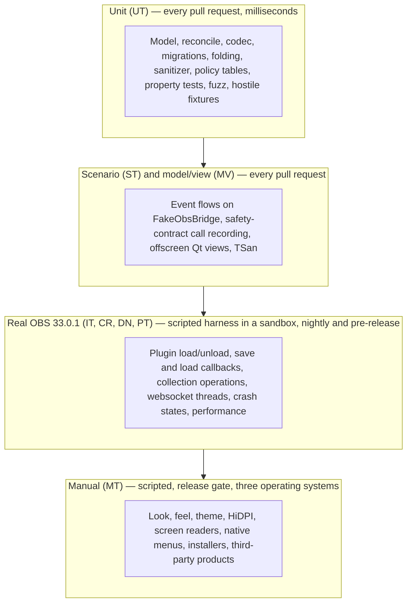
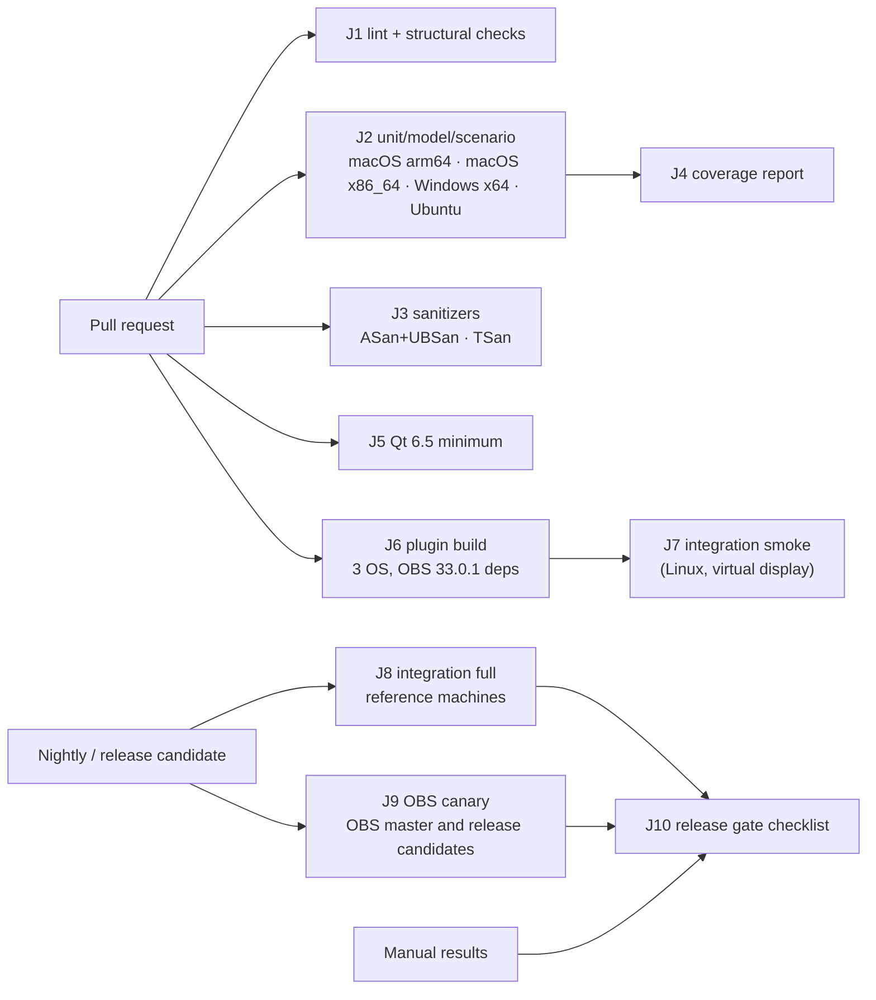
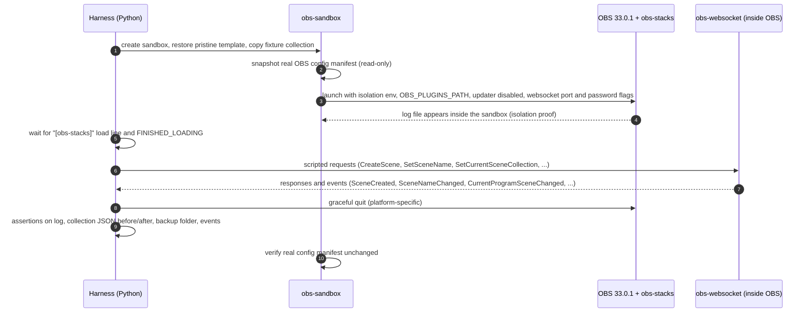
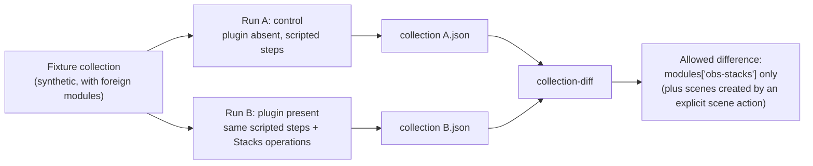
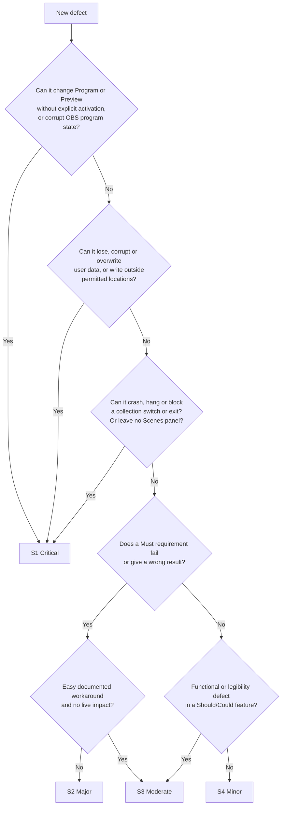

# Stacks for OBS — Testing Strategy

> Status: Draft — pending product-owner validation (Phase 1)  
> Target: OBS Studio 33.0.1+  
> Last updated: 2026-11-04

This document defines how Stacks for OBS is verified: which tests exist, where they run, what they prove, what must stay manual, how performance and crash recovery are measured, how real user data is kept out of harm's way, and which results gate a release. It turns the **safety contract** (SC-01 to SC-15 in [02-product-requirements.md](02-product-requirements.md)), the **hypothesis register** of [04-software-architecture.md](04-software-architecture.md) and the open runtime questions of [01-technical-feasibility.md](01-technical-feasibility.md) into a concrete, schedulable test plan.

It is a **plan**, not a record of results. Nothing in it has been executed: no OBS build was run to write it, and every statement about OBS behavior is either *Verified in source* (OBS Studio 33.0.1 code read for this document), *Documented*, *Third-party*, or a *Hypothesis* with the test that will close it. Every numeric target, threshold, trial count and time budget is a **proposal**, and every performance target is a **target to measure**, not a claim. Design values (colors, sizes, spacing) referenced by tests are owned by [03-ux-ui-specification.md](03-ux-ui-specification.md) and remain **proposals pending a design review page**; tests read them from the design tokens and never hard-code them.

Sibling documents: [01-technical-feasibility.md](01-technical-feasibility.md), [02-product-requirements.md](02-product-requirements.md), [03-ux-ui-specification.md](03-ux-ui-specification.md), [04-software-architecture.md](04-software-architecture.md), [05-implementation-plan.md](05-implementation-plan.md).

Conventions: evidence references `[E..]` resolve to the evidence index of the architecture document; `[T..]` resolve to the [evidence index of this document](#17-evidence-index). Component names (`IObsBridge`, `FakeObsBridge`, `Reconciler`, `SchemaCodec`, `EventCoordinator`, `ActionService`, `ActivationPolicy`, `UndoService`, `PersistenceCoordinator`, `BackupStore`, `NativeDockAdapter`, `SearchIndex`, `SvgSanitizer`, `TextFolding`, `StacksItemModel`, `StacksFilterProxy`, `StacksTreeView`) are those of the architecture document.

Test identifier families used throughout:

| Prefix | Family | Section |
|---|---|---|
| SK-x | Structural and static checks (scripts run in the lint job) | [2.5](#25-static-and-structural-checks) |
| UT-xx | Unit tests (pure core, no OBS, no widgets) | [4](#4-unit-tests-ut) |
| MV-xx | Model, view and UI-geometry tests (offscreen Qt) | [5](#5-model-view-and-scenario-tests-mv-st) |
| ST-xx | Scenario tests on `FakeObsBridge` (event flows, safety contract) | [5](#5-model-view-and-scenario-tests-mv-st) |
| IT-xx | Integration tests against a real OBS Studio 33.0.1 | [6](#6-integration-tests-against-real-obs-it) |
| MT-xx | Manual test scripts | [7](#7-manual-test-scripts-mt) |
| PT-xx | Performance tests | [9](#9-performance-tests-pt) |
| CR-xx | Crash-recovery tests | [10](#10-crash-recovery-tests-cr) |
| DN-xx | Data non-destruction tests | [11](#11-data-non-destruction-tests-dn) |

(The prefix `SC-xx` is reserved for the safety contract clauses of the PRD; scenario tests are therefore `ST-xx`.)

## Table of contents

1. [Scope, principles and quality bar](#1-scope-principles-and-quality-bar)
2. [Test pyramid and tooling](#2-test-pyramid-and-tooling)
3. [Test data and environment safety](#3-test-data-and-environment-safety)
4. [Unit tests (UT)](#4-unit-tests-ut)
5. [Model, view and scenario tests (MV, ST)](#5-model-view-and-scenario-tests-mv-st)
6. [Integration tests against real OBS (IT)](#6-integration-tests-against-real-obs-it)
7. [Manual test scripts (MT)](#7-manual-test-scripts-mt)
8. [Compatibility matrix](#8-compatibility-matrix)
9. [Performance tests (PT)](#9-performance-tests-pt)
10. [Crash-recovery tests (CR)](#10-crash-recovery-tests-cr)
11. [Data non-destruction tests (DN)](#11-data-non-destruction-tests-dn)
12. [Regression suite and release gate](#12-regression-suite-and-release-gate)
13. [Bug triage and severity scale](#13-bug-triage-and-severity-scale)
14. [Traceability: safety contract to tests](#14-traceability-safety-contract-to-tests)
15. [Hypothesis register: how each is closed](#15-hypothesis-register-how-each-is-closed)
16. [Open points](#16-open-points)
17. [Evidence index](#17-evidence-index)

---

## 1. Scope, principles and quality bar

### 1.1 What is being protected

Stacks sits next to a live broadcast tool. A defect that annoys a user at their desk is a bug; the same defect during a live show is an incident. The test strategy is therefore **risk-ordered**, and the order comes from the PRD risk register:

| Rank | Harm | PRD risk | Primary defense in this plan |
|---|---|---|---|
| 1 | An unintended Program change on air (click, right-click, drag, undo, rebuild) | R-01, R-02 | `ActivationPolicy` table (UT-100 to UT-107), call-recording scenario tests (ST-14 to ST-17), Studio Mode manual matrix (MT-05 to MT-09), real-OBS event watch (IT-14) |
| 2 | Loss or corruption of a user's collection or organization | R-05, R-06, R-11, R-17 | Reconciliation and codec unit tests, data non-destruction suite (DN), crash-recovery suite (CR), collection matrix (MT-14 to MT-18) |
| 3 | OBS refusing to switch collection or exiting because a source reference leaked | R-03 | Include-boundary check, 50-switch soak (IT-06), log assertions on the verified leak message [E37] [E38] |
| 4 | Stalls or deadlocks on a non-UI thread (obs-websocket workers) | R-04 | Threaded scenario tests under TSan (ST-18), websocket burst and shutdown soak (IT-08, IT-09) |
| 5 | User left without a Scenes panel after disable or uninstall | R-07, R-09 | Native dock spikes S-1 to S-4 (IT-19), MT-03, MT-04, MT-19, MT-20 |
| 6 | Wrong or unreadable UI (theme, HiDPI, language, accessibility) | R-16, R-18 | MV geometry tests, manual theme, HiDPI, keyboard and screen-reader scripts |
| 7 | Performance regressions at hundreds of scenes | R-14 | PT suite on reference hardware |

### 1.2 Principles

| # | Principle | Consequence |
|---|---|---|
| QP1 | **The safety contract is the specification.** Each SC clause has at least one automated test and, where the clause concerns real OBS behavior, one real-OBS or manual test ([section 14](#14-traceability-safety-contract-to-tests)). | A clause without a test is a release blocker. |
| QP2 | **Prove with the fake what a fake can prove; prove with real OBS what it cannot.** The core runs against `FakeObsBridge`; the fake is kept honest by contract tests that also run against the real bridge ([2.4](#24-keeping-the-fake-honest)). | Most logic is tested in milliseconds on every pull request; the real-OBS tier is small and targeted. |
| QP3 | **Real user data is never used.** Sandboxed OBS configuration, synthetic fixtures, read-only snapshots ([section 3](#3-test-data-and-environment-safety)). | A test run cannot touch a real collection, profile, stream key or plugin folder. |
| QP4 | **Deterministic by construction.** Injected clock, UUID generator and file system; seeded random generators whose seed is printed on failure. | A failing test is reproducible from its log. |
| QP5 | **Verification tests are explicit about their label.** A test that closes a *Hypothesis* names it (H-xx) and records the observed behavior, which then becomes the contract. | The hypothesis register shrinks over time ([section 15](#15-hypothesis-register-how-each-is-closed)). |
| QP6 | **Every fixed bug gets a regression test** at the lowest layer that can reproduce it, plus a fixture if data was involved. | The regression suite grows monotonically ([section 12](#12-regression-suite-and-release-gate)). |
| QP7 | **Manual tests are scripts, not exploration.** Numbered steps, expected result, evidence to capture, severity if failed. Exploratory sessions are additional and time-boxed. | Results are comparable across releases and testers. |
| QP8 | **Measured, not claimed.** Performance and accessibility targets are reported as measurements with method, hardware and sample size. A missed target is investigated and either fixed or explicitly renegotiated by the product owner (PRD 13.1). | No number appears in release notes without a measurement behind it. |
| QP9 | **Live-broadcast bias in triage.** A defect that can change Program, lose data or block a collection switch is Severity 1 regardless of how rare it is ([section 13](#13-bug-triage-and-severity-scale)). | Release decisions follow the harm, not the frequency. |

### 1.3 What is out of scope

- OBS's own behavior beyond what Stacks depends on (OBS is not tested; where Stacks depends on an OBS behavior, a test *observes* it so that an OBS release which changes it is detected, see the per-release acceptance run in [12.3](#123-per-obs-release-acceptance-run)).
- Features out of v1 (presets, nested stacks, "Apply Stacks order to OBS", extra canvases). The schema reservation `canvas_uuid` is covered only by pass-through tests (UT-61).
- Code signing and notarization results (not available yet, PRD decision 8). The *unsigned installation experience* is tested manually (MT-33); signing is added to the release gate when certificates exist.

---

## 2. Test pyramid and tooling

### 2.1 Pyramid



| Layer | IDs | Proves | Runs on | Proposed budget | Blocks merge |
|---|---|---|---|---|---|
| Unit | UT | Pure logic is correct, total (never crashes) and deterministic | Every pull request, 4 OS jobs | ≤ 2 min per job | Yes |
| Model/view | MV | Qt item model contract, filtering, keyboard map, activation gating, geometry, accessible text | Every pull request, offscreen QPA | ≤ 3 min per job | Yes |
| Scenario | ST | Event flows of architecture section 6.3 end to end on the fake; SC-01, SC-03, SC-04, SC-07, SC-09, SC-13 call recording; thread safety under TSan | Every pull request | ≤ 5 min per job | Yes |
| Real OBS (smoke) | IT subset | Plugin loads and unloads, one save round trip, one collection switch | Every pull request on the Linux integration job, if feasible (H-T2) | ≤ 10 min | Yes if the job exists; otherwise nightly |
| Real OBS (full) | IT, CR, DN | Everything a fake cannot prove | Nightly and release candidates on reference machines | ≤ 90 min | Gate for release |
| Performance | PT | NFR-01 to NFR-11 at 10/50/100/250/500 scenes | On demand and before each release, on reference hardware only | Hours | Gate for release (hard NFRs only, [9.7](#97-reporting-and-pass-criteria)) |
| Manual | MT | What automation cannot see | Release candidates, per the matrix of [section 8](#8-compatibility-matrix) | Days | Gate for release |

The shape is deliberate: about 115 unit tests, 46 model/view and scenario tests, 25 integration tests (plus 10 crash-recovery and 12 data non-destruction tests) and 38 manual scripts at the time of writing. The ratio matters more than the numbers: **everything that can be decided without OBS is decided without OBS.**

### 2.2 Framework decision: Qt Test

The architecture already assumes Qt Test (`stacks_tests` links `Qt6::Test`, [3.2 of 04](04-software-architecture.md#32-build-targets), [17.2 of 04](04-software-architecture.md#172-layers)). This section records why, against the two common alternatives.

| Criterion | **Qt Test** | Catch2 v3 | GoogleTest |
|---|---|---|---|
| Ships with the Qt the project already depends on (no extra download at configure time) | **Yes** (*Hypothesis* H-T1 that the obs-deps Qt package includes the Test module; fallback below) | No (FetchContent or vendoring; a network fetch at configure unless vendored) | No (same) |
| `QSignalSpy`, queued-connection and event-loop handling, `QTest::qWait` / `QTRY_*` | **Native** | Needs glue code | Needs glue code |
| `QAbstractItemModelTester` (model contract checking, part of Qt Test) | **Native** | Not available without Qt Test anyway | Not available without Qt Test anyway |
| Synthesized mouse, key, drag events for widgets (`QTest::mouseClick`, `keyClick`, `QTest::mouseMove`) | **Native** | Not available without Qt Test anyway | Not available without Qt Test anyway |
| Offscreen platform (`QT_QPA_PLATFORM=offscreen`) | Works the same for all | Same | Same |
| Data-driven tables (`QTest::addColumn` / `newRow`) for the policy and folding tables | **Native**, row names appear in failure output | `GENERATE` / table macros | Value-parameterized tests |
| Micro-benchmarks (`QBENCHMARK`) | **Native** (used for model-level search and reconcile benchmarks, PT-01 to PT-03) | Built-in benchmark macro | Separate library |
| CTest integration | One CTest test per test class (executable), JUnit XML output (`-o file.xml,junitxml`) | Good (`catch_discover_tests`) | Good (`gtest_discover_tests`) |
| Sanitizers (ASan, UBSan, TSan) | Yes (test executables only, [16.1 of 04](04-software-architecture.md#161-required-changes-to-the-scaffold)) | Yes | Yes |
| Test discovery granularity in CTest | Per class, not per slot (weaker) | Per test case | Per test case |
| Failure messages | Adequate (`QCOMPARE` prints both values) | Better expression decomposition | Good |
| License compatibility | LGPL / GPL, compatible | BSL-1.0 | BSD-3 |
| Mocking | Hand-written fakes (which we want anyway: `FakeObsBridge`) | None | gMock (not needed) |

**Decision (TS-1, proposal for product-owner and implementation-plan review): Qt Test is the single test framework.** Reasons: it is the only option that covers *all* needs (pure functions, Qt models, widget events, signal timing, benchmarks) with one dependency the project already has; mixing frameworks would make the three layers (core, model/view, scenario) inconsistent for little gain. The weaker discovery granularity is mitigated by one test class per area (about 20 executables) and by data-driven rows, which give per-row names in CI output.

Two small in-repo helpers fill the gaps:

- **`tests/support/property.hpp`**: a seeded generator toolkit (random trees, random operation sequences, random mutations of fixtures). The seed comes from `STACKS_TEST_SEED` or is drawn randomly and **printed on every failure** so the case can be replayed. No shrinking library is introduced; failing operation sequences are reduced by a simple delta-debugging loop in the helper (remove one operation at a time while the failure persists). Property-based testing of reconcile and the operation inverses is thereby available without a new dependency.
- **`tests/support/fixtures.hpp`**: loads fixtures from `tests/fixtures/` with a path from the environment, and provides a **canonical JSON comparator** (sorted keys, normalized numbers) used wherever the architecture says "byte-comparable after canonical sorting".

**Fallback if H-T1 fails** (obs-deps' Qt does not ship `Qt6::Test`): the tested targets (`stacks_core`, `stacks_ui`, `tests/`) contain **no OBS code** ([2.4 of 04](04-software-architecture.md#24-layering-and-dependency-rules)), so the unit, model/view and scenario jobs build against an independently installed Qt of the same minor version (distribution packages on Linux, a Qt installer or `aqtinstall` on macOS and Windows) while the plugin-build jobs keep using the obs-deps Qt. Verification of H-T1: the first CI run of `find_package(Qt6 6.5 COMPONENTS Test)` against the buildspec Qt (Phase 2, week 1).

### 2.3 Layout, CTest and labels

The test tree is the one of [3.1 of 04](04-software-architecture.md#31-tree): `tests/unit`, `tests/model`, `tests/ui`, `tests/scenarios`, `tests/fakes`, `tests/fixtures`. This document adds `tests/support` (helpers above), `tests/integration` (Python harness, [6.1](#61-harness)) and `tests/tools` (sandbox, generator and extraction scripts, [section 3](#3-test-data-and-environment-safety) and [9.3](#93-generating-test-collections-safely)).

Illustrative CMake (design, not final):

```cmake
# tests/CMakeLists.txt  (enabled by -DBUILD_TESTING=ON)
include(CTest)
find_package(Qt6 6.5 REQUIRED COMPONENTS Test Widgets Svg)

function(stacks_add_test name)
  cmake_parse_arguments(T "" "" "SOURCES;LIBS;LABELS" ${ARGN})
  add_executable(${name} ${T_SOURCES})
  target_link_libraries(${name} PRIVATE Qt6::Test stacks_test_support ${T_LIBS})
  add_test(NAME ${name}
           COMMAND ${name} -o ${CMAKE_BINARY_DIR}/test-results/${name}.xml,junitxml -o -,txt)
  set_tests_properties(${name} PROPERTIES
    LABELS "${T_LABELS}"
    TIMEOUT 120
    ENVIRONMENT "QT_QPA_PLATFORM=offscreen;STACKS_FIXTURES=${CMAKE_SOURCE_DIR}/tests/fixtures")
endfunction()

stacks_add_test(test_reconciler   SOURCES unit/test_reconciler.cpp    LIBS stacks_core LABELS "unit;safety")
stacks_add_test(test_item_model   SOURCES model/test_item_model.cpp   LIBS stacks_ui   LABELS "model")
stacks_add_test(test_scenarios    SOURCES scenarios/test_flows.cpp    LIBS stacks_core stacks_test_fakes LABELS "scenario;safety")
```

| CTest label | Content | Typical command |
|---|---|---|
| `unit` | UT-xx | `ctest --preset ci -L unit` |
| `model`, `ui` | MV-xx | `ctest --preset ci -L "model\|ui"` |
| `scenario` | ST-xx | `ctest --preset ci -L scenario` |
| `safety` | Every test that backs an SC clause (cross-cutting) | `ctest --preset ci -L safety` (the fast safety-contract gate) |
| `hostile` | Hostile fixtures: SVG, PNG, JSON bombs, deep nesting | Runs on every pull request ([17.3 of 04](04-software-architecture.md#173-proposed-quality-gates-to-be-agreed-in-06)) |
| `fuzz` | Seeded mutation runs (short in CI, long nightly) | `STACKS_FUZZ_ITERATIONS=200000 ctest -L fuzz` |
| `bench` | `QBENCHMARK` micro-benchmarks | Not a pass/fail gate; results are archived |

Real-OBS tests (IT, CR, DN, PT) are **not** CTest tests: they need an OBS installation and a sandbox, so they are driven by the Python harness (`tests/integration/run.py`) and are listed by label (`--suite smoke|full|crash|data|perf`). A thin CTest wrapper may call the smoke suite where a runner can host OBS.

### 2.4 Keeping the fake honest

`FakeObsBridge` encodes beliefs about OBS (a shared namespace for source names, silent rename of duplicates, a delayed-visibility window for new scenes, `set_current_preview_scene` as a no-op outside Studio Mode). A fake that drifts from OBS gives false confidence, so each behavior it models is tied to evidence and re-verified.

| Mechanism | Description |
|---|---|
| **Behavior register** | `tests/fakes/BEHAVIORS.md` lists each modeled OBS behavior with its evidence reference (E-number or T-number) and the IT test that re-verifies it on real OBS. A fake behavior without an evidence line is not allowed. |
| **Contract tests** | A shared test suite (`IObsBridgeContract`) exercises the `IObsBridge` surface: name uniqueness, rename suffixing, preview semantics, scene create/remove visibility, undo restore with the same UUID. It runs against `FakeObsBridge` on every pull request and against the real `ObsBridge` through the test hook in the real-OBS tier (IT-22). A divergence fails the nightly run and is fixed in the fake. |
| **Re-verification per OBS release** | The contract suite is part of the per-OBS-release acceptance run ([12.3](#123-per-obs-release-acceptance-run)). |

### 2.5 Static and structural checks

These are cheap tests expressed as scripts; they run in the `lint` job and are part of the gate.

| ID | Check | Why |
|---|---|---|
| SK-1 | A script fails if any file outside `src/obs/` includes `<obs.h>`, `<obs-frontend-api.h>`, `<obs-module.h>` or any `util/` OBS header ([16.1 of 04](04-software-architecture.md#161-required-changes-to-the-scaffold)); CMake target boundaries are checked by building `stacks_core` and `stacks_ui` without OBS include paths | SC-13 by construction (no `obs_source_t*` can be held outside the bridge) |
| SK-2 | A script greps `src/` for `BlockingQueuedConnection`, `findChild` outside `NativeDockAdapter`, `QProcess`, `QNetwork*`, `QLibrary`, `eval`-like calls, `fopen`/`std::ofstream` outside `persistence/` and `utils/` | R1, SC-12, SC-14, P1 |
| SK-3 | Locale parity: every key of `data/locale/en-US.ini` exists in `fr-FR.ini` and vice versa; no empty values; every `obs_module_text("…")` key used in the code exists in `en-US.ini`; placeholders (`%1`, `%2`) match between languages | FR-59, NFR-15 (target 100 % key coverage) |
| SK-4 | Every JSON fixture in `tests/fixtures/valid/` validates against the JSON Schema of [4.4 of 04](04-software-architecture.md#44-json-schema-v1-draft-2020-12); every file in `tests/fixtures/invalid/` fails it for the documented reason | Schema and fixtures cannot drift apart |
| SK-5 | The release binary contains none of the test-hook symbols or strings ([6.2](#62-test-hook-proposal)) and links no network library (`otool -L`, `dumpbin /dependents`, `ldd`) | SC-12, NFR-17 |
| SK-6 | `clang-format` check, `clang-tidy` on changed files, compiler warnings as errors with the project flag set ([16.1 of 04](04-software-architecture.md#161-required-changes-to-the-scaffold)) | Code hygiene |
| SK-7 | Relative links and anchors of `docs/*.md` resolve; documentation contains no placeholder markers | Documentation quality |

### 2.6 Continuous integration jobs (proposal)

The repository uses the GitHub Actions workflows of the plugin template. Runner labels below are proposals; the exact image names (in particular for Ubuntu 26.04 and the Visual Studio 2026 toolchain) are confirmed when the workflows are written (Phase 2, [05-implementation-plan.md](05-implementation-plan.md)).



| Job | Trigger | Runners | Steps | Gate |
|---|---|---|---|---|
| **J1 lint** | PR | Linux | clang-format, clang-tidy (changed files), SK-1 to SK-7 | Required |
| **J2 test** | PR, push to main | macOS arm64, macOS x86_64 (an Intel runner, or the arm64 runner with `arch -x86_64` if no Intel runner exists), Windows x64, Ubuntu | Configure `-DBUILD_TESTING=ON`, build `stacks_core`, `stacks_ui`, tests; `ctest -L "unit\|model\|ui\|scenario\|hostile\|safety"` with JUnit upload | Required on all four |
| **J3 sanitizers** | PR | Linux (Clang), macOS arm64 | ASan + UBSan on all tests; TSan on `scenario` and the concurrency tests (ST-18, ST-19) | Required (TSan on Linux only if the runner supports it; otherwise nightly) |
| **J4 coverage** | PR (Linux) | Linux | `llvm-cov` or `gcov` on `stacks_core` (model, persistence, core, utils); report as an artifact | Proposal: ≥ 90 % lines on `stacks_core` and ≥ 80 % on changed lines (architecture 17.3 proposes ≥ 90 %) |
| **J5 Qt minimum** | PR | Linux with Qt 6.5.x | Build and run the test tree with `QT_DISABLE_DEPRECATED_UP_TO=0x060500` and warnings as errors | Required. Catches use of APIs newer than Qt 6.5 ([16.1 of 04](04-software-architecture.md#161-required-changes-to-the-scaffold)) |
| **J6 plugin build** | PR | macOS (universal), Windows, Ubuntu | Template build of the real `obs-stacks` module against the OBS 33.0.1 dependencies of `buildspec.json`; SK-5 on the artifact; upload artifacts | Required |
| **J7 integration smoke** | PR (when feasible) and nightly | Linux with a virtual display (*Hypothesis* H-T2) | Obtain OBS 33.0.1 (package, Flatpak or a cached source build), start it in a sandbox with the plugin from J6, run IT-01, IT-03, IT-06 (reduced) | Required if H-T2 passes; otherwise folded into J8 |
| **J8 integration full** | Nightly, release candidates | Reference machines (developer MacBook Pro M1 Max with a dedicated test account; one Windows machine; one Ubuntu machine). The production Mac mini is **never** a CI runner | Full IT, CR, DN suites; PT on demand | Gate for release |
| **J9 OBS canary** | Nightly (non-blocking) | Linux | Build OBS from `master` and from release candidates (tracking upstream pull requests #13328 and #13617, [R-08 of 02](02-product-requirements.md#12-risks)); run the smoke and contract suites against it; report | Informational; a failure opens an issue, it does not block |
| **J10 release gate** | Release tag | n/a | A checklist workflow requiring: J1 to J8 green on the release commit, the manual result sheet uploaded ([12.2](#122-release-gate-checklist)), the performance report attached | Required |

Feasibility of J7 is a **Hypothesis** (H-T2): OBS needs a working graphics path at startup. Verification: a spike in Phase 2 that launches an OBS 33.0.1 build under a virtual display with software rendering and reaches `FINISHED_LOADING`; if it cannot, the smoke suite runs only on J8 and PRs rely on the scenario tier. Obtaining OBS for CI is a build-or-install decision (distribution package for the target Ubuntu if OBS 33.0.1 is available for it, Flatpak, or a cached build of the 33.0.1 tag with the browser and other heavy options off); it is decided with the spike.

---

## 3. Test data and environment safety

This section comes early on purpose: every real-OBS and manual test depends on it, and a mistake here costs a user's scene collections or a live show.

### 3.1 What could go wrong

| # | Hazard | Consequence |
|---|---|---|
| H1 | A test OBS instance reads and writes the **real** OBS configuration directory | Real collections rewritten, profile and streaming settings touched, `DockState` changed |
| H2 | A development build is installed into the **real** plugin directory | The plugin is loaded in daily use before it is validated; a hidden native dock stays hidden |
| H3 | A real collection is used as a fixture, committed, attached to an issue or pasted into a log | Leak of private names, file paths, browser-source URLs or tokens |
| H4 | A test starts a stream or recording against a real service | Public broadcast, or a stream key exposed |
| H5 | obs-websocket left enabled without authentication on a shared network | Remote control of OBS |
| H6 | Two OBS instances share one configuration | Corrupted or lost writes |
| H7 | Test OBS self-updates or phones home | Changed version under test; unexpected network traffic |
| H8 | A performance or soak run on the **production** machine of a working show | Load, instability, or a crash on the machine that goes on air |

### 3.2 Hard rules

| # | Rule |
|---|---|
| **S1** | **Never run a development build of Stacks against the real OBS configuration.** All tests run in a sandbox ([3.3](#33-isolating-the-obs-configuration)) whose location is proven isolated before OBS starts ([3.5](#35-sandbox-guard)). |
| **S2** | **Never copy a development build into a real plugin directory.** Dev builds are loaded only through `OBS_PLUGINS_PATH` ([3.4](#34-loading-the-development-build)). Installer and uninstall tests run in a clean account or virtual machine (MT-19, MT-20, MT-33). |
| **S3** | **Fixtures are synthetic.** They are generated by `tests/tools/gen-collection` ([9.3](#93-generating-test-collections-safely)) or captured once from a throwaway OBS sandbox (for instance a collection produced by the real *Duplicate* command, IT-17). No real collection is ever committed, attached to an issue or logged. |
| **S4** | **A real collection may be used for dogfooding only as a read-only snapshot copied into a sandbox**, after the owner's explicit consent, never opened in place, and never on the day of a live show. Bug reports about organization data contain only the extracted `modules["obs-stacks"]` block, with names scrubbed on request (`tests/tools/extract-stacks-block --scrub`). |
| **S5** | **No streaming, no real service.** Sandbox profiles have no stream service configured. Recording (only in PT-11) writes to the sandbox. The harness never passes `--startstreaming` ([T01]). |
| **S6** | **No open control port.** The harness enables obs-websocket with authentication and a random per-run password (`--websocket_password`, `--websocket_port`, [T12]), only inside the sandbox, and tears it down at the end. Runs on shared networks use a host firewall or an isolated virtual machine (*Hypothesis* H-T4: the obs-websocket server's bind address is not verified here; verify with `lsof -i` / `netstat` during the first harness run and document it). |
| **S7** | **One OBS instance per configuration.** The sandbox guard refuses to start if another process holds the sandbox. `--multi` is passed only to suppress OBS's own multiple-instance warning, never to share a configuration ([T01]). |
| **S8** | **Updater off, reports off.** `--disable-updater` and `--disable-missing-files-check` are always passed ([T01]); crash-report upload is declined by the harness (it answers the unclean-shutdown dialog with *Launch Normal* or removes the sentinel, [10.1](#101-how-obs-saves-loads-and-detects-a-crash-verified-in-source)). |
| **S9** | **A pristine sandbox is restored before every test** from a read-only template (APFS clone on macOS, `cp --reflink=auto` on Linux, `robocopy` on Windows). Tests never depend on the previous test's state. |
| **S10** | **The production machine is not a test machine.** Performance reference hardware (MacBook Pro M1 Max, Mac mini M4) is used **only in a dedicated test user account** and only when no show is scheduled; no CI runner is ever hosted on the production machine. |

### 3.3 Isolating the OBS configuration

Where OBS keeps its configuration is decided in `GetAppConfigPath` and the platform layer. What each platform offers for isolation:

| OS | Real configuration location | Isolation mechanism | Evidence | Label |
|---|---|---|---|---|
| **Windows** | `%APPDATA%\obs-studio` (`CSIDL_APPDATA`) | **Portable mode**: `--portable` / `-p`, or a file named `portable_mode`, `obs_portable_mode`, `portable_mode.txt` or `obs_portable_mode.txt` placed in the OBS installation root (two levels above the 64-bit binary directory). The configuration then lives in the `config` folder of that root. The paths are **relative to the working directory**, so the harness starts OBS with its binary directory as the working directory. Use a **copy** of the OBS installation folder for the sandbox. | [T02] [T03] | Verified in source |
| **Linux** | `$XDG_CONFIG_HOME/obs-studio` or `$HOME/.config/obs-studio` | Environment: `HOME=<sandbox>/home` and `XDG_CONFIG_HOME=<sandbox>/config`; the user plugin root follows `$XDG_DATA_HOME`, so also set `XDG_DATA_HOME=<sandbox>/data`. (Portable mode exists only when OBS is built with `ENABLE_PORTABLE_CONFIG`, **off by default**.) | [T03] [T04] [T05] | Verified in source (config path); plugin root from the loader comment |
| **macOS** | `~/Library/Application Support/obs-studio` through `NSSearchPathForDirectoriesInDomains(NSApplicationSupportDirectory, NSUserDomainMask)` | **Portable mode is not available** (the portable switch is compiled in only for Windows, or for Linux builds with `ENABLE_PORTABLE_CONFIG`). **Recommended: a dedicated standard macOS user account** (`obs-test`) or a virtual machine, so that `~/Library/Application Support` is a different directory. An environment-only override (`HOME=…`) is **unproven**: *Hypothesis* H-T3 that Foundation resolves the Application Support folder independently of `$HOME`; verification is the canary procedure below. | [T02] [T03] [T04] | Verified in source (no portable mode); Hypothesis (HOME override) |

**Canary procedure for H-T3** (never against real data): create `<sandbox>/home`, set `HOME` to it, start OBS with an empty profile, and after exit check whether `obs-studio/logs/*.txt` appeared under the sandbox or under the real Application Support directory. Compare a read-only manifest (file names and modification times) of the real directory before and after. Until H-T3 is closed, **only the dedicated-account method is allowed on macOS**.

Linux packaging note: the Flatpak build keeps its configuration under `~/.var/app/com.obsproject.Studio` (*Documented* convention, not verified here) and is a later target (PRD 10.7); it is tested with its own sandbox procedure when it ships.

### 3.4 Loading the development build

`OBS_PLUGINS_PATH` adds a user plugin path on every OS ([T05], *Verified in source*). The expected layout under that path is the OBS 33 plugin layout:

| OS | Layout under `OBS_PLUGINS_PATH` | Evidence |
|---|---|---|
| macOS | `<path>/obs-stacks.plugin/Contents/MacOS/obs-stacks` and `<path>/obs-stacks.plugin/Contents/Resources` | [T05] |
| Windows | `<path>\obs-stacks\obs-stacks.dll` and `<path>\obs-stacks\data` | [T05] |
| Linux | `<path>/obs-stacks/obs-stacks.so` and `<path>/obs-stacks/data` | [T05] |

(The exact output of the template's install step against these layouts is checked at the first Phase 2 install test, [01 section 14](01-technical-feasibility.md).) Two corollaries:

1. The **real** user plugin directory (`~/Library/Application Support/obs-studio/plugins`, `C:\ProgramData\obs-studio\plugins`, `$XDG_DATA_HOME/obs-studio/plugins`) is loaded as well. A previously installed release of Stacks there would be loaded **in addition** to the development build. The dedicated account, copy or virtual machine of [3.3](#33-isolating-the-obs-configuration) therefore also keeps that directory empty of Stacks.
2. Unloading the development build is "unset the variable". Nothing is installed, so nothing needs uninstalling.

*Hypothesis* H-T5: macOS OBS hardened-runtime library validation accepts an ad-hoc signed plugin loaded from `OBS_PLUGINS_PATH` (OBS's own release is signed; the entitlement that allows third-party libraries is *Verified in source*, see [12.3 of 01](01-technical-feasibility.md#123-macos); whether an ad-hoc signature is sufficient at runtime under that entitlement is not verified here). Verification: first macOS load test; if refused, the dev workflow uses a locally built OBS or re-signs OBS in the sandbox, and the finding goes into the contributor documentation.

### 3.5 Sandbox guard

`tests/tools/obs-sandbox` is the only entry point used by the harness and by humans for real-OBS runs. Pseudocode of its safety logic:

```text
create(sandbox_root):
    refuse if sandbox_root is inside, or equal to, the real OBS config directory or the user's home
    mkdir sandbox_root/{config|home,data,plugins,fixtures,artifacts}
    write sandbox_root/.stacks-test-sandbox   # sentinel with a random id and creation time
    copy template (config skeleton, empty profile, no stream service) from tests/tools/template/

launch(sandbox_root, args):
    require sentinel; require no other OBS process already bound to this sandbox
    snapshot_real = manifest(real OBS config dir, names + mtimes + sizes)      # READ-ONLY
    env = isolation_env(os, sandbox_root)  [+ --portable on Windows]
    env.OBS_PLUGINS_PATH = <build output under sandbox_root/plugins>
    start OBS with: --disable-updater --disable-missing-files-check --multi --verbose  [+ test args]
    wait until a log file appears under sandbox_root/**/obs-studio/logs/
    ABORT (kill, nonzero exit) if:
        no log file appeared inside the sandbox, or
        manifest(real OBS config dir) != snapshot_real                          # something wrote to the real one

after_run:
    verify manifest(real OBS config dir) == snapshot_real  → record "real config untouched" in the run report
```

Why a log file as proof: OBS creates its `logs` directory through the same configuration-path function it uses for everything else ([T15]); a log under the sandbox proves the configuration resolved there. The before/after manifest of the real directory is the second, independent proof. Both are required results in every real-OBS run report.

### 3.6 Fixtures, backups and artifacts

| Item | Rule |
|---|---|
| Fixture catalogue | `tests/fixtures/`: `valid/` (v1 in several shapes), `invalid/` (one file per failure class), `newer/` (schema above supported), `oversized/`, `hostile/` (JSON, SVG, PNG), `legacy/` (pre-29.1-style collection without UUIDs, *Hypothesis* H-12 until captured from a real old build), `duplicate/` (a collection saved by the real *Duplicate* command: new UUIDs, same `modules`), `golden/` (frozen before/after pairs for DN tests). Every file has a one-line provenance note in `tests/fixtures/PROVENANCE.md` (generated by script X with seed Y, or captured from OBS 33.0.1 sandbox on date Z). |
| Template sandbox | Read-only template under `tests/tools/template/`; restored per test (S9). |
| Run artifacts | Per run: OBS log(s), the collection JSON before and after, the Stacks backup folder, plugin config, screenshots and recordings for manual runs. Stored under `artifacts/<run-id>/`, never committed, scrubbed of names before being attached to an issue (S4). |
| Real-machine safety net (dogfooding only, S4) | Before any dogfooding session: *Scene Collection > Export Scene Collection* of every collection ([T16]), a copy of `basic/scenes/*.json*` and of the Stacks backup folder, and the knowledge of the three recovery paths (Docks menu toggle, *Docks > Reset Docks*, Safe Mode). |

---

## 4. Unit tests (UT)

Unit tests exercise `utils/`, `model/`, `persistence/` and the pure parts of `core/` with **no OBS, no widgets and no event loop**, in milliseconds. They are the bulk of the safety net. Conventions:

- *Trace* gives the invariant (I1 to I9, [4.2 of 04](04-software-architecture.md#42-invariants)), error code ([12.2 of 04](04-software-architecture.md#122-error-taxonomy)), requirement (FR-xx) or safety clause (SC-xx) the test backs.
- "Property" means a seeded randomized test (`tests/support/property.hpp`); iteration counts are CI defaults, raised nightly.
- Where the UX specification decides an exact behavior, the test encodes that decision and cites the section; if the specification is silent, the test records the proposal and the open point.
- Every test that touches time, identifiers or files uses the injected `FakeClock`, `FakeUuid` and `FakeFs`.

### 4.1 Model invariants and operations

| ID | Test | Expected result | Trace |
|---|---|---|---|
| UT-01 | Depth limit: move a stack into a stack, create a stack inside a stack, drop a stack payload on a stack header; load a hand-edited tree with a nested stack | Operations rejected with a typed reason and the tree unchanged; on load the nested stack is repaired (promoted to root right after its parent, order kept) and logged once | I1, FR-25, E-REPAIR |
| UT-02 | Scene UUID uniqueness: file the same scene twice through the API; load a tree where one UUID appears in two entries | API rejects; load keeps the first occurrence, drops later ones, logs a warning | I2 |
| UT-03 | Plugin id uniqueness: duplicate stack or separator ids on load | Later duplicates receive fresh ids from the injected generator; children and order preserved | I3 |
| UT-04 | Unsorted constraints: singleton, last at root, scenes only; cannot be renamed, deleted, moved or dropped into; a missing Unsorted is created at the end; two Unsorted nodes are merged | Invariant holds after every operation and after load repair | I4, FR-14 |
| UT-05 | Separators are never activatable: `ActionService::activate` on a separator id; selection-to-activation flag of the node | Typed error; no bridge call | I5, SC-02 |
| UT-06 | Name rules: empty or whitespace-only stack name; 257-character stack name; empty label on a `labeled` separator; 2,000-character scene name | Rejected on input (stack, label); truncated to 256 on load with a log; scene name value preserved, truncated only in display | I6, I8 |
| UT-07 | Color validation: `#3478F6`, lower-case hex, `#fff`, `rgb(1,2,3)`, `red`, 8-digit hex, empty string, non-string | Only `#RRGGBB` accepted; everything else treated as absent on load (node kept); normalization of case is stable | I7, FR-30 |
| UT-08 | Inverse operations: for each operation (`MoveNodes`, `CreateStack`, `DissolveStack`, `Rename`, `SetColor`, `SetIcon`, `SetFavorite`, `SetCollapsed`, `CreateSeparator`, `EditSeparator`, `RemoveSeparator`, `FileScene`, `Restamp`, `Tombstone`), `inverse(apply(op))` is the identity (property, 10,000 trees) | Canonical-equal trees | [4.3 of 04](04-software-architecture.md#43-in-memory-model) |
| UT-09 | Operation sequences: random sequences of up to 50 operations, then their inverses in reverse order | Original tree restored exactly; invariants I1 to I9 hold after **every** step (property) | I1-I9 |
| UT-10 | Dissolve stack: with children, empty, with separators and favorites; undo | Children promoted in place, order kept, no scene entry added or removed, scene color/icon/favorite untouched; undo recreates the stack with the same id | SC-05, FR-24 |
| UT-11 | Create stack: with and without a selection, as the first and last root node, with an empty name proposal | Placement per [03 section 10](03-ux-ui-specification.md#10-interactions); empty stack allowed (FR-26); stack-name collision rule as specified in 03 | FR-19, FR-26 |
| UT-12 | No duplication, pass-through nodes: color/icon/favorite on a scene never creates a second entry; moves and dissolves around *opaque* and *tombstone* entries | A scene exists in exactly one place; opaque nodes and tombstones keep their relative position and bytes through every operation | I2, I9, SC-09 |

### 4.2 Ordering operations and drag-and-drop rules

| ID | Test | Expected result | Trace |
|---|---|---|---|
| UT-13 | Move Up / Move Down inside a container: first and last boundaries, single and multiple selection, contiguous and non-contiguous, across separators | Boundary moves are no-ops (not errors); non-contiguous selections keep their relative order; table-driven expected orders | FR-23 |
| UT-14 | Move to Top / Move to Bottom for scenes, stacks and separators; stacks never move below Unsorted | Expected orders; Unsorted stays last | FR-23, I4 |
| UT-15 | Drop positions: before, after, onto a stack header (insertion point as specified in [03 section 10.2](03-ux-ui-specification.md#102-drag-and-drop)), into an empty stack, into a collapsed stack, from Unsorted into a stack, from a stack to top level | Expected trees; scene order inside containers preserved | FR-22 |
| UT-16 | Invalid drops: stack onto a stack, onto itself, anything onto or below Unsorted, a separator into Unsorted, a missing/tombstone entry | Rejected with no change to the tree | I1, I4 |
| UT-17 | Stack reorder at root, including an attempt to pass Unsorted | Result clamped before Unsorted | FR-23 |
| UT-18 | Multi-selection of mixed node types (scenes + a separator, or a stack + a scene) dropped into a stack | Valid sets move as one; invalid sets are rejected **as a whole** (all-or-nothing) | FR-22 |
| UT-19 | Batch atomicity: a batch whose last operation fails | The tree is exactly as before the batch; no partial state; one undo entry or none | [10.1 of 04](04-software-architecture.md#101-command-pipeline) |
| UT-20 | Native order is untouched: after every ordering operation, the call recorder shows **no** reorder or scene call and `SceneRegistry.nativeIndex` values are unchanged. A golden file lists the method names of `IObsBridge`; adding a method that could reorder scenes fails the test and forces a review | Zero such calls; interface surface equals the golden list | SC-03, ADR-002 |

### 4.3 Separator constraints

| ID | Test | Expected result | Trace |
|---|---|---|---|
| UT-21 | Variants: `line`, `labeled`, `spacer` (sizes are enumerations; their pixel values belong to the design tokens and are **proposals**); conversion between variants through the editor, including `labeled` to `line` to `labeled` | Label required and non-empty for `labeled`; conversion keeps or drops the label as specified in [03 section 12.8](03-ux-ui-specification.md#128-separator-editor); unknown size falls back and is preserved | FR-27, FR-28 |
| UT-22 | Placement: allowed at root and inside a stack, never inside Unsorted; moving between stacks | Expected results; invalid placements rejected | I4 |
| UT-23 | Never a scene: create, edit, move and remove separators with the call recorder attached | Zero `IObsBridge` calls; `listScenes()` and the registry never include a separator; scene count unchanged | SC-02, FR-29 |
| UT-24 | Reconcile with separators: matched by plugin `id` (they have no UUID), survive when every scene disappears, survive a collection Duplicate | Separators unchanged by every reconcile mode | FR-27 |
| UT-25 | Separator text: labels with emoji, right-to-left marks, combining marks, 256 characters | Stored and returned exactly; rendered as plain text (see MV-16) | FR-27, [15.2 of 04](04-software-architecture.md#152-rules) |

### 4.4 Reconciliation

`Reconciler` is a pure function `(persisted tree, live snapshot, mode, now) → (tree, report)` ([5.2 of 04](04-software-architecture.md#52-algorithm-design-not-implementation)); every test builds the live snapshot explicitly.

| ID | Scenario | Expected result | Trace |
|---|---|---|---|
| UT-26 | Normal load: every entry matches a live scene by UUID | Identical tree, empty report | FR-49 |
| UT-27 | Hygiene: one UUID in two entries; entries with an empty `uuid` | First kept, later dropped with a warning; empty UUID tolerated (scene entries only) and matched by name in LoadClass | I2 |
| UT-28 | **Collection duplicate** (fixture `duplicate/`, captured from the real *Duplicate* command, [IT-17](#63-integration-test-catalogue)): all live UUIDs are new, names unchanged | UUID pass binds nothing; name pass re-keys every entry (`rekeyed = N`); structure, colors, icons, favorites, collapsed state identical; entries carry the new UUIDs | FR-49, R-11, [5.3 of 04](04-software-architecture.md#53-scenarios) |
| UT-29 | **New UUIDs for a subset** (half of the scenes re-keyed) | Mixed UUID and name binding; no live scene bound twice; second reconcile is a no-op | FR-49 |
| UT-30 | **Pre-29.1 / UUID-less collection**: entries without UUID; three simulated launches in which the live scenes get different random UUIDs each time and no save happens in between | Every launch re-binds by name; the organization is identical across launches; after a save the stamped UUIDs bind in the UUID pass (closes H-12 on the plugin side; the OBS side is IT-23) | FR-49, H-12 |
| UT-31 | **Duplicate names**, two unbound entries with the same name and one live scene of that name (hand-edited file) | Not guessed: the live scene goes to Unsorted; both entries become tombstones | FR-49 |
| UT-32 | Duplicate names where one entry is UUID-bound | The unbound twin does not bind to the already-claimed live scene | FR-49 |
| UT-33 | Scene renamed while the plugin was disabled | UUID pass binds it, name restamped, position kept, `renamed = 1` | FR-49 |
| UT-34 | Scene deleted and recreated by name while disabled (new UUID, same name) | Name pass binds it to the old place; counted in `rekeyed` so the notice can say it was matched by name | FR-49 |
| UT-35 | **Runtime mode**: a brand-new scene reuses the name of a tombstone | No name pass at runtime: the scene goes to Unsorted; the tombstone remains | FR-14, FR-49 |
| UT-36 | New scenes: several at once, with a mixed native order | Appended to Unsorted in native order, never into a stack; flagged "new" in the report | FR-14 |
| UT-37 | Missing scene becomes a tombstone | `missing_since` from the injected clock; position kept; repeated reconciles do not rewrite it | FR-51 |
| UT-38 | Unsorted entry of a vanished scene | Dropped when it has no user data; tombstoned when it has color, icon or favorite | [5.2 of 04](04-software-architecture.md#52-algorithm-design-not-implementation) step 4 |
| UT-39 | Tombstone revived by UUID (what OBS undo of a deletion causes) | Back in the original stack and index; `missing_since` cleared | FR-51, SC-06 |
| UT-40 | Tombstone revived after its stack was dissolved in between | Revived at the entry's surviving position; documented behavior | FR-51 |
| UT-41 | Tombstone caps: 200 (soft) and 2,000 (hard, proposals) | Notice flag at 201; at the hard cap the oldest by `missing_since` are trimmed deterministically with one log line; active entries and entries with user data of live scenes never trimmed | FR-51, OP-4 |
| UT-42 | Property: idempotence `reconcile(reconcile(P,L),L) == reconcile(P,L)`, both modes, 10,000 random pairs | Holds | [5.2 of 04](04-software-architecture.md#52-algorithm-design-not-implementation) property 1 |
| UT-43 | Property: completeness: every live scene appears exactly once among bound entries | Holds | property 2 |
| UT-44 | Property: conservativeness: entries carrying user data are never deleted except by the hard-cap trim | Holds | property 3, SC-09 |
| UT-45 | Purity and exact name semantics: a clock that throws proves no hidden time access; names compare **byte-exactly** (NFC "É" and NFD "E+◌́" are different names; case and trailing spaces matter, mirroring OBS, see IT-22 for the OBS side) | Holds | property 4, H-T6 |

### 4.5 Schema, codec and limits

| ID | Test | Expected result | Trace |
|---|---|---|---|
| UT-46 | v1 round trip: `decode(encode(model)) == model` (property) and `encode(decode(fixture))` canonical-equals the fixture for every file in `fixtures/valid/` | Holds | FR-48 |
| UT-47 | Output stability: encoding the same model twice produces identical bytes; key order is deterministic | Identical bytes (needed for backup dedup and for the DN comparisons) | FR-48, FR-52 |
| UT-48 | Schema conformance: random valid models validate against the JSON Schema of [4.4 of 04](04-software-architecture.md#44-json-schema-v1-draft-2020-12) (external validator in SK-4 on dumped samples); random invalid mutations are rejected by `Validator` with the documented class | Holds | FR-48 |
| UT-49 | Limits table ([4.6 of 04](04-software-architecture.md#46-validation-and-size-limits)): object of 8 MiB and 8 MiB + 1; 5,000 and 5,001 nodes per container; JSON depth 8 and 9 | Boundary accepted; first excess goes to Passthrough (`TooLarge`) with the original untouched | FR-50, E-LIMIT |
| UT-50 | String limits: scene name 1,024 and 1,025; stack name and label 256 and 257 | Scene name preserved; stack name and label truncated to 256 on load with a log | I8 |
| UT-51 | Custom icon limits: 64 icons, 64 KiB each, 512 KiB total, one past each | Offending icon dropped (fallback glyph), its bytes kept in pass-through | FR-35, E-ICON |
| UT-52 | Recoverable defects: bad color, bad size enumeration, bad variant, NaN/negative numbers, optional fields of the wrong type | Attribute dropped, node kept, one log line per class, counters reported | FR-50, E-REPAIR |
| UT-53 | Unicode: emoji, ZWJ sequences, RTL marks, combining marks, astral characters, escaped surrogate pairs | Exact round trip; **no normalization applied to stored names** | FR-48 |
| UT-54 | Numbers in known fields at extremes | Defined behavior (clamp or reject), never undefined | FR-48 |
| UT-55 | Save self-check: serialize, parse, compare. Failure injection with a stub serializer bug | Save skipped, previous object kept, banner raised, `E-ROUNDTRIP` logged once, no exception | SC-08, FR-50 |

### 4.6 Forward compatibility, unknown data and migrations

| ID | Test | Expected result | Trace |
|---|---|---|---|
| UT-56 | `schema_version` newer than supported (fixture `newer/`) | Passthrough (`NewerSchema`): `onSave()` returns `nullopt`, edits rejected with the explanation, stored bytes unchanged | SC-08, FR-50 |
| UT-57 | Unknown fields at every level (`unknown`, `extras` on every node type), including key order inside unknown objects and arrays | Survive decode, edit and encode verbatim | SC-08 |
| UT-58 | Unknown node types | Kept as *opaque* nodes at their position, re-emitted verbatim, never rendered, counted; operations around them preserve relative order | SC-08, I9 |
| UT-59 | Unknown separator variant, unknown size, unknown icon id | Preserved in data; fallback rendering | SC-08 |
| UT-60 | `writer_version` is informational: vary it across fixtures | No logic branches on it; only the field itself is rewritten with the running version | [13.1 of 04](04-software-architecture.md#131-versioning-policy) |
| UT-61 | **Numeric fidelity of pass-through** (also covers the reserved `canvas_uuid` and any future field): unknown values containing integers above 2^53, `-0`, long decimals, exponents | Exact round trip. *Hypothesis H-T7*: a double-based JSON value type (such as `QJsonValue`) loses integer precision above 2^53. If confirmed, `SchemaCodec` must carry unknown numbers as raw text tokens (a design change to feed back to 04) | SC-08 |
| UT-62 | Migration framework with **synthetic** test-only steps (v0→v1, v1→v2): golden pair (frozen vN fixture migrates to frozen vN+1 fixture, canonical comparison) and chain (every historical fixture reaches the latest in one run) | Holds | [13.3 of 04](04-software-architecture.md#133-tests-required-for-every-migration) |
| UT-63 | Idempotence and no-loss: migrating current data changes nothing; counts of scenes, stacks, separators, colors, favorites preserved; unknown fields preserved; output satisfies I1 to I9 and the vN+1 schema | Holds | 13.3 |
| UT-64 | Failure injection: a deliberately failing step | Passthrough (`MigrationFailure`), original untouched; a pre-migration backup is written before the first save that would replace the object | SC-08, SC-10 |
| UT-65 | Fuzz: seeded random mutations (bit flips, truncations, field swaps, type swaps, deep nesting) of every fixture; 20,000 iterations in CI, millions nightly | Never crashes, never hangs, never yields a tree that violates I1 to I9; failures print the seed and write the minimized input | NFR-13 |

### 4.7 Corrupted data and exception boundaries

| ID | Test | Expected result | Trace |
|---|---|---|---|
| UT-66 | Truncated JSON at every prefix length of a valid fixture (sampled) | Passthrough (`ParseFailure`); raw bytes retained for Export raw; no exception escapes | SC-08, E-PARSE |
| UT-67 | Wrong top-level types: null, array, string, number, boolean, `{}`, object without `schema_version` | Each yields a defined outcome (proposal: all of these are `ParseFailure`; an *absent* key, as opposed to a present wrong one, is the only "empty organization" case) | SC-08, H-06 |
| UT-68 | Wrong child types: `nodes` not an array, node not an object, `children` null, `name` numeric, malformed `uuid`, `collapsed` as a string | Repaired or dropped by the rules of 4.6; invariants hold afterwards | E-REPAIR |
| UT-69 | Invalid text: invalid UTF-8 bytes, lone surrogates (`\ud800`), `\u0000`, a 1 MiB name | No crash; display-safe output; one log line | NFR-13 |
| UT-70 | Hostile structure: 100,000 nested arrays, a 5-million-element flat array, repeated keys, giant numbers, run under ASan with a **small thread stack** | Depth and count limits reject **before** recursion or allocation; no stack overflow | [15.2 of 04](04-software-architecture.md#152-rules) |
| UT-71 | Identifier forms: empty, short, long, upper-case, non-hex UUIDs for scenes, stacks, separators | Scene entries may have an empty UUID (name fallback); plugin ids are regenerated when malformed | I2, I3 |
| UT-72 | Exception boundary: inject an exception from each service (codec, reconcile, backup, bridge stub) at each C entry wrapper (load hook, save hook, event callback, signal trampolines, undo trampolines); then three within 60 s of the injected clock | Each is caught and counted; entry points return safely; the third trips **tripped mode** (sync stopped, edits disabled, native dock guard asked to show the native dock, data untouched) | SC-13, R8, [12.4 of 04](04-software-architecture.md#124-exception-boundary-and-recovery-mode) |

### 4.8 Search folding and index

Folding is `NFKD`, removal of non-spacing marks, `toCaseFolded`, plus an explicit map for letters that do not decompose ([14.5 of 04](04-software-architecture.md#145-search)). The expected values below are **proposals** to be confirmed against the actual Qt behavior (hypotheses H-03 and P-7); once confirmed, the table becomes the contract.

| ID | Test | Expected result | Trace |
|---|---|---|---|
| UT-73 | Fixture table below (accents, case, ligatures, decomposed and composed input) | Every row matches as stated | FR-36 |
| UT-74 | Accent-insensitivity in both directions: accented query vs. unaccented name and the reverse | Match | FR-36 |
| UT-75 | Letters that do not decompose (`æ`, `œ`, `ø`, `đ`, `ł`, `ı`, `ß`) through the explicit map | Match as in the table | H-03 |
| UT-76 | **Index map**: highlight ranges map back to original positions where folding changes length (`ß`→`ss`, `œ`→`oe`, NFD input, surrogate pairs); property over random names | Ranges never split a surrogate pair or a base letter from its combining marks; ranges cover exactly the matched original characters | FR-37 |
| UT-77 | Empty query, whitespace-only query, leading and trailing spaces, multi-word queries | As specified in [03 section 10.4](03-ux-ui-specification.md#104-search) | FR-36, FR-38 |
| UT-78 | Incremental maintenance: after random rename, insert and remove sequences the index equals a full rebuild (property) | Equal | [14.5 of 04](04-software-architecture.md#145-search) |
| UT-79 | Search covers stack names and scenes inside collapsed stacks; the report names each match's parent; the saved `collapsed` flags are never modified | Holds (view side in MV-04) | FR-37 |
| UT-80 | Locale independence: run with `QLocale` set to `tr_TR`, `de_DE`, `fr_FR`, `en_US` | Identical results; the Turkish dotted/dotless `İ ı I i` behavior is recorded as the contract | P-7 |
| UT-81 | Normalization forms: NFC, NFD, NFKC, NFKD variants of one name all match each other; compatibility characters (full-width `ＯＢＳ`, ligature `fi`, superscripts) fold per NFKD | Match | P-7 |
| UT-82 | Non-Latin scripts and emoji: Cyrillic, Greek (final sigma), CJK, Arabic with vowel marks, Devanagari, Hebrew with niqqud, emoji | Documented behavior. **Finding to resolve**: stripping every non-spacing mark also strips meaningful marks of some scripts; the proposal is to strip marks only after Latin, Greek and Cyrillic base letters. The outcome is a product decision recorded here | H-03, P-7 |

**Fixture table for UT-73 (proposals)**

| Name in the scene list | Query | Match expected | Note |
|---|---|---|---|
| `Écran partagé` | `ecran` | Yes | accent + case |
| `Écran partagé` | `ECRAN PARTAGE` | Yes | accent + case, multi-word |
| `Pause café` | `cafe` | Yes | |
| `Pause cafe` | `café` | Yes | reverse direction |
| `Générique` | `generique` | Yes | |
| `À propos` | `a pro` | Yes | |
| `Ça va` | `ca va` | Yes | cedilla |
| `Noël` | `noel` | Yes | diaeresis |
| `L'été` | `l'ete` | Yes | straight apostrophe both sides |
| `L’été` (U+2019) | `l'ete` | Recorded | typographic apostrophe: undecided, outcome becomes the contract |
| `Œuvre` | `oeuvre` | Yes | explicit map |
| `Cœur` | `coeur` | Yes | explicit map |
| `Æther` | `aether` | Yes | explicit map |
| `Straße` | `strasse` | Yes | explicit map |
| `STRASSE` | `straße` | Yes | |
| `Łódź` | `lodz` | Yes | explicit map + marks |
| `Øresund` | `oresund` | Yes | explicit map |
| `Đà Nẵng` | `da nang` | Yes | explicit map + stacked marks |
| `Zażółć` | `zazolc` | Yes | |
| `Mañana` | `manana` | Yes | `ñ` folds to `n` (accent-insensitive by requirement) |
| `naïve` (NFD: `nai` + U+0308 + `ve`) | `naive` | Yes | decomposed input |
| `finale` (U+FB01) | `finale` | Yes | compatibility decomposition |
| `ＯＢＳ` (full-width) | `obs` | Yes | compatibility decomposition |
| `ΣΑΣ` | `σας` | Yes | final sigma folds |
| `İstanbul` | `istanbul` | Recorded | Turkish dotted capital I |
| `ısı` | `isi` | Recorded | Turkish dotless i |
| `日本語` | `日本` | Yes | substring, CJK |
| `Café ☕` | `☕` | Yes | emoji preserved, not stripped |
| `Intro` | `ıntro` | Recorded | |

### 4.9 SVG sanitizer and PNG import

The sanitizer **rejects rather than filters** and re-serializes from the accepted token stream ([15.3 of 04](04-software-architecture.md#153-svg-sanitizer-whitelist)). Hostile fixtures live in `tests/fixtures/hostile/svg/`, one file per row, named by number:

| # | Hostile construct | # | Hostile construct |
|---|---|---|---|
| 01 | `<script>` element | 14 | `<animate>`, `<set>` |
| 02 | `onload`/`onclick` attributes | 15 | 10,000 nested `<g>` |
| 03 | `<foreignObject>` with HTML | 16 | More than 2,000 elements |
| 04 | `<image href="file:///…/canary">` (local file) | 17 | Input larger than 64 KiB |
| 05 | `<image xlink:href="http://…">` (remote) | 18 | `d` attribute larger than 16 KiB |
| 06 | `<?xml-stylesheet href="…"?>` | 19 | `NaN`, `Infinity`, `1e999`, huge `viewBox` |
| 07 | DOCTYPE with nested entity expansion ("billion laughs") | 20 | BOM, UTF-16, invalid UTF-8 |
| 08 | External entity `SYSTEM "file:///…"` | 21 | Empty and truncated input |
| 09 | `<use href>` (self-reference and external) | 22 | Entity-encoded attribute names and values (`&#x6A;avascript:`) |
| 10 | `<style>` element and `style=` with `url()` | 23 | `<a href>` |
| 11 | `fill="url(#g)"`, `var(--x)` | 24 | `<text>` with external font reference |
| 12 | CDATA sections | 25 | `transform` with an unknown function |
| 13 | Namespace tricks (`svg:script`, `xmlns:evil`) | 26 | `defs` + `pattern`/`mask`/`filter` with `feImage` |

| ID | Test | Expected result | Trace |
|---|---|---|---|
| UT-83 | Every hostile fixture goes through `SvgSanitizer` | Rejected, or, where the whitelist allows a salvage, output that **re-parsed with `QXmlStreamReader` contains only whitelisted elements and attributes** (property over fixtures and fuzzed variants) | SC-12, FR-35 |
| UT-84 | Positive set: the 18 bundled Lucide icons and fixtures using only allowed constructs; sanitize twice | Output renders equal to the input within tolerance at three sizes; `sanitize(sanitize(x)) == sanitize(x)` | FR-33 |
| UT-85 | Value grammar: colors `none`, `currentColor`, `#rgb`, `#rrggbb` only; finite numbers with absolute value at most 100,000; `d`/`points` character classes; `transform` limited to `translate`, `scale`, `rotate`, `matrix` | Each outside value rejected | [15.3 of 04](04-software-architecture.md#153-svg-sanitizer-whitelist) |
| UT-86 | Size caps: input 64 KiB, 2,000 elements, depth 16, `d`/`points` 16 KiB, `viewBox` sides 1 to 4,096, output 32 KiB; each at the limit and one past | Limit accepted, +1 rejected | 15.3 |
| UT-87 | **Threat reality check (closes H-07)**: render the *raw* fixtures 04, 05, 06, 08 with the real QtSvg in an isolated test process, with a canary file referenced by `<image href>`, watching file access (`strace`, `fs_usage`, Process Monitor or a file-system event watcher on the canary). Then repeat after sanitization | Part one is informational: the observed behavior per platform and Qt version is recorded as the baseline. Part two **blocks**: zero accesses to the canary and zero network attempts | H-07, SC-12 |
| UT-88 | Icon data from a hand-edited collection is sanitized again at load | Failure yields the fallback glyph, bytes kept in pass-through, no crash, one log line | SC-12, E-ICON |
| UT-89 | Displayed size is always the requested icon size regardless of `width`, `height`, `viewBox` claims | Holds (pixel size check in MV-15) | 15.3 |
| UT-90 | PNG rejections: wrong signature, more than 256 KiB, more than 1,024×1,024 pixels **declared in the header** (a tiny file declaring 60,000×60,000 must not allocate), truncated file, wrong extension, APNG, 16-bit, interlaced, palette with transparency, metadata chunks (`tEXt`, `eXIf`, `iCCP`), bad CRC | Each yields a defined accept or reject; the decompression bomb is rejected from the header without decoding | [15.4 of 04](04-software-architecture.md#154-png-import), SC-12 |
| UT-91 | PNG normalization: downscale to at most 128×128 preserving alpha and aspect ratio; re-encode drops metadata chunks; output at most 48 KiB; only the PNG decoder is used (a JPEG, GIF or SVG renamed `.png` is rejected) | Holds | 15.4 |
| UT-92 | Import path safety: file names with `../`, UNC paths, very long names, control characters | No path or URL is stored; the stored icon holds only sanitized bytes | SC-12 |

### 4.10 Backups, export, import and settings

| ID | Test | Expected result | Trace |
|---|---|---|---|
| UT-93 | Rotation: keep the newest 10 per collection (configurable 3 to 50, clamped), prune after a successful write, never delete the file just written; unrelated files in the directory | Expected survivors; unrelated files never touched | FR-52 |
| UT-94 | Triggers and dedup (`FakeClock`): skip when the content hash equals the newest backup; `session-start` only when the raw object differs; periodic at most once per 5 minutes on change; `pre-operation:<op>` always | Expected file set | FR-52 |
| UT-95 | File naming: ASCII-folded slug of at most 40 characters plus `hash8`; two collections with the same slug do not collide; hostile names (`../../x`, `CON`, `NUL`, trailing dot or space, 300 characters, emoji, RTL, control characters, drive letters) | Safe in-directory name; path resolved and verified to stay inside the plugin config directory | [9.3 of 04](04-software-architecture.md#93-rolling-backups), [15.2 of 04](04-software-architecture.md#152-rules) |
| UT-96 | Failure handling with `FakeFs`: read-only directory, disk full, rename failure, partial write, file removed concurrently; fault injection at every write step | One warning, retry on the next trigger, no exception, no blocking; the final file is **never partially written** (temp plus rename) | E-BACKUP, NFR-13 |
| UT-97 | Never automatic: `onLoad` and every service perform **zero reads** of the backup directory (read recorder). Restore only through the explicit API, which previews matches and first writes a pre-operation backup of the raw current object | Holds | SC-10 |
| UT-98 | Export and import envelope: `format`, `format_version` checks (newer rejected with a message), payload validated with the load limits, LoadClass reconcile with preview counts (matched by UUID, by name, unmatched, stacks, separators), applied only after confirmation as one undoable step after a pre-operation backup; imported icons re-sanitized | Holds | FR-53, SC-12 |
| UT-99 | Settings `config.json`: defaults for missing keys, unknown keys tolerated, corrupt file replaced by defaults with a notice (corrupt file kept aside), atomic writes, no organization data inside; the write recorder shows **only** plugin-directory paths | Holds | FR-62, SC-07 |

### 4.11 Activation policy and action rules

| ID | Test | Expected result | Trace |
|---|---|---|---|
| UT-100 | **Exhaustive `ActivationPolicy` table**: all combinations of intent (Click, DoubleClick, Enter, SendToProgram, RightClick, Drag, FocusMove, Search, Programmatic) × studio mode × Safe click × OBS double-click setting × transition running × target is Program × target is Preview, compared against an **independently written** reference table (the table of [10.2 of 04](04-software-architecture.md#102-activation-policy), re-typed in the test) | Every combination has a defined result; none missing; actual equals reference | SC-04, FR-05–FR-07, FR-45–FR-47 |
| UT-101 | OBS parity rows (outside Studio Mode, Safe click off): click → Program unless already; double-click → None; Enter → Program | As in the table | FR-05 |
| UT-102 | Safe click rows: click → SelectOnly; double-click and Enter activate | As in the table | FR-06 |
| UT-103 | Studio Mode rows: click → Preview; double-click → Preview, then transition **only** if the setting is on and no transition runs; Enter → Preview | As in the table | FR-45 |
| UT-104 | **Non-activating intents** (right-click, drag, focus move, search, programmatic selection) → None in **every** combination, including a target that is already selected | None everywhere | SC-04, FR-07 |
| UT-105 | Arrow keys never activate (intentional deviation from the native list) | Intent `FocusMove` → None | FR-07 |
| UT-106 | Blocked cases: Send to Program while a transition runs, outside Studio Mode, on a separator, on a stack header, on a missing entry; and, in Studio Mode, double-click-to-transition while a transition runs (FR-47). Outside Studio Mode, a click during a transition is **not** blocked and maps to the same call as native OBS | Blocked(reason) with a typed reason | FR-46, FR-47 |
| UT-107 | Target already Program or Preview | None (no redundant API call) except the documented cases | FR-08 |
| UT-108 | Rename validation: empty, whitespace, duplicate of a scene, duplicate of a **non-scene source** (one namespace for all public sources, [E21]), unchanged name, OBS read-back mismatch | Typed `ActionError`, no OBS call on invalid input; mismatch logged | FR-10 |
| UT-109 | Add scene: name rules; placement inside the selected stack after the selected scene; no selection; never activates the new scene; in Studio Mode never changes Preview | As specified in FR-09; zero switching calls | FR-09, SC-04 |
| UT-110 | Duplicate: the copy is placed right after the original in the same stack; new name rules; the copy has a new UUID; the original is untouched; the copy is neither selected nor activated | As specified in FR-11; zero switching calls | FR-11, decision 12 |
| UT-111 | **Safe delete guards**: Program by UUID, Program **by name** (scene-duplication mode where the Program UUID differs, H-09), last scene, scene used by Program directly or transitively (OP-8, pending), Preview (flag `allow_delete_of_preview`, default off, H-10), transition running. Each is evaluated at confirmation time **and again at execution time** after the state changed in between | Refused with a typed reason both times | SC-06, FR-12 |
| UT-112 | Safe delete execution against `FakeObsBridge`: tombstone kept in place; undo payload holds the snapshot; redo removes by UUID | Zero scene-switch calls | SC-06, FR-56 |
| UT-113 | Undo payload parsing: `{ "v": 1, "op": … }`; unknown `v` or `op`, truncated, huge, wrong types; target missing; plugin not alive; phase not `Ready` | No-op plus notice; missing target degrades to root or Unsorted with a log line | [10.6 of 04](04-software-architecture.md#106-undoredo-integration) |
| UT-114 | `repeatable` undo entries (Move Up/Down, color picking): payload merge keeps the first undo and the last redo, matching OBS's merge of identical names within 3 seconds ([E28]) | Holds | FR-56 |
| UT-115 | Undo registration gating: with organization undo disabled by setting, no entries are registered; after `onCleanup` no stale callback acts | Holds | FR-56, OP-3 |

---

## 5. Model, view and scenario tests (MV, ST)

These tests need Qt widgets or the full service stack on `FakeObsBridge`, but still **no OBS**. They run on every pull request with `QT_QPA_PLATFORM=offscreen`. No test compares pixels across platforms: token values are checked as numbers, and painting is smoke-tested for crashes and non-empty output ([17.2 of 04](04-software-architecture.md#172-layers)).

### 5.1 Model, view and UI-geometry tests

| ID | Test | Expected result | Trace |
|---|---|---|---|
| MV-01 | `QAbstractItemModelTester` attached to `StacksItemModel` (and to `StacksFilterProxy`) while random operation sequences run (property) | No model-contract violation (row counts, parents, signals) | [14.3 of 04](04-software-architecture.md#143-model-and-view) |
| MV-02 | Change batching: single operations emit `rowsInserted/Removed/Moved` and `dataChanged(roles)`; Program/Preview changes touch at most four rows; above the threshold (proposal: more than 64 changed rows or a quarter of the rows) one reset | As stated | NFR-07 |
| MV-03 | Filter proxy: recursive filtering keeps a stack visible when a child matches; favorites filter; both together | Expected visible sets | FR-36, FR-40 |
| MV-04 | **Search does not touch saved state**: collapsed stacks expand in the view during a search and return to their saved state when the search is cleared; the model's `collapsed` flags and the serialized bytes are unchanged | Holds | FR-37 |
| MV-05 | Selection and expansion are restored **by node id** after structural changes (resets included), without any activation | Holds; zero `activateRequested` | [14.3 of 04](04-software-architecture.md#143-model-and-view), SC-04 |
| MV-06 | **Activation gating (closes H-01)**: synthesize left, right and middle button presses and releases, release after drag, with Ctrl and Shift, double-click, touch-style events | `activateRequested` only for a left-button release without drag and without Ctrl/Shift, for double-click and for Enter; **never** from `currentChanged` or `selectionChanged` | SC-04, H-01 |
| MV-07 | Keyboard map: every row of [03 section 14.1](03-ux-ui-specification.md#141-tree) and [14.2](03-ux-ui-specification.md#142-search-field-and-dialogs) (arrows, Home/End, Page, Left/Right semantics, Enter, Space, F2, Delete/Backspace, Alt+Up/Down, Ctrl+Shift+N, Ctrl+F and `/`, Esc, Menu/Shift+F10, Shift/Ctrl selection, Ctrl+A, Tab order) | Each key produces the stated action or none; no key activates except those specified | FR-18, FR-38 |
| MV-08 | `ShortcutOverride` for Ctrl+F inside the dock; the main-window shortcut is not triggered while focus is in the dock; other keys are not swallowed | Holds in the offscreen harness (the real-window behavior is MT-31, P-1) | FR-18, P-1 |
| MV-09 | Drag and drop acceptance matrix and drop-indicator positions for every node-type pair, with the rejections of UT-16 | Indicator and acceptance equal the model's answer; `Esc` cancels | FR-22, FR-23 |
| MV-10 | Inline rename: F2 and double-click start; Enter commits; Esc cancels; collision and empty names show the message and keep the editor open; focus loss behavior as specified | As specified in [03 section 10.3](03-ux-ui-specification.md#103-inline-rename) | FR-10, FR-20 |
| MV-11 | Accessible text and description roles for **every** state of [03 section 9](03-ux-ui-specification.md#9-state-matrix) (selected, Program, Preview, favorite, missing, collapsed, expanded, drop target, color name) | Every state has a textual accessible cue; no state is color-only; stack headers announce expanded/collapsed and child count | FR-32, FR-60, NFR-14 |
| MV-12 | Hit targets and row heights computed from the design tokens: rows, star, chevron, footer and header buttons, swatches (at least 24×24 logical pixels per [03 section 15.5](03-ux-ui-specification.md#155-hit-targets), a **proposal**) at the three densities | Token-derived sizes meet the minimum; the test reads values from the token source, never from literals | FR-60 |
| MV-13 | Length expansion: every UI string in French and a pseudo-localized English (+40 %) laid out at the minimum dock width (160 px, proposal) | No clipped required text in `sizeHint` computations; elision only where specified | NFR-15 |
| MV-14 | Theme derivation and contrast guard: for the reference palettes (Yami Dark, Yami Light, a synthetic high-contrast palette, a synthetic low-contrast palette) compute every pair of [03 section 15.4](03-ux-ui-specification.md#154-contrast-targets) with the WCAG relative-luminance formula | Targets met after the guard; when the guard cannot comply it switches to the safe set (no tints, thicker strip, text-only badges) | NFR-14, NFR-16 |
| MV-15 | Icon provider: cache keys `(icon, color, size, devicePixelRatio)`, cache invalidated on palette change and `THEME_CHANGED`, pixel size equals requested size at DPR 1, 2 and 3 | Holds | [14.4 of 04](04-software-architecture.md#144-icons) |
| MV-16 | Delegate paint smoke: paint every state at three densities and two DPRs into an image; names containing HTML such as `` are drawn as plain text | No crash, non-empty output, no rich-text interpretation | [15.2 of 04](04-software-architecture.md#152-rules) |
| MV-17 | Banners and notices: Passthrough variants (`NewerSchema`, `ParseFailure`, `TooLarge`, `MigrationFailure`), tripped mode, load notice (re-keyed count), cleanup soft-cap notice | Correct text in both languages, one action button, dismissible, never modal | [12.3 of 04](04-software-architecture.md#123-user-visible-errors) |
| MV-18 | Settings dialog round trip: each setting persists to `config.json` and re-applies; "Restore native Scenes dock" calls the adapter fake | Holds | FR-62 |

### 5.2 Scenario tests on `FakeObsBridge`

Each flow of [6.3 of 04](04-software-architecture.md#63-flows) is scripted end to end against `FakeObsBridge` with the real `EventCoordinator`, `SyncEngine`, `ActionService`, `PersistenceCoordinator` and `StacksItemModel`. The fake supports deterministic native order, scripted transitions, call recording, failure injection, **delayed visibility of new scenes** (to reproduce the native-handler race) and a scene-usage graph.

| ID | Scenario | Key assertions | Trace |
|---|---|---|---|
| ST-01 | Startup: `obs_module_load`, load callback with valid data, `CHANGED`, `FINISHED_LOADING` | One reconcile at load; the later syncs are no-ops; first-run flow only at `FINISHED_LOADING` | FR-01, FR-54 |
| ST-02 | Scene created externally (native dock, websocket, Stream Deck simulated) | Appears in Unsorted with the "new" marker; not activated; no save storm | FR-14 |
| ST-03 | **Scene renamed through obs-websocket on a worker thread** (hint posted from another `QThread` while a model change is applied) | Registry and model updated on the main thread; the next save stamps the new name; no direct access from the worker | FR-55 |
| ST-04 | Scene removed, then OBS undo (same UUID returns) | Tombstone created in place, then revived at the original stack and position | FR-51 |
| ST-05 | Collection switch: `CLEANUP`, removals for every scene, load of the next collection | Hints ignored outside `Ready`; **no purge** of the previous organization; the previous tree is never written into the next collection | SC-09, FR-54 |
| ST-06 | **New empty collection** after `CLEANUP` (no load callback, [E12]) | `SCENE_COLLECTION_CHANGED` moves to `Ready` with an empty tree and the default scene in Unsorted; the stale tree of the previous collection never survives | FR-54 |
| ST-07 | Collection *Duplicate* load (new UUIDs) through the load callback | Name pass re-keys; the first save writes the new UUIDs; report counters correct | FR-49 |
| ST-08 | Studio Mode toggle on and off with a selected scene | Highlight roles update; selection preserved; no activation | FR-08, FR-45 |
| ST-09 | Hint burst: 500 `source_create` hints during a load or import | One snapshot and one batch; handler work bounded (NFR-07 as a call-count proxy) | FR-55 |
| ST-10 | Pending-hint retry: a new scene becomes visible to `listScenes` only after 0, 1 or 2 turns | At most 3 attempts (next turn, 20 ms, 50 ms), then it is reconciled on the next trigger; never lost, never duplicated | [7.3 of 04](04-software-architecture.md#73-debounce-and-burst-handling-proposals) |
| ST-11 | Save flow: restamp inside the save callback | `Origin::Save` never marks the model dirty; dirtiness is a content-hash difference; no save loop | [7.4 of 04](04-software-architecture.md#74-loop-prevention) |
| ST-12 | Echo loop: our own action produces an echo event | Echo reconcile is empty; no second save; **no second undo entry** | 7.4 |
| ST-13 | Passthrough lifecycle: newer schema and parse failure at load; edit attempts; save; Restore from backup; Reset organization; Export raw | Save writes nothing; edits refused with explanation; restore and reset write a pre-operation backup first; the key is erased only by explicit reset | SC-08, SC-10 |
| ST-14 | **SC-04, non-activation paths** (1): rebuild after a model reset, search typing and clearing, drag and drop, right-click menu, focus moves, selection, context-menu open | Call recorder: **zero** `activateProgram`, `activatePreview`, `triggerTransition` | SC-04 |
| ST-15 | **SC-04** (2): undo and redo of every undoable action, including scene deletion and its undo | Zero switching calls | SC-04, SC-06 |
| ST-16 | **SC-04** (3): every collection-phase transition, Passthrough entry and exit, tripped mode, dock hide and show | Zero switching calls | SC-04 |
| ST-17 | **SC-01 and SC-03**: every organization operation (stacks, separators, colors, icons, favorites, moves, dissolve, cleanup, import, restore) | Zero scene or source mutations and zero reorder calls on the bridge; registry snapshot identical before and after | SC-01, SC-03 |
| ST-18 | **Concurrency under TSan**: hints posted from four worker threads while the main thread applies snapshots, saves and switches phases | No data race reported; no `BlockingQueuedConnection`; no deadlock within a watchdog | R1, R2, SC-13 |
| ST-19 | Shutdown: `EXIT` with pending hints and queued timers; hints delivered **after** `EXIT` and after `obs_module_unload` simulation | Bridge marked dead, timers stopped, late hints are no-ops, no use of the bridge after `EXIT` | R7, H-14 |
| ST-20 | Tripped mode: three injected exceptions within 60 s | Sync stops, edits disabled, banner shown, the native-dock guard fake is asked to show the native dock, data untouched, restart clears | [12.4 of 04](04-software-architecture.md#124-exception-boundary-and-recovery-mode) |
| ST-21 | Timers and phase: a debounced timer firing after `CLEANUP` or `EXIT`; no timer pending when idle (`FakeClock` reports zero pending timers) | Timers re-check phase and `alive`; the idle state has **no** pending timer (automated proof of NFR-10 at the design level) | NFR-10, [7.4 of 04](04-software-architecture.md#74-loop-prevention) |
| ST-22 | `source_remove` storm: 500 removals during switch and exit | No tombstone churn, no purge, no save | SC-09 |
| ST-23 | **SC-07**: a fake collection object containing foreign modules, scene settings and OBS keys; run every operation, save, restore | Everything outside `modules["obs-stacks"]` is byte-identical afterwards | SC-07 |
| ST-24 | Undo robustness through `UndoService`: callbacks arriving in `Unloaded`/`Passthrough`, with a missing target, after cleanup | No-op plus notice; no crash; no state change | [10.6 of 04](04-software-architecture.md#106-undoredo-integration) |
| ST-25 | Safe delete flow with every guard of UT-111 on the fake: confirmation, state change between confirm and execute, nested scene, undo restores the same UUID and the tombstone revives, redo | Guards hold at both times; no Program change; undo does not select or activate | SC-06, FR-12 |
| ST-26 | Create, rename and duplicate flows with placement rules, including the delayed-visibility race and a name collision with a non-scene source | Node inserted before the echo; no flash in Unsorted; typed refusals | FR-09, FR-10, FR-11 |
| ST-27 | Send to Program with a scripted running transition, then the stop event | Disabled while running; enabled after `TRANSITION_STOPPED`; a request during the transition is refused, never sent | FR-46, FR-47, R-02 |
| ST-28 | Native dock guard state machine (layers L0 to L6 of [11.4 of 04](04-software-architecture.md#114-recommended-design-layered-guard)) against a fake `NativeDockAdapter`: self-check failure, hide with read-back mismatch, Passthrough entry, tripped mode, close-intent normalization with a cancelled close | The invariant "at least one Scenes panel visible" holds in every state; every failure leaves the native dock visible | FR-17, SC-11 |

---

## 6. Integration tests against real OBS (IT)

### 6.1 Harness

Integration tests drive a **real OBS Studio 33.0.1** in a sandbox ([section 3](#3-test-data-and-environment-safety)) with the plugin loaded from `OBS_PLUGINS_PATH`. The harness (`tests/integration/`) is a small Python program (standard library plus a minimal in-repo obs-websocket 5 client, so there is no third-party dependency to vet). The obs-websocket protocol and requests used are those of the plugin shipped in the OBS 33.0.1 tree ([T12]).



**Assertion sources**, in order of preference: (1) the collection JSON files on disk after a clean exit; (2) the OBS log (verified strings listed below); (3) obs-websocket responses and events; (4) the optional test hook ([6.2](#62-test-hook-proposal)).

**Verified log strings** the harness relies on (OBS 33.0.1):

| Purpose | String | Evidence |
|---|---|---|
| Collection cleanup succeeded | `All scene data cleared` (INFO) | [E38] |
| **Leaked source reference** (what SC-13 forbids) | `Not all sources were cleared when clearing scene data:` (ERROR) followed by the orphan names; OBS then keeps saving disabled and, on the next load, shows the *SourceLeak* dialog and closes | [E37] [E38] |
| Isolation | `Portable mode: true/false` at startup (informational) | [T02] |
| Safe Mode | `Safe Mode enabled.` and `[Safe Mode] …` | [T07] |
| Unclean shutdown on the previous run | `Crash or unclean shutdown detected` | [T08] |
| Backup-file fallback by OBS | `attempting backup file` | [T09] |
| Exit without leaks | `Number of memory leaks: 0` (this counts allocator leaks, not source references) | [T11] |

The plugin's own log lines (prefix `[obs-stacks]`, [12.1 of 04](04-software-architecture.md#121-logging)) used for synchronization are defined in Phase 2; the harness reads their text from a single constants file so that renaming a log line cannot silently break a test.

**Graceful quit** per platform (needed so that OBS runs `saveAll` and emits `EXIT`): macOS, `osascript` quit or `kill -TERM` (SIGTERM calls `saveAll` through OBS's signal path, [E41]); Windows, a close-window request (`CloseMainWindow`), not `taskkill /F`; Linux, window close through the window manager or SIGTERM. Hard kill is used only by the CR suite.

### 6.2 Test hook (proposal)

Many assertions (what the plugin believes the Program scene is, whether the dock is visible, which bridge calls were made) are invisible from outside. **Proposal TP-1 (needs an amendment to the architecture document and product-owner acceptance)**: an optional, **compile-time gated** test hook.

| Aspect | Design |
|---|---|
| Build flag | `STACKS_TEST_HOOKS`, default **OFF**; set only by the integration-test build in CI. Release and packaging jobs never enable it |
| Activation | Even in a hook-enabled build, active only when the environment variable `STACKS_TEST_HOOKS=1` is set |
| Transport | An obs-websocket **vendor** (`obs-stacks-test`) registered through the obs-websocket plugin API (`obs_websocket_register_vendor`, `obs_websocket_vendor_register_request`; the API header is in the OBS tree, [T12]). The plugin gains **no socket of its own** and no network code |
| Requests (proposal) | `DumpState` (phase, model tree as the canonical JSON, registry, Program/Preview, Studio Mode, Stacks dock visible, native dock visible, timers pending), `CallLog` (bridge calls since the last reset, for SC-04 and SC-03 assertions), `ResetCallLog`, `Perform` (invoke `ActionService` commands without UI: create stack, move, dissolve, delete scene with confirmation bypass, undo, redo, search text), `ContractRun` (run `IObsBridgeContract` against the real bridge) |
| Guard in CI | SK-5: the release binary contains none of the hook's symbols or strings |
| If rejected | The IT suite degrades to black-box assertions (collection JSON, OBS log, websocket events). Rows marked **[hook]** below are then manual or dropped |

Safe Mode disables obs-websocket ([T07]), so hook-based and websocket tests never run in Safe Mode; IT-18 is file-level only.

### 6.3 Integration test catalogue

Automation level: **A** fully scripted, black-box; **A+H** scripted and needs the test hook; **M** cannot be automated and is a manual script (cross-reference).

| ID | Test | Steps (summary) | Pass criteria | Level | Closes / backs |
|---|---|---|---|---|---|
| IT-01 | **Plugin load and unload** | Start OBS with the plugin; wait for `FINISHED_LOADING`; quit gracefully; repeat 10 times | Module listed among the loaded modules in the log ([T18]); no `[obs-stacks]` ERROR; clean exit; `crashes/` directory without new files ([T15]); no unclean-shutdown dialog on the next start | A | FR-01, R16, [01 open question 4](01-technical-feasibility.md) |
| IT-02 | **Version gate** (negative) | Load the 33-layout plugin into an older OBS (32.x) if the loader accepts it | No crash; plugin logs the reason and returns `false`, or the loader refuses it; OBS starts | A | [12.5 of 04](04-software-architecture.md#125-startup-self-checks), FR-61 |
| IT-03 | **Save callback round trip** | Fixture with `modules["obs-stacks"]` v1 and other modules' data; start; trigger a save (websocket `CreateScene` then `RemoveScene`: OBS's native handlers for scene creation, removal and rename each request a project save, [T17]); quit; read the collection | `modules["obs-stacks"]` canonical-equal to the expectation (a scene created and removed while in Unsorted leaves no entry, UT-38); every other module block byte-identical | A | SC-07, FR-48 |
| IT-04 | **OBS keeps the block of an absent plugin** | Same fixture, plugin **not** loaded (no `OBS_PLUGINS_PATH`); trigger saves; quit | `modules["obs-stacks"]` byte-identical afterwards (OBS keeps the whole `modules` object, [E07]); re-verifies the assumption behind uninstall safety on each OBS release | A | SC-11, SC-08 |
| IT-05 | **`obs_data` JSON fidelity** (H-13) | Fixture block with large integers, nested arrays, Unicode, a 1 MiB string, 5,000 nodes; start, save, quit | Block survives `obs_data_create_from_json` / `obs_data_get_json` exactly, or the in-plugin round-trip check (UT-55) trips and Passthrough is shown | A | H-13, SC-08 |
| IT-06 | **50-switch collection soak** | Two collections A and B with organizations; `SetCurrentSceneCollection` A↔B 50 times (websocket), with scene churn in between; then 50 more with a long transition in progress | No crash; log has `All scene data cleared` after each switch and **never** `Not all sources were cleared`; A's organization returns intact each time; B never contains A's stacks; the process exits cleanly | A | NFR-12, SC-13, R-03, SC-09 |
| IT-07 | **New empty collection** | Websocket `CreateSceneCollection`; inspect; switch back | Empty organization, default scene in Unsorted; after saving, the new collection's file has either no Stacks key or an empty tree; the previous collection's tree is not copied | A+H (state) / A (file) | FR-54, [E12] |
| IT-08 | **Websocket bursts on worker threads** | Four parallel websocket connections: 200 `CreateScene`, 100 `SetSceneName`, 100 `RemoveScene`, interleaved; a watchdog sends `GetVersion` every 250 ms | Watchdog never exceeds 2 s (proposal); no deadlock; at save, every surviving new scene is in Unsorted and every rename is stamped; no stray tombstones for removed Unsorted entries; log without ERROR | A | R-04, FR-55, NFR-07 |
| IT-09 | **Shutdown and unload under websocket activity** (H-14) | Start a scene create/remove loop over websocket; request graceful quit at random offsets; 100 trials per OS | Exit completes within a timeout (proposal 30 s); no hang, no crash, no `crashes/` entry | A | H-14, R7 |
| IT-10 | **Websocket rename** | `SetSceneName`, including to a name already used by an input source (OBS silently suffixes, [E26]) | Plugin shows the actual OBS name; next save stamps it; read-back mismatch logged at WARNING | A+H | FR-10, [E26] |
| IT-11 | **Studio Mode API semantics** | `SetStudioModeEnabled`, `SetCurrentPreviewScene`, `SetCurrentProgramScene`, `TriggerStudioModeTransition`; plugin `Perform` for Preview and Send to Program | Preview API is a no-op outside Studio Mode ([E17]); `trigger_transition` with Preview equal to Program is harmless (H-08); Program unchanged by Preview requests | A+H | H-08, FR-45, FR-46 |
| IT-12 | **Transition guard equivalence** (P-4, OP-5) | Set transition duration to 5,000 ms (`SetCurrentSceneTransitionDuration`), trigger a transition, poll `GetCurrentSceneTransitionCursor`; at several points ask the hook whether Send to Program is enabled; attempt `Perform SendToProgram` mid-transition | Disabled for the whole run of the transition, enabled after; Program after the transition equals the target; the guard's decision equals OBS's own running test at every sample | A+H | FR-47, R-02, P-4 |
| IT-13 | **Scene-duplication mode highlight** (H-09) | Enable the Studio Mode "Duplicate Scene" option; make a scene Program; compare the plugin's Program highlight (UUID and name) with `GetCurrentProgramScene` | Highlight is on the right row by UUID or by name; delete guard refuses by name | A+H | H-09, FR-08, P-11 |
| IT-14 | **SC-04 event watch** | Subscribe to `CurrentProgramSceneChanged`, `CurrentPreviewSceneChanged`, `SceneListChanged`; run a scripted sequence of plugin-only operations through `Perform` (rebuild, search, drag simulation, create stack, move, dissolve, undo, redo) in and out of Studio Mode | **Zero** scene-change events during the sequence; `CallLog` shows no switching call | A+H | SC-04, R-01 |
| IT-15 | **Scene delete, undo, redo; Preview deletion** (H-10, OP-2) | Through `Perform`: delete a nested scene, a scene used by Program, the Preview scene in Studio Mode; undo through the hook's undo entry and (separately, manual) through Edit > Undo | Guards as designed; undo restores the same UUID and nested references; Program never changes; deleting Preview changes Preview only (or the feature flag stays off) | A+H (+ M: MT-13) | H-10, OP-2, SC-06 |
| IT-16 | **Collection operation fixtures replayed** | Start OBS on fixtures captured from the real *Duplicate*, *Rename*, *Import* commands (IT-17) | Duplicate: name pass re-keys, tree intact; Rename and Import: UUID pass, tree intact; no `.bak` expectations on Duplicate/Rename ([E10]) | A | FR-49, R-11 |
| IT-17 | **Capturing the collection-operation fixtures** | In a sandbox, run the real menu commands *Scene Collection > Duplicate / Rename / Export Scene Collection / Import Scene Collection* ([T16]) on a golden collection; save the resulting files into `fixtures/` with provenance | Fixtures exist and are replayable by IT-16; re-captured on every OBS minor release | M (once per OBS release) | H-12 (partially), FR-49 |
| IT-18 | **Safe Mode launch** | Start with `--safe-mode` on a fixture carrying the Stacks block ([T01]); quit | Plugin not loaded (log: Safe Mode); scenes intact; the Stacks block byte-identical afterwards (IT-04 behavior) | A (file level) | SC-11, FR-57 |
| IT-19 | **Native dock spikes S-1 to S-4** | Hook reports native-dock visibility; scripted hide through the adapter; graceful quit via window close, File > Exit (where scriptable) and SIGTERM; restart; read the state; 30 trials per OS and per path | S-2 criterion of [11.6 of 04](04-software-architecture.md#116-spikes-before-phase-2-exit): native dock visible after exit in 100 % of trials, or the OS falls back to O1 + L3 + L5 as documented. Cancel-prompt path and Cmd+Q are manual (MT-04, MT-38) | A+H (+ M) | H-15 to H-18, FR-17, SC-11 |
| IT-20 | **Plugin Manager disabled-state emulation** | Edit the sandbox `obs-studio/plugin_manager/modules.json` so the module's `enabled` is `false` ([T06]); start; save; quit; re-enable | Plugin not loaded; scenes and block intact; re-enabled plugin reconciles (scenes created in between go to Unsorted). The real checkbox UI is MT-20 | A | SC-11, FR-57 |
| IT-21 | **Log hygiene** | Run IT-03, IT-06, IT-08 with scenes named `CANARY-É-7f3a` and stacks named `CANARY-STACK`; grep the whole OBS log | No INFO-or-above line contains a canary name (proposal FR-58); every plugin line has the `[obs-stacks]` prefix; WARNING-and-above lines are rate-limited (no repeated flood) | A | FR-58 |
| IT-22 | **`IObsBridge` contract on the real bridge** | Hook `ContractRun`: the shared suite of [2.4](#24-keeping-the-fake-honest) | Real bridge behaves like the fake, including: one namespace for all source names, silent rename of duplicates, name comparison case/byte semantics (H-T6), preview semantics, delayed visibility | A+H | QP2, [E21], [E26] |
| IT-23 | **Load-path hypotheses** (H-05, H-06, H-12) | With a debug assertion build: log any frontend event not on the main thread (H-05); start on a collection without the key and on a null/absent `modules` (H-06); start on a collection saved by an OBS older than 29.1 if one can be produced (H-12) | No assertion fires (or the coordinator's re-post is shown to be needed); null/absent handled; UUID-less collection reconciles by name | A+H | H-05, H-06, H-12 |
| IT-24 | **Exit-path stability** | 30 graceful quits per OS and per path with the dock visible, hidden, floating and docked | Exit code 0; no new `crashes/` file; no unclean-shutdown dialog next start; macOS dylib unload order verified (R16) | A | R16, [01 open question 4](01-technical-feasibility.md) |
| IT-25 | **Native order unchanged (SC-03, real OBS)** | Record `GetSceneList` (native order) and the `scene_order` array of the saved collection; run organization operations (`Perform`); record again | Identical native order, in memory and on disk; `GetSceneList` contains no separator and no stack | A+H | SC-02, SC-03 |

### 6.4 What must stay manual

| Area | Why automation cannot cover it | Covered by |
|---|---|---|
| Look and feel: spacing, color rendering, hover and focus visuals, animation feel, icon crispness | Needs eyes and the real compositor; pixel comparison across OS and Qt versions is brittle | MT-26, MT-29, MT-30 |
| Real drag-and-drop with a pointer, auto-scroll, drop indicator | Synthesized events do not reproduce platform drag sessions | MT-24 |
| Native menus: *Scene Collection > Duplicate / Rename / Export / Import / Remove*, Edit > Undo and Redo, *Docks* menu toggles, *Reset Docks*, Plugin Manager UI | Not reachable through obs-websocket or the plugin API | MT-14 to MT-21, MT-35 |
| Focus and shortcut interplay with OBS's main window, floating versus docked docks | Needs the real window system | MT-31, MT-37 |
| Screen readers (VoiceOver, NVDA) | Needs the assistive technology | MT-32 |
| Installers, Gatekeeper, SmartScreen, Plugin Manager install | OS and signing behavior | MT-21, MT-33 |
| Third-party products (Stream Deck app, Companion, Touch Portal, Advanced Scene Switcher, other organizer plugins) | Closed source or interactive | MT-36 |
| Themes, HiDPI and multi-monitor scaling changes | Display configuration | MT-29, MT-30 |
| Language switch in OBS and text growth in the real layout | Needs the real fonts and OBS locale handling | MT-34 |

---

## 7. Manual test scripts (MT)

Manual scripts cover what automation cannot see ([6.4](#64-what-must-stay-manual)). They are executed on release candidates according to the matrix of [section 8](#8-compatibility-matrix), in a sandbox ([section 3](#3-test-data-and-environment-safety)). A script is a contract: numbered steps, an expected result, the evidence to keep, and the severity if it fails ([section 13](#13-bug-triage-and-severity-scale)).

### 7.1 Common setup and result recording

**Setup P0 (every script unless stated otherwise)**

1. Real OBS configuration isolated (rule S1); sandbox guard report says "real config untouched".
2. OBS Studio 33.0.1 (or the version under test), development or release-candidate build of Stacks loaded through `OBS_PLUGINS_PATH` (rule S2).
3. Fixture collections from `tests/fixtures/` copied into the sandbox: `golden-12` (12 scenes, 3 stacks, 2 separators, colors), `golden-50`, `unsorted-8` (8 scenes, **no** Stacks block), `nested` (nested scenes, a group, shared sources), `fr-names` (accented names).
4. Streaming and recording **not configured** (rule S5). A **Program projector** or Multiview on a second window is open, so Program and Preview changes can be seen independently of the Stacks dock (it is the source of truth for the on-air checks).
5. The OBS log file is open in a viewer; screenshots or a screen recording are ready.

**Result sheet** (one row per script run; stored with the release candidate)

| Script | OS / version / arch | OBS | Plugin build | Tester | Date | Result (Pass / Fail / Blocked) | Evidence | Issue |
|---|---|---|---|---|---|---|---|---|

Labels used in scripts: **Phase** is the phase in which the feature ships ([PRD section 14](02-product-requirements.md#14-scope-by-phase)); scripts for later phases are written now so that they exist when the feature lands. **Sev** is the severity if the script fails.

### 7.2 Scripts

#### MT-01 First run on a clean configuration
**Phase 2 · Sev S2 (S1 if anything is hidden without consent)** · Setup: P0 with an empty profile and the default collection (one scene).
1. Start OBS. Open the **Docks** menu: the Stacks dock is listed (OBS registers plugin docks hidden and floating, [E02]). The native *Scenes* dock is visible.
2. Enable the Stacks dock from the Docks menu. The floating panel opens. The first-run dialog **Hide native Scenes dock?** appears ([03 section 12.1](03-ux-ui-specification.md#121-first-run-hide-native-scenes-dock)) with the default button *Hide Native Scenes Dock* and the secondary *Keep Both Docks*. Read the order note and the safety note.
3. Press `Esc` (equals *Keep Both Docks*). The native dock is still visible. A follow-up notice explains how to dock the panel.
4. Drag the Stacks dock into the OBS window next to the native dock. Quit OBS normally and restart.
5. Reopen: the dock is at the same position; **no** first-run dialog appears again; the default scene is listed under *Unsorted*.
**Expected:** nothing was hidden or changed without consent; the order note is visible in the dialog and in the first-run hint; the layout persisted. **Evidence:** screenshots of steps 2 and 5, log excerpt of load.

#### MT-02 First run on an existing collection (nothing is filed silently)
**Phase 2 · Sev S1 if scenes are silently moved or lost, otherwise S2** · Setup: P0, collection `unsorted-8`.
1. Open the Stacks dock. All 8 scenes are in **Unsorted** in the native order of the OBS scene list.
2. Compare with the native dock (side by side): same scenes, same order, no scene missing, no extra row, no stack, no separator.
3. Create a stack ("New Stack"), drag two scenes into it, add a labeled separator, color one scene. Observe the native dock: **its order and content do not change** (SC-03, SC-15).
4. Quit and restart: organization identical. Open the file `basic/scenes/<collection>.json`: `scene_order` is identical to before (compare with the pre-run copy).
**Expected:** the native order never changes; the organization persists; separators appear only in Stacks. **Evidence:** both docks in one screenshot, JSON diff of `scene_order`.

#### MT-03 Hide the native Scenes dock (opt-in)
**Phase 2 · Sev S1 if the user cannot get a Scenes panel back, S2 otherwise** · Setup: MT-01 completed with *Keep Both*.
1. Open Stacks settings (gear) > *Data and Help* and switch the option to hide the native Scenes dock (or reset first-run state and choose *Hide Native Scenes Dock* in the dialog).
2. The native Scenes dock disappears; Stacks stays visible. The Docks menu shows *Scenes* unchecked.
3. Quit normally and restart. Start a **screen recording at 60 frames per second** from before the OBS window appears: the native dock is not visible for more than one frame (S-4, H-15) and the Stacks dock is where it was.
4. Repeat on each OS.
**Expected:** hiding is reversible, persistent and flicker-free (or the threshold accepted by the product owner is met). **Evidence:** recording, screenshots of Docks menu.

#### MT-04 Restore the native dock: three recovery paths and the exit paths
**Phase 2 · Sev S1 if any recovery path fails, S2 if only the automatic restoration fails** · Setup: native dock hidden as in MT-03.
1. **Path A, Stacks settings:** switch the option off, or press *Restore native Scenes dock*. The native dock appears **at once** (L6).
2. Hide it again. **Path B, Docks menu:** Docks > *Scenes* (checkbox). The native dock appears.
3. Hide it again. **Path C, Docks > Reset Docks** ([T13]): confirm the warning if shown. The native dock appears. **Note and record:** Reset Docks also hides and floats plugin docks, so the Stacks dock disappears; re-enable it from the Docks menu. (*View > Reset UI* behaves the same for docks, because it calls the same handler first, then also resets toolbars, grid mode and preview scaling; prefer *Docks > Reset Docks* in user documentation.)
4. Hide it again, then quit by each route in turn and restart **with the plugin unloaded** (unset `OBS_PLUGINS_PATH` or start in Safe Mode): (a) macOS `Cmd+Q`, (b) File > Exit, (c) window close button. After each, the Scenes panel must be visible on the next start (S-2, L4; criterion in [11.6 of 04](04-software-architecture.md#116-spikes-before-phase-2-exit)).
5. If OBS's "confirm on exit" prompt is enabled in Settings, quit, **cancel** the prompt, and observe that the user's hide choice is re-applied (the dock is hidden again, not left visible by the close-intent normalization).
6. Hide again, then terminate OBS with `SIGTERM` (macOS/Linux; `kill -TERM`) and restart without the plugin. **Record** whether the native dock is hidden; if it is, recover through Path B. (Expected gap, [11.5 of 04](04-software-architecture.md#115-what-is-and-is-not-guaranteed): signal exits persist the current layout.)
**Expected:** Paths A, B, C always work; automatic restoration works on the quit routes of step 4; the gap of step 6 is documented in the README. **Evidence:** screenshots after each restart, `DockState` presence not needed.

#### MT-05 Studio Mode: click selects Preview, Send to Program transitions
**Phase 2 · Sev S1 for any unintended Program change** · Setup: P0, `golden-12`, Studio Mode on, Safe click off, Program = A, Preview = B.
1. Click scene C in Stacks. **Preview becomes C; Program stays A** (watch the Program projector). No transition starts.
2. Click the Program scene A. Preview becomes A or stays as OBS rules dictate; Program stays A.
3. Select C, use the context menu **Send to Program** (and `Ctrl/Cmd+Enter`). The configured transition runs; Program becomes C.
4. Toggle Studio Mode off and on three times: **no** scene switch by Stacks (FR-45); indicators follow OBS.
**Expected:** Preview and Program change only as stated; the Program projector never shows an unintended change. **Evidence:** screen recording showing Stacks and the Program projector together.

#### MT-06 Double-click setting (OBS preference)
**Phase 2 · Sev S1 if a double-click transitions while the preference is off, S2 otherwise** · Setup: as MT-05.
1. OBS *Settings > General*: the checkbox **Transition to scene when double-clicked** ([T14]) **off**. In Studio Mode double-click scene C: Preview becomes C, **no** transition.
2. Turn the preference **on** (without restarting). Double-click D: Preview becomes D **and** the transition to Program runs.
3. Outside Studio Mode (preference on): double-click a scene: it becomes Program once (from the first click); the double-click causes no further change.
4. Repeat 1 to 3 with **Safe click on** (MT-07 describes the semantics).
**Expected:** the plugin follows OBS's preference live; never transitions on a plain click in Studio Mode. **Evidence:** recording.

#### MT-07 Safe click
**Phase 2 · Sev S1** · Setup: P0, Safe click turned on in Stacks settings.
1. Outside Studio Mode: single-click scene C: it becomes *selected* (highlight) but **Program is unchanged**. Double-click C, or press `Enter`: Program becomes C.
2. Studio Mode: single click selects only (Preview unchanged); `Enter` sets Preview; double-click sets Preview (and transitions only if the OBS preference is on).
3. Arrow keys move the highlight without any scene change in either mode.
4. Verify the **selected** state is distinguishable from **Program** and **Preview** without relying on color (badges, outline, text, [03 section 9](03-ux-ui-specification.md#9-state-matrix)).
5. Turn Safe click off: single click activates again.
**Expected:** with Safe click on, no single click or key move ever changes Program or Preview. **Evidence:** recording with the Program projector.

#### MT-08 Transition running
**Phase 2 · Sev S1 (Program corruption), S2 otherwise** · Setup: Studio Mode on; set the transition duration to 5,000 ms (Transitions dock).
1. Select C and *Send to Program*. While the transition runs: the *Send to Program* menu item and `Ctrl/Cmd+Enter` are **disabled** (tooltip explains); pressing them does nothing.
2. During the same transition click scene D and double-click scene E: Preview may change as OBS allows, but **no Program request is sent** (FR-47). After the transition ends the Program scene is exactly C, the Program indicator is on C, and the OBS Program projector agrees.
3. The *Send to Program* control becomes enabled again when the transition finishes (without polling; no delay beyond one frame).
4. Outside Studio Mode with a 5 s Fade: click scene F, then immediately click G. Compare with native OBS (record both): Stacks must behave exactly as the native Scenes dock (FR-47 applies to Studio Mode only), and the final Program scene must match the indicator.
5. Repeat with a Stinger transition if available.
**Expected:** no Program-state corruption in any ordering; indicators equal the actual Program. **Evidence:** recording, log (no ERROR), the Program projector.

#### MT-09 Non-activating interactions while on air
**Phase 2 · Sev S1** · Setup: Program = A, in both normal and Studio Mode, Safe click off.
For each of the following, check that **Program and Preview do not change** (watch the Program projector): right-click on a scene (open the menu, then `Esc`); open the context menu with the keyboard (`Menu`, `Shift+F10` or `Ctrl+Return` on macOS); start a drag and drop of a scene and cancel with `Esc`; complete a drag of a scene into another stack; move focus with `Tab` and arrow keys; type in the search field (Phase 3) and press `Down`; extend the selection with `Shift` and `Ctrl`/`Cmd`; collapse and expand stacks; create a stack; color a scene; toggle a favorite; rename a scene inline; hide and show the dock; undo and redo each of these actions.
**Expected:** zero unintended switches. **Evidence:** a continuous recording of the whole sequence.

#### MT-10 Add scene ("+") placement and the order of new scenes
**Phase 2 · Sev S2** · Setup: `golden-12`.
1. Select a scene inside stack S1. Use *Add* ("+"): enter a name. The new scene appears inside S1 **right after the selected scene**, is **not** activated, and the Program/Preview did not change (SC-04).
2. With nothing selected, add a scene: it appears at the end of the top level (FR-09), in inline rename, and is not activated.
3. Create a scene from the **native dock** and from an obs-websocket client (any client; or the Stream Deck plugin): it appears in **Unsorted** with the "new" marker and is not activated.
4. Delete the new Unsorted scene from outside: it disappears without leaving a visible placeholder.
**Expected:** placement rules hold; external scenes never land in a stack. **Evidence:** screenshots.

#### MT-11 Rename and name collisions
**Phase 2 · Sev S2 (S1 if OBS ends with a silently suffixed name unseen by the user)** · Setup: `golden-12` plus an *input* source named `Camera` (a color source is enough).
1. Rename a scene inline (`F2`) to a unique name: committed; check the native dock shows the same name.
2. Rename to the name of **another scene**: the message "The name is already in use." appears; the editor stays open ([03 section 10.3](03-ux-ui-specification.md#103-inline-rename)). `Esc` cancels.
3. Rename to the name of the **input** `Camera` (a non-scene source): also refused, with the same message (one namespace for all sources, [E21]).
4. Rename to empty or spaces only: "You cannot use empty names."
5. Rename a stack to the name of another stack (differing only by case and accents): refused; a stack may share a name with a *scene*.
6. Rename a scene to a very long name (300 characters) and to a name with emoji, an accent in NFD form, and a right-to-left word: stored and displayed as typed; elided with a tooltip.
7. From an obs-websocket client rename a scene to a name already used: OBS suffixes it; Stacks shows the **actual** OBS name.
8. Undo and redo a scene rename from Edit.
**Expected:** Stacks never lets OBS silently suffix a name it validated; names round-trip unchanged. **Evidence:** screenshots, log.

#### MT-12 Duplicate a scene
**Phase 2 · Sev S2** · Setup: `nested`.
1. Duplicate a scene inside stack S1 via the context menu or the footer button. The copy appears **right after the original in S1**, with a free name; neither the copy nor the original becomes Program or Preview.
2. In the native dock the copy exists (native placement is OBS's decision); the organization of Stacks is unaffected.
3. Open the copy's sources: they are references to the same sources as the original (`OBS_SCENE_DUP_REFS`); edit nothing.
4. Undo: the copy is removed; redo: it returns.
5. Duplicate a scene that is in Unsorted: the copy is placed after it in Unsorted.
**Expected:** as stated; no activation. **Evidence:** screenshots, log.

#### MT-13 Delete a scene, undo and redo
**Phase 2 · Sev S1 for any Program change or data loss, S2 otherwise** · Setup: `nested` (scene N nested inside scene P; P is Program).
1. Select a plain scene, press `Delete`: a **confirmation dialog** names the scene, its item count and every scene that nests it. Cancel: nothing happens.
2. Confirm: the scene disappears from Stacks; the Program is unchanged. Edit > **Undo** (`Ctrl/Cmd+Z`): the scene returns with the **same stack and position**, its sources intact, and it is **not** activated. Redo deletes it again.
3. Select the **Program** scene: Delete is disabled or refused with a reason. Select the **only remaining scene** (reduce the collection to one scene first): refused.
4. Select scene N nested inside the Program scene P: refused or warned according to the final decision of OP-8; if allowed, P's on-air picture must not change unexpectedly (check the Program projector).
5. In Studio Mode, delete the **Preview** scene (only if the feature flag is on, H-10): Preview changes, Program does not.
6. Delete a scene, then **quit and restart**, then undo is not available (OBS clears its undo stack at cleanup, [E11]): the entry remains a tombstone ("Missing scenes") and the organization is intact.
7. Compare with the native dock's own delete on the same fixture in a second run (DN-09): the resulting `sources` arrays are identical.
**Expected:** SC-06. **Evidence:** recording with the Program projector, JSON diff for step 7.

#### MT-14 Collection switching with organization
**Phase 2 · Sev S1 if OBS refuses to switch or exits (leak), S2 otherwise** · Setup: collections A (`golden-12`) and B (`golden-50`).
1. Switch A → B → A using *Scene Collection* menu five times. Each time the organization shown matches the collection (A's stacks never appear in B).
2. Create a stack in B, switch to A and back: B keeps it.
3. During a switch watch for any dialog "SourceLeak" or a closing OBS ([E37]); open the log and confirm `All scene data cleared` after each switch and no `Not all sources were cleared`.
4. With the Stacks dock floating, hidden and docked in turn, repeat one switch.
**Expected:** no leak, no cross-contamination, no flash of the previous collection's tree. **Evidence:** log, recording.

#### MT-15 Scene Collection > Duplicate
**Phase 2 · Sev S1 if organization is lost, S2 if it needs manual repair** · Setup: collection A (`golden-12`).
1. *Scene Collection > Duplicate* A as "A copy". OBS switches to it.
2. The Stacks organization of "A copy" equals A's (stacks, separators, colors, favorites, collapsed state), although **every scene UUID changed** (Duplicate regenerates them, [E09]). A one-line notice may state that scenes were matched by name.
3. Save (any change) and restart: still equal; the notice does not repeat (the stamps now match).
4. Switch back to A: untouched, as before.
5. Rename two scenes in "A copy" to the same name as scenes in A: unrelated; no cross-effects.
**Expected:** the organization survives Duplicate. **Evidence:** screenshots, JSON of both collections (blocks equal except UUID stamps).

#### MT-16 Scene Collection > Rename
**Phase 2 · Sev S2** · Setup: A.
1. Rename A to "A renamed". The organization is preserved (the block travels with the file; **no `.bak` is written** by Rename, [E10]).
2. Check the Stacks rolling backup folder: a new series begins for the new name; the old series is listed as "other collections" for manual cleanup; nothing was applied automatically.
3. Rename again to a name with an accent and a space; rename to a name that already exists (OBS refuses).
**Expected:** as stated. **Evidence:** file listing before and after.

#### MT-17 Export and Import
**Phase 2 (collection), Phase 3 (organization JSON)** · **Sev S1 if organization is lost** · Setup: A.
1. *Scene Collection > Export Scene Collection* to a sandbox path; open the file: `modules["obs-stacks"]` is present.
2. Remove collection A (*Scene Collection > Remove*), then *Import Scene Collection* from the exported file. The organization returns intact (UUIDs travel with the file, [5.3 of 04](04-software-architecture.md#53-scenarios)).
3. Import the same file twice (OBS renames the second): both identical.
4. **Phase 3:** in Stacks settings export the organization as `.stacks.json`; edit the file by hand (change a stack name, add an unknown field, break one color); import into a collection with some matching scenes: the **preview** shows counts (matched by UUID, by name, unmatched, stacks, separators); confirm; the result applies as **one undoable step**; the unknown field is kept; the bad color is dropped. Try importing a truncated file and a file with a newer `format_version`: refused with a message, nothing changes.
**Expected:** SC-08, SC-10, FR-53. **Evidence:** exported files, screenshots of the preview.

#### MT-18 New collection, remove collection, import from another machine
**Phase 2 · Sev S2** · Setup: A.
1. *Scene Collection > New*: the new collection shows an empty organization and its default scene in Unsorted; A's tree is not copied.
2. Remove it; switch back to A: intact.
3. Import a collection file produced by the **other OS** (create it on a second OS, or a fixture): organization intact; line endings and paths irrelevant.
**Expected:** as stated. **Evidence:** screenshots.

#### MT-19 Safe Mode
**Phase 2 · Sev S1 if scenes or data are affected** · Setup: P0 with the native dock hidden (MT-03) and `golden-12`.
1. *Help > Restart in Safe Mode* (or start with `--safe-mode`, [T01]). OBS warns that third-party plugins, scripting and WebSockets are disabled.
2. The Stacks dock does **not** exist (the plugin is not loaded, [T07]); **a Scenes panel is available** (native dock visible, or recoverable through Docks > Scenes). All scenes are present in native order.
3. Make a change in OBS (add and remove a scene), quit, restart normally: the organization is intact; the scene added and removed leaves no trace.
**Expected:** SC-11, FR-57. **Evidence:** screenshots, JSON diff of the block (identical).

#### MT-20 Disable in Plugin Manager
**Phase 2 · Sev S1 if data or the Scenes panel is lost** · Setup: P0, plugin installed in a **normal** plugin location (not `OBS_PLUGINS_PATH`, because the Plugin Manager manages installed modules; use the clean account or virtual machine, rule S2).
1. *Tools > Plugin Manager* ([T06]): find **Stacks for OBS**, uncheck it, confirm the restart message ("OBS Studio must be restarted to apply plugin changes").
2. Restart. The Stacks dock is gone; a Scenes panel is visible; every scene is intact.
3. Create a scene and rename another in the native dock, quit, re-enable the plugin, restart: the organization returns; the new scene is in **Unsorted**; the renamed scene kept its place (UUID pass).
4. With the native dock hidden before disabling (MT-03): after disabling, the Scenes panel is available through the recovery paths of MT-04.
**Expected:** SC-11. **Evidence:** screenshots of the Plugin Manager, JSON diff.

#### MT-21 Uninstall and reinstall
**Phase 2 / Phase 4 · Sev S1** · Setup: clean account or virtual machine, a **released** package (the unsigned release candidate).
1. Install Stacks using the documented procedure (MT-33). Run MT-01 and MT-03 (hide native dock). Organize `golden-12`.
2. Quit. **Uninstall** (remove the plugin files). Start OBS: **a Scenes panel is visible** (native dock restored by L4, or recoverable). Scenes intact.
3. Save, quit, open the collection JSON: `modules["obs-stacks"]` is still present and unchanged (inert data).
4. Reinstall the same version: the organization returns, nothing is duplicated, no first-run dialog loops (the first-run flag lives in the plugin config; if the config folder was removed, the dialog appears once, which is acceptable).
5. Install an **older** build over a newer organization (downgrade): newer schema opens as read-only with the banner; nothing is lost (UT-56 in real life).
**Expected:** FR-17, FR-57, SC-11. **Evidence:** file listings and screenshots on each OS.

#### MT-22 External scene creation (all sources of change)
**Phase 2 · Sev S2** · Setup: `golden-12`, obs-websocket enabled with a password.
1. Create a scene from: the native dock; an obs-websocket client (rename, remove as well); a scripted client sending 20 `CreateScene` calls quickly; *Scene Collection > Import* of a collection (not a scene); the Stream Deck plugin if available.
2. Each new scene appears in **Unsorted** in native order, with the "new" marker; none is activated; the dock stays responsive during the burst.
3. Delete and recreate a scene by name from the websocket client: it re-enters **Unsorted** (runtime mode never inherits a placement by name).
**Expected:** FR-14, FR-55. **Evidence:** screenshots, log.

#### MT-23 Native order is unchanged and what other tools see
**Phase 2 · Sev S2 (S1 if the native order changes)** · Setup: `golden-12` organized in Stacks.
1. Reorder scenes in Stacks (into stacks, up, down). Compare with: the **native dock**, the **Multiview** (View > Multiview), `GetSceneList` over obs-websocket, and (if installed) the **Stream Deck** and **Companion** scene lists. All still show the **native** order.
2. The in-product explanation (first-run note, settings help text) says so in plain words (FR-16, SC-15).
3. Record how Stream Deck and Touch Portal order scenes (native order or alphabetical): OP-7, documentation only.
**Expected:** SC-03, SC-15. **Evidence:** screenshots of each consumer, the help text.

#### MT-24 Stacks: create, rename, collapse, dissolve, drag in and out
**Phase 2 · Sev S2** · Setup: `golden-12`.
1. *New Stack* via the footer button and the context menu. Rename with double-click on the name and `F2`.
2. Collapse and expand with the chevron, `Left`/`Right`; quit and restart: the collapsed state persisted.
3. Drag scenes into a stack, out to top level, from Unsorted into a stack, and a stack to another position. Try the forbidden drops: a stack into a stack, anything below Unsorted: the drop indicator refuses and nothing changes.
4. **Dissolve Stack…**: confirm; the scenes remain in place (promoted), none deleted (SC-05). Undo (Phase 3 if organization undo is later): the stack returns.
5. Delete key on a stack header offers Dissolve, not delete (OP-6).
6. Create an **empty stack** and a stack with one scene: both render correctly.
7. Do drag and drop with a trackpad, a mouse and, on a touch screen if available, touch; with the dock docked, floating and narrow (160 px, proposal).
**Expected:** FR-19 to FR-26. **Evidence:** recording of step 3.

#### MT-25 Separators
**Phase 2 · Sev S2 (S1 if a separator ever appears as a scene)** · Setup: `golden-12`.
1. Add a **line**, a **labeled** (with an accented, long and emoji label) and a **spacer** separator at root and inside a stack. Edit, move, convert type, remove.
2. A separator is not selectable for activation: clicking or pressing `Enter` on it does nothing to Program/Preview.
3. Check the **native dock**, **Multiview**, `GetSceneList` and the Stream Deck list: no separator appears anywhere, and the scene count is unchanged (SC-02).
4. Use the OBS *Transition* "Scene" pickers and the *Projector* menu: no separator is offered.
**Expected:** FR-27 to FR-29. **Evidence:** screenshots of every consumer.

#### MT-26 Colors, display modes and state legibility
**Phase 2 (strip), Phase 3 (modes, custom) · Sev S3** · Setup: `golden-12`, then `golden-50`.
1. Assign each of the 8 palette colors to scenes and stacks; use *No Color*; Phase 3: *Custom…*, *Recent*, reset.
2. For each color mode (Color Strip, Tinted, Dot, Combined): verify **selected**, **Program** and **Preview** rows remain identifiable, in Organized and Compact modes, and with the Program scene colored in each palette color (including a color close to the selection highlight: the halo rule, [03 section 7.3](03-ux-ui-specification.md#73-interaction-with-selection-hover-program-and-preview)).
3. Each state is identifiable **without color** (badges, text, shape).
4. Check the contrast numbers on screen with a color-picker tool for 3 colors, against the computed targets of [03 section 15.4](03-ux-ui-specification.md#154-contrast-targets).
5. Colors never change OBS's own source colors (open the native dock: unchanged).
**Expected:** FR-30 to FR-32. **Evidence:** screenshots per mode and theme. All palette values are **proposals** pending the design review page.

#### MT-27 Icons and custom icon import (Phase 3)
**Phase 3 · Sev S3 (S1 if an imported file causes a crash or a file access)** · Setup: `golden-12`.
1. Assign each of the 18 built-in icons; change size and color; remove; check alignment and weight consistency.
2. Import a valid SVG and a valid PNG. Import the hostile fixtures `04`, `05`, `06`, `08` of [4.9](#49-svg-sanitizer-and-png-import) and a decompression-bomb PNG: each is **rejected with a message**, OBS stays responsive, nothing outside the sandbox is read.
3. Hand-edit a collection to embed a hostile SVG in the Stacks block, load it: fallback glyph, no crash, one log line.
**Expected:** FR-33 to FR-35. **Evidence:** screenshots, file-access trace for step 2 (as in UT-87).

#### MT-28 Search and favorites (Phase 3)
**Phase 3 · Sev S2** · Setup: `fr-names`, `golden-50`.
1. `Ctrl/Cmd+F` or `/` focuses search. Type `ecran`, `ÉCRAN`, `cafe`, `noel`, `oeuvre`: matching is case- and accent-insensitive; matches inside **collapsed** stacks are shown (stacks expand in view); matches are highlighted at the right characters (including `œ`, `ß`).
2. Clear the search: the stacks return to their saved collapsed state; restart: unchanged.
3. `Down`/`Enter` in the field moves to the first match **without activating**; `Esc` clears then leaves.
4. Toggle favorites; filter favorites; a scene is never shown twice; the star is discreet; the favorites view is a projection.
5. Load a 500-scene fixture (from the PT generator) and type quickly: no visible lag (measurements are in PT-03).
**Expected:** FR-36 to FR-40. **Evidence:** recording.

#### MT-29 Theme switch: dark, light and third-party themes
**Phase 2 (dark/light), Phase 4 (third-party QA) · Sev S3 (S2 if unreadable)** · Setup: `golden-12`.
1. OBS *Settings > Appearance*: switch Theme and Variant between **Yami (Dark)**, **Yami Light**, Grey, Classic, Acri, Rachni, Default and **System** ([03 section 17.2](03-ux-ui-specification.md#172-themes-to-support-and-test)) **while the dock is visible**, without restarting.
2. After each switch the dock re-skins at once (THEME_CHANGED), no stale colors, no icon with the old tint, selection/Program/Preview legible, the footer glyphs present (in the System theme verify the fallback icons).
3. Install one third-party theme (an `.ovt`) and a high-contrast one; check legibility and that the contrast guard's safe set (no tints, thicker strip) appears when needed.
4. Switch the **OS** appearance (macOS Light/Dark, Windows app mode) with the System theme.
5. Turn on the OS **reduce motion** setting (macOS *Reduce motion*, Windows *Animation effects* off) and perform collapse, expand, drag: record whether the animation stops, and whether the explicit Stacks setting is then the only control (P-8).
6. Windows: enable a **high-contrast** theme (P-13): the dock stays legible, tints are dropped and the strip thickens when the contrast guard requires it.
7. If debug logging is on, compare the palette values logged at the moment of the theme switch and one loop turn later (P-5).
**Expected:** FR-44, NFR-16; no restart needed. **Evidence:** one screenshot per theme (also feeds the design review).

#### MT-30 HiDPI, scaling and multiple monitors
**Phase 2 (basic), Phase 4 (audit) · Sev S3** · Setup: a display with scaling options.
1. Windows and Linux: 100 %, 125 %, 150 %, 200 %. macOS: standard and Retina (and a scaled "More Space" resolution). Restart OBS at each setting.
2. Check crisp 1-pixel lines (strip, rules, rings), icon sharpness, row heights, no clipped text, drop indicator and focus ring visible.
3. OBS Appearance *Font Size* change: the dock scales coherently ([03 section 15.6](03-ux-ui-specification.md#156-text-scaling-and-hidpi)).
4. **Drag the floating dock between two monitors of different scale**: it re-renders at the right device pixel ratio.
**Expected:** FR-60. **Evidence:** screenshots at each scale.

#### MT-31 Keyboard-only operation
**Phase 2 · Sev S2 (S1 if a key changes Program unintentionally)** · Setup: `golden-12`, mouse unplugged or not used.
1. Reach the dock with `Tab`/`Shift+Tab`; follow the order header field → favorites → settings → tree → footer buttons, with a **visible focus ring** everywhere and no focus trap ([03 section 14.1](03-ux-ui-specification.md#141-tree)).
2. In the tree: arrows, `Home`/`End`, `PageUp/PageDown`, `Left`/`Right` on stacks, `Enter`/`Space` semantics, `F2`, `Delete`, `Alt/Option+Up/Down`, `Ctrl+Shift+N`, `Menu` / `Shift+F10` / `Ctrl+Return` for the context menu, `Esc`.
3. Do a complete workflow without the mouse: create a stack, move two scenes into it, rename, color, dissolve.
4. Check **conflicts with OBS shortcuts** (P-1): with the Sources dock docked beside, `Delete` in Stacks never removes a source; `Ctrl/Cmd+F` in the dock focuses search instead of "Fit to Screen"; bind a bare key as an OBS hotkey and type it in the search field: record whether the hotkey fires.
5. macOS: press `Return` on a focused scene (the native list renames on `Return`, P-2): Stacks activates, as the brief states; record how surprising that is and the Program effect.
6. Focus order when the dock is floating; `Ctrl/Cmd+Z` while focus is in a floating Stacks dock (H-11): record whether the main window's Undo receives it.
**Expected:** FR-18, FR-60. **Evidence:** notes per key, recording.

#### MT-32 Screen-reader smoke test
**Phase 2 (baseline), Phase 4 (audit) · Sev S3, a Phase 4 release blocker only for items marked "must" in the audit checklist** · Setup: macOS with **VoiceOver**; Windows with **NVDA** (and Narrator as a cross-check); Linux with **Orca** if time permits (P-12).
1. Enable the screen reader; navigate to the Stacks dock.
2. Walk the tree: each **scene** is announced with its name, position, and state words (selected, **on air**, **preview**, favorite, missing); each **stack** with name, expanded or collapsed and child count; **separators** as separators with their label; *Unsorted* as a section.
3. Perform *rename*, *move*, *collapse* and *delete (confirmation)* with the screen reader running: the dialogs are announced and focus is not lost.
4. Footer and header buttons have accessible names; icon-only buttons are not announced as "button" alone.
5. Record what is announced for each step in the audit sheet, and what is missing. This is a **smoke test**: failures are logged as accessibility issues and prioritized (Qt exposes `QAccessible` through the model's accessible text roles; the quality of the exposure inside a plugin dock is a *Hypothesis*, P-12).
**Expected:** every state has a spoken cue; no unlabeled control; nothing announces Program/Preview only by color. **Evidence:** the audit sheet and, where possible, an audio or transcript capture.

#### MT-33 Unsigned installation experience
**Phase 4 · Sev S2** · Setup: a clean macOS account (Apple Silicon and Intel, if available), a clean Windows 11 machine and Ubuntu 26.04, release-candidate packages **downloaded with a browser** (so quarantine flags apply).
1. macOS: follow the documented install steps for an ad-hoc signed build; note every Gatekeeper dialog and the exact workaround; confirm OBS loads the plugin ([T05] layout; H-T5).
2. Windows: run the installer or copy the folder; note every SmartScreen message and the workaround.
3. Ubuntu: install the `.deb`; confirm the plugin appears in OBS and the Plugin Manager.
4. After install, run MT-01 (smoke) on each OS.
5. Confirm the documentation (README) states the workaround for each OS (R-13).
**Expected:** installation is possible with documented steps; the plugin loads. **Evidence:** screenshots of each system dialog, copy of the README steps.

#### MT-34 French and English
**Phase 4 (strings maintained from Phase 2) · Sev S3** · Setup: `fr-names`.
1. Start OBS in English, then switch OBS's language to French (restart): every Stacks string changes (dock, menus, dialogs, settings, notices, tooltips, accessible names); no mixed-language leftovers, no raw keys (`Stacks.…`) visible.
2. Check text growth: long French strings in the footer, context menus, the first-run dialog and the settings at the minimum dock width: no clipped required text ([03 section 18.3](03-ux-ui-specification.md#183-length-expansion)).
3. Rename the key of one string in a build, run: the fallback to English happens (P-9).
4. Terminology: "Stack" in French (P-10, native-speaker review): record the reviewer's decision.
**Expected:** FR-59, NFR-15. **Evidence:** screenshots in both languages.

#### MT-35 Organization undo and redo (Phase 3) and shortcut reach
**Phase 3 · Sev S2** · Setup: `golden-12`, organization undo on.
1. Perform: create stack, rename stack, move scenes, set color, dissolve, edit separator. Use Edit > **Undo** and **Redo** (and `Ctrl/Cmd+Z`) to step through, with the menu text localized.
2. Interleave a **scene delete** (OBS stack) and a stack edit: undo order is reverse-chronological across both.
3. Switch collection: the undo stack is cleared; Undo is unavailable ([E11]).
4. Collapse/expand, favorite, search, display settings are **not** undoable (no flood).
5. Undo a "move up" repeated quickly (merging within 3 seconds, [E28]).
**Expected:** FR-56 (organization part). **Evidence:** the Edit menu texts.

#### MT-36 Coexistence with other products
**Phase 2 and 4 · Sev S1 for any data or Program interference, S2 otherwise** · Setup per [section 8.3](#83-coexistence-matrix).
Run the checks listed for each product in [8.3](#83-coexistence-matrix). Always with the **Program projector** open and the collection copy in the sandbox.

#### MT-37 Layout persistence: docked, floating, lock, Reset Docks
**Phase 2 · Sev S2** · Setup: P0.
1. Dock Stacks beside Sources, tab it with another dock, float it, resize it to the minimum width; restart each time: layout persists (H-04).
2. *Docks > Lock Docks*: the Stacks dock obeys.
3. *Docks > Reset Docks*: Stacks returns to hidden and floating as OBS does for plugin docks ([T13]); re-enabling restores it; no first-run dialog repeat.
4. Remove the dock's saved state by deleting the user layout in the sandbox and start: the dock is hidden and floating, as at first run.
**Expected:** the dock id `obs-stacks-dock` never changes; layout survives. **Evidence:** screenshots.

#### MT-38 Quit paths and cancellation
**Phase 2 · Sev S2 (S1 if data is lost)** · Setup: `golden-12`, an unsaved organization edit just made.
1. Quit with: macOS `Cmd+Q`, OBS menu *File > Exit*, the window close button, the OS "Quit" from the Dock/taskbar; Linux: window close, session logout (if available).
2. After each, restart: the **last organization edit is present** (the save callback runs before exit, [E41]); no unclean-shutdown dialog.
3. With "confirm on exit" on, **cancel** the exit; keep working: the dock still works, no stale state.
4. Quit while a collection switch is pending and while a scene burst is running (MT-22).
**Expected:** no data loss on any normal quit. **Evidence:** screenshots of restarts.

---

## 8. Compatibility matrix

### 8.1 Operating systems, architectures and OBS versions

Tiers define how much of the suite runs where. **Full** means the full IT, DN and CR suites plus every MT script; **Smoke** means IT-01, IT-03, IT-06, IT-18 and MT-01, MT-03, MT-04, MT-14, MT-15, MT-19; **CI** means unit, model/view, scenario and plugin-build jobs only.

| OS | Arch | OBS 33.0.1 (floor) | Latest 33.0.x | Next minor / release candidate | Notes |
|---|---|---|---|---|---|
| macOS (latest GA) | Apple Silicon (M1 Max, M4) | **Full** | **Full** | Smoke | Reference hardware; dedicated test account; Retina |
| macOS 13 (deployment target) | Apple Silicon | Smoke | CI | CI | The lowest supported system; confirms the minimum deployment target |
| macOS 13 or later | Intel x86_64 | Smoke | CI | CI | Universal binary check (both slices load); GitHub runner or physical Mac |
| Windows 11 x64 | x64 | **Full** | **Full** | Smoke | Portable-mode sandbox; scaling matrix (MT-30) |
| Windows 10 x64 (latest supported build) | x64 | Smoke | CI | CI | SmartScreen path (MT-33) |
| Ubuntu 26.04 | x86_64 | **Full** | **Full** | Smoke | X11 and Wayland sessions both |
| Ubuntu 26.04 | arm64 | CI | CI | CI | Only if a package is shipped |
| Flatpak (later) | x86_64 | Planned | Planned | Planned | Own sandbox procedure (section 3.3) |
| Any | Any | **OBS 32.x negative test (IT-02)** | | | The plugin must fail soft on an unsupported OBS |

**Qt matrix.** macOS and Windows: the Qt pinned by `buildspec.json` (obs-deps 2026-10-23, Qt 6.11.1) is the only runtime. Linux: the system Qt of the target distribution, plus the CI job on **Qt 6.5** (J5) to catch accidental use of newer APIs ([16.1 of 04](04-software-architecture.md#161-required-changes-to-the-scaffold)). *Hypothesis* on the oldest system Qt of the target `.deb` is in the PRD open points.

**Display matrix.** Scaling 100 %, 125 %, 150 %, 200 % (Windows, Linux X11/Wayland fractional), Retina and scaled macOS modes; one single-monitor and one two-monitor setup with different scales; light and dark OS appearance.

**Per-OBS-release rule.** On every OBS release (patch, minor, release candidate), the acceptance run of [12.3](#123-per-obs-release-acceptance-run) executes before Stacks claims support in its compatibility statement.

### 8.2 Tested-with statement

The release notes list, per release: the OBS versions run through the acceptance suite, the OS versions on which MT scripts were executed, and the Qt versions. Nothing is listed as supported that was not run.

### 8.3 Coexistence matrix

Versions are the ones documented in [01-technical-feasibility.md](01-technical-feasibility.md) at the time of writing; re-check at test time. "Expected" is a **Hypothesis** until run. Always with a Program projector open and a sandbox copy of the collection.

| Product | Version to test | What is verified | Expected | Where |
|---|---|---|---|---|
| **obs-websocket clients** (obs-websocket-js, Streamer.bot, Bitfocus Companion, a hand-written client) | obs-websocket 5.x bundled with OBS 33.0.1 | `GetSceneList` returns the native order and **no** separators; `SetCurrentProgramScene`, `SetCurrentPreviewScene`, `CreateScene`, `SetSceneName`, `RemoveScene` from clients are reflected in Stacks (Unsorted for new scenes) without errors; events (`SceneListChanged`, `CurrentProgramSceneChanged`) are not generated by Stacks operations | As stated | IT-08, IT-14, IT-25, MT-22, MT-23 |
| **Stream Deck** (Elgato app and the obs-websocket-based plugin) | Current at test time | Scene list and ordering as seen by the device (native order or alphabetical, OP-7); switching from the device updates Stacks' Program indicator; scenes created by the device appear in Unsorted | Order is not Stacks' (native or alphabetical); no separators | MT-23, MT-36 |
| **Touch Portal** | Current at test time | Same as Stream Deck (OP-7) | Documentation only | MT-23 |
| **Advanced Scene Switcher** | Current at test time | Automatic scene switches (by window title, timer, macro) update the Program highlight; **Stacks' dock does not interfere** with switches issued by the plugin; with Safe click on, the plugin's switches still work (Safe click only affects clicks in Stacks); Stacks does not hold references that break ASS's scene lookups; both plugins during collection switches (no leak log) | As stated | MT-36, IT-06 variant |
| **StreamUP** (Scene Organiser 2.4.1 and the StreamUP suite) | 2.4.1 and later | Both docks loaded: no crash, no shared data corruption (each uses its own storage; StreamUP's side files keyed by names, [01 section on competitors](01-technical-feasibility.md)); collection operations (Duplicate, Rename) still work; document any visual or behavioral overlap | No interference; document the overlap | MT-36 |
| **Other scene-tree plugins** (SceneAnchor 2.0.0, gd-scene-tree, TheThirdRail fork, DigitOtter obs_scene_tree_view where it loads, jcocano obs-scene-tree, WaffleSmacker obs-scene-folders) | As available | Loading together does not crash OBS or corrupt collections; if a plugin rewrites the native scene order, record it (Stacks never does); check Stacks' tombstones and Unsorted after the other plugin reorders | No crash; native-order changes by the other plugin are shown correctly by Stacks (it reads `obs_frontend_get_scenes`) | MT-36 |
| **Aitum Vertical and other canvas plugins** | Current | Scenes of other canvases do not appear in Stacks and are not touched; no launch crash (the failure mode seen in a competitor, [01 section 14](01-technical-feasibility.md)) | Main canvas only | MT-36 |
| **Source Dock** and the **Move transition** | Current | Loading together (no reports found, [01 open question 27](01-technical-feasibility.md)): docks coexist, transitions unaffected, no leak log on collection switch | No interference | MT-36, IT-06 variant |
| **OBS Multiview** and **Projectors** | OBS 33.0.1 | Native order only; opening a scene projector from the Stacks context menu works (`obs_frontend_open_projector`); the screenshot action writes a file | As stated | MT-23, MT-36 |
| **Browser docks and custom docks** | OBS 33.0.1 | *Reset Docks* hides plugin docks ([T13]); layout persistence with many docks | As stated | MT-37 |

---

## 9. Performance tests (PT)

All targets below are the **proposals of PRD section 10.1** (NFR-01 to NFR-11). They are **targets to measure**, not claims. No result exists yet; the tables in [9.6](#96-result-template) are empty by design.

### 9.1 Reference hardware and environment control

| Machine | Role | Notes |
|---|---|---|
| MacBook Pro M1 Max | Development reference | Dedicated test account; nightly and pre-release runs |
| Mac mini M4 | Production reference | Pre-release only, in a **dedicated test account**, never during a show and never with real collections (rule S10) |
| Mid-range Windows 11 x64 machine (to be chosen, PRD 10.1) | Windows reference | A modest integrated-or-entry GPU class, to stay representative of streamers' hardware |
| Mid-range Ubuntu 26.04 machine (to be chosen) | Linux reference | X11 session for measurement; Wayland check separately |

Recorded with every result: CPU, RAM, OS build, display(s) with refresh rate and scale factor, power mode, OBS build, Qt version, plugin commit and build type (**Release with symbols**), OBS video settings (proposal: base and output 1920×1080 at 60 fps) and encoder.

**Environment control:** machine on AC power; no other applications; notifications off; display sleep off (`caffeinate` on macOS, a high-performance power plan on Windows, no screensaver on Linux); thermal state recorded (let the machine cool between runs); network disabled (nothing in the plugin uses it, and it removes noise); Spotlight and antivirus scans paused for the sandbox directory if the OS allows; the same OBS profile for every run; **a control run with the plugin absent** (`OBS_PLUGINS_PATH` not set) is the baseline for every A/B comparison.

### 9.2 Instrumentation

Two complementary sources, so that a result does not depend on a single tool:

1. **In-plugin scope timers** (build flag `STACKS_PERF_TRACE`, default **OFF**, ON only in the performance build): monotonic-clock scopes around `obs_module_load`, the load callback to first complete paint, a search keystroke to the end of layout, collapse/expand, inter-paint intervals during a drag, `ICollectionIo::onSave`, each scene-event handler on the main thread, and click-to-bridge-call. Results are written as one JSON line per sample to a file in the sandbox plugin config directory, never to the OBS log. The overhead of the instrumentation is measured (end-to-end metrics with the flag off and on) and reported.
2. **External tools** (independent of the plugin): macOS Instruments (Time Profiler, Allocations, System Trace for wake-ups, Animation Hitches), `sample`, `footprint` and `vmmap`, `top` with idle-wakeups columns; Windows Performance Recorder and Analyzer (ETW), PresentMon, Process Explorer or `Get-Counter` for private working set; Linux `perf`, `perf stat`, `/proc/<pid>/smaps_rollup` (PSS), `strace -c` for syscall volume.

### 9.3 Generating test collections safely

`tests/tools/gen-collection` (Python 3, standard library only) creates deterministic collections of **10, 50, 100, 250 and 500 scenes** in several profiles.

| Aspect | Design |
|---|---|
| Source of truth for the file format | A **seed collection exported from a throwaway OBS 33.0.1 sandbox**. The generator clones that file's own scene entries, so the exact field set comes from OBS and not from guesswork (the per-field format is therefore not restated here) |
| Determinism | `--seed`; scene UUIDs are UUIDv5 over seed and index; names from a fixed word list; the output file and its SHA-256 are listed in `MANIFEST.json` |
| Content of each scene | 0 to 3 items referencing **built-in, hardware-free sources only** (for instance color sources); a few nested scenes in the *heavy* profile. **Never** capture devices, browser sources, media files, network sources or absolute paths |
| Safety | Writes only under a directory that contains the sandbox sentinel (rule S3); refuses any other output path; never reads real OBS directories; no network; no execution of fixture content |
| Self-validation | Scene count equals N; names and UUIDs unique; the Stacks block validates against the JSON Schema; then a one-time **round-trip check**: open the file in the sandbox OBS and save it, and verify the counts are unchanged (so that OBS did not silently repair the fixture) |

| Profile | Purpose | Shape (proposal) |
|---|---|---|
| `flat` | Worst case for the list | All scenes in Unsorted, no Stacks block |
| `mixed` (the reference profile) | Typical organized collection | About 30 % of scenes in roughly N/25 stacks (at least 3), separators about N/20, colors on 40 %, icons on 20 % (Phase 3), favorites on 10 %, two collapsed stacks |
| `heavy` | Stress collapse, expand and drag | 5 stacks hold 70 % of scenes (at least 100 children each at N = 250 and 500), 40 % colored, 200 tombstones |
| `fr` | Search | Accented French names, ligatures, apostrophes, emoji, Unicode forms |
| `longnames` | Layout and elision | 60 to 300 character names, NFD names |

A second generator path exercises the **event path** instead of the file path: `tests/tools/ws-fill` creates N scenes over obs-websocket at a fixed rate (proposal: 50 per second) into an empty sandbox collection. It is used by PT-07 and IT-08.

### 9.4 Procedure

1. Prepare the sandbox ([section 3](#3-test-data-and-environment-safety)); generate the fixture; record its SHA-256.
2. Start OBS with the performance build; wait until idle for 30 seconds; discard the first run of each metric as **warm-up**.
3. Execute the scripted scenario of the PT item (the hook's `Perform` for in-process inputs; platform input injection for the external capture).
4. Repeat **at least 20 times** for latencies and **at least 5 times** for memory and A/B runs (counts are proposals); collect median, 95th percentile, maximum and standard deviation.
5. Repeat the same steps with the plugin absent for baselines (memory, CPU, A/B).
6. Save raw samples, the OBS log, the fixture hash and the machine description under `artifacts/<run-id>/`.

### 9.5 Performance test catalogue

| ID | Metric (requirement) | Target (proposal) | Method | Sample |
|---|---|---|---|---|
| PT-01 | Time added to OBS startup by `obs_module_load` (NFR-01) | ≤ 50 ms | Scope timer around `obs_module_load`; cross-check with end-to-end time to `GetVersion` answering, A/B | 20 cold and 20 warm starts |
| PT-02 | Time to populate the dock after a collection load (NFR-02) | ≤ 100 ms at 500 scenes | Load-callback entry to the first complete paint of the populated view; all profiles at 10/50/100/250/500; also H-20 (restore selection and expansion after a reset) | 20 loads per cell |
| PT-03 | Search: keystroke to updated view, p95 (NFR-03) | ≤ 50 ms at 500 scenes | 200 keystrokes from a name-derived query set (including accented French queries) on the `mixed` and `fr` profiles, with collapsed stacks; key event to end of layout and next paint. Also the model-level `QBENCHMARK` (PT-12) to separate logic from painting; closes H-02 | 200 samples per cell |
| PT-04 | Collapse and expand of a stack with 100 children (NFR-04) | ≤ 50 ms | Toggle time to paint, `heavy` profile | 100 toggles |
| PT-05 | Drag feedback frame time, median (NFR-05) | ≤ 16.7 ms | Scripted 3-second drag across a 500-scene list: in-process inter-paint intervals (hook) and an external capture (Instruments Animation Hitches, PresentMon). Report median, p95 and hitch count; note the display refresh rate (a 120 Hz panel is not a 60 Hz measurement) | 20 drags |
| PT-06 | Save callback duration (NFR-06) | ≤ 20 ms at 500 scenes | Scope timer around `onSave` in a real run, plus a `QBENCHMARK` on the fake; icons and colors present | 100 saves |
| PT-07 | Handler work on the UI thread per scene event (NFR-07) | ≤ 5 ms | Burst of 500 websocket `CreateScene`, 500 renames, 500 removals (`ws-fill`); sum the main-thread time spent in plugin handling and divide by events; separately time the trampolines on the worker thread (they run under the signal mutex: copy and post only) | 5 bursts |
| PT-08 | Click to scene-switch API call dispatched (NFR-08) | ≤ 1 frame (16 ms), excluding OBS's own transition | Release-event timestamp to the bridge call entry (`activateProgram`), 500-scene profile | 200 clicks |
| PT-09 | Additional memory with 500 scenes, icons and colors (NFR-09) | ≤ 20 MB | Physical footprint (macOS `footprint`, Windows private working set, Linux PSS) with the plugin versus absent, same fixture, after 60 s idle; also after 10 and 50 collection switches (growth must stay bounded) and after one hour idle | 5 pairs |
| PT-10 | Idle CPU and wake-ups (NFR-10) | No timers, no polling, about 0 % | 10 minutes idle with the dock visible, floating and hidden: `top` idle-wakeups, `perf stat` or ETW; a 10-second `sample` shows no plugin frames beyond the event loop. Automated design-level proof: ST-21 (no pending timer when idle) | 3 runs per state |
| PT-11 | Effect on the render and encode path (NFR-11) | No measurable change in dropped or lagged frames with output running | A/B local **recording to the sandbox** (never streaming), 10 minutes, deterministic scene content; sample `GetStats` every 5 s (`cpuUsage`, `memoryUsage`, `activeFps`, `averageFrameRenderTime`, `renderSkippedFrames`, `outputSkippedFrames`, [T12]); second half of each run performs scripted Stacks activity (search typing, drags, collapse and expand, scene bursts). **A/A runs first** to establish the run-to-run noise; the plugin run must fall within the A/A 95 % interval, and `outputSkippedFrames` must not exceed the baseline | 5 pairs, randomized order |
| PT-12 | Core micro-benchmarks (regression tracking) | Trend only | `QBENCHMARK`: reconcile at 10/50/100/250/500 (both modes), encode/decode, `SearchIndex` update and query, `StacksItemModel` batch apply, folding | Archived per run |
| PT-13 | Icon rasterization and cache (Phase 3) | Trend; startup unaffected | 500 scenes with icons: first paint cost, cache hit rate, memory with the cache cap (proposal 4 MiB / 512 entries), DPR 1/2/3 | 20 runs |

### 9.6 Result template

One table per metric, filled from the raw samples (shown here empty on purpose):

| Metric | Fixture profile | 10 | 50 | 100 | 250 | 500 |
|---|---|---|---|---|---|---|
| e.g. PT-03 search p95 (ms) | `mixed` | to be measured | to be measured | to be measured | to be measured | to be measured |
| e.g. PT-09 added memory (MB) | `mixed` | to be measured | to be measured | to be measured | to be measured | to be measured |

### 9.7 Reporting and pass criteria

Proposal, for product-owner validation (PRD 13.1: "measured and met, or explicitly renegotiated"):

| Class | Metrics | Rule |
|---|---|---|
| **Hard** (they protect the live path) | NFR-07, NFR-08, NFR-10, NFR-11, NFR-12 (soak) | A miss is a **Severity 1** finding ([section 13](#13-bug-triage-and-severity-scale)); release is blocked until fixed |
| **Soft** | NFR-01 to NFR-06, NFR-09 | A miss is investigated; the release proceeds only with a fix or an explicit, recorded product-owner decision to renegotiate the target |

The report states, for every number: hardware, OS, OBS and Qt versions, plugin commit, fixture hash, sample size, method, and the instrumentation overhead.

---

## 10. Crash-recovery tests (CR)

Stacks cannot make OBS's own file handling safer, but it must (a) never make a crash worse, (b) classify every post-crash state correctly, and (c) give the user a recovery path. This section starts with what OBS 33.0.1 actually does, because the tests depend on it.

### 10.1 How OBS saves, loads and detects a crash (Verified in source)

| Fact | Evidence |
|---|---|
| OBS saves a collection by writing the full JSON to `<file>.tmp`, flushing (`fflush`, **no `fsync`**), then replacing the file with the backup extension `bak`. | [T09] |
| On **macOS and Linux** the replacement is two separate `rename` calls: `file → file.bak`, then `file.tmp → file`. A kill **between** them leaves **no `file.json`**, a complete `file.json.tmp` and the previous version in `file.json.bak`. On **Windows** it is a single `ReplaceFileW` call (with a move fallback). | [T09] |
| On load, OBS reads the file and, if that fails, **renames `file.bak` over the file** and retries (log line `attempting backup file`). If the file still cannot be read it renames it to `file.json.invalid` and creates a default scene. | [T09] [T10] |
| The collection **menu lists only files with the extension `.json`**. A collection whose file is missing (state above) is therefore *not listed* until the file is restored. *Hypothesis H-T8*: confirm by observation (CR-01, CR-02). | [T10] |
| *Duplicate* and *Rename* of a collection remove any pre-existing `.json.bak` of the new name and write none. A migration of an old-coordinate collection writes `.json.v1`. | [T10] |
| An **unclean shutdown** is detected by a sentinel file (`obs-studio/.sentinel`, `run_*` entries) in **release builds only**; on the next start OBS shows a dialog offering *Run in Safe Mode* or normal launch. | [T08] |

Consequences for the plan: the Stacks block is protected against a half-written file by OBS's own write order (never by Stacks); the plugin's **own rolling backups** protect the *organization* when OBS falls back to an older `.bak`, when the block is corrupted, or when Duplicate/Rename leave no `.bak`; and every post-crash state must leave the harness able to launch OBS (it answers or removes the sentinel, rule S8).

### 10.2 Crash-recovery catalogue

| ID | Test | Method | Pass criteria | Backs |
|---|---|---|---|---|
| CR-01 | **Kill during save, randomized** | Large collection (500 scenes, `mixed` profile, Stacks block near 1 MiB); a loop of websocket scene operations forces saves (each native scene-create, remove and rename handler requests a save, [T17]); `kill -9` (macOS, Linux) or `taskkill /F` (Windows) at randomized offsets; 200 trials per OS. Classify the file set after each kill: **K0** new file valid; **K1** old file valid; **K2** file missing, `.bak` valid, `.tmp` complete (POSIX window); **K3** file partial or zero length | K3 **never** occurs. K0 and K1: OBS starts and Stacks loads a consistent tree. K2: record the frequency; restore by renaming `.bak` to `.json`; Stacks then reconciles in LoadClass mode (scenes created after the `.bak` go to Unsorted). The frequencies and the K2 recovery steps go into the user documentation | NFR-12, R-17, H-T8 |
| CR-02 | **Deterministic post-crash states** | Build each state by script from a golden collection and start OBS: (a) K1, (b) K2, (c) K4 orphan complete `.tmp` only, (d) K5 corrupt file plus valid `.bak` (OBS fallback), (e) K6 zero-length file plus valid `.bak`, (f) K7 corrupt file and no `.bak` (OBS creates a default scene and keeps `.json.invalid`) | OBS behaves as in 10.1; Stacks never reads `.bak`, `.tmp`, `.invalid`, `.v1` itself; after (d) the organization comes from the `.bak` (older) and newer scenes appear in Unsorted; after (f) the Stacks rolling backup of that collection exists and **Restore from backup** previews correctly | SC-10, FR-52 |
| CR-03 | **Corrupted `modules["obs-stacks"]`** (valid collection JSON, damaged block) | Variants: string instead of object, truncated nested arrays, newer `schema_version`, oversized, wrong types, invalid UTF-8 inside a string | Passthrough with the banner; scenes fully usable; every organization edit refused with an explanation; save writes nothing; after quit the block is **byte-identical** to the input (DN-06); *Export raw data* works; *Restore from backup* previews and writes a pre-operation backup of the raw object first; *Reset organization* is an explicit confirmed action; the block is never erased otherwise | SC-08, SC-10, FR-50 |
| CR-04 | **`.bak` behavior across operations** | After a normal save the `.bak` holds the previous version (including the previous Stacks block); after Duplicate and Rename there is none; verify that the **plugin's file operations are confined to its config directory** (code audit by SK-2, the write recorder of UT-99 and UT-97, and a sandbox file-event watcher that attributes any write outside `plugin_config/obs-stacks/` to OBS) | No plugin write outside its directory; the plugin never reads `.bak` | SC-07, SC-10 |
| CR-05 | **Kill during a Stacks backup write** | Make the backup large (stress profile), kill during the `BackupStore` write; restart | No crash; a stray temporary file (from the atomic-write mechanism) is ignored and eventually pruned; the newest *valid* backup is offered for restore; the collection is unaffected | FR-52, E-BACKUP |
| CR-06 | **Kill during Duplicate or Rename** | Kill OBS during *Scene Collection > Duplicate* of a large collection. The menu command cannot be scripted, so use a manual loop with a helper script that kills OBS a chosen number of milliseconds after the command is issued, over several delays; restart | The **source** collection is untouched; a partially written new collection is OBS's concern (recorded); Stacks never loads half an organization (parse failure leads to Passthrough, not guessing) | R-17, SC-08 |
| CR-07 | **Crash with the native dock hidden** | Hide the native dock (MT-03), then hard-kill OBS; restart: answer the unclean-shutdown dialog with *Run in Safe Mode*, then repeat with *Normal*; also restart with the plugin removed | A Scenes panel is available through at least one of the three recovery paths (MT-04) in every combination; record the exact state per [11.5 of 04](04-software-architecture.md#115-what-is-and-is-not-guaranteed); the README documents it | SC-11, R-07, FR-17 |
| CR-08 | **Disk full and read-only directories** | Run the sandbox on a tiny volume (RAM disk on macOS, tmpfs on Linux, small VHD on Windows) and fill it; then make the plugin config directory read-only | OBS logs its own save failure; Stacks logs **one** backup warning, never blocks, never throws, keeps editing in memory; no crash; after freeing space the next save succeeds | E-BACKUP, NFR-13 |
| CR-09 | **Residual risk of power loss** | Cannot be simulated faithfully (OBS does not `fsync`, [T09]). Simulate the **result** states instead: K3 and zero-length files injected by script | OBS fallback applies; Stacks classifies the block (Passthrough or normal) correctly; the residual risk is **stated in the user documentation** | SC-08 |
| CR-10 | **Kill during a collection switch** | Kill at random offsets while IT-06 switches collections; 100 trials per OS | Both collections load afterwards; the collection being left was saved before the switch (OBS runs `SaveProjectNow`, [E13]); neither organization is mixed with the other | NFR-12, R-05 |

---

## 11. Data non-destruction tests (DN)

The product promise is that Stacks changes **nothing** of the user's scenes, sources and settings except its own block. This suite proves it on real OBS output files, using an **A/B control** rather than frozen golden bytes: OBS rewrites the collection itself on every save, so the right question is "what differs between the same session with and without the plugin", not "what differs from a file captured earlier".

### 11.1 Method



`tests/tools/collection-diff` (Python) compares two collection files:

| Mode | How | Use |
|---|---|---|
| **Strict** | Splits each file into the **raw byte span of every top-level member**, and of every member of `modules`; compares spans byte for byte, ignoring only `modules["obs-stacks"]` | Preferred: this is what "byte-identical" means in the brief |
| **Canonical** | Parses and compares with sorted keys and normalized numbers | Fallback if OBS output is not deterministic (*Hypothesis* H-T9) |

DN-01 establishes which mode is usable. Sibling files (`.bak`, `.tmp`, `.invalid`, `.v1`) are listed and compared as well.

### 11.2 Fixture requirements

Fixtures carry data Stacks must not touch: foreign `modules` entries (another plugin's block, including an unknown key with large integers), scenes with nested scenes and groups, source filters, scene-item transforms, **scene private settings** (including the multiview setting), transitions and per-scene transition overrides, `scene_order`, current Program and Preview names, and a `.json.bak` from a previous save.

### 11.3 Data non-destruction catalogue

| ID | Test | Procedure | Pass criteria | Backs |
|---|---|---|---|---|
| DN-01 | **A/A baseline** | Run the control scenario twice with the plugin absent; diff the two outputs | Identical (strict). If not, characterize the differences (key order, ordering of arrays, whitespace), list them as *tolerated OBS-generated differences*, and switch to canonical mode for the rest of the suite | H-T9 |
| DN-02 | **Organization operations do not touch scenes** | Run B: create, rename, dissolve stacks; add, edit, move, remove separators; set colors, icons, favorites; move scenes; collapse and expand; search; change display settings; create backups; export and import the organization; clean up missing scenes; undo and redo all of it. Run A: no operations | After removing `modules["obs-stacks"]`, A and B are **byte-identical** (every other top-level member and every other module) | SC-01, SC-07 |
| DN-03 | **`scene_order` untouched** | Run B includes massive reordering in Stacks (hundreds of moves); compare `scene_order` | Byte-identical to A; and to the pre-run fixture where OBS did not change it | SC-03 |
| DN-04 | **Other modules' data** | Fixture with `modules["other-plugin"]` (nested, large integers, Unicode) | Identical in A and B | SC-07 |
| DN-05 | **Scene settings and private settings** | Fixture with `show_in_multiview`, per-scene transition overrides and filters | Identical in A and B | SC-07, SC-01 |
| DN-06 | **Passthrough preserves bytes** | Fixtures: newer schema, truncated block, oversized block, wrong types; run B with a save | The `modules["obs-stacks"]` member in B is **byte-identical to the input** | SC-08 |
| DN-07 | **Unknown data through real OBS** | Block with unknown top-level and nested fields, unknown node types, unknown separator variants, large integers | After edits and saves the unknown content is preserved verbatim, numbers exact (real-OBS counterpart of UT-57 to UT-61) | SC-08 |
| DN-08 | **Scene-action parity: create, rename, duplicate** | Same fixture: Stacks creates scene X, renames Y, duplicates Z (Run B) versus the same actions through obs-websocket (`CreateScene`, `SetSceneName`) and the native dock's Duplicate (Run A, native, manual for Duplicate) | The `sources` arrays are identical apart from UUIDs, native placement and names chosen by the user; no extra or missing sources; settings of the copy equal | SC-01, FR-11 |
| DN-09 | **Delete parity and undo round trip** | Delete a nested scene via Stacks (B) versus the native dock (A, manual); then Undo in each | `sources`, `groups` and nested references identical after delete; after undo equal to the original fixture except OBS-expected changes; the restored scene has its original UUID | SC-06, R-15 |
| DN-10 | **Uninstall path** | Run with the plugin and organize; run without the plugin (`OBS_PLUGINS_PATH` unset) with edits and saves; run with the plugin again | The block is byte-identical after the plugin-less run; the organization is intact after reinstall; scenes created in between are in Unsorted | SC-11 |
| DN-11 | **Collection operations** | Duplicate, Rename, Export, Import on the fixture (replayed fixtures, IT-16, and manual runs, MT-15 to MT-17) | Between source and result: only UUID regeneration differs outside the Stacks block (Duplicate); the Stacks block equal up to the UUID stamps; nothing else changes | FR-49, R-11 |
| DN-12 | **No unexpected file writes** | After a full run, compare the sandbox tree with the template and with the control run's tree | The only files created or modified by the plugin run beyond the control run are under `plugin_config/obs-stacks/` (settings, backups); OBS's own state files (including the `DockState` that OBS writes at exit) are OBS's | SC-07 |

---

## 12. Regression suite and release gate

### 12.1 The regression suite

| Element | Rule |
|---|---|
| **Every fixed bug gets a test** | At the lowest layer that reproduces it (unit if possible), named `RG-<issue number>`, with the fixture that triggered it and its provenance. A bug that can only be reproduced in real OBS gets an IT entry or an MT step |
| **Tiers** | **Per pull request:** UT, MV, ST, hostile fixtures, static checks, TSan and sanitizers, plugin build. **Nightly:** everything above plus long fuzz runs (millions of iterations), IT smoke and full on reference machines, DN, CR (reduced trial counts), OBS canary (J9). **Release candidate:** everything, with full CR trial counts, the PT suite and the MT matrix |
| **Safety suite** | Tests labeled `safety` (the SC-clause backers) are the fast gate: they run first and a single failure fails the build |
| **Fixture discipline** | New fixture classes (a new failure class of the Stacks block, a new OBS-captured collection) are added with provenance; fixtures are never edited in place, only added, so old regressions stay reproducible |
| **Flaky tests** | A flaky test is a defect. Quarantine is allowed for at most 7 days with an owner and an issue. **Safety tests are never retried silently**: an intermittent failure in a `safety` test is treated as a real failure until proven otherwise (rerun 3 times, any failure counts). Real-OBS tests may retry once, with logs of both attempts attached |
| **Self-hosted runners** | The runners that host real-OBS and reference-hardware jobs (J8) must **not** run code from forked pull requests (public repository risk); they run only maintainer-triggered, nightly and tag workflows |
| **Metrics tracked** | Test counts per layer, coverage of `stacks_core`, flake rate, time per job, open S1/S2 defects, fuzz iterations without finding |

### 12.2 Release gate checklist

A release candidate becomes a release only when every item is checked and the evidence is attached to the release issue. Items are gates in the sense of PRD 13.1; thresholds are **proposals** for product-owner validation.

**Automated**

- [ ] J1 to J7 green on the release commit (lint, unit/model/scenario on four OS jobs, sanitizers, Qt 6.5, plugin builds, integration smoke)
- [ ] All `safety`-labeled tests pass, mapped to SC-01 to SC-15 in [section 14](#14-traceability-safety-contract-to-tests) with no gap
- [ ] Hostile-fixture suite and long fuzz run (nightly, the last 7 days) without finding
- [ ] Line coverage of `stacks_core` at or above the agreed bar (proposal 90 %)
- [ ] Release binaries pass SK-5 (no test hooks, no network libraries)
- [ ] Locale parity (SK-3): 100 % of keys in en-US and fr-FR

**Real OBS (reference machines, full counts)**

- [ ] IT-01 to IT-25 pass on macOS (Apple Silicon and Intel smoke), Windows, Ubuntu
- [ ] IT-06 50-switch soak and IT-09 shutdown soak: no crash, no leak log (NFR-12)
- [ ] CR-01 to CR-10 pass; K2 recovery steps documented
- [ ] DN-01 to DN-12 pass (SC-01, SC-03, SC-07, SC-08)
- [ ] Native-dock spike results (S-1 to S-4) recorded per OS and the README states the achieved guarantee on each

**Manual**

- [ ] MT-01 to MT-38 executed per the matrix of [section 8](#8-compatibility-matrix); no open S1 or S2 result
- [ ] The Studio Mode and click matrix (MT-05 to MT-09) executed **on every OS**, with the Program projector recording archived
- [ ] Uninstall/reinstall (MT-21) and Safe Mode (MT-19) executed on every OS
- [ ] Screen-reader pass (MT-32) completed; accessibility checklist result attached
- [ ] Coexistence checks (MT-36) executed for the products listed in [8.3](#83-coexistence-matrix)

**Performance**

- [ ] PT-01 to PT-13 measured at 10/50/100/250/500 on the reference hardware; report attached
- [ ] **Hard** metrics (NFR-07, NFR-08, NFR-10, NFR-11, NFR-12) met; **soft** metrics met or renegotiated in writing by the product owner

**Documentation and packaging**

- [ ] README and docs state: the safety contract, the native-order explanation, the recovery paths (Docks menu toggle, *Docks > Reset Docks*, Safe Mode), the unsigned-install steps per OS, the OBS versions tested, known issues
- [ ] Licenses: GPL-2.0-or-later notice, Lucide ISC notice shipped with the binary
- [ ] Packages built reproducibly from the tag; checksums published; install tested from the produced artifacts (MT-33)
- [ ] Release notes list OBS, OS and Qt versions actually tested ([8.2](#82-tested-with-statement))

**Defects**

- [ ] No open Severity 1 defect; no open Severity 2 defect against a *Must* requirement; every open S2/S3 listed in the known issues
- [ ] A rollback and communication plan exists for the release (previous version retained, instructions to downgrade, schema-version policy: older plugin reads a newer schema as read-only, [13.2 of 04](04-software-architecture.md#132-pipeline))

### 12.3 Per-OBS-release acceptance run

Stacks depends on public API behavior that OBS can change (R-08). On every OBS release, release candidate and, for watched changes, upstream pull requests #13328 (replaces the native Scenes dock implementation) and #13617 (no reload after rename), the following runs **before** compatibility is claimed:

| Step | Content |
|---|---|
| 1. Build | Rebuild against the new OBS dependencies; J6 green |
| 2. Contract | IT-22 (bridge contract), IT-04 (absent-plugin block preservation), IT-25 (native order) |
| 3. Lifecycle | IT-01, IT-03, IT-06, IT-08, IT-09, IT-16, IT-19 (including the self-check that the native dock is still found by its object name, H-19) |
| 4. Safety | IT-14 (zero scene-change events), DN-01 to DN-05 |
| 5. Manual subset | MT-01, MT-03, MT-04, MT-05 to MT-09, MT-13 to MT-15, MT-19, MT-20 on the reference macOS machine and one other OS |
| 6. Quick performance | PT-09 and PT-10 at 500 scenes |
| 7. Re-capture | IT-17 (collection-operation fixtures) and the verified log strings of [6.1](#61-harness) |
| 8. Verdict | Update the compatibility statement only if every step passes; otherwise open issues and state the unsupported version |

J9 (OBS canary) gives early warning on `master` and release candidates without blocking.

### 12.4 Beta and dogfooding protocol

Beta use on real setups is valuable and risky, so it follows rule S4: a read-only copy goes into a sandbox for the first session; a real collection is opened by a beta build only after a full export and file backup, with the three recovery paths known, and **never on the day of a live show**. Beta feedback uses the triage template of [13.3](#133-intake-and-process). There is no telemetry (NFR-17), so beta evidence is the voluntary reports and the soak logs.

---

## 13. Bug triage and severity scale

The scale reflects one fact: **Stacks runs next to something that is on air.** Severity is decided by the worst credible consequence, **not by how often it happens**: a rare defect that can change Program on air is Severity 1.

### 13.1 Severity scale

| Severity | Name | Definition | Examples | Response (proposals) |
|---|---|---|---|---|
| **S1** | **Critical: on-air or data safety** | Any defect that can (a) change Program or Preview without an explicit user activation, or corrupt OBS's program state; (b) lose, corrupt or silently overwrite scenes, sources, settings or organization; (c) crash, hang, or make OBS refuse a collection switch or exit (including a leaked source reference); (d) write outside the permitted locations or modify another module's data; (e) leave the user with no way to get a Scenes panel; (f) execute or read content from an imported file (security). **Also:** a missed hard performance target (NFR-07, NFR-08, NFR-10, NFR-11) | Click, right-click, drag or undo switches the Program scene; a transition request during a running transition; organization wiped at collection switch or exit; plugin block erased on Passthrough; `Not all sources were cleared` in the log; deadlock under websocket load; hostile SVG reads a local file | **Stop-ship.** Triage within 24 hours; mitigation guidance (disable the plugin, Safe Mode, restore from backup) within 72 hours; fix released as a hotfix; regression test and a short written root-cause note are mandatory |
| **S2** | **Major** | A *Must* requirement does not work, or produces a wrong result, without on-air effect and without data loss; there may be a workaround | Organization not persisted but recoverable from a backup; reconcile misfiles scenes and the user must re-file them; delete wrongly refused; search wrong; native-dock automatic restoration fails but the manual path works; accessibility blocker; a soft performance target missed beyond the renegotiated bound | Fix in the next release; blocks a release if it concerns a *Must* requirement |
| **S3** | **Moderate** | A *Should*/*Could* feature defect, or a *Must* defect with an easy, documented workaround; visual problems that remain legible | Theme legibility issue in a third-party theme; icon import message unclear; translation error; soft performance regression within the renegotiated bound | Scheduled; listed in known issues |
| **S4** | **Minor** | Cosmetic or documentation | One-pixel misalignment; tooltip wording; typo in the docs | Backlog |

### 13.2 Modifiers

| Modifier | Effect |
|---|---|
| **Live impact** (could occur while streaming or recording) | Raises the severity by **one level** (S3 to S2, S2 to S1) |
| **Data at risk** (any path where user data may be lost) | At least S1 until the data path is shown to be safe |
| **Regression** (worked in the previous release) | Raises priority within its severity; adds a release-note entry |
| **Platform spread** (all three OS versus one) | Informs priority, **never lowers severity** |
| **Reproducibility** (rare or intermittent) | **Never lowers severity** of S1; an intermittent S1 is investigated with the same priority as a deterministic one |



### 13.3 Intake and process

| Step | Rule |
|---|---|
| **Template** | OBS version and build, OS and version, architecture, Stacks version, whether the issue happened **live** (streaming or recording), steps, expected and actual result, the OBS log (scrubbed), and, for organization problems, the **extracted block** (`tests/tools/extract-stacks-block --scrub`), never the whole collection (rule S4) |
| **First response** | Ask for the three safe facts: does it reproduce in a new empty collection, in Safe Mode (to separate OBS from Stacks), and with the plugin disabled |
| **Mitigation first** | For any S1, publish the mitigation (disable in the Plugin Manager, Safe Mode, restore from backup, the K2 recovery steps) before the fix |
| **Reproduction** | Convert the report into a fixture or a scripted scenario; a bug without a reproduction stays open but cannot be closed as fixed |
| **Closure** | A fix is closed only with its `RG-<n>` regression test, an updated fixture register, and, for S1, the root-cause note and a check of sibling code paths |
| **Release effect** | S1 stops the release train; S2 against a *Must* requirement blocks the next release; both are visible in the known-issues list |

---

## 14. Traceability: safety contract to tests

Each clause is a release gate ([PRD section 11](02-product-requirements.md#11-safety-contract)). An empty cell in this table is a release blocker.

| SC | Guarantee (short) | Automated | Real OBS | Manual |
|---|---|---|---|---|
| SC-01 | No scene or source change except by explicit action | UT-23, ST-17 | IT-14, DN-02, DN-05, DN-08 | MT-09 |
| SC-02 | Stacks and separators are never scenes or sources | UT-05, UT-23, ST-17 | IT-25 | MT-25 |
| SC-03 | Native scene order never modified | UT-20, ST-17 | IT-25, DN-03 | MT-02, MT-23 |
| SC-04 | No Program/Preview change except explicit activation | UT-100 to UT-107, MV-06, ST-14 to ST-16 | IT-11, IT-14 | MT-05 to MT-09 |
| SC-05 | Dissolve never deletes scenes | UT-10, ST-17 | DN-02 | MT-24 |
| SC-06 | Safe delete: confirm, undo, refuse Program and last scene, no switch | UT-111, UT-112, ST-25 | IT-15, DN-09 | MT-13 |
| SC-07 | Only `modules["obs-stacks"]` and own config directory written | UT-99, ST-23 | IT-03, DN-02 to DN-05, DN-12, CR-04 | MT-02 |
| SC-08 | Pass-through, read-only on newer schema, never erased | UT-55 to UT-61, UT-66, UT-67, ST-13 | IT-05, DN-06, DN-07, CR-03 | MT-21 |
| SC-09 | No purge on signals; tombstones | UT-12, UT-44, ST-05, ST-22 | IT-06 | MT-14 |
| SC-10 | Backups never overwrite automatically; restore explicit | UT-64, UT-93 to UT-98, ST-13 | CR-02, CR-03, CR-05 | MT-16, MT-17 |
| SC-11 | Disable or uninstall leaves scenes intact; native dock not left hidden | ST-28 | IT-04, IT-18, IT-19, IT-20, DN-10, CR-07 | MT-03, MT-04, MT-19, MT-20, MT-21 |
| SC-12 | No external resources, no network, no execution; sanitized imports | UT-83 to UT-92, SK-2, SK-5 | n/a | MT-27 |
| SC-13 | No `obs_source_t` held beyond a callback; handlers never block, none on render or encode path | SK-1, ST-18, ST-19 | IT-06, IT-08, IT-09, CR-10 | MT-14 |
| SC-14 | No unsupported OBS internals (one narrow exception) | SK-1, SK-2 (`findChild` only in `NativeDockAdapter`), code review | IT-19 (self-check H-19) | MT-04 |
| SC-15 | UI explains that organized order does not change native order | SK-3 (string keys exist in both languages), MV-17 | n/a | MT-01, MT-02, MT-23 |

---

## 15. Hypothesis register: how each is closed

Hypotheses of the architecture document (H-xx), of the UX specification (P-xx), of the PRD (OP-xx) and the hypotheses introduced by this plan (H-Txx). The test that closes each is named; the outcome is recorded here when known and then the label changes to *Verified*.

| ID | Hypothesis (short) | Closed by |
|---|---|---|
| H-01 | `clicked` fires for non-left buttons; the view must filter | MV-06 |
| H-02 | Recursive proxy filtering meets NFR-03 at 500 scenes | PT-03, PT-12 |
| H-03 | NFKD + mark stripping + case folding is right for FR/ES/DE/PL | UT-73 to UT-82, MT-28 |
| H-04 | Dock registered in `obs_module_load` keeps its layout | MT-01, MT-37 |
| H-05 | Frontend events always arrive on the main thread | IT-23 |
| H-06 | Load callback may get no modules object; missing key returns null | UT-67, IT-23 |
| H-07 | QtSvg follows `<image href>` and `xml-stylesheet`; Qt6::Svg shipped | UT-87 (and the first Phase 2 build) |
| H-08 | `trigger_transition` is a no-op when Preview equals Program | IT-11 |
| H-09 | Scene-duplication Program is a private copy; match by name works | IT-13, MT-08 |
| H-10 | Deleting Preview in Studio Mode changes Preview only | IT-15, MT-13 |
| H-11 | `Cmd/Ctrl+Z` reaches OBS Undo from a floating Stacks dock | MT-31, MT-35 |
| H-12 | Pre-29.1 collections lack UUIDs; name fallback covers them | UT-30, IT-17, IT-23 |
| H-13 | `obs_data` JSON round trip preserves the schema | IT-05, UT-55 |
| H-14 | Unload and shutdown cannot deadlock against a websocket worker | IT-09, ST-19 |
| H-15 | No visible flash of the native dock before the first hide | MT-03, IT-19 |
| H-16 | Close filter runs before `saveAll`; cancel detection reliable | IT-19, MT-04, MT-38 |
| H-17 | Tabified docks persist as visible (spike S-3) | IT-19 |
| H-18 | Toggle-action hide equals the user's menu click (spike S-1) | IT-19 |
| H-19 | Object name `scenesDock` stable through 33.x | IT-19 self-check, per-OBS-release run ([12.3](#123-per-obs-release-acceptance-run)) |
| H-20 | Restoring selection and expansion at 500 rows stays in budget | PT-02, PT-12 |
| P-1 | Shortcut conflicts; hotkeys while typing | MV-08, MT-31 |
| P-2 | `Return` on macOS (native list renames) versus Stacks activation | MT-31 (macOS step), product decision |
| P-4, OP-5 | Transition guard equivalent to OBS's test | IT-12, MT-08 |
| P-5 | `THEME_CHANGED` ordering versus palette application | MT-29 |
| P-7, OP-5 | Folding corner cases (Turkish, ß, ligatures, decomposed) | UT-73 to UT-82 |
| P-8 | Reduced-motion detection | MT-29 (reduced-motion step) |
| P-9 | Missing-key fallback from fr-FR to en-US | MT-34 |
| P-10 | French word for "Stack" | MT-34 (reviewer decision) |
| P-11 | Program badge under scene duplication | IT-13 |
| P-12 | Screen-reader exposure of tree roles and states | MT-32 |
| P-13 | High-contrast detection | MT-29 (Windows high-contrast step) |
| P-14 | Native row and button sizes | MV-12, MT-30 |
| OP-2 | Preview deletion and undo restore behavior | IT-15, MT-13 |
| OP-7 | Stream Deck and Touch Portal ordering | MT-23, MT-36 |
| H-T1 | The obs-deps Qt package includes `Qt6::Test` | First CI run of `find_package(Qt6 COMPONENTS Test)`; fallback in [2.2](#22-framework-decision-qt-test) |
| H-T2 | OBS 33.0.1 can run under a virtual display on a CI runner | Phase 2 spike ([2.6](#26-continuous-integration-jobs-proposal)) |
| H-T3 | On macOS an environment-only `HOME` override isolates the configuration | Canary procedure ([3.3](#33-isolating-the-obs-configuration)); until closed, dedicated account only |
| H-T4 | obs-websocket's bind address | `lsof` / `netstat` during the first harness run |
| H-T5 | OBS's hardened runtime accepts an ad-hoc signed plugin from `OBS_PLUGINS_PATH` | First macOS load test |
| H-T6 | OBS compares source names byte-exactly and case-sensitively | IT-22, UT-45 |
| H-T7 | A double-based JSON type loses integers above 2^53 | UT-61, DN-07 |
| H-T8 | A collection whose `.json` is missing but `.bak` exists is not listed by OBS | CR-01, CR-02 |
| H-T9 | `obs_data_get_json_pretty` output is deterministic | DN-01 |
| H-T10 | The test hook can register an obs-websocket vendor from `obs_module_load` or `obs_module_post_load` | Phase 2 prototype ([6.2](#62-test-hook-proposal)) |

---

## 16. Open points

| ID | Point | Proposed resolution | Decider |
|---|---|---|---|
| TP-1 | **Test hook** ([6.2](#62-test-hook-proposal)): a compile-time gated obs-websocket vendor for state dump, call log and scripted actions. It needs an amendment to the architecture (a new optional component and build flag) | Accept the hook behind `STACKS_TEST_HOOKS` (default off, scanned out of release binaries by SK-5); without it the IT suite loses its **A+H** rows | Product owner, architecture |
| TP-2 | **Numeric fidelity of pass-through** (UT-61, H-T7): if the JSON type used by `SchemaCodec` is double-based, large integers in unknown fields would be corrupted, contradicting "verbatim" | Verify early; if confirmed, carry unknown numbers as raw text tokens. Feed back to [04](04-software-architecture.md) | Architecture |
| TP-3 | **Recovery path wording.** Earlier drafts say "*Docks > Reset UI*"; in OBS 33.0.1 the action is **Docks > Reset Docks** (it shows the Scenes dock but also **hides and floats plugin docks**, including Stacks) and *View > Reset UI* does the same for docks (it calls `on_resetDocks_triggered` first) [T13] | Use "Docks > Reset Docks" in the README, first-run safety note and [11 of 04](04-software-architecture.md#11-native-scenes-dock-hide-and-restore-design); document the side effect on the Stacks dock | Architecture, UX |
| TP-4 | **Stack name length**: 03 proposes 64 characters on input, 04 stores up to 256 | Keep both (input stricter than storage); the tests cover both (UT-06, MV-10); confirm the 64 | UX, architecture |
| TP-5 | **FR-47 outside Studio Mode** (resolved, 05 D-02): the guard applies in Studio Mode only; outside Studio Mode a click behaves as native OBS. UT-100, UT-106 and MT-08 step 4 encode this | None (kept for traceability) | Product owner |
| TP-6 | **Folding scope** (UT-82): stripping all non-spacing marks affects scripts where marks are meaningful | Restrict stripping to marks following Latin, Greek and Cyrillic base letters | Product owner |
| TP-7 | **CI feasibility and cost**: Ubuntu 26.04 and Visual Studio 2026 runner images, an Intel macOS runner, headless OBS (H-T2), where the reference machines are hosted and how self-hosted runners are secured | Decide with the implementation plan ([05](05-implementation-plan.md)); the plan degrades gracefully (smoke on J8 only) | Maintainers |
| TP-8 | **Thresholds**: IT timeouts (watchdog 2 s, shutdown 30 s), A/A noise bound for PT-11, trial counts, coverage bar | Validate after the first measurements | Product owner |
| TP-9 | **Accessibility audit ownership**: screen-reader testing has not been done by anyone yet (NFR-14, P-12) | Assign a tester per OS before Phase 4; MT-32 is the smoke pass, a deeper audit is separate | Product owner |
| TP-10 | **Documentation of the K2 state** (file missing, `.bak` present on macOS and Linux) | After CR-01, publish the frequency and the recovery steps in the user documentation | Maintainers |

---

## 17. Evidence index

All permalinks refer to tag `33.0.1` of `obsproject/obs-studio`. obs-websocket is a git submodule of that tree (`plugins/obs-websocket`, [.gitmodules](https://github.com/obsproject/obs-studio/blob/33.0.1/.gitmodules)), so its files are cited below as plain-text paths inside obs-studio 33.0.1, not as permalinks. Labels: *Verified in source* unless stated.

| ID | What it shows | Permalink |
|---|---|---|
| T01 | Command-line options: `--portable`, `--safe-mode`, `--collection`, `--profile`, `--studio-mode`, `--disable-updater`, `--disable-missing-files-check`, `--multi`, `--verbose`; help text | [frontend/obs-main.cpp L955-L1024](https://github.com/obsproject/obs-studio/blob/33.0.1/frontend/obs-main.cpp#L955-L1024), [L1026-L1056](https://github.com/obsproject/obs-studio/blob/33.0.1/frontend/obs-main.cpp#L1026-L1056) |
| T02 | Portable mode: switch files and flag, configuration path resolution, log line | [obs-main.cpp L1064-L1070](https://github.com/obsproject/obs-studio/blob/33.0.1/frontend/obs-main.cpp#L1064-L1070), [OBSApp.cpp L1760-L1783](https://github.com/obsproject/obs-studio/blob/33.0.1/frontend/OBSApp.cpp#L1760-L1783), [OBSApp.cpp L1335](https://github.com/obsproject/obs-studio/blob/33.0.1/frontend/OBSApp.cpp#L1335) |
| T03 | Configuration location per OS | [platform-windows.c L435-L438](https://github.com/obsproject/obs-studio/blob/33.0.1/libobs/util/platform-windows.c#L435-L438), [platform-cocoa.m L45-L58](https://github.com/obsproject/obs-studio/blob/33.0.1/libobs/util/platform-cocoa.m#L45-L58) and [L87-L90](https://github.com/obsproject/obs-studio/blob/33.0.1/libobs/util/platform-cocoa.m#L87-L90), [platform-nix.c L228-L250](https://github.com/obsproject/obs-studio/blob/33.0.1/libobs/util/platform-nix.c#L228-L250) |
| T04 | Portable configuration only on Windows, or Linux builds with `ENABLE_PORTABLE_CONFIG` (default OFF) | [cmake/linux/defaults.cmake L9](https://github.com/obsproject/obs-studio/blob/33.0.1/cmake/linux/defaults.cmake#L9), [frontend/cmake/os-linux.cmake L11](https://github.com/obsproject/obs-studio/blob/33.0.1/frontend/cmake/os-linux.cmake#L11), [OBSApp.cpp L1760-L1764](https://github.com/obsproject/obs-studio/blob/33.0.1/frontend/OBSApp.cpp#L1760-L1764) |
| T05 | `OBS_PLUGINS_PATH` and the plugin layouts per OS | [PluginModuleLoader.hpp L31-L33](https://github.com/obsproject/obs-studio/blob/33.0.1/frontend/plugin-manager/PluginModuleLoader.hpp#L31-L33), [macOS L29-L50](https://github.com/obsproject/obs-studio/blob/33.0.1/frontend/plugin-manager/PluginModuleLoader_MacOS.mm#L29-L50), [Windows L35-L64](https://github.com/obsproject/obs-studio/blob/33.0.1/frontend/plugin-manager/PluginModuleLoader_Windows.cpp#L35-L64), [Linux L31-L59](https://github.com/obsproject/obs-studio/blob/33.0.1/frontend/plugin-manager/PluginModuleLoader_Linux.cpp#L31-L59) |
| T06 | Plugin Manager state file `obs-studio/plugin_manager/modules.json` (fields including `enabled`); restart message | [PluginManager.cpp L65-L66](https://github.com/obsproject/obs-studio/blob/33.0.1/frontend/plugin-manager/PluginManager.cpp#L65-L66), [L190-L210](https://github.com/obsproject/obs-studio/blob/33.0.1/frontend/plugin-manager/PluginManager.cpp#L190-L210), [en-US.ini L1678-L1682](https://github.com/obsproject/obs-studio/blob/33.0.1/frontend/data/locale/en-US.ini#L1678-L1682) |
| T07 | Safe Mode loads only core modules; obs-websocket does not start in Safe Mode | [OBSApp.cpp L2080-L2087](https://github.com/obsproject/obs-studio/blob/33.0.1/frontend/OBSApp.cpp#L2080-L2087), `plugins/obs-websocket/src/obs-websocket.cpp` L120-L123, [en-US.ini L136-L152](https://github.com/obsproject/obs-studio/blob/33.0.1/frontend/data/locale/en-US.ini#L136-L152) |
| T08 | Unclean-shutdown detection and the Safe/Normal dialog; sentinel path; release builds only | [OBSApp.cpp L119-L160](https://github.com/obsproject/obs-studio/blob/33.0.1/frontend/OBSApp.cpp#L119-L160), [L1188-L1200](https://github.com/obsproject/obs-studio/blob/33.0.1/frontend/OBSApp.cpp#L1188-L1200), [CrashHandler.cpp L36-L42](https://github.com/obsproject/obs-studio/blob/33.0.1/frontend/utility/CrashHandler.cpp#L36-L42), [L135-L138](https://github.com/obsproject/obs-studio/blob/33.0.1/frontend/utility/CrashHandler.cpp#L135-L138) |
| T09 | Safe write (`tmp`, then replace with `bak`), no `fsync`; POSIX two-step rename; Windows `ReplaceFileW`; safe read with `.bak` fallback; JSON save | [platform.c L261-L326](https://github.com/obsproject/obs-studio/blob/33.0.1/libobs/util/platform.c#L261-L326), [platform-nix.c L576-L581](https://github.com/obsproject/obs-studio/blob/33.0.1/libobs/util/platform-nix.c#L576-L581), [platform-windows.c L751-L778](https://github.com/obsproject/obs-studio/blob/33.0.1/libobs/util/platform-windows.c#L751-L778), [obs-data.c L641-L668](https://github.com/obsproject/obs-studio/blob/33.0.1/libobs/obs-data.c#L641-L668), [L769-L778](https://github.com/obsproject/obs-studio/blob/33.0.1/libobs/obs-data.c#L769-L778) |
| T10 | Collection enumeration by `.json` extension; load fallback and `.json.invalid`; removal of a stale `.json.bak` on Duplicate/Rename; `.json.v1` migration backup | [OBSBasic_SceneCollections.cpp L80-L92](https://github.com/obsproject/obs-studio/blob/33.0.1/frontend/widgets/OBSBasic_SceneCollections.cpp#L80-L92), [L438-L450](https://github.com/obsproject/obs-studio/blob/33.0.1/frontend/widgets/OBSBasic_SceneCollections.cpp#L438-L450), [L1128-L1160](https://github.com/obsproject/obs-studio/blob/33.0.1/frontend/widgets/OBSBasic_SceneCollections.cpp#L1128-L1160), [L1300-L1320](https://github.com/obsproject/obs-studio/blob/33.0.1/frontend/widgets/OBSBasic_SceneCollections.cpp#L1300-L1320) |
| T11 | Exit log line `Number of memory leaks` (allocator count) | [obs-main.cpp L1099](https://github.com/obsproject/obs-studio/blob/33.0.1/frontend/obs-main.cpp#L1099) |
| T12 | obs-websocket: configuration keys, `--websocket_port`/`--websocket_password` overrides, request table, `GetStats` fields, scene events, plugin API header, vendor registration example | `plugins/obs-websocket/src/Config.cpp` L31-L35, L91-L125, `plugins/obs-websocket/src/requesthandler/RequestHandler.cpp` L28-L200, `plugins/obs-websocket/src/requesthandler/RequestHandler_General.cpp` L60-L95, `plugins/obs-websocket/src/eventhandler/EventHandler_Scenes.cpp`, `plugins/obs-websocket/lib/obs-websocket-api.h`, `plugins/obs-websocket/src/obs-websocket.cpp` L296-L320 |
| T13 | *Docks > Reset Docks* (`on_resetDocks_triggered`): shows Scenes, hides and floats plugin docks; *View > Reset UI* also calls `on_resetDocks_triggered` before resetting toolbars, grid mode and preview scaling; menu structure and labels | [OBSBasic_Docks.cpp L46-L102](https://github.com/obsproject/obs-studio/blob/33.0.1/frontend/widgets/OBSBasic_Docks.cpp#L46-L102), [OBSBasic_MainControls.cpp L526-L538](https://github.com/obsproject/obs-studio/blob/33.0.1/frontend/widgets/OBSBasic_MainControls.cpp#L526-L538), [OBSBasic.ui L954-L962](https://github.com/obsproject/obs-studio/blob/33.0.1/frontend/forms/OBSBasic.ui#L954-L962), [en-US.ini L870](https://github.com/obsproject/obs-studio/blob/33.0.1/frontend/data/locale/en-US.ini#L870) and [L876-L880](https://github.com/obsproject/obs-studio/blob/33.0.1/frontend/data/locale/en-US.ini#L876-L880) |
| T14 | Label of the double-click preference and its reading | [en-US.ini L964](https://github.com/obsproject/obs-studio/blob/33.0.1/frontend/data/locale/en-US.ini#L964), [OBSBasicSettings.cpp L1380](https://github.com/obsproject/obs-studio/blob/33.0.1/frontend/settings/OBSBasicSettings.cpp#L1380) |
| T15 | Configuration subdirectories: `logs`, `crashes`, `plugin_config`, `basic/scenes`, `basic/profiles` | [OBSApp.cpp L455-L489](https://github.com/obsproject/obs-studio/blob/33.0.1/frontend/OBSApp.cpp#L455-L489) |
| T16 | *Scene Collection* menu: New, Duplicate, Rename, Remove, Import, Export | [OBSBasic.ui L886-L897](https://github.com/obsproject/obs-studio/blob/33.0.1/frontend/forms/OBSBasic.ui#L886-L897) |
| T17 | Native scene create, remove and rename handlers call `SaveProject`; `obs_frontend_save` queues a deferred project save | [OBSBasic_Scenes.cpp L105-L230](https://github.com/obsproject/obs-studio/blob/33.0.1/frontend/widgets/OBSBasic_Scenes.cpp#L105-L230), [OBSStudioAPI.cpp L463-L466](https://github.com/obsproject/obs-studio/blob/33.0.1/frontend/OBSStudioAPI.cpp#L463-L466), [OBSBasic_SceneCollections.cpp L1528-L1536](https://github.com/obsproject/obs-studio/blob/33.0.1/frontend/widgets/OBSBasic_SceneCollections.cpp#L1528-L1536) |
| T18 | Loaded-modules log listing | [libobs/obs-module.c L257-L263](https://github.com/obsproject/obs-studio/blob/33.0.1/libobs/obs-module.c#L257-L263) |

